# 并发基础理论

## 竞态条件

多个线程访问共享资源时，如果对资源的读写顺序不受控制，导致结果不确定或错误，这种现象就叫做竞态条件。

## 检测死锁

检测死锁可以使用 jconsole工具，或者使用 jps 定位进程 id，再用 jstack 定位死锁。

## 线程安全

- 避免**共享数据的竞态访问**。

- 保证对共享变量的 **原子性、可见性、有序性**。

## 变量的线程安全

| 变量类型                | 是否被共享     | 操作类型           | 结论                                                         |
| ----------------------- | -------------- | ------------------ | ------------------------------------------------------------ |
| **成员变量 / 静态变量** | 没有共享       | —                  | **线程安全**                                                 |
|                         | 共享           | **只读**           | **线程安全**                                                 |
|                         | 共享           | **读 + 写**        | **存在竞争：**把读写代码划为「临界区」，使用同步机制（锁、CAS 等） |
| **局部变量 (栈上变量)** | —              | —                  | **线程安全**                                                 |
| **局部变量引用的对象**  | 对象未逃逸方法 | —                  | **线程安全**                                                 |
|                         | 对象逃逸方法   | 可能被其他线程访问 | **存在竞争**：在对象级别加锁或改为局部使用                   |

## 线程安全类

包括不可变类，还有Vector，java.util.concurrent包下的类等等。

## juc中的无状态是指什么？

在多线程编程中，“无状态”意味着：**无共享的可变变量，天然线程安全，不需要加锁。**

# 线程

Java中的线程是内核线程还是用户线程？

经典的 `new Thread(...)`（也叫 *platform thread*）在现在的 Java（包含 8、11、17、21…）里都是**1:1 映射到操作系统内核线程**的。

从 **JDK 19/21** 开始有了 **虚拟线程（virtual thread）**：它们不是内核线程，而是由 JVM 在少量内核线程（carrier threads）之上**用户态调度**的 M→N 模式。

## 创建

- 继承Thread类+重写run()
- 匿名内部类实现Runnable接口，并作为参数传给线程。

```java
public class Thread implements Runnable {
	/* What will be run. */
    private Runnable target;
    @Override
    public void run() {
        if (target != null) {
            target.run();
        }
    }
}
```

- 手动封装FutureTask，可以传入Callable和Runnable手动启动线程（Callable可以抛异常和返回结果）
- 实现Callable接口，使用线程池，线程池自动封装成FutureTask

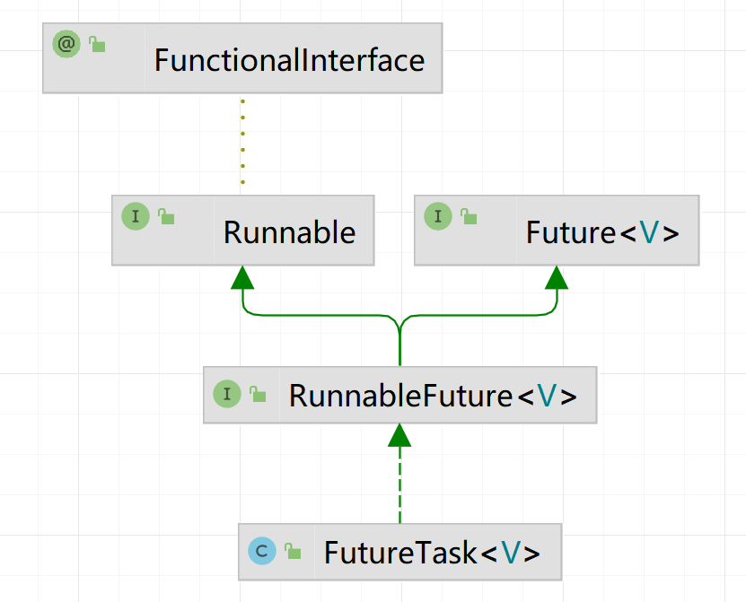

## 状态

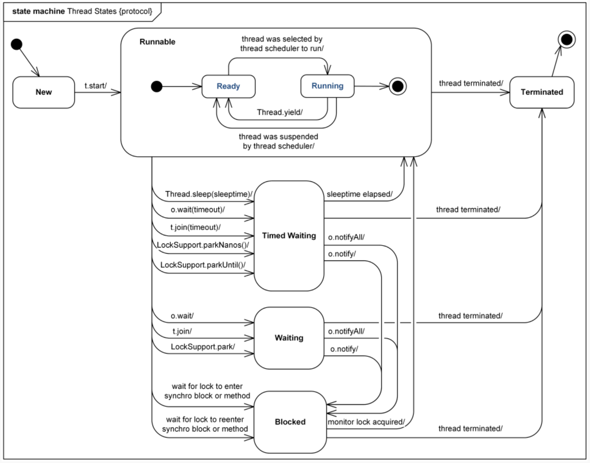

RUNNABLE：包含“就绪 + 正在运行”。

BLOCKED：**仅**表示“等synchronized的monitor”。**不是**ReentrantLock。

ReentrantLock的await()/signal()使用的是LockSupport。

## 虚拟线程

平台线程=1:1 OS 线程；虚拟线程=JVM 级实现，**M:N 调度**。

虚拟线程**在执行到IO操作或Blocking操作时，会自动切换到其他虚拟线程执行，从而避免当前线程等待，能最大化线程的执行效率**； 虚拟线程使用普通线程相同的接口，最大的好处是无需修改任何代码，就可以将现有的IO操作异步化获得更大的吞吐能力。

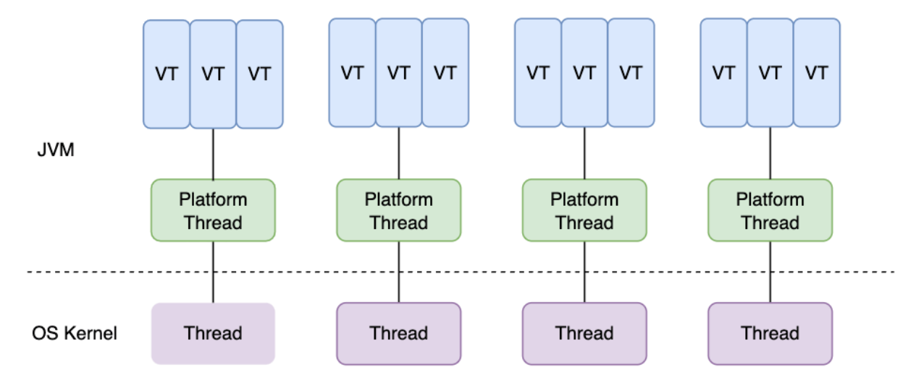

### 优点

- **线程多而廉价**：每个请求一个线程的同步写法也能高并发；阻塞 I/O 时虚拟线程会被挂起、释放底层 OS 线程，实现 M:N 调度，吞吐大幅上去而不用改成回调/响应式风格。

- **易迁移、可观测**：还是 `java.lang.Thread`，大多旧代码直接跑；JFR 与 `jcmd` 支持虚拟线程事件和新的 JSON 线程转储，排查更顺手。

- **不需要池化**：虚拟线程“用完即弃”，官方明确建议“**永远不要池化**”；要限流用 `Semaphore` 或资源自身的池（如连接池）。

- **生态配套**：与“结构化并发（Structured Concurrency）”“作用域值（Scoped Values）”配合，让并发编排、上下文传递更简洁（JDK21 为预览）。

### 局限

  - **不是加速器**：CPU 密集型任务不会更快；虚拟线程提升的是**并发度/吞吐**，不是单次延迟。
  - **剩余 pinning 场景**：调用本地代码（JNI/FFM）并回调到可能阻塞/等待监视器的 Java 代码仍可能发生 pinning；JFR 里仍保留 `jdk.VirtualThreadPinned` 事件用于诊断。
  - **ThreadLocal/缓存习惯需要收敛**：虚拟线程数量可达百万级，依赖 ThreadLocal 做对象缓存会放大内存占用；官方建议这类场景改为作用域值或其他共享策略。
  - **一些行为被固定**：虚拟线程始终是 **daemon**、优先级固定为 `NORM_PRIORITY`，且不参与传统线程组；调度器基于 FIFO 模式的 ForkJoinPool，可通过 `jdk.virtualThreadScheduler.parallelism` 调整并行度。
  - **异步框架收益有限**：如果全链路已经是非阻塞/响应式模型，切到虚拟线程收益不大（甚至增加上下文切换）。官方“采用指南”也强调更适合阻塞式同步风格

# 关键字

## 基础线程机制

- **Executor**：任务提交与执行线程解耦，由框架统一调度和复用线程池。
- **Daemon**：守护线程仅提供后台服务，若 JVM 只剩守护线程将自动终止进程。
- **sleep()**：让当前线程暂停指定时间但:star:**不释放锁**，用于节流或定时。
- **yield()**：提示调度器可让出 CPU，不过是否切换线程由操作系统决定。

## 线程中断/终止

- **stop()：**不建议使用。

- **interrupt()**：
  
  - https://www.51cto.com/article/754489.html
  - https://my.oschina.net/emacs_8649034/blog/16879636
  - 设计 interrupt() 和中断标记机制的目的，**不是为了强制终止线程**，而是提供一种:star: **协作式取消（Cooperative Cancellation）**的方式，让线程可以 **优雅、可控地自行退出**。
  - 作用：Java 线程中断机制提供了一种安全的方式来终止线程的执行。当一个线程被中断时，它会收到一个中断信号。线程可以通过检查中断状态来响应这个信号，并且可以选择立即终止或者处理完当前任务后再终止。这种机制避免了直接停止线程执行所带来的潜在问题，如线程正处于不安全状态或者正在执行一些不允许中断的操作。
  
  Thread对象维护一个 “中断标志位”（一个volatile boolean）
  
  任何线程都可以调用otherThread.interrupt()把对方的标志位置true。
  
  常用API
  
  ```java
  t.interrupt();        // 给t线程发送中断信号
  boolean b = t.isInterrupted(); // 查询标志，不会清除中断标志
  boolean c = Thread.interrupted(); // 查询并清除当前线程标志
  ```
  
  不同线程状态如何响应中断
  
  RUNNABLE（运行中）：不会自动停，除非代码自己检查：
  
  ```java
  while (!Thread.currentThread().isInterrupted()) { /* do work */ }
  ```
  
  WAITING / TIMED_WAITING
  
  sleep / wait / join / Condition.await(...)：立刻抛 InterruptedException，并把中断标志清掉（变回false）。你应该退出或重新置位：
  
  ```java
  catch (InterruptedException e) {
      Thread.currentThread().interrupt(); // 传递信号
      return;
  }
  ```
  
  为什么这个线程会收到中断异常？
  
  把目标线程的 中断标志 设为 `true`（一个 `volatile` 位）。
  
  如果目标线程正处在“可中断的等待”里（`sleep / wait / join / Condition.await(...)` 等），**立即把它从内核JVM的等待里唤醒**。
   在 HotSpot 里，对 `sleep`/`wait` 会给对应的等待结构发“unpark/interrupt”信号；等待返回后，运行时看到标志为真，按规范将其转化为 `InterruptedException` 抛出，**并把标志清零**。
  
- **Executor 的中断操作**：`shutdownNow()` 试图取消队列任务并中断正在执行的工作线程。

## 线程互斥同步

- **synchronized**：基于对象监视器的内置锁，进入自动加锁、退出自动释放。
- **ReentrantLock**：显式可重入锁，支持限时、可中断、公平策略及条件队列。
- **比较**：ReentrantLock 更灵活功能多，synchronized 简洁且易用。
- **使用选择**：简单互斥首选 synchronized，需要高级特性再考虑 ReentrantLock。

## 线程之间的协作

- **join()**：调用者等待目标线程执行完毕后再继续，常用于顺序依赖。
- **wait() / notify() / notifyAll()**：基于对象监视器的等待-通知机制，:star:**必须在同步块**内使用。
- **await() / signal() / signalAll()**：Condition 配合显式锁实现多条件队列，通知更细粒度。

### join原理

```java
public final void join() throws InterruptedException {
    synchronized (this) {           // 🔒 锁的是当前线程对象
        while (isAlive()) {         // 🌀 轮询检查线程是否还活着
            wait(0);                // ⏸ 如果活着，就进入等待队列
        }
    }
}
```


## synchronized

回顾synchronized，先回顾轻量级锁依赖的Lock Record，重量级锁依赖的Monitor。

然后回顾锁的原理，也就是流程，最后是锁的一些优化。

可以参考黑马的《并发编程_原理》，写的不错。

### 什么是线程栈中的 Lock Record？

> 只有在synchronized中使用

当线程 `Thread-0` 进入 `synchronized(obj)` 代码块时，会在自己的**栈帧**中的本地变量表与操作数栈之间额外划出一段 **monitors block**，专门顺序存放这些 `BasicObjectLock`，也就是存锁记录（Lock Record），锁记录结构如下：

- `lock record 地址 00`：表示这个锁记录的地址；
- `Object reference`：记录当前锁的是哪个对象（比如 `obj`）；

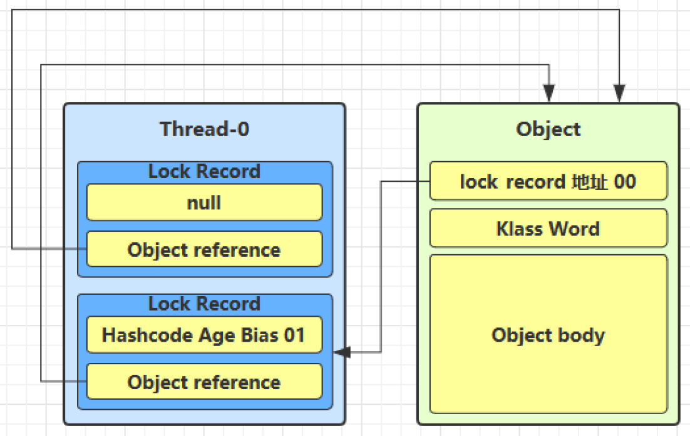


### Lock Record 可以有多个吗？

每进入一次`synchronized`代码块或方法，就会创建一个新的 `Lock Record`，**重入同一个锁**的时候也会创建新的 `Lock Record`。

**同一个线程可以同时持有多个锁（多个不同对象的锁）**，每一个锁都会有自己对应的 Lock Record。


### 什么是Monitor？

> 获取监视器的唯一语言级入口就是 synchronized

Monitor 是一种线程同步的工具，在 JVM 层由 **对象的 Monitor（监视器锁）** 实现。

- 每一个对象（不是类）都有一个 **Monitor**；
- 当某个线程执行 `synchronized(obj)` 代码块时，必须先获得该对象的 Monitor；
- **真正的 `ObjectMonitor` 结构体并不是天生就有，而是**在需要升级为重量级锁时才懒惰分配
- Monitor 本质依赖操作系统底层的 **互斥量（mutex）** 和条件变量来实现线程的**互斥访问**与**等待/唤醒**机制。
- 它们会被分配在 **JVM 管理的 Monitor Pool 中（即 native 堆，不是Java堆）**；

### Monitor结构和两个队列

> 这里的park是指JVM内部的

| **链路**            | **触发操作**                                                 | **JVM 代码路径(简化)**                                       | **进入后线程的 `Thread.State`** |
| ------------------- | ------------------------------------------------------------ | ------------------------------------------------------------ | ------------------------------- |
| **WaitSet**         | - 当前线程**已经拿到**监视器- 执行 `obj.wait()` / `obj.wait(timeout)` | `ObjectMonitor::wait()`1. 把 `ObjectWaiter` 节点挂到 `_WaitSet`2. `exit()` 释放锁3. `Self->_ParkEvent->park()` 挂起自己 | `WAITING` / `TIMED_WAITING`     |
| **EntryList / CXQ** | - 其他线程尝试 `monitorenter`- 快速自旋+CAS失败，发现锁被人持有 | `ObjectMonitor::enter()` → `EnterI()`1. 先挂到 `_cxq`（*Contention Queue*）2. 可能被转移到 `_EntryList`3. `Self->_ParkEvent->park()` 挂起自己 | `BLOCKED`                       |

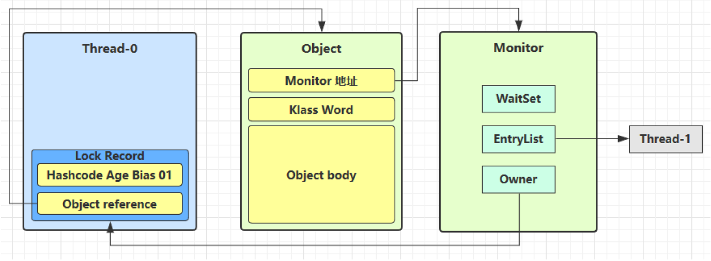

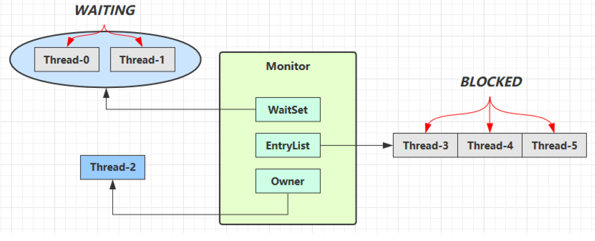

### sychronized原理？

1. 最开始是偏向锁，最轻量级，可重入。针对只有一个线程的情况，第二次进入直接检查通过，不用再CAS。
2. 升级方式：自己调用hashCode()，其他线程竞争，调用wait/notify
3. 轻量级锁，通过cas，lock record，可重入
4. 存在竞争，为对象申请重量级锁的monitor

### 偏向锁（已废弃）

还是要使用Lock Record，只不过只写线程ID，写一次。

```
monitorenter ➜ 总会压 1 条 Lock Record
┌─────────────┐
│  偏 向 锁   	│  第一次仍需 1 次 CAS 写 ThreadID
│  (ThreadID) │  以后同线程 0 成本
└─────────────┘
      │ 若竞争
      ▼
撤销补全 Lock Record → 退化轻/重量级锁
```

### jvm关于synchronized锁优化有哪些？

重量级锁优化：本来**重量级锁**一旦竞争失败，线程就要阻塞（挂起）；但挂起+唤醒需要系统调用（如 `park/unpark`），代价很高；所以 JVM 会尝试“自旋”一小段时间，看看锁是否会很快释放。

批量重定向：当 JVM 发现某个对象的**偏向锁**被频繁切换到新的线程，而这些线程之间并没有竞争关系，JVM 会进行一次“批量重定向”，将后续该类对象的偏向锁“默认偏向新线程”。

批量撤销：当 JVM 发现同一类对象的**偏向锁**频繁发生真实线程竞争（两个线程争夺同一个锁），就会触发「批量撤销」，直接关闭这个类的所有对象的偏向锁支持。

锁消除：是 JVM 编译器在运行时（JIT 编译时）进行的一种优化，当它判断某段 `synchronized` 代码的加锁对象不会被其他线程访问时，就直接去掉加锁操作，从而提升性能。

### synchronized使用

修饰代码块

```java
static final Object lock = new Object();
public void method() {
    // 锁实例对象
    synchronized(lock) { ... }
    // 锁类对象
    synchronized(Test.class) { ...}
}
```

修饰方法

```java
public synchronized void method() { ... }
// 等价于
public void method() {
    synchronized(this) { ... }
}

public synchronized static void method() { ... }
// 等价于
public void static method() {
    synchronized(Test.class) { ... }
}
```

### API：wait/notify/notifyAll

只有在获得对象锁之后才能调用

wait和sleep的对比：

- sleep 是 Thread 方法，而 wait 是 Object 的方法
- sleep 不需要强制和 synchronized 配合使用，但 wait 需要和 synchronized 一起用
- sleep 在睡眠的同时，如果加了对象锁，也不会释放对象锁的，但 wait 在等待的时候会释放对象锁
- 它们状态 TIMED_WAITING

### synchronized的线程安全

**1) 原子性（互斥）**
 进入 `synchronized(lock){...}` 后，只有获得 `lock` 的线程能执行临界区，复合操作（读-改-写、检查-再执行）在这把锁内是原子的。

**2) 可见性（happens-before）**
 JMM 规定：**对同一监视器 M 的 `unlock` 先行发生于之后对 M 的 `lock`**。
 含义：线程 A 在退出同步块前对内存做的写入，在线程 B 之后进入同一把锁的同步块时**必然可见**（相当于释放/获取屏障）。

**3) 有序性（禁止越界重排）**
 编译器/JIT/CPU 不能把同步块内的读写**移动到边界之外**，也不能把外部的移动到同步块内部；同步边界建立了明确的执行顺序。

### synchronized如何保证有序性？

`synchronized` 能保证**临界区代码的执行具有顺序性**，是因为它**具备“内存屏障（memory barrier）”语义**：

加锁（进入 synchronized）时：

- 会插入一个“**Load Barrier**”：**禁止重排序** synchronized 代码之前的指令 **和其后的指令互换**。

解锁（退出 synchronized）时：

- 会插入一个“**Store Barrier**”：**禁止重排序** synchronized 代码之后的指令 **和其前的指令互换**；
- 并且刷新变量到主内存。

这样，JVM 和 CPU 都必须遵守这组**屏障规则**，**保证同步块前后的操作不会被乱序执行**。

### synchronized内存语义？

根据 Java 内存模型（JMM）规范：

- **进入 `synchronized` 代码块（加锁）时**，**会清空线程工作内存中的共享变量副本**，强制从主内存中重新读取变量值；
- **退出 `synchronized` 代码块（释放锁）时**，**会将本地线程对共享变量的修改刷新回主内存**，以供其他线程读取。

因此，`synchronized` 保证了**从主内存读取最新数据，也保证了修改数据写回主内存**，从而实现了**可见性**。

### 可重入

- 在轻量级锁阶段可以理解为用“多条 Lock Record”隐式表达重入层数。
- 在重量级锁阶段则是监视器里的显式计数器。

## volatile

### 可见性和有序性

volatile能保证**有序性和可见性**，它主要通过两种屏障：

一句话概括：**写之后写屏障，读之前读屏障**

- 写 volatile 时：插入 **StoreStore + StoreLoad 屏障**
- 读 volatile 时：插入 **LoadLoad + LoadStore 屏障**

但相比 `synchronized`，`volatile` 的有序性保障较弱，只针对**volatile 变量本身的读写顺序**。

:star:在一个写线程，多个读线程的情况下，volatile只能保证的有序性，不能保证原子性。如果有多个写线程，则必须要使用synchronized来保证原子性。

# 无锁

对于共享的成员变量/静态变量，多线程写的情况下保证这个变量的线程安全？一种解决思路是对该变量的存取加锁，另一种思路是使用无锁。无锁的一种思路是CAS+volatile，其中原子类就是这样实现的。

#### 为什么无锁效率高？
1. 省掉了线程挂起 / 唤醒的昂贵系统调用

- **加锁失败** → 线程可能被挂起（如 `synchronized` 进入内核的 *monitor wait*，或 `ReentrantLock` 在 `park()` 时调用 `Unsafe.park()` 让内核把线程加入等待队列）。
- **挂起/唤醒** 涉及**上下文切换**（保存/恢复寄存器、TLB、堆栈、内核调度器抢占），一次就几万~几十万 CPU 周期。
- **无锁**用 CAS（或 LL/SC、原子指令）在用户态完成，失败时只是重试循环，不进入内核。

2. 减少“锁竞争导致的串行化”

- 锁把**所有临界区串行**化：虽然省心，但只有拿到锁的线程在做实事，其余线程要么阻塞要么自旋。高并发下吞吐跌得很快。
- 无锁允许**多个线程并行读取并尝试更新**；真正冲突的时刻只在原子指令那一瞬间，大多数时间大家各干各的。

3. 避免“锁粗粒度”导致的**缓存行抖动(CACHE BOUNCE)**

- 锁变量本身是共享的 **cache line**。频繁加/解锁会让该 line 在各 CPU 之间来回失效‑置写(coherency traffic)。
- 无锁算法往往按 **细粒度数据或分段** 做原子更新，或利用 per‑thread 本地变量，大大降低缓存一致性流量。

4. 消除了典型锁问题：

| 传统锁问题             | 描述                                   | 无锁表现                 |
| ---------------------- | -------------------------------------- | ------------------------ |
| **Lock Contention**    | 抢锁的人多，排队等待                   | CAS 失败马上重试，不排队 |
| **锁饥饿 / Convoy**    | 线程 A 长时间持锁拖慢 B、C             | 无锁无“持锁时间”概念     |
| **Priority Inversion** | 低优先级线程持锁导致高优先级线程被阻塞 | 原子操作不受优先级影响   |
| **死锁**               | 互相占锁形成环路                       | 无锁天然无死锁           |

5. 现代 CPU 原生支持高效原子指令

- x86 的 `LOCK CMPXCHG`, ARM 的 `LDXR/STXR`、`CAS` 等指令在 **硬件层面** 保证原子性，只锁定局部总线或缓存子系统，延迟通常只有十几到几十纳秒。
- JVM、C++ 原子库、Go runtime 等都把它们包装成 **CAS / atomic** API，调用成本~普通函数。

6. **可伸缩性 (Scalability)**

- 加锁：线程越多，锁竞争概率 **指数上升**；最终系统吞吐趋近于 (临界区执行时间) 的倒数。
- 无锁：即便在高并发下，失败重试的开销相对稳定；吞吐更接近 **线性扩展**（当然取决于算法设计）。

#### 无锁的实现思路

| 思路/结构                  | 如何做到“不加锁”                             | JDK/示例                                                   |
| -------------------------- | -------------------------------------------- | ---------------------------------------------------------- |
| **单点 CAS 自旋** | 对同一个共享变量做 `compare‑and‑swap` 循环；CAS 失败便立即自旋重试，成功即退出。实现最简，但高冲突场景可能产生活锁，需要退避策略 | `AtomicInteger.incrementAndGet()`、`AtomicReference.compareAndSet()`（Treiber 栈、简单计数器等） |
| **分段（Cell/Stripe）**    | 写请求分布到 N 个槽，槽内 CAS；热点稀释      | `LongAdder`、`ConcurrentHashMap`（分段桶头）               |
| **双缓冲 / Copy‑On‑Write** | 写时复制新对象，再用 Volatile 引用一步替换   | `CopyOnWriteArrayList`, `AtomicReference` + 新数组         |
| **一次性发布（单赋值）**   | `volatile` 保证写后可见，之后只读不改        | `Singleton.lazy`（双检锁后只读）、不可变对象               |
| **读‑拷贝‑更新 RCU**       | 写方创建新版本 ➜ volatile 指针跳转；读方无锁 | 实时监控配置、Linux RCU 思路可用 VarHandle                 |
| **环形缓冲 + 序号屏障**    | 生产/消费各自维护序号；依赖顺序栅栏          | LMAX Disruptor                                             |
| **无锁链表/队列**          | 多点 CAS（头/尾/中间）+ 自旋                 | `ConcurrentLinkedQueue`、`ConcurrentLinkedDeque`           |
| **无锁栈 (Treiber)**       | `top` 字段 CAS 更新；弹栈失败重试            | `java.util.concurrent.ConcurrentLinkedDeque` 的 stack 部分 |
| **哈希分段 + CAS 链更新**  | 拉链桶头 CAS、拉链内乐观自旋                 | JDK 8+ `ConcurrentHashMap`（非锁区域）                     |


#### CAS+volatile为什么可以实现无锁？

| 能力       | CAS  | volatile |
| ---------- | ---- | -------- |
| 原子性     | ✅    | ❌        |
| 可见性     | ❌    | ✅        |
| 禁止重排序 | ❌    | ✅        |

CAS（compareAndSet）是基于CPU 指令（如lock cmpxchg）实现的。

#### CAS的问题

只能对一个变量有效、ABA问题（版本号可以解决）、会导致饥饿

#### ABA 问题定义

**ABA 问题**是指在使用 CAS（Compare‑And‑Swap）等“比较并交换”原子操作时，
如果一个共享变量在一次 CAS 期间经历了 **A → B → A** 的变化，
最终又回到了原值 **A**，那么 CAS 只比较 *当前值* 与 *期望值*，
**检测不到这期间发生过的两次修改**，从而把“变量没变”误判为“状态未被其他线程动过”，导致并发逻辑错误。


### 原子类

#### 为什么使用这些类？

这些类都是线程安全的，并且**不需要加锁**就可以在多线程环境下安全地修改它们的值。

#### 有哪些原子类？

| 分类           | 原子类举例                                   | 特点/用途                                    |
| -------------- | -------------------------------------------- | -------------------------------------------- |
| 基本类型原子类 | `AtomicInteger`、`AtomicLong`                | 替代 `int`、`long` 等基本类型的线程安全变量  |
| 数组原子类     | `AtomicIntegerArray`、`AtomicReferenceArray` | 多线程安全操作数组                           |
| 引用原子类     | `AtomicReference`、`AtomicStampedReference`  | 操作对象引用，解决 ABA 问题                  |
| 字段更新器     | `AtomicIntegerFieldUpdater`                  | 针对对象字段进行原子更新，内存开销更小       |
| 高性能累加器   | `LongAdder`、`LongAccumulator`               | 高并发下性能更好，适合统计计数等热点变量场景 |

#### AtomicInteger

```java
AtomicInteger count = new AtomicInteger(0);

// 原子自增
count.incrementAndGet();    // 等价于 ++count

// 原子加法
count.addAndGet(5);         // += 5

// CAS 比较并交换
count.compareAndSet(5, 10); // 如果当前值为5，则设为10
```

#### 原子引用类

在并发场景中，对对象的赋值（比如链表的指针更改、缓存引用替换等）也需要线程安全。如果使用锁会降低效率，所以使用这些原子引用可以做到 **无锁替换对象**。

| 类名                      | 功能描述                                           |
| ------------------------- | -------------------------------------------------- |
| `AtomicReference<T>`      | 保证引用对象的读写原子性，还是使用CAS+volatile实现 |
| `AtomicStampedReference`  | 附带“**版本号**”，防止 ABA 问题                    |
| `AtomicMarkableReference` | 附带一个 boolean 标记，防止 ABA 或逻辑状态切换问题 |

AtomicReference<T>

```java
AtomicReference<String> ref = new AtomicReference<>("A");

// 如果当前值是 A，就改为 B
ref.compareAndSet("A", "B");
```

AtomicMarkableReference<T>

> 引用一个对象的同时，携带一个 `boolean` 标记位，常用于“逻辑删除”。

```java
AtomicMarkableReference<Node> nodeRef =
    new AtomicMarkableReference<>(node, false);

// 改标记为已删除（true）
nodeRef.compareAndSet(node, newNode, false, true);
```

AtomicStampedReference<T>

> 解决 **ABA 问题** —— 值从 A ➝ B ➝ A，CAS 会认为没变，其实中间变过。

```java
AtomicStampedReference<String> ref =
    new AtomicStampedReference<>("A", 1);

int[] stampHolder = new int[1];
String current = ref.get(stampHolder); // 拿到值和版本号

// 更新值时检查版本号
ref.compareAndSet("A", "B", stampHolder[0], stampHolder[0] + 1);
```

#### 什么是LongAdder

通过**分段累加 + CAS**实现的高并发计数器，适合用于**高吞吐、低延迟的场景**，如请求量统计、热点计数、指标采集等。

📌注意：**不保证瞬时一致性**，不适合用于需要精确原子语义的场景（比如余额扣减）。

#### Unsafe

Unsafe 对象提供了非常底层的，操作内存、线程的方法，Unsafe 对象不能直接调用，只能通过反射获得

#### Unsafe的CAS

Java 原生不提供直接的 CAS 操作，但 `sun.misc.Unsafe` 类中提供了底层接口，JDK 中的原子类都是基于它实现的。

示例：`AtomicInteger` 的核心实现

```java
private volatile int value;

public final boolean compareAndSet(int expect, int update) {
    return unsafe.compareAndSwapInt(this, valueOffset, expect, update);
}
```

Unsafe 的 CAS 是 Java 并发包中实现无锁原子操作的核心基础，它提供了底层的比较-替换功能，支撑了 `AtomicXXX`、`LongAdder`、无锁队列等高性能组件。

# 不可变

## 引入

由于 SimpleDateFormat 不是线程安全的，有很大几率出现 java.lang.NumberFormatException 或者出现不正确的日期解析结果。

因为SimpleDateFormat把“可变状态”暴露给了多个线程，而又没有同步保护，所以**不要跨线程共享同一个实例**——

解决思路：要么加锁，要么局部创建，要么用ThreadLocal，要么直接换成**不可变**的DateTimeFormatter。

```java
SimpleDateFormat sdf = new SimpleDateFormat("yyyy-MM-dd");
for (int i = 0; i < 10; i++) {
    new Thread(() -> {
        try {
        	log.debug("{}", sdf.parse("1951-04-21"));
        } catch (Exception e) {
        	log.error("{}", e);
        }
    }).start();
}
```

#### 不可变类有哪些？

| 类名                                                       | 简要说明                                       |
| ---------------------------------------------------------- | ---------------------------------------------- |
| `String`                                                   | 最典型的不可变类，字符串内容不可更改           |
| `Integer`, `Long`, `Short`, `Byte`, `Character`, `Boolean` | 基本类型的包装类，全是不可变的                 |
| `BigInteger`, `BigDecimal`                                 | 大数运算相关的类，操作结果会返回新对象         |
| `LocalDate`, `LocalTime`, `LocalDateTime`, `Instant`       | Java 8 的日期时间 API，全部不可变              |
| `UUID`                                                     | 表示唯一标识符的类，构造后不可更改             |
| `Path`                                                     | Java NIO 中用于表示路径的类，是不可变的        |
| `Enum` 类型                                                | 枚举本身是不可变的，其字段也建议设置为 `final` |


#### 不可变类的特征/设计？

要创建一个不可变类，通常需要遵循以下规则：

1. **类本身是 `final` 的**，防止被继承后更改行为
2. **所有字段是 `private final` 的**
3. **不提供 setter 方法**
4. **构造函数完全初始化所有字段**
5. **对于引用类型字段，确保“深拷贝”或“只读”访问**。通过创建副本对象来避免共享的手段称之为保护性拷贝（defensive copy）

```java
public final class Person {
    private final String name;
    private final int age;
    private final List<String> hobbies;

    public Person(String name, int age, List<String> hobbies) {
        this.name = name;
        this.age = age;
        this.hobbies = new ArrayList<>(hobbies); // 保护性拷贝
    }

    public String getName() { return name; }
    public int getAge() { return age; }
    public List<String> getHobbies() {
        return Collections.unmodifiableList(hobbies); // 只读视图
    }
}
```

### final

#### final的内存语义

在构造函数执行完之前，JMM会在final字段的写入后插入写屏障（Store Barrier），确保这些字段对 其他线程可见且不可重排序。

```java
class Holder { int n; Holder() { n = 42; } }
static Holder H;

Thread A: H = new Holder();     // 可能“先把 H 指向新对象”，再给 n=42
Thread B: if (H != null) print(H.n);  // 有小概率打印 0（默认值）


class Holder { final int n; Holder() { n = 42; } }
static Holder H;

Thread A: H = new Holder();
Thread B: if (H != null) print(H.n);  // 一定打印 42
```

#### final为什么不能修改？

编译阶段和运行阶段都会检查是否有修改行为。

不过，如果你通过 Unsafe类这种底层方法，是可以绕过的，这说明：final的“不可变”是语言层级的约定 + JVM 运行时的限制，**不是从物理内存彻底防写**。

final只能保证 **引用地址不变**，不能保证引用指向的内容不变。要实现深度不可变，还是需要配合不可变类。

#### final的原理

final 变量的赋值也会通过 putfield 指令来完成，同样在这条指令之后也会加入写屏障，保证在其它线程读到它的值时不会出现为0（初始值）的情况。

# 线程池（Executor框架）

### 概述

#### 为什么要有Executor框架

把“提交任务”与“执行任务”解耦——像数据库连接池一样，用**线程池**复用线程，用**统一 API**管理任务生命周期，并可按需调度、监控、扩缩容。

#### 核心接口层次

```
Executor
 ├─ ExecutorService           // 管理任务生命周期，支持 Future、shutdown
 │   └─ ScheduledExecutorService   // 定时/周期任务
 ├─ CompletionService        // 先完成先取，组合 Executor + BlockingQueue
 ├─ Future / Callable        // 可返回值/抛异常/取消
 ├─ ThreadFactory            // 定制线程属性（名字、优先级、守护线程…）
 └─ RejectedExecutionHandler // 任务拒绝策略
```

#### 经典实现与工厂方法

| 工厂方法（`Executors.*`）                        | 底层实现                                      | 特点 / 适用场景                                      |
| ------------------------------------------------ | --------------------------------------------- | ---------------------------------------------------- |
| `newFixedThreadPool(n)`                          | **ThreadPoolExecutor**+ `LinkedBlockingQueue` | *CPU 密集*；固定 n 条工作线程，队列无界（⚠️OOM 风险） |
| `newCachedThreadPool()`                          | ThreadPoolExecutor+ **SynchronousQueue**      | *IO 密集/短任务*；线程数无限上升，空闲 60 s 回收     |
| `newSingleThreadExecutor()`                      | ThreadPoolExecutor+ LinkedBlockingQueue       | 串行执行、保证顺序                                   |
| `newScheduledThreadPool(n)`                      | **ScheduledThreadPoolExecutor**               | 代替 `java.util.Timer`；支持 cron 式周期或延迟任务   |
| `newWorkStealingPool(n)` (JDK 8)                 | **ForkJoinPool**                              | 基于 Work‑Stealing，适合 CPU 密集 + 任务递归拆分     |
| **`newVirtualThreadPerTaskExecutor()`** (JDK 21) | **ThreadPerTaskExecutor**基于虚拟线程         | 每个任务 1 条虚拟线程，几乎零开销，简化并发          |

### ThreadPoolExecutor

#### 线程池状态

线程池一共有 **5 种状态**，通过一个整型变量ctl的高3位表示（低 29 位表示线程数），目的是将线程池状态与线程个数合二为一，这样就可以用一次 cas 原子操作进行赋值。
| 状态名         | 含义说明                                                   |
| -------------- | ---------------------------------------------------------- |
| **RUNNING**    | 接收新任务、处理队列中的任务                               |
| **SHUTDOWN**   | 不接收新任务，但继续处理队列中的任务                       |
| **STOP**       | 不接收新任务，也不处理队列中的任务，同时中断正在执行的任务 |
| **TIDYING**    | 所有任务执行完毕，工作线程也销毁之后，准备进入终结状态     |
| **TERMINATED** | `terminated()` 方法执行完成后的最终状态                    |

#### 构造方法

```java
public ThreadPoolExecutor(
        int corePoolSize,                 // 核心线程数——常驻线程，空闲也不回收（除非显式允许）
        int maximumPoolSize,              // 最大线程数——队列满时才会向核心数以外扩容
        long keepAliveTime,               // 非核心线程（或允许超时的核心线程）空闲多久被回收
        TimeUnit unit,                    // keepAliveTime 的时间单位（秒、毫秒等）
        BlockingQueue<Runnable> workQueue,// 任务队列——保存等待执行的 Runnable
        ThreadFactory threadFactory,      // 线程工厂——创建新线程时如何命名、优先级、是否守护等
        RejectedExecutionHandler handler  // 拒绝策略——队列满且线程达到上限时如何处理新任务
) { ... }
```

#### 原理/工作方式

先核心线程，然后阻塞队列，再是临时线程，最后拒绝策略。

#### 核心线程数设置

- CPU密集型：corePoolSize = CPU核数 + 1（避免过多线程竞争CPU）
- IO密集型：corePoolSize = CPU核数 x n（或更高，具体看IO等待时间）

更通用的公式：CPU核数 * （1 + （线程运行时间 - 线程计算时间）/ 线程计算时间）

IO密集说明我们需要等待

#### 任务队列

**SynchronousQueue（直接移交队列）**

- 容量为 0，不存任务，提交就必须被某个工作线程立即接走。
- 效果：基本不会排队，而是优先“**扩容线程数**”（到 `maximumPoolSize`），扩不动就拒绝。
- 典型：`Executors.newCachedThreadPool()`。
- 适合：突发、短任务、希望快速放大并发的场景。

**LinkedBlockingQueue（链表队列）**

- 默认**无界**（危险，可能堆积到 OOM），也可指定**有界**容量。
- 无界时：任务优先排队，线程数**不超过 corePoolSize**，`maximumPoolSize` 基本形同虚设。
- 有界时：满了才继续建线程到 `maximumPoolSize`，再满就拒绝。
- 适合：希望“先排队、再扩容”的常规后台任务；生产中建议**指定容量**。

**ArrayBlockingQueue（数组队列，有界、FIFO）**

- 必须指定容量，内存占用可控、吞吐可预期；相比链表实现更紧凑。
- 行为与“有界 LinkedBlockingQueue”类似。
- 适合：对内存/延迟更可控、稳定吞吐的场景。

**PriorityBlockingQueue（优先级队列）**

- **无界**，按优先级排序（任务需实现 `Comparable` 或提供 `Comparator`）。
- 与无界 LinkedBlockingQueue 一样会让 `maximumPoolSize` 基本失效，但可实现任务**抢占式顺序**。
- 适合：需要“任务有优先级”的场景（如紧急任务先执行）。

**DelayQueue / DelayedWorkQueue（延迟队列）**

- 按到期时间出队，只有到点的任务才可被取走。
- 线程池里主要由 `ScheduledThreadPoolExecutor` 使用（其内部是 `DelayedWorkQueue`）。
- 适合：定时/延时任务调度。

#### JDK 内置 4 种策略

1. **AbortPolicy（默认）**
   
   直接抛出 `RejectedExecutionException`。在过载时**立即失败**并把错误暴露给上游（例如 Web 层快速返回 503）。
   
2. **CallerRunsPolicy**
   
   新的任务不会被丢掉或抛异常，而是**在提交任务的那个线程里**立刻同步执行 `run()`，直到这个任务做完 `execute()` 才返回。这样提交方被“拖慢”，形成**反压**。
   
3. **DiscardPolicy**
   
   静默丢弃**当前提交的任务，不抛异常。
   
4. **DiscardOldestPolicy**
   - 行为：丢弃**队列头部**最老的任务（`workQueue.poll()`），然后**重试**把当前任务入队。
   - 场景：更看重**新任务**的时效性（例如最新行情、监控数据）。
   - 注意：只有 **FIFO 队列**（如 `ArrayBlockingQueue`/`LinkedBlockingQueue`）才接近“最老”；若用 `PriorityBlockingQueue/DelayQueue`，被丢的未必是“时间上最老”。

### ForkJoinPool

**ForkJoinPool** 是 JDK 7 引入的专用线程池，目标是 **高效执行“可递归拆分”的并行任务**。与普通 `ThreadPoolExecutor` 侧重于提交一批彼此独立的 Runnable 不同，Fork/Join 框架围绕 **“分而治之”（divide‑and‑conquer）** 设计：

1. **Fork（分裂）**：把一个大任务拆成若干子任务；
2. **Join（合并）**：等待子任务完成并聚合结果。

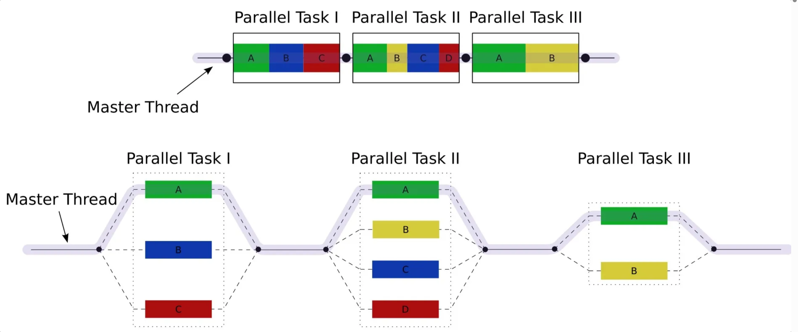

#### 关键特性

| 特性                              | 说明                                                         |
| --------------------------------- | ------------------------------------------------------------ |
| **工作窃取（Work‑Stealing）算法** | 每个工作线程维护**双端队列（Deque）**。自己总是从头部取任务执行；当空闲时，就去别的线程的队列尾部“偷”任务，实现负载均衡、减少上下文切换。 |
| **轻量任务模型**                  | 典型任务用 `RecursiveTask<V>`（有返回值）或 `RecursiveAction`（无返回值）表示；子任务拆得越细，窃取就越有效。 |
| **并行度 = CPU 核心数**           | `new ForkJoinPool()` 默认并行级别等于 `Runtime.getRuntime().availableProcessors()`；可通过构造函数或 JVM 参数 `java.util.concurrent.ForkJoinPool.common.parallelism` 调整。 |
| **公共池 & 专用池**               | JDK 为所有并行流 (`Stream.parallel()`)、`CompletableFuture` 等提供 **公共共享池**；手动 `new ForkJoinPool(n)` 可避免业务与框架抢线程。 |

#### 适用场景

1. **CPU 密集型、可递归拆分** 
   - 典型如：快速排序、矩阵乘法、N⁄π 计算、图像渲染、全文件校验和。
   - 拆分粒度足够细，子任务耗时相近，才能最大化利用工作窃取。
2. **JDK 并行流内部实现**
    `list.parallelStream()` 背后就是公共 ForkJoinPool，对集合分段并行处理。
3. **异步流水线 (`CompletableFuture`)**
    默认也使用公共池。当链式调用多、阻塞少时效果好。

> **不适合** I/O 密集任务——Fork/Join 线程数有限，遇到阻塞会浪费宝贵线程；IO 任务更适合 `ThreadPoolExecutor` 或 **虚拟线程**。

#### 基本用法示例

```java
class SumTask extends RecursiveTask<Long> {
    private static final int THRESHOLD = 10_000;
    private final int[] arr;
    private final int start, end;

    SumTask(int[] arr, int start, int end) {
        this.arr = arr; this.start = start; this.end = end;
    }

    @Override
    protected Long compute() {
        int len = end - start;
        if (len <= THRESHOLD) {               // 到达阈值，顺序求和
            long sum = 0;
            for (int i = start; i < end; i++) sum += arr[i];
            return sum;
        }
        int mid = start + len / 2;            // 拆分成左右子任务
        SumTask left  = new SumTask(arr, start, mid);
        SumTask right = new SumTask(arr, mid, end);
        left.fork();                          // 异步执行左半
        long rightRes = right.compute();      // 当前线程先算右半
        long leftRes  = left.join();          // 等左半结果
        return leftRes + rightRes;
    }
}

// 调用
ForkJoinPool pool = new ForkJoinPool();       // 可省略，使用公共池
long result = pool.invoke(new SumTask(arr, 0, arr.length));
```

# Lock体系

> 可以理解为JUC包的内容

## LockSupport

> `LockSupport` 为并发库作者提供了 *安全、可诊断、跨平台且与对象监视器解耦* 的最小挂起/唤醒原语，用来搭建比 `wait/notify` 更强大、比旧 `suspend/resume` 更安全的同步工具。
>
> **核心操作** ：`park` / `unpark` 两个概念

### park和unpark

**依赖JVM 内部给每个线程准备的 Parker对象**

> HotSpot/OpenJDK 源码：`hotspot/src/share/vm/runtime/objectMonitor.hpp` & `park.hpp`

```c++
class Parker : public os::PlatformParker {
  volatile int _counter;   // 0/1 “许可”位，unpark 把它置 1，park 消耗置 0
  // PlatformParker 根据操作系统实现 ↓
}
```

| 平台          | PlatformParker 里的底层原语                                  |
| ------------- | ------------------------------------------------------------ |
| Linux / macOS | `pthread_mutex_t` + `pthread_cond_t`（JDK 8 以后用 **futex**） |
| Windows       | `HANDLE` (AutoResetEvent)                                    |
| 其他          | 对应 OS 的 event/condvar                                     |

- 关注三个变量：counter，mutex，cond

- 若先调用park，再调用unpark，与其他同步器没区别，park检查counter为0，就获得mutex锁，进入cond阻塞。
- 若先调用unpark，再调用park，此时线程不会阻塞，unpark就像是给counter充能，park检查counter为1，则消耗counter。

### 与Object的wait&notify相比

- wait，notify 和 notifyAll 必须配合 Object Monitor 一起使用，而 park，unpark 不必
- park & unpark 是以线程为单位来【阻塞】和【唤醒】线程，而 notify 只能随机唤醒一个等待线程，notifyAll是唤醒所有等待线程，就不那么【精确】
- park & unpark 可以先 unpark，而 wait & notify 不能先 notify

### JVM和JDK的park

| 层次                             | 用途                                                         | 路径                                                     |
| -------------------------------- | ------------------------------------------------------------ | -------------------------------------------------------- |
| **JVM 内部** `ParkEvent::park()` | Monitor、条件变量、safepoint 等所有需要让线程睡眠的地方都会用 | C++ 实现，直接调 OS API                                  |
| **JDK 层** `LockSupport.park()`  | 给 `java.util.concurrent` 包里各种同步器（AQS、`ReentrantLock`、`CountDownLatch`…）用 | 通过 JNI 走同一个 `ParkEvent`，**只是包了一层 Java API** |

```java
public class LockSupport {
    private static final Unsafe U = Unsafe.getUnsafe();   // JDK 9 起是 jdk.internal.misc.Unsafe

    // 省略其它方法……

    public static void park(Object blocker) {
        Thread t = Thread.currentThread();
        setBlocker(t, blocker);          // ① 记录“我是为什么阻塞”的信息
        U.park(false, 0L);               // ② 真正挂起（核心逻辑在 Unsafe）
        setBlocker(t, null);             // ③ 清理 blocker，便于监控工具辨认
    }

    public static void unpark(Thread t) {
        if (t != null)
            U.unpark(t);                 // 直接透传
    }
}
```

### park/unpark设计目的

>  阻塞和唤醒原语

1. **作为并发原语搭建积木**
   J.U.C 大多数同步器（AQS、`ReentrantLock`、`Semaphore`、`CountDownLatch`、`SynchronousQueue`、`ForkJoinPool` 等）都需要“把某个线程**挂起**，等条件满足再**精确唤醒**”。`park/unpark` 就是为此提供的**最低层**、高性能、可被精准指向线程的阻塞/唤醒原语。
2. **避免 `wait/notify` 的局限**

- `wait/notify` 依赖**监视器**（必须在同步块内调用），容易出现**丢通知**与用错锁的问题。
- `unpark` 可以在**任何位置**调用，也可以**先 unpark 后 park**，不丢信号（见“许可位”语义）。
- 唤醒是**点对点**（针对某个线程对象），不是 `notifyAll` 那种“群发唤醒”。

3. **可诊断 & 可控**
   提供 `park(Object blocker)`、`parkNanos/parkUntil` 等形态，能在 jstack 等工具里看到阻塞原因（blocker），并支持**定时**挂起。

### 什么是park/unpark

`park()` / `unpark()` 用于**线程阻塞与唤醒**的底层机制，由 `LockSupport` 提供，基于 JVM 内部的 `Parker` 实现。

相比传统的 `wait()` / `notify()`，它们更灵活、性能更高，并且是**非对称通信机制**（不像 `wait/notify` 需要依赖同步块）。

| 特点                                    | 说明                                                         |
| --------------------------------------- | ------------------------------------------------------------ |
| **无需同步块（不需要 `synchronized`）** | 不像 `wait()` / `notify()` 需要获取对象锁，`park()` / `unpark()` 不依赖锁 |
| **先 `unpark()` 后 `park()` 也有效**    | `unpark()` 类似发“许可”，线程后续 `park()` 会立刻通过，不会阻塞 |
| **只能 “消耗一次许可”**                 | 多次 `unpark()` 只能生效一次（内部许可 `_counter` 只有 0/1） |
| **支持指定线程唤醒**                    | `unpark(Thread t)` 能精确唤醒某个线程，而 `notify()` 不能指定 |
| **避免死锁和伪唤醒问题更简单**          | 不再强依赖条件判断 + `while` 循环方式防止伪唤醒（虽然仍推荐使用） |
| **底层实现轻量高效**                    | `park` 使用系统的条件变量或 `futex`，避免频繁上下文切换，性能好 |
| **支持中断**                            | 如果线程被 `interrupt()`，则 `park()` 立即返回，需通过 `Thread.interrupted()` 判断中断状态 |
| **不能跨线程传递数据**                  | 不像 `wait()` 可以和共享变量配合，`park()` 只是挂起/唤醒，不传值 |

### 库和硬件的park、CAS

| 层次                 | 对应 **park** 的哪一层           | “谁”在写代码                                            | 入口 API / 指令                                        | 最终掉到哪里                                                 |
| -------------------- | -------------------------------- | ------------------------------------------------------- | ------------------------------------------------------ | ------------------------------------------------------------ |
| **库层 (Java 代码)** | `LockSupport.park()`             | JDK（java.util.concurrent.atomic.*、VarHandle、Unsafe） | `compareAndSet / compareAndSwap*`                      | → 被 HotSpot **识别成 intrinsic**，直接换成机器码里的原子指令 |
| **运行时 / 硬件层**  | HotSpot 内部 `ParkEvent::park()` | HotSpot C++ + JIT/解释器模板                            | `lock cmpxchg`（x86）`ldaxr` + `stlxr` 循环（AArch64） | → 由 CPU 总线保证原子语义                                    |

### 什么是parker对象？

```c++
struct Parker {
    int _counter;         // 0 表示阻塞；1 表示可以继续
    Mutex* _mutex;        // 互斥量（保护条件变量）
    CondVar* _cond;       // 条件变量（线程挂起/唤醒）
}
```

`Parker` 是 **HotSpot JVM 内部实现中的一个类/结构体**，用于支持 Java 中线程的 **挂起与唤醒机制**，即 `LockSupport.park()` 和 `unpark()` 背后的底层实现。

**每个 Java 线程在 JVM 层都维护了一个 `Parker` 对象**，它是线程阻塞/唤醒的最小单元。

## ReentrantLock

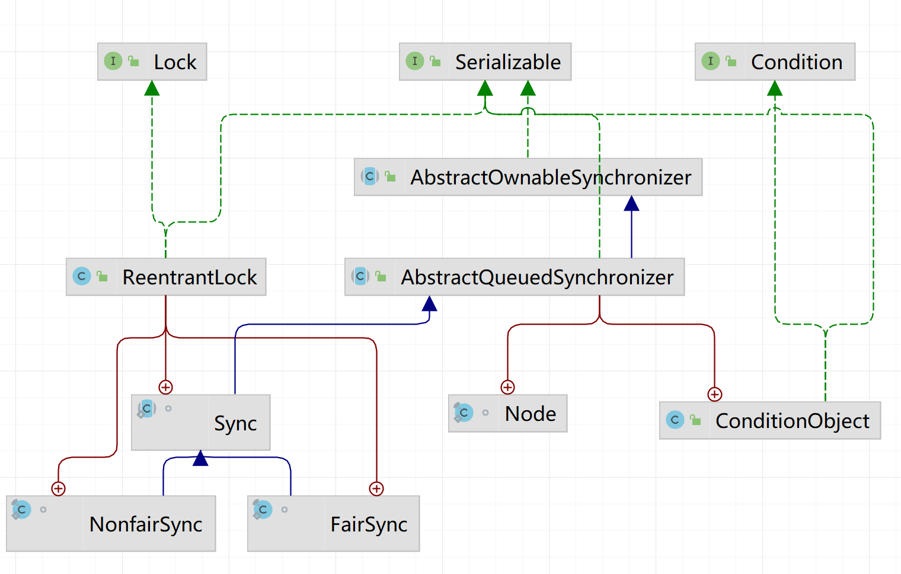

#### 是什么

是 Java 中java.util.concurrent.locks包提供的一个显式锁实现，它相对于synchronized提供了更强大的锁控制功能。

下面是ReentrantLock的几个**主要特点**

| 特点         | 描述                                     | 示例方法                     |
| ------------ | ---------------------------------------- | ---------------------------- |
| 可重入性     | 同一线程可多次获取锁                     | `lock.lock()` 多次嵌套调用   |
| 可中断锁     | 阻塞时可响应中断（需要提前设置）         | `lock.lockInterruptibly()`   |
| 公平锁       | 按线程等待顺序获取锁（可选）             | `new ReentrantLock(true)`    |
| 尝试锁       | 尝试获取锁时，**限时等待**避免阻塞       | `tryLock()`，`tryLock(time)` |
| 条件变量支持 | 可创建**多个**条件等待队列，精细唤醒控制 | `lock.newCondition()`        |


1. **可重入性（Reentrant）**

> 同一个线程可以重复获取同一把锁，获取几次就要释放几次。

```java
ReentrantLock lock = new ReentrantLock();

public void reentrantExample() {
    lock.lock();
    try {
        // 第一次获取锁
        innerMethod();
    } finally {
        lock.unlock(); // 对应第一次 lock
    }
}

public void innerMethod() {
    lock.lock(); // 可重入，当前线程已经持有锁
    try {
        // 执行内部逻辑
    } finally {
        lock.unlock(); // 对应第二次 lock
    }
}
```


2. **可中断锁（Interruptible）**

> 可以响应中断，避免线程永久阻塞。

语法示例：

```java
public class MyRentrantlock {
    Thread t = new Thread() {
        @Override
        public void run() {
            ReentrantLock r = new ReentrantLock();
            // 1.1、第一次尝试获取锁，可以获取成功
            r.lock();

            // 1.2、此时锁的重入次数为 1
            System.out.println("lock() : lock count :" + r.getHoldCount());

            // 2、中断当前线程，通过 Thread.currentThread().isInterrupted() 可以看到当前线程的中断状态为 true
            interrupt();
            System.out.println("Current thread is intrupted");

            // 3.1、尝试获取锁，可以成功获取
            r.tryLock();
            // 3.2、此时锁的重入次数为 2
            System.out.println("tryLock() on intrupted thread lock count :" + r.getHoldCount());
            try {
                // 4、打印线程的中断状态为 true，那么调用 lockInterruptibly() 方法就会抛出 InterruptedException 异常
                System.out.println("Current Thread isInterrupted:" + Thread.currentThread().isInterrupted());
                r.lockInterruptibly();
                System.out.println("lockInterruptibly() --NOt executable statement" + r.getHoldCount());
            } catch (InterruptedException e) {
                r.lock();
                System.out.println("Error");
            } finally {
                r.unlock();
            }

            // 5、打印锁的重入次数，可以发现 lockInterruptibly() 方法并没有成功获取到锁
            System.out.println("lockInterruptibly() not able to Acqurie lock: lock count :" + r.getHoldCount());

            r.unlock();
            System.out.println("lock count :" + r.getHoldCount());
            r.unlock();
            System.out.println("lock count :" + r.getHoldCount());
        }
    };
    public static void main(String str[]) {
        MyRentrantlock m = new MyRentrantlock();
        m.t.start();
    }
}
```

代码解读

`r.lock()`：当前线程首次获得锁，重入计数=1。

`interrupt()`：你**主动把当前线程的中断标志置为 true**（`isInterrupted()==true`）。

`r.tryLock()`：`tryLock()` 是**非阻塞**尝试，且当前线程已持有锁，属于重入路径——它**不会理会中断标志**，直接成功，重入计数=2。

`r.lockInterruptibly()`：这一行是“可中断地获取锁”。底层 AQS 的实现（`acquireInterruptibly`）在真正尝试获取之前会**先检查线程的中断标志**：

- 如果已经被中断（正是你的场景），**立刻抛出 `InterruptedException`**，而且**不会增加重入计数**；
- 如果未被中断，才进入排队/阻塞等待，并在**等待期间若被中断也会抛出** `InterruptedException`。

可中断锁和不可中断锁有什么区别

- **可中断锁**：获取锁的过程中可以被中断，不需要一直等到获取锁之后 才能进行其他逻辑处理。`ReentrantLock` 就属于是可中断锁。
- **不可中断锁**：一旦线程申请了锁，就只能等到拿到锁以后才能进行其他的逻辑处理。 `synchronized` 就属于是不可中断锁。


3. **公平锁（Fair Lock，可选）**

> 默认是非公平锁（性能高），可通过构造函数设置为公平锁，按等待时间顺序分配锁。

语法示例：

```java
// 创建公平锁
ReentrantLock fairLock = new ReentrantLock(true); // true 表示公平锁

fairLock.lock();
try {
    // 公平获取到锁后执行任务
} finally {
    fairLock.unlock();
}
```


4. **尝试锁（Try Lock）**

> 尝试获取锁，不会阻塞线程。可设置等待时间。

语法示例（立即返回）：

```java
if (lock.tryLock()) {
    try {
        // 获取到锁才执行任务
    } finally {
        lock.unlock();
    }
} else {
    // 没有获取到锁
    System.out.println("Could not acquire lock");
}
```

语法示例（限时等待）：

```java
try {
    if (lock.tryLock(2, TimeUnit.SECONDS)) {
        try {
            // 成功获取锁
        } finally {
            lock.unlock();
        }
    } else {
        // 超时未获取锁
        System.out.println("Timeout, failed to acquire lock");
    }
} catch (InterruptedException e) {
    e.printStackTrace();
}
```

5. **支持条件变量（Condition）**

> 更加灵活地控制线程间通信，类似 `Object.wait/notify`，但支持多个条件队列。

语法示例：

```java
ReentrantLock lock = new ReentrantLock();
Condition condition = lock.newCondition();

public void awaitCondition() throws InterruptedException {
    lock.lock();
    try {
        System.out.println("Waiting for signal...");
        condition.await(); // 进入等待
        System.out.println("Received signal!");
    } finally {
        lock.unlock();
    }
}

public void signalCondition() {
    lock.lock();
    try {
        condition.signal(); // 唤醒一个等待线程
    } finally {
        lock.unlock();
    }
}
```

#### 原理

:star:看继承结构图可以知道，使用了Sync作为同步器，而Sync又有公平和非公平的两个子类。Sync是AQS的一个实现。

:star:公平和非公平原理：非公平刚来或者被唤醒直接做cas，也就是尝试获取锁，如果这时刚好释放锁，那么对于队列中排队的节点就是不公平的，而公平是你尝试获取锁的时候还要先检查队列。

:star:可重入原理：控制state

:star:可打断原理：即使它被打断，仍会驻留在 AQS 队列中，一直要等到获得锁后方能得知自己被打断了。

:star:条件变量原理：一个条件变量对应一个队列，线程上面标识2表示condition，调用await之后加入到相应的队列，直到相应的signal，把唤醒队列加入NonFairSyn队列的尾部，并把标识改为0

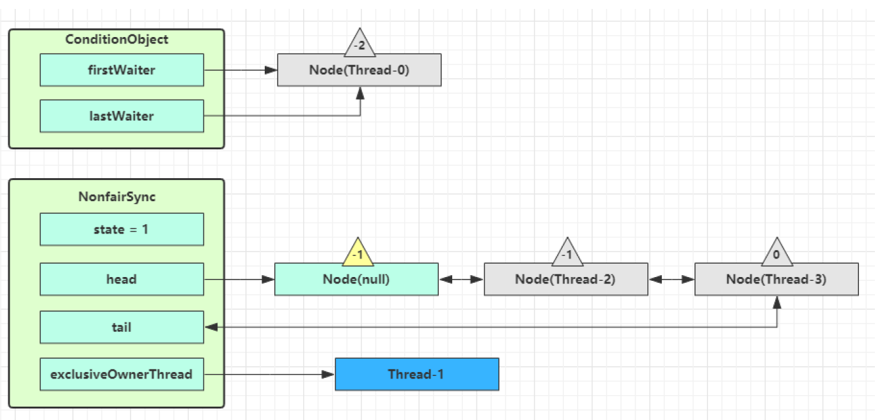


# Java内存模型（JMM）

抽象了线程和主内存之间的关系之外，其还规定了从 Java 源代码到 CPU 可执行指令的这个转化过程要遵守哪些和并发相关的原则和规范，其主要目的是为了简化多线程编程，增强程序可移植性的。

它在以下行为中有所体现：

- 原子性 - 保证指令不会受到线程上下文切换的影响

- 可见性 - 保证指令不会受 cpu 缓存的影响

- 有序性 - 保证指令不会受 cpu 指令并行优化的影响

### CPU缓存结构

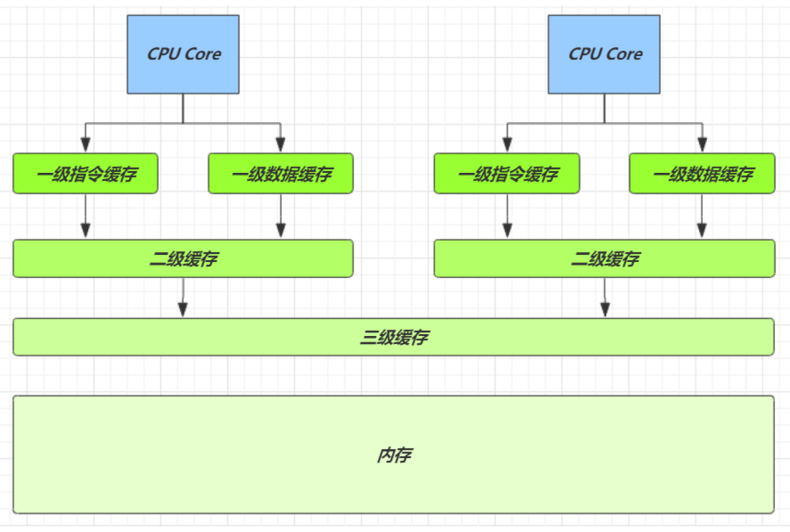

#### CPU缓存一致性

使用MESI (Modified‑Exclusive‑Shared‑Invalid) 缓存一致性协议，应用于 **多核 CPU 的缓存结构**：

- 每个 CPU 核心有自己的 L1/L2 Cache。
- 多个核心可能会访问 **相同的主内存地址**，但各自缓存了该地址的副本。
- 为防止出现“**缓存不一致**”（例如一个核改了变量 x，另一个还读到旧值），就需要 **一致性协议** 来协调缓存副本。


### JMM和CPU缓存关系

一般来说，编程语言也可以直接复用操作系统层面的内存模型。不过，不同的操作系统内存模型不同。如果直接复用操作系统层面的内存模型，就可能会导致同样一套代码换了一个操作系统就无法执行了。

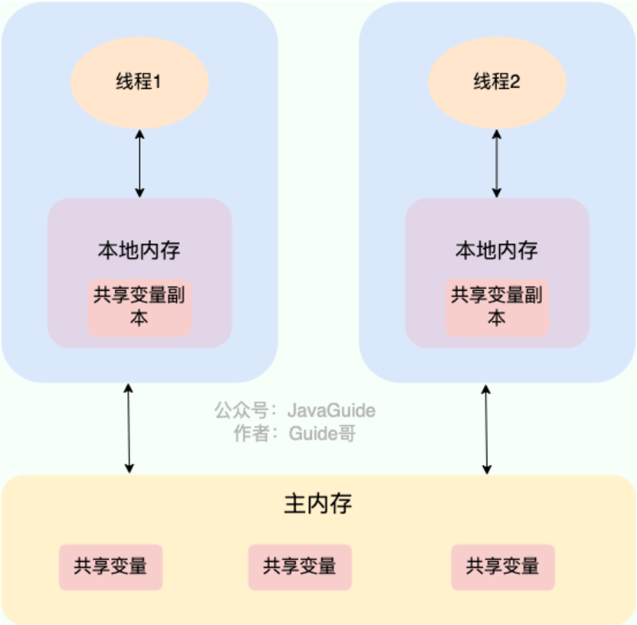

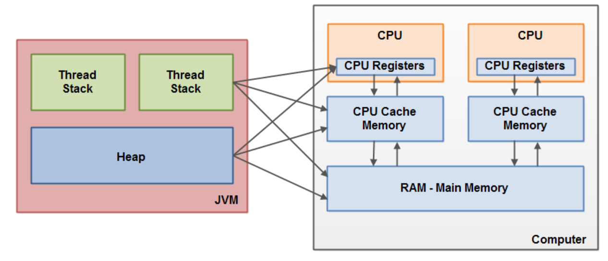

### 有序性问题

- **编译器优化**：Java 编译器和 JIT 会对代码做优化调整执行顺序。
- **CPU 重排序**：现代 CPU 为提升性能，也会对指令进行乱序执行。
- **内存系统重排**：为了更高吞吐量，缓存系统也可能重排序。

**这些“重排序”不会影响单线程结果，但会破坏多线程下的执行预期。**

### 可见性问题

main 线程对 run 变量的修改对于 t 线程不可见，导致了 t 线程无法停止，因为 t 线程要频繁从主内存中读取 run 的值，JIT 编译器会将 run 的值缓存至自己工作内存中的高速缓存中，减少对主存中 run 的访问，提高效率。这里的高速缓存就是CPU的数据cache。怎么解决，对run加volatile解决。

```java
static boolean run = true;
public static void main(String[] args) throws InterruptedException {
    Thread t = new Thread(()->{
        while(run){
        	// ....
        }
    });
    t.start();
    sleep(1);
    run = false; // 线程t不会如预想的停下来
}
```

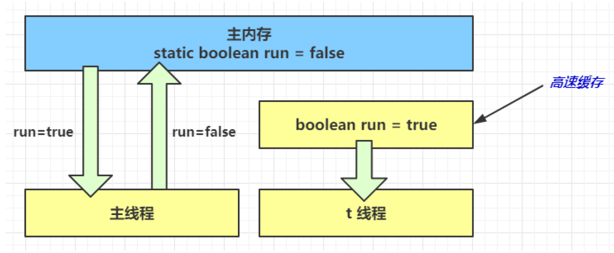


### happens-before

:star:happens-before是 Java 并发的核心规则，定义了线程之间操作的**可见性与有序性保障**。只要两个线程间的操作满足 happens-before 关系，那么**前一个线程的操作结果一定对后一个线程可见**。Java 通过 synchronized、volatile、线程启动终止等机制建立这种关系。

**happens-before 不是实际执行顺序，而是**一种**抽象的“执行关系约束”**，由 JVM 和硬件必须保证。


### 保证happens-before的方式？

| happens-before 规则              | 说明                                                         |
| -------------------------------- | ------------------------------------------------------------ |
| **程序顺序规则**                 | 同一个线程内，按照程序顺序，前面的操作 happens-before 后面的操作 |
| **监视器锁规则（synchronized）** | 解锁一个锁 happens-before 之后加锁这个相同锁                 |
| **volatile 变量规则**            | 对一个变量的写操作 happens-before 后续对该变量的读操作       |
| **线程启动规则**                 | `Thread.start()` happens-before 该线程中任何动作             |
| **线程终止规则**                 | 线程中的所有操作 happens-before 另一个线程调用 `Thread.join()` 的返回 |
| **传递性规则**                   | 如果 A happens-before B，且 B happens-before C，那么 A happens-before C |


### 什么是内存屏障

- Memory Barrier（Memory Fence）是编译后，JVM 会在字节码中插入特殊标记，HotSpot 在生成机器码时会插入如 `LOCK`, `MFENCE` 等指令。

- 可见性
  写屏障（sfence）保证在该屏障之前的，对共享变量的改动，都同步到主存当中
  而读屏障（lfence）保证在该屏障之后，对共享变量的读取，加载的是主存中最新数据
- 有序性
  写屏障会确保指令重排序时，不会将写屏障之前的代码排在写屏障之后
  读屏障会确保指令重排序时，不会将读屏障之后的代码排在读屏障之前


# Java.Util.Concurrent

## AQS

### 作用

AQS 解决了开发者在实现同步器时的复杂性问题。它提供了一个通用框架，用于实现各种同步器，例如 **可重入锁**（`ReentrantLock`）、**信号量**（`Semaphore`）和 **倒计时器**（`CountDownLatch`）。通过封装底层的线程同步机制，AQS 将复杂的线程管理逻辑隐藏起来，使开发者只需专注于具体的同步逻辑。

简单来说，AQS 是一个抽象类，为同步器提供了通用的 **执行框架**。它定义了 **资源获取和释放的通用流程**，而具体的资源获取逻辑则由具体同步器通过重写模板方法来实现。 因此，可以将AQS看作是同步器的**基础“底座”**，而同步器则是基于 AQS 实现的 **具体“应用”**。

是同步器框架（AbstractQueuedSynchronizer）：

- AQS 是 JDK 并发包中用于构建锁和同步器（如:star: ​**​ReentrantLock、Semaphore、CountDownLatch** 等）的基础框架。
- 它通过一个 **volatile 的 state 变量 + 一个 FIFO 等待队列（基于 CLH）** 来实现线程的同步等待机制。
- 用 state 属性来表示资源的状态（分独占模式和共享模式），子类需要定义如何维护这个状态，控制如何获取锁和释放锁。
- 核心设计就是：如果竞争失败，就将线程加入队列，阻塞等待；释放时再唤醒下一个。

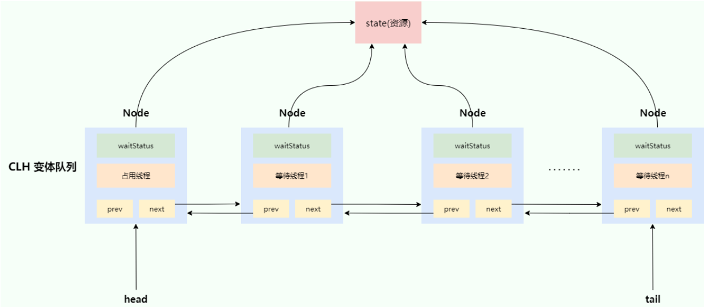

### 独占模式（Exclusive）

- **定义**：一次只允许一个线程成功获取同步状态，其他线程必须排队等待。

- **队列唤醒策略**：持有锁的线程 `release` 时，只需唤醒**队首**的一个节点。

- **实现要点**

  ```java
  protected boolean tryAcquire(int arg)     // 子类写抢锁逻辑
  protected boolean tryRelease(int arg)     // 子类写解锁逻辑
  ```

- **示例：ReentrantLock（非公平）**

  - `tryAcquire` ⇒ `compareAndSetState(0, 1)` 拿到；若已是当前线程则 `state++`（可重入）。
  - 释放时 `state--` 变为 0 才真的唤醒下一个。

### 共享模式（Shared）

- **定义**：一次可允许 *多个* 线程并发获得同步状态，只要“资源计数”允许。

- **队列唤醒策略**：`releaseShared` 时，需要唤醒**整个链**（或按条件级联传播），因为接下来可能不止一个线程能成功。

- **核心 API**

  ```java
  protected int tryAcquireShared(int arg)    // 返回 ≥0 表示成功并可继续向后传播
  protected boolean tryReleaseShared(int arg)
  ```

- **示例 1：Semaphore(permits)**

  - `tryAcquireShared(1)` 用 CAS 把 `state = state - 1`；若结果 ≥ 0 表示还有余量，可让后继继续竞争。

- **示例 2：CountDownLatch**

  - 获取时直接返回 `(state == 0) ? 1 : -1`；只有当计数归零时，所有等待线程才能一并通过。

### 混合模式

- **示例：读写锁ReentrantReadWriteLock**


### CLH
（Craig, Landin, and Hagersten）是一种虚拟双向链表队列：

- AQS 使用的是 **改进版的 CLH 队列**，不是传统的 CLH 自旋锁（原始 CLH 是基于链式结构的本地自旋锁）。
- CLH 队列是一个**隐式单向队列**，每个节点代表一个等待线程。
- 每个线程在尝试获取锁失败后，会通过 CAS 将自己加入队尾，并自旋或挂起。

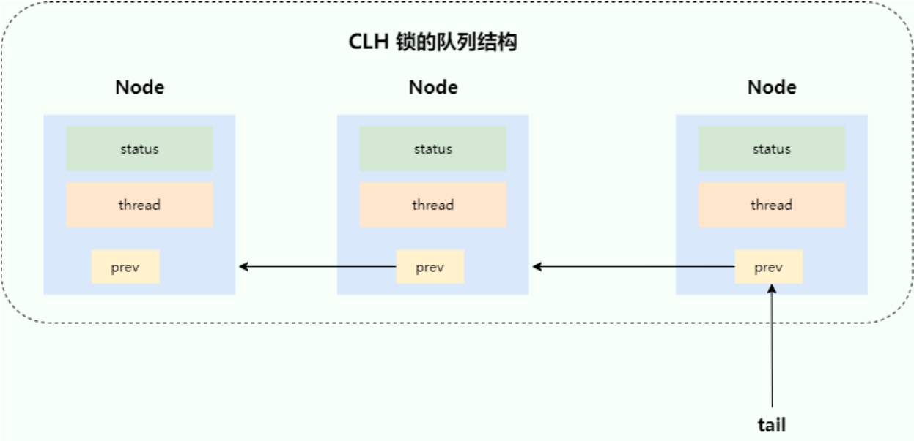

:star:单点 CAS是不断 `while(!CAS(lock,0,1))`，CLH改进了单点CAS。

CLH 自旋锁优化：把线程排成隐式链表，每个线程只盯着**前驱结点的标志位**忙等。释放线程仅需写一次 `false`，后继立刻感知并拿锁。对比CAS的优点：CAS的持有者 `unlock` 时对这条缓存线的写入会**同时**使所有 CPU 的该行失效，所有等待者又会立刻争抢写入 → 巨大的失效/竞争流量，天然公平，并发伸缩性更好。CAS会导致有的线程**饥饿**。

AQS进一步优化：**自旋 + 阻塞**，CLH 锁使用纯自旋方式等待锁的释放，但大量的自旋操作会占用过多的 CPU 资源。**单向队列改为双向队列**，为了解决 “唤醒、取消、跳过” 等现实中的并发场景更高效、更健壮。

## ReentrantLock

写在Lock体系

## 读写锁

### ReentrantReadWriteLock

为什么要使用这个锁？

当读操作远远高于写操作时，这时候使用读写锁让读-读可以并发，提高性能。 类似于数据库中的 select...from...lock in share mode。

可以用于实现缓存。

| 项目           | 内容                                   |
| -------------- | -------------------------------------- |
| **是否可重入** | ✅ 是，读写都支持重入                   |
| **公平性**     | 支持公平与非公平（默认非公平）         |
| **实现方式**   | 基于 AQS（AbstractQueuedSynchronizer） |
| **读锁模式**   | 共享锁（多个线程可以同时读）           |
| **写锁模式**   | 独占锁（只能一个线程写）               |
| **state结构**  | 高 16 位：读锁次数；低 16 位：写锁次数 |
| **适用场景**   | 多读少写场景；适合普通并发编程需求     |

原理概述：

- 内部维护一个 `Sync` 类继承 AQS；
- **两个锁，写锁使用独占模式，读锁使用共享模式；**
- 读写冲突时写优先（默认），也可设置为读优先。


## StampedLock

| 项目           | 内容                                         |
| -------------- | -------------------------------------------- |
| **是否可重入** | ❌ 否，不支持重入                             |
| **公平性**     | ❌ 非公平锁                                   |
| **实现方式**   | 基于 `Unsafe` CAS 实现，:star:不是AQS        |
| **读锁模式**   | 支持悲观读锁（类似共享锁）和乐观读锁（无锁） |
| **写锁模式**   | 独占锁（阻塞其他读写）                       |
| **适用场景**   | 高并发下，大量读少量写，追求极致性能         |

原理概述：

- `tryOptimisticRead()` 获取**乐观读锁**（无锁，仅返回一个时间戳 stamp）；
- 后续使用 `validate(stamp)` 检查 stamp 是否有效（期间有没有写入）；
- 如果写入了，就退化成正常的**悲观读锁**；
- 适合对数据访问的冲突非常低的场景。

## Semaphore

申请一个可用资源数量的锁，是基于共享模式的AQS实现的。

```java
import java.util.concurrent.Semaphore;
import java.util.concurrent.ThreadLocalRandom;
import java.util.concurrent.TimeUnit;

public class ConnectionPoolDemo {

    // 5 表示“池”里一共有 5 个可用资源
    private static final Semaphore POOL = new Semaphore(5, true); // 第二个参数 true -> 公平信号量

    public static void main(String[] args) {
        // 启动 15 个并发线程来模拟 15 个请求抢占连接
        for (int i = 1; i <= 15; i++) {
            int id = i;
            new Thread(() -> doBusiness(id)).start();
        }
    }

    private static void doBusiness(int threadId) {
        try {
            log(threadId, "尝试申请连接…");
            POOL.acquire();                 // ↓ 1. 申请一个 permit（可被中断的版本是 acquire()）
            log(threadId, "获得连接，开始工作");

            // ====== 模拟真实业务：随机处理 0.5~2 秒 ======
            TimeUnit.MILLISECONDS.sleep(ThreadLocalRandom.current().nextInt(500, 2000));

            log(threadId, "业务完成，准备归还连接");
        } catch (InterruptedException e) {
            Thread.currentThread().interrupt();
        } finally {
            POOL.release();                 // ↓ 2. 归还 permit
            log(threadId, "已归还连接（当前可用：" + POOL.availablePermits() + "）");
        }
    }

    private static void log(int id, String msg) {
        System.out.printf("[%s] 线程-%02d: %s%n",
                java.time.LocalTime.now().withNano(0), id, msg);
    }
}
```


## CountDownLatch

使用：用来进行线程同步协作，等待所有线程完成倒计时。其中构造参数用来初始化等待计数值，await() 用来等待计数归零，countDown() 用来让计数减一。

原理：`CountDownLatch` 通过一个共享变量（`state`）表示“倒计时计数器”，线程调用 `await()` 会阻塞，直到其他线程调用 `countDown()` 把计数器减到 0；整个过程是基于 AQS实现的。

底层结构图示：

```java
public class CountDownLatch {
    private final Sync sync;

    private static final class Sync extends AbstractQueuedSynchronizer {
        ...
    }
}
```

#### 核心 API

- `new CountDownLatch(int count)`
- `void countDown()`
- `void await()` / `boolean await(long timeout, TimeUnit unit)`
- `long getCount()`（调试用）

> 一次性：计数到 0 后不能重置；需要可复用请看 `CyclicBarrier` 或 `Phaser`。

------

#### 常用场景 & 模板

1) 等待 N 个任务全部完成（最常用）

```java
ExecutorService pool = Executors.newFixedThreadPool(4);
int n = 10;
CountDownLatch done = new CountDownLatch(n);

for (int i = 0; i < n; i++) {
    pool.submit(() -> {
        try {
            // do work...
        } catch (Exception e) {
            // 记录异常
        } finally {
            done.countDown(); // 一定要放 finally，防止“漏数”导致主线程永远等
        }
    });
}

done.await(); // 或 done.await(5, TimeUnit.SECONDS)
System.out.println("all tasks finished");
pool.shutdown();
```

2) 基准测试/并发对齐：同时开跑 + 等待全部结束

```java
int threads = 8;
CountDownLatch startGate = new CountDownLatch(1);
CountDownLatch endGate   = new CountDownLatch(threads);

for (int i = 0; i < threads; i++) {
    new Thread(() -> {
        try {
            startGate.await();  // 等统一起跑
            // 执行被测代码
        } catch (InterruptedException ignored) {
        } finally {
            endGate.countDown();
        }
    }).start();
}

long t0 = System.nanoTime();
startGate.countDown();   // 所有线程同时起跑
endGate.await();         // 等全部跑完
long t1 = System.nanoTime();
System.out.println("cost = " + (t1 - t0)/1_000_000 + " ms");
```

3) 线程按顺序执行（A→B→C）

```java
CountDownLatch l12 = new CountDownLatch(1);
CountDownLatch l23 = new CountDownLatch(1);

new Thread(() -> {
    System.out.println("A");
    l12.countDown();
}).start();

new Thread(() -> {
    try { l12.await(); } catch (InterruptedException ignored) {}
    System.out.println("B");
    l23.countDown();
}).start();

new Thread(() -> {
    try { l23.await(); } catch (InterruptedException ignored) {}
    System.out.println("C");
}).start();
```


## CyclicBarrier

可循环使用（Cyclic）的屏障（Barrier），用来进行线程协作，等待线程满足某个计数，然后所有线程才能执行第二阶段任务。CyclicBarrier是基于**ReentrantLock**。

```java
import java.util.concurrent.CyclicBarrier;
import java.util.concurrent.BrokenBarrierException;
import java.util.concurrent.TimeUnit;

public class CyclicBarrierDemo {

    // ① 创建屏障：4 个参与线程 + 当 4 人全部到达时要执行的“哨兵任务”
    private static final CyclicBarrier BARRIER =
            new CyclicBarrier(4, () -> System.out.println("—— 全员就绪，统一进入下一阶段 ——"));

    public static void main(String[] args) {
        // 启动 4 个工人线程
        for (int i = 1; i <= 4; i++) {
            int id = i;
            new Thread(() -> work(id)).start();
        }
    }

    /** 每个工人要执行两轮相同的流程 */
    private static void work(int id) {
        try {
            for (int cycle = 1; cycle <= 2; cycle++) {
                // Phase 1：搬砖
                log(id, "Cycle " + cycle + ": 开始搬砖");
                TimeUnit.MILLISECONDS.sleep(300 + id * 100); // 模拟不同耗时
                log(id, "Cycle " + cycle + ": 搬砖完毕，等待同伴");

                BARRIER.await();  // ② 阻塞到这儿，直到 4 人都到达
                // ---- 哨兵任务打印分隔线 ----

                // Phase 2：休息
                log(id, "Cycle " + cycle + ": 开始休息");
                TimeUnit.MILLISECONDS.sleep(200 + id * 50);
                log(id, "Cycle " + cycle + ": 休息完，等待同伴");

                BARRIER.await();  // ③ 第二次同步，同一把屏障循环复用
                // ---- 再次触发哨兵任务 ----
            }
            log(id, "全部完成，收工回家");
        } catch (InterruptedException | BrokenBarrierException e) {
            Thread.currentThread().interrupt();
        }
    }

    private static void log(int id, String msg) {
        System.out.printf("[%s] 工人‑%d: %s%n",
                java.time.LocalTime.now().withNano(0), id, msg);
    }
}
```

## 线程安全集合类

- 遗留的线程安全集合：如Hashtable，Vector
- 使用 Collections 装饰的线程安全集合：如Collections.synchronizedList
- java.util.concurrent.*：包含三类关键词，Blocking、CopyOnWrite、Concurrent，比如ConcurrentHashMap。具体的写在Java集合中。

## Future

异步任务的接口，但是什么时候完成，还是得自己去查看

## FutureTask

`FutureTask` 不光实现了 `Future`接口，还实现了`Runnable` 接口，因此可以作为任务直接被线程执行。

## CompletableFuture

把**异步任务**写成可读、可组合、可恢复的**“流水线”**。相对传统 `Future` 只能 `get()` 阻塞拿结果，它提供了启动、编排、并行合并、异常处理、超时与手动完成等一整套能力。

# 其他

## ThreadLocal

:star:ThreadLocal 的价值不在“让数据只属于当前线程”——那本来就可以做到；它的关键在于“把这份线程私有的数据，隐式地、随处可取地贯穿调用链”，从而省去层层显式传参的麻烦。

示例代码：黑马商城中的用户数据，如果不使用ThreadLocal，那么后面每个线程的调用都要传:star:userDTO这个参数。

```java
public class UserContext {
    private static final ThreadLocal<UserDTO> USER_HOLDER = new ThreadLocal<>();

    public static void set(UserDTO user) {
        USER_HOLDER.set(user);
    }
    public static UserDTO get() {
        return USER_HOLDER.get();
    }
    public static void clear() {
        USER_HOLDER.remove();
    }
}

// 登录鉴权过滤器
public void doFilter(ServletRequest req, ServletResponse resp, FilterChain chain) {
    try {
        UserDTO user = authService.parseToken(req);
        UserContext.set(user);          // 放入 ThreadLocal
        chain.doFilter(req, resp);
    } finally {
        UserContext.clear();            // 必须清理
    }
}

// 深层业务代码
public void createOrder(OrderDTO dto) {
    UserDTO user = UserContext.get();   // 不用改方法签名也能拿到
    ...
}

```

#### 为什么要用 ThreadLocal？

在并发环境下，如果多个线程**只读**同一个对象没问题，但如果需要给每个线程各自保存一份状态（例如：

- 非线程安全对象：`SimpleDateFormat`、数据库连接、`Random`；
- 统计信息：每个线程的计数器、trace id；
- 一些上下文：用户身份、事务信息；

与其用 `Map<Thread, Object>` 或锁来区分，不如用 `ThreadLocal`——它把「数据找线程」反向为「线程找数据」，且**时间复杂度 O(1)**，无需同步。

#### 基础示例：线程私有计数器

```java
public class ThreadLocalCounterDemo {

    // 给每条线程准备一个独立的计数器，初始值为 0
    private static final ThreadLocal<Integer> COUNTER = ThreadLocal.withInitial(() -> 0);

    public static void main(String[] args) throws InterruptedException {
        Runnable task = () -> {
            // 每个线程自增 5 次并打印
            for (int i = 0; i < 5; i++) {
                COUNTER.set(COUNTER.get() + 1);
                System.out.printf("%s -> %d%n",
                        Thread.currentThread().getName(), COUNTER.get());
            }
            // 业务完成后务必清理，避免线程池复用导致“脏数据”泄露
            COUNTER.remove();
        };

        Thread t1 = new Thread(task, "worker‑A");
        Thread t2 = new Thread(task, "worker‑B");
        t1.start(); t2.start();
        t1.join();  t2.join();
    }
}
```

**输出思路**：你会看到 `worker‑A` 和 `worker‑B` 两条线程各自从 1 数到 5，互不干扰。

> **关键点**：`ThreadLocal` 底层是在 `Thread` 对象里维护了一个 `ThreadLocalMap`，键是 `ThreadLocal` 实例（弱引用），值是你放进去的对象，因此**读写都不需要锁**。

#### 原理

简单来说，每个线程会有一个ThreadLocalMap存着私有的数据，Thread类有ThreadLocalMap变量

这个map的**键**（比如上面程序中的COUNTER）不同线程之间是共享的，**值**是单独存储的。

这个map的解决冲突是线性探测。

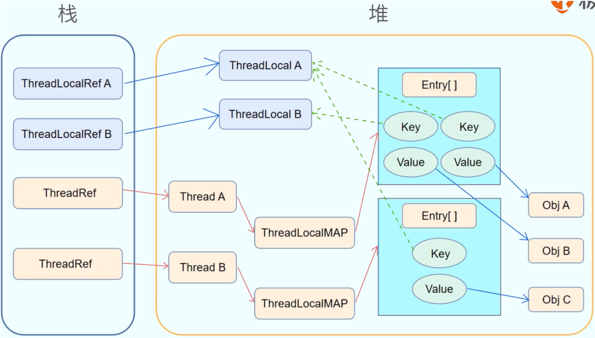

#### 内存泄漏

因为key 是弱引用，value 是强引用。满足以下条件：`ThreadLocal` 实例不再被强引用；线程持续存活，导致 `ThreadLocalMap` 长期存在。就会发生内存泄漏，解决办法try-final中使用remove()方法。


## 并发设计模式

| #    | 并发模式                                  | 原理要点                                                     | 常见应用 / API 举例                                          |
| ---- | ----------------------------------------- | ------------------------------------------------------------ | ------------------------------------------------------------ |
| 1    | **Producer – Consumer（生产者-消费者）**  | 用**有界阻塞队列**把“产出”与“消费”解耦；速率不匹配时自动背压 | 日志写入、消息队列Java：`ArrayBlockingQueue`、`LinkedBlockingQueue` |
| 2    | **Thread Pool / Worker Thread（线程池）** | 复用固定线程执行任务对象，避免频繁创建/销毁线程开销          | Web 服务器业务线程池、数据库连接池工作线程Java：`ExecutorService`、`ForkJoinPool`（内部也是池） |
| 3    | **Future / Promise**                      | 提前返回“占位符”，任务完成后再取结果；支持回调/链式组合      | 异步 HTTP/RPC 调用；GUI 主线程不阻塞Java：`CompletableFuture`、JS：`Promise` |
| 4    | **Read-Write Lock（读写锁）**             | **多读共享、写独占** —— 读多写少场景最大化并发               | 配置缓存、词典型只读数据Java：`ReentrantReadWriteLock`；C++：`shared_mutex` |
| 5    | :star:**Reactor**                         | **I/O 多路复用**线程监听就绪事件 → 分发给 Handler 做非阻塞处理 | Netty/Nginx 事件循环、Node.js 单线程模型Java：`Selector` + Netty 的 Boss/Worker 组；Redis单线程模型 |
| 6    | **Fork/Join（分治并行）**                 | 递归拆分子任务→并行执行→结果归并；**工作窃取**提升负载均衡   | 并行排序、矩阵运算、Map-Reduce 类批处理Java：`ForkJoinTask`、`parallelStream()` |
| 7    | Leader-Follower 模式                      | 一个线程成为 **Leader**，调用 `select()` 阻塞；事件到来，Leader 把 FD **分发** 给某个 *Follower*（或自己变 Worker），随后让 **另一个线程** 立刻顶上做新的 Leader；如此反复，轮换执行。 |                                                              |

