## JVM概述

#### jvm作用/功能

- 解释运行，将字节码指令根据不同的os解释成机器码并运行。

- 内存管理，自动分配内存，垃圾回收。

- 即时编译jit，解释并优化，相当于汇编，并存在内存。

#### 有哪些jvm？

| 名称        | 特点                               |
| ----------- | ---------------------------------- |
| **HotSpot** | 官方标准，最广泛使用，稳定         |
| **OpenJ9**  | 轻量级，低内存占用，高性能，可拓展 |
| **GraalVM** | 多语言支持，支持原生镜像，微服务   |

#### jvm组成/结构

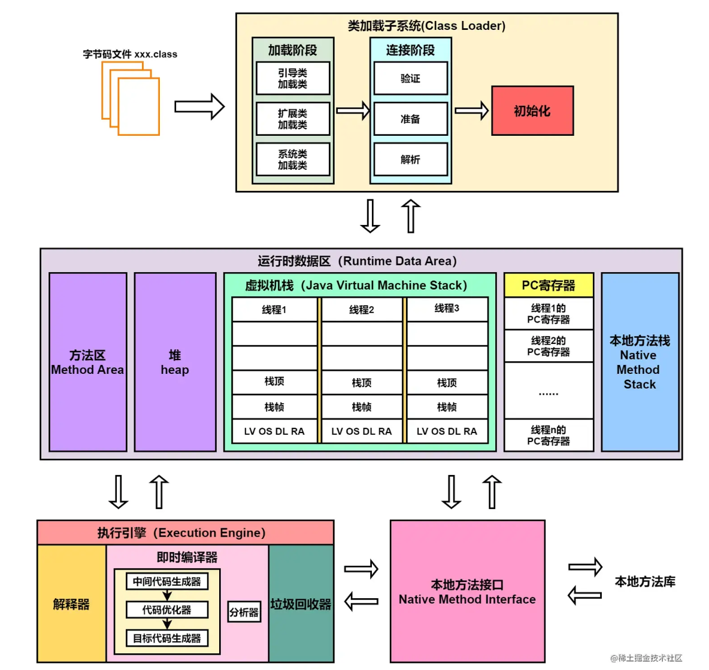

| 组成部分                                   | 作用                             | 说明                                                    |
| ------------------------------------------ | -------------------------------- | ------------------------------------------------------- |
| **类加载子系统（Class Loader Subsystem）** | 加载 `.class` 字节码文件到内存   | 按需加载类文件，负责验证、准备、解析和初始化            |
| **运行时数据区（Runtime Data Areas）**     | JVM 运行过程中使用的数据内存区域 | 包括方法区、堆、虚拟机栈、本地方法栈、程序计数器        |
| **执行引擎（Execution Engine）**           | 执行字节码指令                   | 包含解释器、JIT 编译器、垃圾回收器等组件                |
| **本地方法接口（Native Interface）**       | 与本地 C/C++ 等库交互            | 使用 JNI（Java Native Interface）调用非 Java 实现的方法 |
| **垃圾回收器（Garbage Collector）**        | 自动内存管理                     | 回收无用对象，优化内存使用                              |
| **Native Method Libraries（本地方法库）**  | 支持 Native 方法的具体实现       | 一般为 .dll / .so 文件                                  |

## 字节码文件

### 字节码文件组成

#### 字节码文件的组成

| 区域分类          | 字段名                              | 简要说明                          | 示例/备注                                    |
| ----------------- | ----------------------------------- | --------------------------------- | -------------------------------------------- |
| **1. 文件头信息** | `magic`                             | 文件标识魔数，固定为 `0xCAFEBABE` | 判断是否为 class 文件                        |
|                   | `minor_version` / `major_version`   | Java class 文件版本号             | 如 Java 8 → `52.0`                           |
| **2. 常量池**     | `constant_pool_count`               | 常量池项数量                      | 从 1 开始编号                                |
|                   | `constant_pool[]`                   | 存储类名、方法名、字符串等常量    | 多种类型：Utf8、Class、Methodref 等          |
| **3. 类信息定义** | `access_flags`                      | 类访问修饰符                      | public、abstract、final 等                   |
|                   | `this_class`                        | 当前类名在常量池中的索引          | 指向 CONSTANT_Class                          |
|                   | `super_class`                       | 父类名在常量池中的索引            | Object 的父类为 0                            |
|                   | `interfaces_count` / `interfaces[]` | 实现的接口数量和列表              | 每项为常量池索引                             |
| **4. 字段信息**   | `fields_count` / `fields[]`         | 类中字段（成员变量）的定义        | 包含名称、类型、访问修饰符                   |
| **5. 方法信息**   | `methods_count` / `methods[]`       | 类中方法的定义                    | 包含方法名、描述符、Code（**字节码指令**）等 |
| **6. 属性信息**   | `attributes_count` / `attributes[]` | 类级别的附加信息                  | 如源码名、行号表、注解等                     |

#### 符号引用机制Symbolic Reference？

字节码中的很多操作（如 `getstatic`, `invokevirtual`, `ldc` 等）使用一个数字编号（如 `#2`）；

这个编号对应常量池的一个**符号项**（比如一个方法、字段的描述）；

JVM 运行时会根据这些**符号引用**去解析出真实内存地址（**直接引用**）或方法句柄；

整个「从编号 → 常量池项 → 符号引用解析」的过程，就是“**符号引用机制**”。

#### 字节码指令中提到的操作数栈，局部变量表在哪？

“操作数栈”和“局部变量表”是**JVM运行时**在执行方法字节码时，**为每个栈帧分配的空间结构**，而不是字节码文件本身的组成部分。字节码文件中只保存了“代码”本身以及运行时结构所需的参数（如`max_stack`, `max_locals`），真正的栈是在运行时才被构建的。

### 类的加载

#### 类的加载过程？

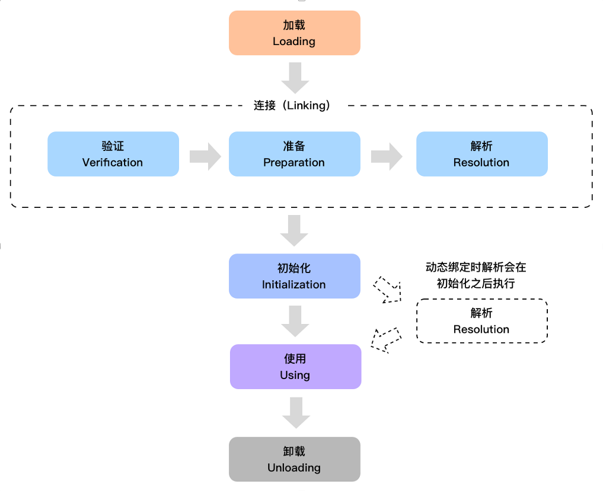

| 阶段   | 详细作用说明                                                 |
| ------ | ------------------------------------------------------------ |
| 加载   | JVM 通过类的全限定名（例如 `com.example.MyClass`）查找并读取 `.class` 文件中的二进制字节流（也可以是动态代理生成的）。通过类加载器（如 AppClassLoader）**将这些字节流转换为方法区中的类元信息，并在堆中创建对应的 `Class` 对象，供程序使用**（反射，动态代理，获取类信息）。此阶段还可能触发父类或接口的加载。 |
| 验证   | 保证被加载类的**字节码符合 JVM 规范**，不会破坏虚拟机的安全。具体包括：① 文件格式校验（是否以 0xCAFEBABE 开头）② 元数据验证（父类是否存在、方法签名合法）③ 字节码验证（指令是否合法、操作数栈深度正确）④ 符号引用验证（是否能正确定位到常量池等）。 |
| 准备   | **为类变量（即 `static` 修饰的变量）分配内存，并设置为默认初始值**（如 0、null、false）。仅当 static final 常量在编译期无法确定值时，才会延迟到初始化阶段赋值，若为编译期常量（比如基本数据类型），则在准备阶段就会赋值。 |
| 解析   | 将常量池中的**符号引用**（如类名、字段名、方法名）解析为具体的内存地址（**直接引用**），即将“字符串形式的引用”替换成“直接指向内存的引用”。解析可以是类、接口、字段、方法等四种引用类型。解析可以在连接阶段完成，也可以在首次使用时再解析（称为“延迟解析”或“动态绑定”）。 |
| 初始化 | 这是类加载的最后一个主动步骤。**执行 `<clinit>()` （class init）方法**（是编译之后自动生成的，由**静态变量赋值语句和静态代码块构成**），对类变量赋显式初始值，并执行静态初始化逻辑。该方法由 JVM 自动收集编译生成，按源码顺序依次执行。若类有父类，先初始化父类。 |
| 使用   | 类已加载并初始化完成，可以被程序正常访问。可能包括：访问 static 字段或方法、创建对象实例、调用方法等。 |
| 卸载   | JVM 判断该类是否无任何实例、Class 对象和 ClassLoader 引用。如果满足条件，就会将其从方法区清除，并释放内存。通常只有自定义类加载器加载的类在特定场景（如热部署）下才会被卸载。BootstrapClassLoader 加载的核心类一般不会被卸载。 |

#### 什么时候会触发类的初始化？

| 场景                                              | 说明                                                         |
| ------------------------------------------------- | ------------------------------------------------------------ |
| 1. 创建类的实例                                   | `new` 一个对象，如：`new MyClass()`                          |
| 2. 访问类的静态变量（非编译期常量）或调用静态方法 | 如：`MyClass.staticField`、`MyClass.staticMethod()`          |
| 3. 反射调用类（常见于框架，如 Spring）            | 如：`Class.forName("MyClass")`、`clazz.getMethod(...)`       |
| 4. 子类初始化时，先初始化父类                     | 即使子类没有访问父类静态字段，也会先初始化父类               |
| 5. 启动类被 JVM 启动                              | JVM 启动时，指定的主类会被初始化                             |
| 6. 动态语言支持                                   | 使用 `MethodHandle` 调用类的 `static` 方法时，也会触发类初始化（在 JDK7 之后加入） |

#### 什么情况下不会触发类的初始化？

| 场景                                   | 说明                                                         |
| -------------------------------------- | ------------------------------------------------------------ |
| 1. 访问 `static final` 编译期常量      | 如：`System.out.println(MyClass.CONST)`，因为编译器会将常量**内联**到调用处，不会触发初始化 |
| 2. 创建数组但不访问类内容              | 如：`MyClass[] arr = new MyClass[10];`，只是创建数组类型，不会触发类加载和初始化 |
| 3. 子类访问父类的静态常量              | 若子类没有主动使用自己，且访问的是**父类的静态字段**，不会导致子类初始化 |
| 4. 通过 `ClassLoader.loadClass` 加载类 | 只是加载，不初始化；与 `Class.forName` 不同，后者会触发初始化 |

### 类的加载器

#### 什么是类加载器（ClassLoader）？

**类加载器（ClassLoader）是 Java 虚拟机中用于加载 `.class` 字节码文件的组件，负责将类的字节码从各种来源读取进 JVM 并生成 `Class` 对象。**

#### 类加载器的核心作用

1. **加载类**：读取 `.class` 文件或字节流并生成 `java.lang.Class` 对象。
2. **命名空间隔离**：每个类加载器都有自己的类名称空间，可以加载同名类而互不冲突（如在热部署、插件系统中使用）。
3. **控制类来源**：可以从本地磁盘、网络、数据库、内存等任意地方加载类字节码。

#### 类加载器分类（按 JVM 层级）

| 类加载器                    | 简称 / 名称                            | 加载内容                                       |
| --------------------------- | -------------------------------------- | ---------------------------------------------- |
| **Bootstrap ClassLoader**   | 启动类加载器（C++实现，9之后Java实现） | `java.*` 包中的核心类（如 `Object`、`String`） |
| **Extension ClassLoader**   | 扩展类加载器（8之后变成平台类加载器）  | 加载 `$JAVA_HOME/lib/ext` 中的类               |
| **Application ClassLoader** | 应用类加载器（系统类加载器）           | 加载 `classpath` 中的类和 jar                  |
| **自定义类加载器**          | 用户自定义                             | 用户指定来源，如数据库、加密文件等             |

#### 什么是双亲委派机制？

自底向上查找该类是否已经加载，确保不要重复加载。

由顶向下尝试是否能够加载这个类，确保类加载的安全性，避免核心类库被替换。

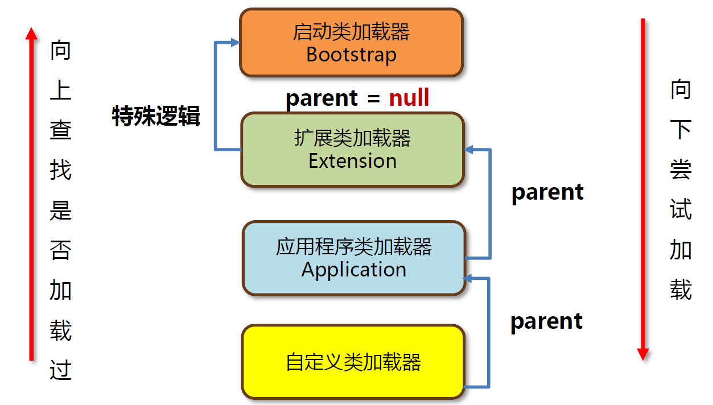

#### 打破双亲委派机制的方式？为什么要打破？怎么打破？

| 打破方式                                          | 如何打破（实现方式）                                         | 使用场景 / 示例                                    | 原因                                                         |
| ------------------------------------------------- | ------------------------------------------------------------ | -------------------------------------------------- | ------------------------------------------------------------ |
| 方式一：重写 `loadClass()` 方法                   | 在 `loadClass()` 中先尝试自己加载（调用 `findClass`），只有失败才交给父加载器 | Tomcat **热部署** 、Spring Boot DevTools 热重启    | - 自定义类需替换旧版本，父加载器已加载旧类无法卸载- 实现类热替换或快速开发重载 |
| 方式二：重写 `findClass()` 并配合 `defineClass()` | 手动读取 `.class` 字节码（可来自本地/网络/数据库），用 `defineClass()` 定义类 | 加密类加载器、远程类下载器、JSP动态编译类加载      | - 类文件非标准格式或经过加密/压缩，不能用默认加载器处理      |
| 方式三：自定义 ClassLoader 隔离加载多个版本类     | 为每个模块/插件使用不同 ClassLoader 实例，加载同名不同内容的类 | 插件系统（如 OSGi、IDEA 插件）、多版本依赖冲突隔离 | - 同一个类名需要加载多个版本（如不同插件依赖各自版本）       |
| 方式四：取消双亲委派（不调用 super.loadClass）    | 在 `loadClass()` 中完全不调用父加载器，自己加载所有类（极端方式） | 一般不推荐，仅用于完全隔离环境                     | - 完全独立运行环境，防止任何类泄露到父加载器中（如沙箱）     |

## 运行时数据区域

### 虚拟机栈

#### 栈帧的内容

局部变量表：字节码文件中的局部变量表的运行时状态。

操作数栈：表达式的计算和函数传参

帧数据：动态链接（保存了编号到运行时常量池的内存地址的映射关系），异常表，方法出口

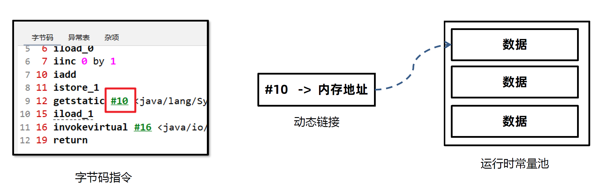

#### 局部变量表存的内容是什么？有什么需要注意的？

按槽位（slot）划分的线性表，用来存储**方法参数**和**方法体内定义的局部变量**，包括基本类型、对象引用、**this引用**（指向当前实例对象的引用）等。

注意：栈帧中的**槽位可以复用**、long 和 double 类型占两个槽位、静态方法没有 this。

字节码文件只是给变量分配好槽位，记录了槽位的编号，运行时放入局部变量表。

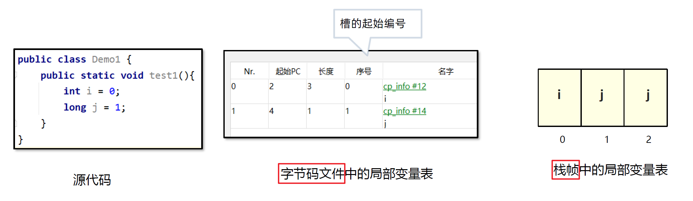

### 堆

#### 堆空间需要关注的三个值？

used、total默认1/64、max默认1/4

#### 堆中大致存着哪些内容？

| 内容类别                            | 说明                                                         |
| ----------------------------------- | ------------------------------------------------------------ |
| **对象实例（Object）**              | 所有通过 `new`、反射、克隆、反序列化等方式创建的对象         |
| **数组对象（Object[] / int[] 等）** | 包括基本类型数组和对象数组                                   |
| **对象字段值**                      | 对象的成员变量（包括引用和基本类型）也存储在堆中（除非被优化） |
| **内部类/匿名类对象**               | 包含外部类引用，也都存在堆中                                 |
| **线程共享对象**                    | 所有线程可见的对象存储在堆中，堆是线程共享的                 |
| **类的静态字段引用的对象**          | 静态变量本身存储在方法区，但其引用的对象仍在堆中             |
| **运行时常量池中引用的字符串实例**  | 比如 `ldc "abc"`，会创建堆中 `String` 对象（也可能被 `intern()` 进入字符串常量池） |

#### 堆中的class对象

当 JVM 加载某个类 `MyClass` 后，除了在元空间中记录类结构信息（字段、方法等），**它还会在堆中创建一个 `java.lang.Class<MyClass>` 实例**，供 Java 层使用。

| 类别                                          | 内容                                                         |
| --------------------------------------------- | ------------------------------------------------------------ |
| **类的基本信息**                              | 类名、包名、修饰符（public、final、abstract）                |
| **类的结构信息**                              | 字段、方法、构造器、父类、接口等反射对象                     |
| **类的 ClassLoader**                          | 加载这个类的类加载器                                         |
| **类的关联对象**                              | 对应的 `ClassLoader`、`ProtectionDomain`、`Module`、注解信息等 |
| **方法句柄缓存**                              | 用于反射或 MethodHandle 的性能优化                           |
| **类的状态信息**                              | 是否已经初始化、是否是接口、是否是数组类等                   |
| **Class 对象对应的 Class 实例的静态字段引用** | `static` 字段的值不是存在这个 Class 对象里，但可通过它访问   |
| **指向元空间中类元信息的引用（HotSpot）**     | `Class` 对象只是访问类元数据的入口，它本身并不包含全部结构信息 |

### 方法区

方法区是《 Java 虚拟机规范》 中设计的:star:**虚拟概念**，每款Java 虚拟机在实现上都各不相同。以Hotspot为例

JDK7及之前的版本将方法区存放在**堆**区域中的永久代空间，堆的大小由虚拟机参数来控制。

JDK8及之后的版本将方法区存放在**元空间**中，元空间位于操作系统维护的直接内存中，默认情况下只要不超过操作系统承受的上限，可以一直分配。

#### 方法区内容

| 内容                                     | 细分要点                                                     | 备注 / 常见误区                                              |
| ---------------------------------------- | ------------------------------------------------------------ | ------------------------------------------------------------ |
| **类元数据 (Class Metadata)**            | 类名、父类/接口、修饰符、字段表、方法表、v‑table 等          | HotSpot 对象是 `Klass/InstanceKlass` 结构，位于 Metaspace 的 Class Space |
| **运行时常量池 (Runtime Constant Pool)** | 字面量（数字、字符串）和符号引用解析后的指针句柄             | 只包含“常量池”本身；字符串常量对象放在 **Java 堆**           |
| **字段 & 方法描述符**                    | 每个字段/方法的签名、注解、属性表、偏移量、访问标记          | Java 反射依赖这些元数据                                      |
| **方法字节码**                           | `Code` 属性：指令序列、`max_stack`、`max_locals`、异常表、行号表等 | 仍保留在 Metaspace，供解释器回溯或 de‑opt                    |
| **方法 Profile 数据**                    | `MethodData*`：分支命中率、类型轮廓统计                      | C1/C2 JIT 做优化决策的重要依据                               |
| **已编译机器码 (Code Cache)**            | HotSpot JIT 生成的本地指令片段，按层级存放（Interpreter Stub、C1、C2、AOT 等区） | 逻辑上归属 Method Area；受 `ReservedCodeCacheSize` 限制      |

#### 运行时常量池和字符串常量池

JDK7之前，运行时常量池**包含**字符串常量池，JDK8之后字符串常量池还在堆中，运行时常量池跟着方法区去了元空间，也就是直接内存。

| 维度                   | 运行时常量池（Runtime Constant Pool）                        | 字符串常量池（String Intern Pool）                           |
| ---------------------- | ------------------------------------------------------------ | ------------------------------------------------------------ |
| **定义**               | 是 `.class` 文件中 `Constant Pool` 的运行时表现，是类或接口加载后创建的一部分 | 是 JVM 内部专门用于存放字符串字面量和 `String.intern()` 结果的一个池 |
| **存储内容**           | 各种符号引用（类、字段、方法）、数值常量、字符串字面量等     | 仅存储字符串对象（`java.lang.String` 的实例引用）            |
| **加载时机**           | 类加载时，由 class 文件中常量池复制或解析而来                | 字符串字面量在 class 加载时进入，`intern()` 字符串在调用时加入 |
| **作用域/归属**        | 每个类或接口有自己的常量池                                   | 是 JVM 级别共享的，全局唯一                                  |
| **使用目的**           | 支撑类的解析、字段/方法调用、常量值使用等                    | 提高字符串复用，减少内存开销                                 |
| **存储位置（JDK 8+）** | 方法区（元空间的一部分）                                     | 堆（Heap）中有一块区域专门用于存储字符串常量池               |
| **可以动态添加吗？**   | 不可以（JVM 在加载类时就决定了）                             | 可以，通过调用 `String.intern()` 方法手动加入                |

### 直接内存

#### 直接内存的作用

Java 堆中的对象如果不再使用要回收，回收时会影响对象的创建和使用。

IO 操作比如读文件，需要先把文件读入直接内存（缓冲区）再把数据复制到Java 堆中。

元空间（方法区）在8之后存在直接内存。

### 其他

#### 不同变量的存储位置

| 变量/常量类型                                               | **值的实际存储位置**                                         | 说明                                                         |
| ----------------------------------------------------------- | ------------------------------------------------------------ | ------------------------------------------------------------ |
| **静态变量 `static`**                                       | **Java 堆**——加载类时创建的 `java.lang.Class` *mirror* 对象里 | “值区”随类初始化写入；随 Class 对象被 GC 回收（通常和类加载器一起卸载） |
| **实例变量（非 static）**                                   | Java 堆中对应实例对象的字段区                                | 每个对象都有一份；随实例对象生命周期消亡                     |
| **局部变量（方法体内的普通变量）**                          | **线程私有** Java 虚拟机栈 → 当前栈帧的 *局部变量表*         | 方法调用时分配，方法返回或异常退出即失效                     |
| **方法参数**                                                | 同局部变量，属于栈帧里的 *局部变量表*                        | JVM 把参数先按槽位压入局部变量表；之后与普通局部变量无区别   |
| **引用变量**                                                | **引用本身** 在栈（局部变量表）或堆（对象字段）里；**所指对象** 在 Java 堆 | “引用≠对象”；GC 先从引用出发遍历                             |
| **编译期常量（`static final` 且基本类型/`String` 字面量）** | - 若被内联：直接写入字节码，无运行时存储- 否则仍在 Java 堆的 Class mirror 内 | `ldc` 指令把常量值从 **运行时常量池** 读取到操作数栈；但真正的常量对象（如 `String`）是普通 Java 对象 |

#### 内存溢出

1. **堆内存溢出**
    当抛出 `java.lang.OutOfMemoryError: Java heap space` 时，就意味着堆内存耗尽。常见原因是：
   - 代码中大量对象分配、释放不及时
   - 内存泄漏导致 GC 多次回收后仍找不到足够大的连续空间来存放新对象
2. **栈溢出**
    若程序不断递归调用且没有终止条件，会无限次压栈，最终抛出 `StackOverflowError`。
    如果 JVM 试图扩展栈空间但失败，也可能直接抛出 `OutOfMemoryError`。
3. **元空间溢出**
    抛出 `java.lang.OutOfMemoryError: Metaspace` 时表示元空间不足。常见原因：
   - 系统代码量过大
   - 引用的第三方包众多
   - 运行时大量动态生成 / 加载类，导致元空间占用激增
4. **直接内存溢出**
    使用 `ByteBuffer.allocateDirect()`（大量 Java NIO / Netty 框架封装该方法）时，若直接内存耗尽，会抛出 `java.lang.OutOfMemoryError: Direct buffer memory`。

## 垃圾回收

### 介绍

#### HotSpot 虚拟机对象的访问方式

句柄：如果使用句柄的话，那么 Java 堆中将会划分出一块内存来作为句柄池，reference 中存储的就是对象的句柄地址，而句柄中包含了对象实例数据与对象类型数据各自的具体地址信息。

直接指针：如果使用直接指针访问，reference 中存储的直接就是对象的地址。

#### 不同数据区域如何回收

- **线程不共享：**随着线程的结束而消亡，比如栈，PC。

- **方法区的回收：**回收主要内容是不再使用的类。判定条件：1. 实例对象都回收。2. 类加载器已回收。3. 堆中的java.lang.Class对象没被引用。主动触发方法区回收：System.gc()

- **堆回收：**主要回收对象，是否**被引用**决定是否回收。

### 引用

#### 如何判断堆上的对象是否被引用？

| 项目               | 引用计数法                           | 可达性分析法                       |
| ------------------ | ------------------------------------ | ---------------------------------- |
| **原理**           | 给对象添加引用计数器，引用+1，释放-1 | 从“GC Roots”出发，遍历可达对象     |
| **优点**           | 实现简单，对象引用关系变化时立即生效 | 能处理复杂引用关系（如循环引用）   |
| **缺点**           | 无法处理**循环引用**，维护计数器     | 实现复杂，**需停顿**应用遍历对象图 |
| **代表语言/场景**  | Python、Objective-C等                | Java、C#等使用 JVM/.NET 的语言     |
| **是否常用于 JVM** | 否（因无法处理循环引用）             | 是（JVM 垃圾回收的主流方式）       |

**垃圾回收的根对象GC Roots**：包括虚拟机栈中的引用、方法区中静态字段和常量、正在执行的线程、本地方法引用及类加载器等一切被 JVM 直接引用的对象。

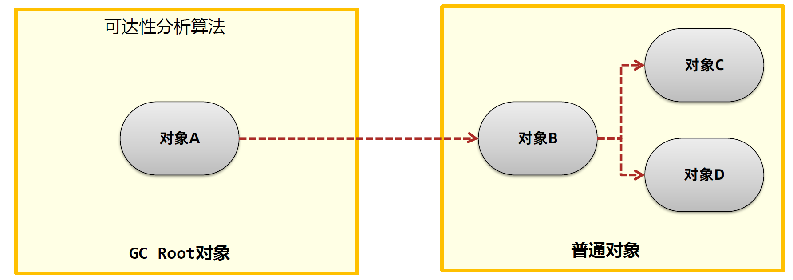

#### 有哪几种对象引用？

| 引用类型   | 类名                             | 是否会被 GC 回收                             | 常用场景说明                                 |
| ---------- | -------------------------------- | -------------------------------------------- | -------------------------------------------- |
| **强引用** | 普通对象引用（如 `new` 出来的）  | **不会被 GC 回收**                           | 默认引用方式，如 `Object obj = new Object()` |
| **软引用** | `java.lang.ref.SoftReference`    | **内存不足时会被回收**                       | **缓存**（如图片缓存），内存吃紧时自动清理   |
| **弱引用** | `java.lang.ref.WeakReference`    | **下一次 GC 就会回收**                       | ThreadLocal 的底层实现、Map 的缓存机制等     |
| **虚引用** | `java.lang.ref.PhantomReference` | **随时可被回收**（几乎无法通过引用获取对象） | 跟踪对象回收状态，配合 `ReferenceQueue` 使用 |

### 垃圾回收算法

#### 垃圾回收算法的评价指标？

垃圾回收过程会通过单独的GC线程来完成。指标：吞吐量、最大暂停时间（指Stop The World的值）、堆使用效率。

#### 垃圾回收算法有哪几种？

| 算法名称          | 基本原理                                                     | 优点                             | 缺点                   | 应用场景                            |
| ----------------- | ------------------------------------------------------------ | -------------------------------- | ---------------------- | ----------------------------------- |
| **标记-清除算法** | 首先标记所有存活对象，然后清除未标记对象                     | 实现简单                         | 会产生**内存碎片**     | 老年代早期 GC 实现                  |
| **复制算法**      | 将内存一分为二，每次只用一半，存活对象复制到另一块再清空当前 | 没有内存碎片，**效率高**         | 内存浪费（只能用一半） | 新生代（大部分对象朝生夕灭）        |
| **标记-整理算法** | 改进标记清除算法，标记后不清除，而是**移动存活对象**并压缩空间 | 无内存碎片，适合**长期存活对象** | 移动对象，开销较大     | 老年代（存活对象多、碎片多）        |
| **分代收集算法**  | 根据对象生命周期分为新生代、老年代，分别采用不同 GC 策略     | 综合各算法优点，性能优化最佳     | 实现复杂               | JVM **主流算法**（如 HotSpot 使用） |

复制算法用于新生代，因为新生代大多数对象都会失效，复制算法更快，更稳，**顺带可以完成晋升**。

#### 分代回收算法

- 创建出来的对象，首先会被放入Eden伊甸园区。

- 随着对象在Eden区越来越多，如果Eden 区满，新创建的对象已经无法放入，就会触发年轻代的GC，称为Minor GC 或者Young GC。

- Minor GC：会把需要eden 中和From 需要回收的对象回收，把没有回收的对象放入To 区。

- 接下来，S0会变成To区，S1变成From区。当eden区满时再往里放入对象，依然会发生Minor GC 。此时会回收eden 区和S1(from) 中的对象，并把eden 和from 区中剩余的对象放入S0 。
- 每次Minor GC 中都会为对象记录他的年龄，初始值为0，每次GC 完加1 。如果Minor GC 后对象的年龄达到阈值（最大15，默认值和垃圾回收器有关），对象就会被晋升至老年代。
- 当老年代中空间不足，无法放入新的对象时，先尝试Minor gc 如果还是不足，就会触发Full GC，Full GC会对整个堆进行垃圾回收，使用的是标记算法。如果Full GC依然无法回收掉老年代的对象，那么当对象继续放入老年代时，就会抛出Out Of Memory 异常。
- 以上可以看出**年轻用复制算法，老年用标记整理算法**。

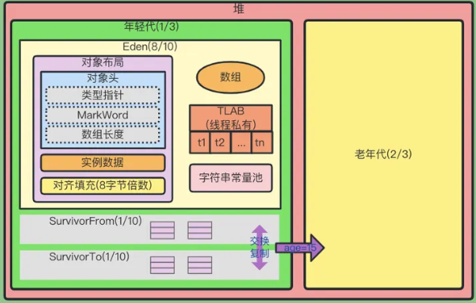

### 垃圾回收器

#### 垃圾回收器有哪些？

| 类型         | 回收器名称                     | 简介与特点                                                   |
| ------------ | ------------------------------ | ------------------------------------------------------------ |
| **年轻代**   | `Serial`                       | 单线程，简单高效，适用于单核/小堆场景                        |
|              | `ParNew`                       | 多线程版 Serial，常与 CMS 搭配使用                           |
|              | `Parallel Scavenge`            | 吞吐量优先，适用于后台运算或批处理类应用                     |
| **老年代**   | `Serial Old`                   | Serial 的老年代版本，单线程，常与 Client 模式搭配            |
|              | `Parallel Old`                 | Parallel Scavenge 的老年代版本，注重吞吐量                   |
|              | `CMS（Concurrent Mark Sweep）` | 并发低停顿，适用于对响应时间敏感的场景（已被 G1 取代）       |
| **混合型**   | `G1（Garbage First）`          | **JDK 9+ 默认**，按 Region 划分内存，能回收年轻代和老年代，低停顿 |
| **前沿技术** | `ZGC`                          | 超低延迟（<10ms），适用于大内存场景（支持 TB 级别堆）        |
|              | `Shenandoah`                   | 与 ZGC 类似，支持更早的 JDK 版本（由 RedHat 提供）           |
|              | `GraalVM（不是 GC）`           | 高性能多语言虚拟机，支持新型 GC 策略，但本身不是垃圾回收器   |

除了G1，其他的回收器都需要搭配使用。

####  HotSpot为什么要分新生代和老年代？

新生代中，每次收集都会有大量对象死去，所以可以选择“复制”算法，只需要付出少量对象的复制成本就可以完成每次垃圾收集。而老年代的对象存活几率是比较高的，而且没有额外的空间对它进行分配担保，所以我们必须选择“标记-清除”或“标记-整理”算法进行垃圾收集。

#### HotSpot VM 对GC的实现

部分收集 (Partial GC)：

- 新生代收集（Minor GC / Young GC）：只对新生代进行垃圾收集；
- 老年代收集（Major GC / Old GC）：只对老年代进行垃圾收集。需要注意的是 Major GC 在有的语境中也用于指代整堆收集；
- 混合收集（Mixed GC）：对整个新生代和部分老年代进行垃圾收集。

整堆收集 (Full GC)：收集整个 Java 堆和方法区。

#### JDK1.8 默认

更关注CPU效率

使用的是 Parallel Scavenge + Parallel Old

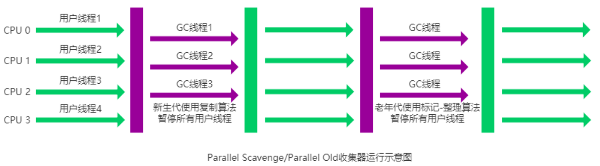

#### CMS

STW更短，更关注用户体验

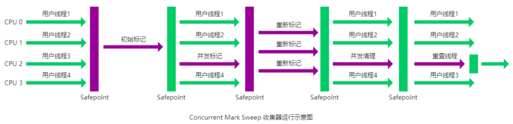

#### ZGC

**超低停顿、并发压缩、区域化管理、读屏障 + 彩色指针、（JDK21 起）支持分代。**

目标是让 **STW 暂停≈与堆大小无关**（常见个位数毫秒量级），同时把**整理/压缩**也放到并发阶段完成。

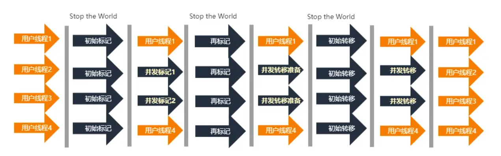

### G1回收器

#### 年轻代回收（Young GC）

回收Eden 区和Survivor 区中不用的对象。会导致STW，G1 中可以通过参数

使用**复制**算法。

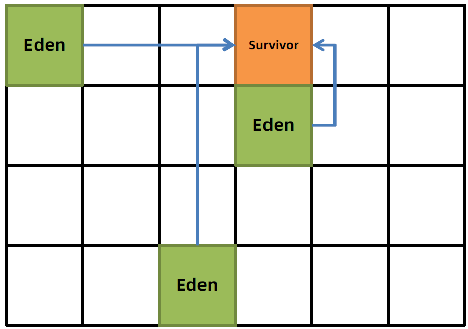

#### 混合回收（Mixed GC）

初始标记（Initial Mark）

- 只标记从 GC Roots 可达的对象（如栈中引用）
- 会有一次短暂停顿（STW）

并发标记（Concurrent Mark）

- 与应用线程同时运行
- 遍历整个堆中对象，找到可达对象
- 不影响程序执行效率

最终标记（Remark）

- 再次 STW，对并发期间发生变化的对象进行处理（例如新创建或引用变动）
- 使用 SATB（Snapshot At The Beginning）算法优化效率

筛选回收（Cleanup / Evacuation）

- 根据回收收益估算，选择性回收某些 Region
- 将存活对象**复制**到新的 Region，并压缩碎片，提升内存连续性

优先选择回收价值最大的 Region(这也就是它的名字 Garbage-First 的由来）

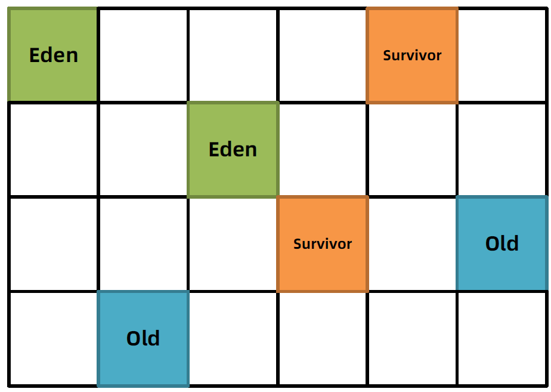

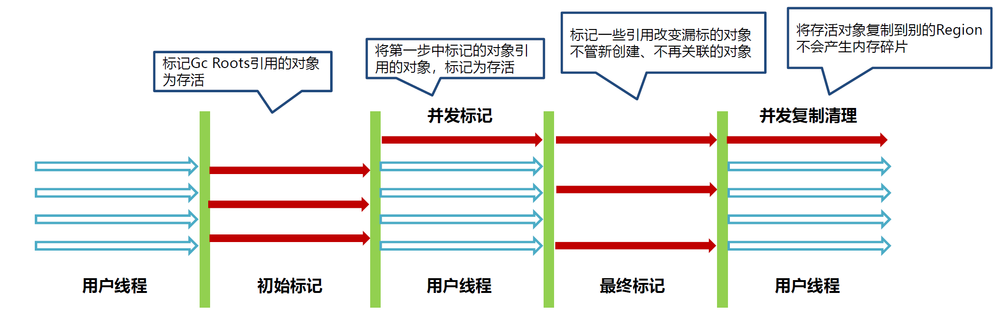

#### FULL GC

如果清理过程中发现没有足够的空Region 存放转移的对象，会出现Full GC 。单线程执行**标记整理**算法，此时会导致用户线程的暂停。

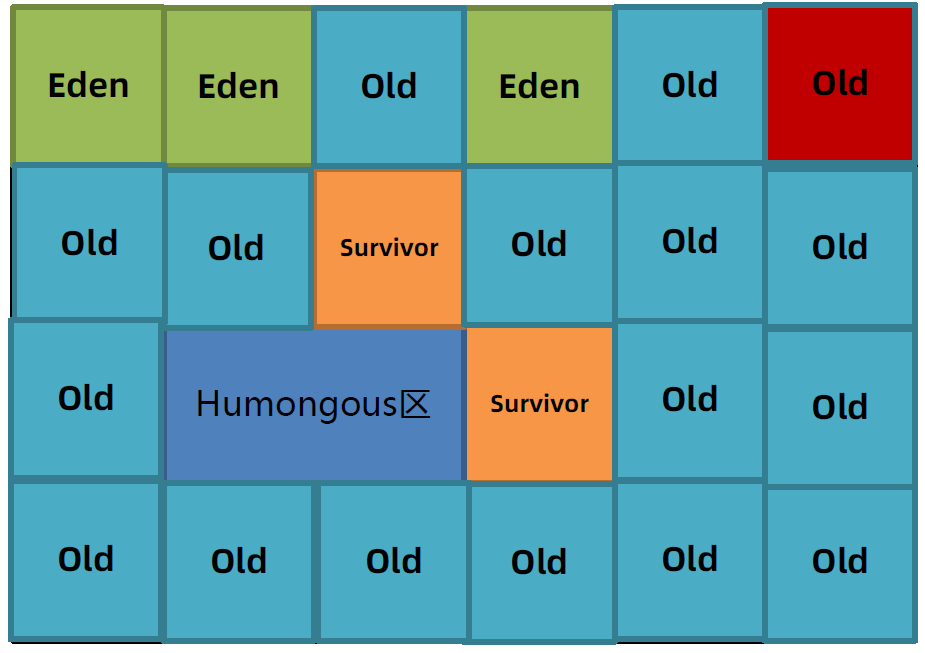
