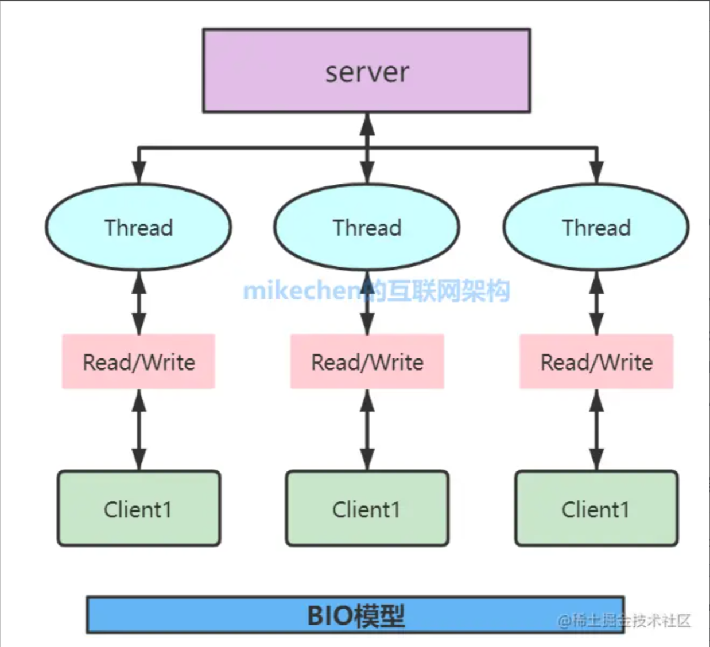
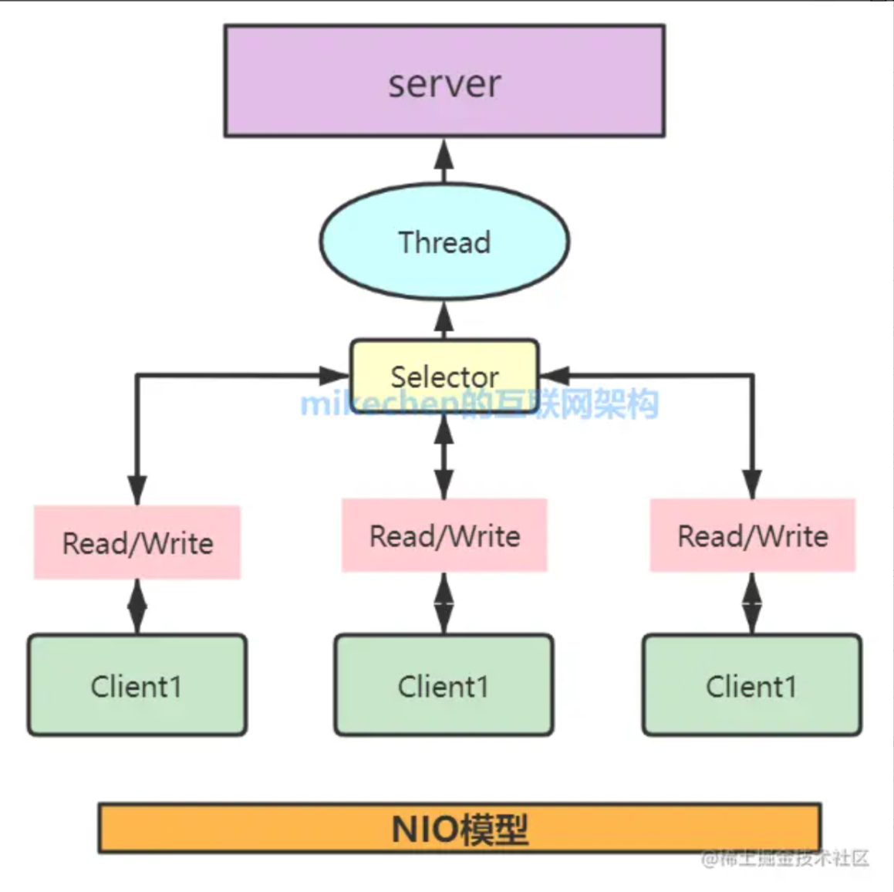

### JIT

长生命周期服务，大量动态特性，吞吐优先，复杂GC的情况下JIT适合。

###  AOT(Ahead of Time Compilation)

这种编译模式会在程序被执行前就将其编译成机器码，属于静态编译（C、 C++，Rust，Go 等语言就是静态编译）。AOT 避免了 JIT 预热等各方面的开销，可以提高 Java 程序的启动速度，避免预热时间长。并且，AOT 还能减少内存占用和增强 Java 程序的安全性（AOT 编译后的代码不容易被反编译和修改），特别适合云原生场景。

极快启动，冷启动频繁；小内存，高密度部署；短任务批处理；可以考虑使用AOT。

要在生产里做 Java 的 AOT 原生化，通常选 **GraalVM Native Image**（或 Mandrel/NIK 这类发行）。

### 包装类型的优点

空值/缺省，支持泛型，内部方法，实现接口，不可变

### 多态有哪些体现

> 多态（polymorphism）就是**同一接口/同一操作在不同类型的对象上表现出不同的实现与行为**。

方法重写，运行时动态分配

方法重载，编译期动态分配

参数多态，泛型

自动提升/装箱拆箱/显式强转

### 抽象类和接口区别

> 回答思路：设计思想 --> 语法（相同点、不同点）

**设计思想**

抽象类：对类的整体的抽象，共性的状态，共性的方法（类似设计模式中的模板方法）。

接口：对类的局部行为的抽象。

**相同点**

不能实例化，抽象方法（无方法体的方法）必须实现。

**不同点**

接口：多继承

抽象类：新增方法/字段并不破坏子类

```java
abstract class Animal {
    protected String name;

    public Animal(String name) {
        this.name = name;
    }

    public abstract void makeSound(); // 抽象方法

    public void sleep() {             // 普通方法
        System.out.println(name + " is sleeping...");
    }
}
```

```java
interface USB {
    // 不可以有构造方法
    void connect();  // 抽象方法

    default void status() { // Java 8+ 默认方法
        System.out.println("USB device is active");
    }
}
```

### 实现深拷贝的三种方法

- 实现Cloneable接口，重写protect clone()方法。如果调用了super.clone()，其父类必须实现Cloneable接口，否则抛异常。
- 构造函数手动拷贝（适用于定制拷贝逻辑）
- 序列化法（通用但性能开销大）

### 泛型

优点

数据类型不同，但是代码相同。约束类型，不用强转。

泛型提升可读性与复用性。

原理

实现依赖编译期检查 + 类型擦除。

### 注解

https://pdai.tech/md/java/basic/java-basic-x-annotation.html

注解也叫声明式接口，按作用范围分为：源码级别，类文件级别，运行时。注解解析的底层实现主要依赖于 Java 的反射机制和字节码文件的存储。

原理：元数据是由**反射**读取的，而注解实例是用 JDK **动态代理**实现

1. **编译期/类文件**：`@interface` 被编译成一个接口（`interface X extends java.lang.annotation.Annotation`），注解数据写入 classfile（取决于 `@Retention`）。

2. **读取（反射）**：当你调用 `Class.getAnnotations()` / `getDeclaredAnnotations()` 等，反射层负责解析 classfile 中的注解属性并把这些元数据取出——这一步是**反射/类加载与 classfile 解析**负责的。

3. **实例化（动态代理）**：反射层为了把注解以“对象”形式返回，会用 `Proxy.newProxyInstance(...)` 创建一个代理实例，这个代理实现注解接口（和 `Annotation`），由 `AnnotationInvocationHandler`（或框架自定义 handler）保存成员名→值 的映射并在被调用时返回值。

4. **调用注解方法**：调用注解的方法（比如 `a.value()`）其实是走代理的 `InvocationHandler.invoke(...)`，handler 从内部 map 返回对应值，或者实现 `equals/hashCode/toString` 等语义。

### 重载与重写

重写是指子类用相同方法签名覆盖父类方法，实现多态。

:star:重写是运行期多态

```java
class A { void hi(){ System.out.println("A"); } }
class B extends A { @Override void hi(){ System.out.println("B"); } }

A x = new B();   // 引用是 A，真实对象是 B
x.hi();          // 输出 B   ← 运行期由“真实类型 B”决定
```

:star:重载是编译期绑定

```java
void f(Object o){ System.out.println("Object"); }
void f(String s){ System.out.println("String"); }

Object s = "hi";   // 静态类型是 Object，值是一个 String
f(s);              // 输出 Object  ← 编译期已选定 f(Object)
f("hi");           // 输出 String  ← 字面量静态类型是 String
```

### 重写equals() 的作用

| 目标                     | 说明                                                         |
| ------------------------ | ------------------------------------------------------------ |
| **逻辑相等**             | 让“业务认为相同”的两个对象返回 `true`。上例中，不同实例但 `id` 相同即可视为同一人。 |
| **覆盖 `Object.equals`** | `Object` 默认是“==”（引用相等）；大多数实体类需要按业务字段比较。 |
| **集合查找**             | `List.contains`、`Set.remove` 等都依赖 `equals` 判断目标元素。 |

### 重写hashCode()有什么用？

如果要让对象能正确地参与哈希结构（如 HashMap、HashSet、Hashtable），**必须重写 `hashCode()` 和 `equals()` 方法**，否则会导致数据查找、删除、去重失败或异常。`hashCode()` 方法的本质，就是**对对象进行“哈希运算”，返回一个 `int` 整数**，这个整数就是对象的“哈希码”或者“哈希值”。

### lambda表达式？

Java中的lambda表达式（Lambda Expression）是对函数式接口（Functional Interface）的一种简洁替代写法，它是用来实现函数式接口的匿名函数形式。

- **函数式接口**：只包含一个抽象方法的接口，用于表示一个函数（行为）。

  ```java
  @FunctionalInterface
  interface MyFunction {
      void apply();
  }
  ```

- **lambda表达式**：是该接口的一个实现方式，**可以替代匿名内部类**来实现函数式接口。

  ```java
  // 传统匿名内部类写法
  MyFunction f = new MyFunction() {
      @Override
      public void apply() {
          System.out.println("Hello");
      }
  };
  
  // lambda表达式写法
  MyFunction f = () -> System.out.println("Hello");
  ```


### Java I/O 模型

https://juejin.cn/post/7121354128067919886

#### 1. BIO

- **每个请求对应一个线程**。
- I/O 操作是阻塞的：当线程进行读/写操作时会阻塞，直到数据准备好。



特点：

- 编程简单。
- 适合连接数少、数据量小的场景。
- 并发连接多时，资源消耗大，性能差。
```java
ServerSocket serverSocket = new ServerSocket(8080);
Socket socket = serverSocket.accept(); // 阻塞
InputStream in = socket.getInputStream();
in.read(); // 阻塞
```

#### 2. NIO:star:

https://juejin.cn/post/6844903519913246734?from=search-suggest

**Java NIO** 是基于 **Channel / Buffer / Selector** 的**就绪事件驱动（Reactor）模型**：把 socket 设为**非阻塞**，由 **Selector** 调用底层 OS 的**多路复用**（Linux epoll、BSD kqueue、Windows 的对应实现）一次等待**成百上千连接的就绪事件**；应用线程拿到事件后再执行读写。相比 BIO 的“一个连接一个线程”，NIO 用更少线程、低上下文切换来支撑**高并发长连接**；相比 AIO（NIO.2）的完成通知模型，NIO 更通用、生态更成熟（如 Netty）。



特点：

- 更高的并发能力。
- 编程复杂（需要手动管理通道状态、缓冲区等）。
- 应用于高性能网络服务，如 Netty。

```java
Selector selector = Selector.open();
ServerSocketChannel serverChannel = ServerSocketChannel.open();
serverChannel.configureBlocking(false);
serverChannel.register(selector, SelectionKey.OP_ACCEPT);

while (true) {
    selector.select(); // 阻塞，直到有事件发生
    Set<SelectionKey> keys = selector.selectedKeys();
    for (SelectionKey key : keys) {
        if (key.isAcceptable()) {
            // 接收连接
        } else if (key.isReadable()) {
            // 读取数据
        }
    }
}
```

服务端收到消息的过程：

```
客户端发送消息
      ↓
操作系统内核 Socket 接收缓冲区
      ↓
底层 socket / fd 变成“可读状态”
      ↓
Selector 监听到这个 Channel 可读
      ↓
Java 线程拿到 OP_READ 事件
      ↓
channel.read(javaBuffer)
      ↓
数据从内核缓冲区读取到 Java ByteBuffer
      ↓
业务代码从 ByteBuffer 读取数据
```

零拷贝：Java NIO 中的零拷贝主要是为了减少数据在内核态和用户态之间的重复拷贝。比如传统的文件网络发送，需要先把文件数据从内核缓冲区拷贝到 Java 用户态 Buffer，再从用户态 Buffer 拷贝回 Socket 的内核缓冲区。而通过 `FileChannel.transferTo()` 等方式，底层可以利用 Linux 的 `sendfile` 等机制，让数据主要在内核中完成文件到网络的传输，从而避免经过 Java 用户态 Buffer，减少 CPU 拷贝和上下文切换，提高大文件传输效率。

#### 3. AIO

- 全异步非阻塞，基于 **操作系统的异步IO能力**（需要底层支持，如 Linux epoll + aio）。
- 读写操作注册回调函数，完成后系统自动通知。

特点：

- 更高并发，适合 I/O 密集型应用。
- 回调式编程，逻辑分散，维护复杂。
- Java 7 引入（`AsynchronousSocketChannel`），应用少于 NIO。

```java
AsynchronousServerSocketChannel server = AsynchronousServerSocketChannel.open()
    .bind(new InetSocketAddress(8080));

server.accept(null, new CompletionHandler<AsynchronousSocketChannel, Void>() {
    @Override
    public void completed(AsynchronousSocketChannel result, Void attachment) {
        ByteBuffer buffer = ByteBuffer.allocate(1024);
        result.read(buffer, buffer, new CompletionHandler<Integer, ByteBuffer>() {
            @Override
            public void completed(Integer bytesRead, ByteBuffer buf) {
                // 处理数据
            }
            public void failed(Throwable exc, ByteBuffer attachment) {}
        });
        server.accept(null, this); // 再次监听
    }

    @Override
    public void failed(Throwable exc, Void attachment) {}
});
```


### 匿名内部类

内部类，匿名内部类

- **继承类**：匿名内部类 → 该类的子类。

- **实现接口**：匿名内部类 → `Object` 的子类 + 实现该接口。

```java
// ① 继承类
Thread t = new Thread("worker") {          // 传入父类构造参数
    @Override
    public void run() {
        System.out.println("anonymous subclass of Thread");
    }
};
t.start();

// ② 实现接口
Runnable task = new Runnable() {
    @Override
    public void run() {
        System.out.println("anonymous implementation of Runnable");
    }
};
new Thread(task).start();
```

### 异常

#### Error

> JVM 层面的致命问题

例如 `OutOfMemoryError`、`StackOverflowError`、`NoClassDefFoundError`、`LinkageError`、`ExceptionInInitializerError`。通常不要捕获，让程序失败更安全。

#### Exception

> 应用级问题，可（也应该）由程序处理。

受检异常 Checked = 可预期且“有望恢复”的情形

典型是外部环境导致的问题：I/O、网络、文件缺失、权限不足、并发取消信号（`InterruptedException`）。调用者有办法（或至少有信息）做出补救或降级：重试、备用方案、提示用户、回滚等。

编译器强制要求 `throws` 或 `try-catch`。如 `IOException`、`SQLException`、`ClassNotFoundException`、`TimeoutException (j.u.concurrent)`。

非受检异常 Unchecked = 编程错误或不可恢复

编程错误/契约被破坏：前置条件不满足、非法参数、对象状态非法、越界、空指针等 → `RuntimeException`。调用点通常无合理恢复手段，应当修代码。无需声明。多为编程错误或不变式被破坏。如 `NullPointerException`、`IllegalArgumentException`、`IllegalStateException`、`IndexOutOfBoundsException`、`ClassCastException`、`ArithmeticException`、`UnsupportedOperationException`、`ConcurrentModificationException`。

JVM/系统级致命问题：`Error`，几乎不应捕获，捕获也多半仅用于紧急清理或记录。

### 代理模式

JavaGuide写的不错。

静态代理：代理对象通常和真实对象实现同一个接口，然后代理对象内部**持有真实对象**，再把调用转发过去。

动态代理：从 JVM 角度来说，动态代理是在运行时动态生成类字节码，并加载到 JVM 中的。JDK代理，cglib代理

**CGLIB** 的全称是 **Code Generation Library**。

它是一个基于 ASM 的字节码生成库，常用于通过**继承子类**的方式创建动态代理（Spring 在无法用 JDK 接口代理时就会用它）。

### 序列化

#### 什么时候需要序列化

1. **跨进程/跨机器传输**

- 微服务调用（HTTP/REST 的 JSON、gRPC 的 Protobuf、Dubbo 的 Hessian/Protobuf 等）。
- RPC/RMI、WebSocket、Netty 协议、自定义二进制协议。
- 消息队列（Kafka/RabbitMQ/RocketMQ 的生产者序列化、消费者反序列化）。

2. **持久化或缓存**

- 写入磁盘文件（快照、检查点、离线任务结果）。
- 分布式缓存/会话（Redis/Memcached/Spring Cache、Spring Session）。
- 数据落地非关系存储（如对象直接存到对象存储/Blob），启动时再恢复。

3. **分布式/并行计算把代码与数据“运过去”**

- Spark/Flink 等把闭包、函数、数据分片**序列化**后发送到远端执行，返回时**反序列化**结果。

4. **容器/中间件要求**

- `HttpSession` 复制/钝化（集群会话迁移要求属性 `Serializable`）。
- JMS `ObjectMessage`、Java RMI、部分安全框架的 Remember-Me 票据等。

5. **（少见）深拷贝/快照**

- 用序列化做“深拷贝”或对象状态快照（可行但**不推荐做热路径**方案）。

### 反射

定义

在运行期获取并操作程序“元数据”（类、构造器、字段、方法、注解）的能力，从而在不预先固定具体类型的情况下，动态地创建对象、读写字段、调用方法与读取注解。

本质是**运行时通过 `Class` 对象访问 JVM 中类的元数据，并通过本地/底层机制动态执行或修改类的行为**

使用场景：当类型/方法在编译期不确定，但运行期需要“按名字/注解/约定”去发现、实例化、调用、装配时，就会用到反射。

**IoC/DI 容器**（如 Spring）：按类型/注解扫描 bean，构造实例，注入字段/调用 `@PostConstruct`。

**AOP / 拦截器 / RPC**：用动态代理在调用前后织入逻辑、做远程桩/stub。

**Web 框架路由与绑定**：扫描 `@Controller/@RequestMapping`，把请求参数绑定到方法参数。

**ORM/序列化**：字段—列的映射（JPA/Hibernate），JSON/XML 序列化（Jackson/Gson/Fastjson）。

**插件/SPI 机制**：`ServiceLoader` 或自定义 ClassLoader 动态发现与加载实现。

**测试与工具**：JUnit、Mock 框架、Bean 拷贝、对象 diff/mapper、校验框架（如 `@NotNull`）。

**JDBC 驱动初始化**：经典的Class.forName("com.mysql.cj.jdbc.Driver")（早期尤其常见）。

