# 基础

MySql实战45讲：https://jums.gitbook.io/mysql-shi-zhan-45-jiang/

## 执行select语句过程

一共两层，server层和引擎层

server层：连接器、查询缓存、查询解析（语法树，查询改写）、查询优化（索引，连接顺序）、查询执行（排序，物化）

引擎层：数据存储和提取

1. 连接与会话初始化

- TCP 建连 / 线程分配（或线程池插件）
- 认证与权限检查、会话变量（autocommit、隔离级别等）初始化

2. 查询缓存：只有查询语句会经过

3. 语法解析 & 预处理（SQL 层）

- 词法/语法解析 → 抽象语法树（AST）
- 预处理：名称解析、权限校验、类型检查、常量折叠、视图/子查询展开

4. 优化器（CBO 为主，辅以规则优化）

- 逻辑优化：谓词下推、投影裁剪、子查询去相关/合并派生表等
- 统计信息：表/索引基数、直方图等
- 物理计划选择：访问路径（全表/索引、range/ref/index_merge/覆盖索引）、连接顺序与算法（NLJ、BKA、Hash Join）、是否用临时表与外部排序
- 产出执行计划（EXPLAIN 可见）

5. 执行器（Server 层）

- 打开表，获取MDL（元数据锁，读/写）
- 建立执行上下文，按计划迭代“拉取”记录：
  - 过滤、投影、JOIN、GROUP BY/聚合、ORDER BY（可能 filesort）、去重、LIMIT
- 需要时建立临时表（内存/磁盘）

6. 访问存储引擎（InnoDB 例）

- 通过 handler API 访问页：先看Buffer Pool，不在则读盘并加入 LRU
- 二级索引回表、覆盖索引可避免回表
- 自适应哈希索引（AHI）可能命中
- 二级索引变更可能用 Change Buffer（插入/更新场景）

7. 并发控制与事务日志

- 一致性读（MVCC）：SELECT 在 RR/RC 下读 Undo 版本，避免加锁
- 加锁读/写：行锁、间隙锁、Next-Key；死锁检测与回滚
- 生成 Undo（回滚与快照）、写 Redo Log Buffer（物理日志）
- Server 层写 Binlog（逻辑/行日志，用于复制）
- **两阶段提交（2PC）**：redo prepare → 写 binlog → redo commit（原子性 & 复制一致）

8. 刷脏与落盘（异步为主）

- 刷 Redo（组提交）、Checkpoint 推进
- 脏页刷盘（Flush List），双写缓冲（Doublewrite）保证页一致性

9. 事务结束与资源回收

- autocommit=1：语句级事务自动提交；否则等待显式 COMMIT/ROLLBACK
- 释放行锁/MDL，关闭临时表/游标，回收执行上下文

10. 结果返回

- 先返回列元数据，再按行流式返回；客户端读取完成


## 存储结构

>  与操作系统的用户段、簇、页、数据项正好对应

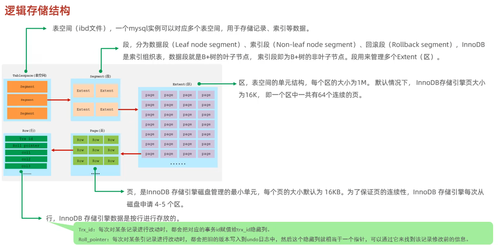

### InnoDB一张表对应的文件

MySQL 8.0（默认 `innodb_file_per_table=ON`）
 一张表通常对应 2 个文件：

- `xxx.ibd`：该表的数据与索引
- `xxx.sdi`：序列化的元数据副本（用于可搬运表空间）；表的元数据主体在内部数据字典中，不再有 `.frm`

MySQL 5.6/5.7 且 `innodb_file_per_table=ON`
 一张表通常对应 2 个文件：

- `xxx.frm`：表结构定义
- `xxx.ibd`：该表的数据与索引

### .ibd文件结构

分段：就像是操作系统中的分段，不同功能分成不同的段

分区：为了磁盘顺序IO，提升局部性，减少碎片。

分页：缓冲池以页为单位做读写与替换

### 聚簇索引和数据页

聚簇索引和数据作为一个整体存放，InnoDB必须使用聚簇索引。

每个B+树节点就是一个数据页。

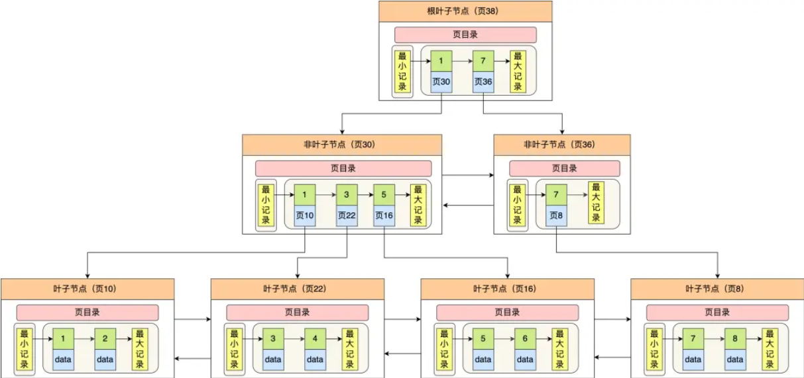

数据页整体格式

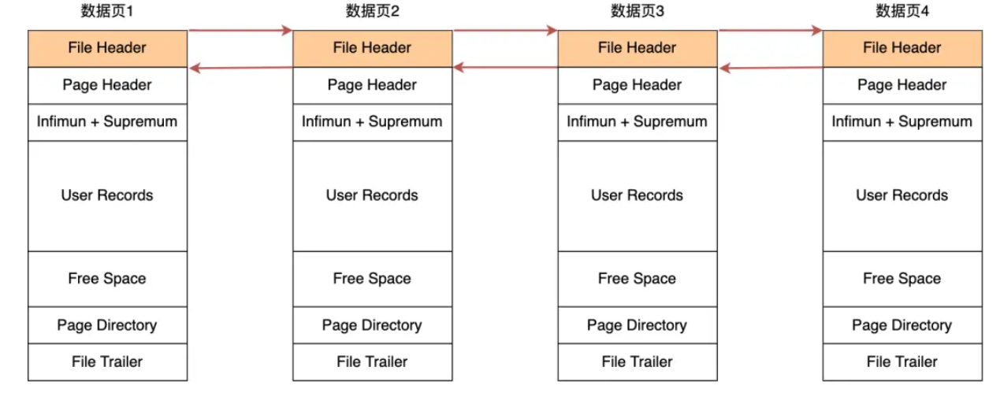

数据页具体记录的组织格式

分组，每个槽索引组的最大记录，组件二分，组内顺序。

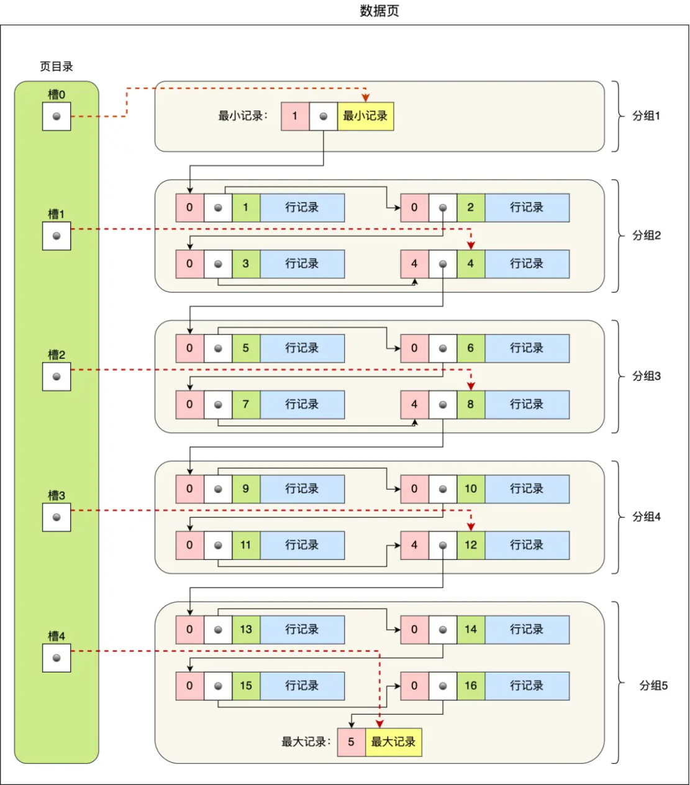

### Compact格式的记录

紧凑格式

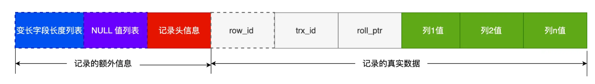

举例说明变长和null

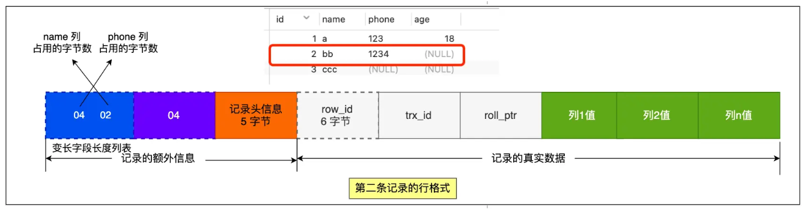

# SQL语法

### SQL语言分类

- **DDL**（数据定义语言）：定义或修改数据库结构，例如 `CREATE`、`ALTER`、`DROP` 等。
- **DML**（数据操作语言）：操作表数据，例如 `INSERT`、`UPDATE`、`DELETE` 等。
- **DQL**（数据查询语言）：查询数据，例如 `SELECT` 语句。
- **DCL**（数据控制语言）：定义数据访问权限，例如 `GRANT`、`REVOKE` 等。

### 关键字示例

- `DESC` / `DESCRIBE`：查看表结构的命令。
- `TRUNCATE`：删除表中所有数据但保留表结构的 DDL 语句（名称源自拉丁语“切割”）。
- *schema*：在 MySQL 中 schema 等同于 database，两者可以互换使用。
- `ASC` 表示升序（ascending），`DESC` 表示降序（descending）。

### DQL 执行顺序

:star:执行顺序：FROM(join) -> WHERE -> GROUP BY -> HAVING -> SELECT -> ORDER BY -> LIMIT

# 函数

### 字符串函数

concat()、substr()、字节数length()、字符数char_length() 、lower/upper

### 数值函数

`ABS()`、`CEIL()`、`FLOOR()`、`MOD()` 等。

### 聚合函数

如果使用了group by则对分组结果起作用，否则对整张表起作用。

COUNT/SUM/AVG/MIN/MAX/GROUP_CONCAT/JSON_ARRAYAGG

```mysql
avg(action = 'confirmed') # 常用技巧，可以统计confirmed比例，因为布尔表达式会返回0/1
```

### 日期函数

 now()、curdate()、datediff()、date_add(date, interval ... day)

### 流程控制函数/表达式

用于实现简单逻辑判断的函数或表达式，例如 `IF()` 函数、`CASE` 表达式。

```mysql
-- MySQL 流程控制函数（简明版）

-- 1) CASE（两种写法）
--   搜索式：按条件返回
CASE WHEN cond1 THEN val1
     WHEN cond2 THEN val2
     ELSE valN END

--   简单式：与某个表达式的值匹配
CASE expr
  WHEN x1 THEN y1
  WHEN x2 THEN y2
  ELSE yN END

-- 2) IF(expr, a, b)        -- expr 为真返回 a，否则返回 b

-- 3) IFNULL(x, alt)        -- x 为 NULL 时返回 alt，否则返回 x

-- 4) NULLIF(a, b)          -- 若 a=b 返回 NULL，否则返回 a（常用于避免除零）

-- 5) COALESCE(a, b, c, ...) -- 从左到右返回第一个非 NULL（SQL 标准）

```

# 约束

### 概念

约束用于限制表中的数据，以保证数据的完整性和有效性。

### 分类

- `NOT NULL`（非空）：列值不能为空。
- `UNIQUE`（唯一）：列值必须唯一；一个表可有多个唯一约束，每个唯一列允许存在单个 NULL。
- `PRIMARY KEY`（主键）：唯一标识一行记录，要求非空且唯一。每表通常只有一个主键。
- `DEFAULT`（默认值）：当插入数据未指定该列值时采用的默认值。
- `CHECK`（检查）：限制列值满足某种条件（MySQL 8.0+ 开始支持）。
- `FOREIGN KEY`（外键）：保证引用完整性，某列的值必须引用另一表对应列（父表）的现有值。

### 外键约束

- **相关表：** 包括父表（被引用表）和子表（引用表）。
- **维护动作：**
  - `ON DELETE/UPDATE CASCADE`：当父表记录删除/更新时，子表对应记录同步删除/更新。
  - `ON DELETE/UPDATE SET NULL` 或 `SET DEFAULT`：当父表记录删除/更新时，子表对应外键值设为 NULL 或默认值（需子表允许该值）。
  - `ON DELETE/UPDATE RESTRICT` 或 `NO ACTION`：拒绝对父表记录的删除/更新，保证引用完整性。
- **注意：** 外键通常需引用父表的主键或具有唯一约束的候选键。

# 多表查询

### 多表关系

- **一对多 (1:N)**： “多”一方在其表中建立外键，引用 “一” 一方的主键。
- **多对多 (M:N)**：通过第三个中间表实现，包含两个外键分别关联两端表的主键。
- **一对一 (1:1)**：通常通过拆分表实现，在两表之间互相建立唯一外键关联，确保记录一一对应。

### 笛卡尔积概念

在没有指定连接条件时，多表查询会产生笛卡尔积，结果行数为两表记录数的乘积。实际查询中需添加连接条件以消除无意义的组合。

### 查询方式分类

- **内连接**：仅返回满足连接条件的匹配行，可用隐式（WHERE 条件）或显式（`JOIN ... ON`，性能更高）写法。
- **外连接**：包括左连接（`LEFT JOIN`）和右连接（`RIGHT JOIN`），返回匹配行以及部分不匹配行（以 NULL 填充）。

```sql
SELECT u.id, o.id AS order_id
FROM users u
LEFT JOIN orders o
  ON o.user_id = u.id AND o.status = 'ACTIVE';
```

==left join：主表每一行去和副表按照on条件匹配，两张表的列都保留。如果这一行都没有匹配，也要保留这一行，附表的列填null。==

- **自连接**：同一表自我连接（可用不同表别名），用于自引用关系（如员工与经理）。
- **并集查询**：使用 `UNION` 或 `UNION ALL` 合并多个查询结果，要求各查询的字段数和数据类型一致。
- **子查询：**
  - **标量子查询**：返回单个值，可用在 WHERE 等条件中与其他值比较。
  - **列子查询**：返回单列的多行结果，常用于 IN 条件中。
  - **行子查询**：返回单行多列结果，可用于多个字段的比较。
  - **表子查询**：返回一个临时表，可在 FROM 子句中使用。

### 多表查询步骤

1. 确定涉及查询的表及它们之间的关系。
2. 确定每两个表之间的连接条件（例如外键 = 主键）。
3. 明确其他筛选条件（WHERE 子句）。
4. 对于嵌套子查询，先编写并验证子查询，再在外层查询中使用。
5. 确定需要返回的列（SELECT 子句）。

# 事务

事务是一组数据库操作，要么全部成功提交，要么全部失败回滚，作为一个不可分割的逻辑单元执行。事务常用于保证数据库操作的 ACID 特性。

## 基本操作

- **自动提交**：MySQL 默认每个语句都会自动提交（`autocommit=1`）。可使用 `SET @@autocommit = 0;` 禁用自动提交。
- **开始事务**：使用 `START TRANSACTION;` 或 `BEGIN;` 显式开启事务。
- **提交事务**：使用 `COMMIT;` 提交事务中的所有更改。
- **回滚事务**：使用 `ROLLBACK;` 撤销当前事务的所有更改。
- **隔离级别**：使用 `SELECT @@transaction_isolation;` 查看当前隔离级别，使用 `SET TRANSACTION ISOLATION LEVEL ...;` 设置隔离级别。

## ACID 特性

- **原子性**：事务中的所有操作要么全部成功，要么全部失败。
  - InnoDB 引擎通过 **Undo Log**（回滚日志）来保证该特性。
- **一致性**：事务执行前后，数据必须满足完整性约束。
  - InnoDB 引擎通过 **持久性** + **原子性** + **隔离性** 来保证该特性。
- **隔离性**：并发事务相互独立，操作间互不干扰。不同隔离级别能够避免不同的并发问题（注意：并非必须避免所有并发问题才算满足隔离性）。
  - InnoDB 引擎通过 **MVCC（多版本并发控制）或锁**机制来保证该特性。
- **持久性**：一旦事务提交，数据修改将永久保存。
  - InnoDB 引擎通过 **Redo Log**（重做日志）来保证该特性。

## :star:事务隔离级别（由低到高）

- **读未提交** (Read Uncommitted)：允许读取未提交数据，可能出现脏读。
  - 实现方式：直接读取，无任何额外机制。
- **读已提交** (Read Committed)：只读取已提交数据，防止脏读，但可能出现不可重复读。（Oracle 默认级别）
  - 实现方式：每条语句执行前都会生成新的 Read View。
- **可重复读** (Repeatable Read)：同一事务内多次读取结果一致，防止不可重复读，但可能出现幻读。（MySQL 默认级别）
  - 实现方式：启动事务时生成 Read View。
- **串行化** (Serializable)：事务完全串行化执行，避免所有并发问题，但性能开销大。
  - 实现方式：采用读写锁机制。

## :star:并发事务问题

MySQL 服务端允许多个客户端并发连接，这意味着可能同时处理多个事务，典型的并发问题包括：脏读、不可重复读、幻读

### 脏读

一个事务读取到了另一个事务尚未提交的数据。

### 不可重复读

同一事务内多次读取同一数据，结果却不一致。

### 幻读

- 事务过程中，另一事务插入了新数据，导致重复查询出现之前不存在的“幻影”记录。

- 完全避免幻读需要使用串行化隔离级别。

## InnoDB可重复读

### 完全避免脏读/避免不可重复读

- 靠MVCC一致性读实现
- 首次 `SELECT` 建立 **Read View**，之后同一事务里的快照读都基于该快照；
- 行记录带有 `DB_TRX_ID` 与回滚指针，必要时从 undo 构造历史版本；
- 因此别的事务未提交/已提交但晚于快照的修改，对你不可见。

### 解决大部分幻读

> 快照读使用MVCC、当前读使用行级锁。

**1、执行普通select，此时会以MVCC快照读的方式读取数据**

在快照读的情况下，RR 隔离级别只会在事务开启后的第一次查询生成 `Read View` ，并使用至事务提交。所以在生成 `Read View` 之后其它事务所做的更新、插入记录版本对当前事务并不可见，实现了可重复读和防止快照读下的 “幻读”

**2、执行 select...for update/lock in share mode、insert、update、delete 等当前读**

这些语句执行前都会查询最新版本的数据，然后再做进一步的操作。如果其它事务有插入新的记录，并且刚好在当前事务查询范围内，就会产生幻读！InnoDB使用 Next-key Lock来防止这种情况。当执行当前读时，会锁定读取到的记录的同时，锁定它们的间隙，防止其它事务在查询范围内插入数据。

### 仍然会幻读的场景

1、A查询不存在的记录（普通读不加锁，使用MVCC），B正好插入改记录并提交，A修改该记录（Read View此时生成）、A再查询该记录发生幻读。

2、A先快照读(a,b]，B在范围内插入数据，A再当前读发生幻读。 

# 存储引擎

### MySQL 架构分层

MySQL 分为连接层 -> 服务层 -> 存储引擎层 -> 存储层。各存储引擎以插件形式实现存储层的具体功能。

### 存储引擎简介

MySQL 支持多种存储引擎，每张表可以选择不同的引擎。常用引擎有 InnoDB（默认）、MyISAM、Memory 等。

### 不同引擎特点

- **InnoDB**：支持事务（ACID）、行级锁、外键约束；采用聚簇索引按主键组织数据；支持崩溃恢复和 MVCC。
- **MyISAM**：不支持事务和外键，使用表级锁；适合读多写少的场景；崩溃恢复相对困难。
- **Memory**：数据存放在内存中，访问速度快，但服务器重启或断电会导致数据丢失；适合存放临时数据或缓存。

# 索引

## 优缺点

优点

- 减少扫描的数据量
- 唯一索引可以保证数据的唯一性
- 利用索引的数据有序，来加速排序和分组

缺点

- 时间和空间的消耗，修改数据还要维护索引
- 索引设计不当，导致查询时选错索引

不适合建立索引

- 表很小、全表扫更快。

- 低选择性（如性别、布尔）且独立使用。

- 查询数据占据表的20%-30%，回表查询消耗大于全表扫描。

- 频繁更新的列。

- 索引失效的情况。


## 索引数据结构

- **B+树索引**：最常用的索引结构，支持范围查询和有序扫描。

- **哈希索引**：利用哈希函数进行快速等值查询，但不支持范围查询。
- **R-Tree 索引**：主要用于地理空间数据的索引。
- **全文索引**：针对大文本字段设计的索引，用于全文搜索。

### B+树优势

相较于哈希

集中在B+树有序性带来的一系列优点

支持范围查询，排序相关查询，能够使用最左前缀最大化利用索引，临键锁防止幻读。

相较于B树

1. 非页节点只存索引值：这样一个索引页存的索引数就多，树层级矮。在修改节点时，B+树也会更加稳定。缓存命中好。
2. 叶子节点额外链表：范围查询。

### 全文索引

分为**正向索引**和**倒排索引**

https://www.cnblogs.com/zlslch/p/6440114.html

倒排索引基本流程：

1. 将文本拆分为关键词（token）。
2. 建立“词 → 文档”的索引结构。
3. 利用查询词在索引中查找包含这些词的文档 ID 列表。
4. 根据匹配度对结果打分排序并返回匹配文档。

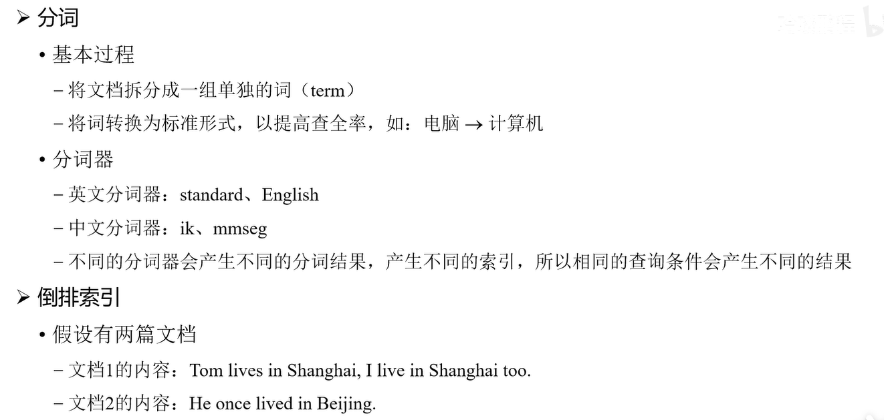

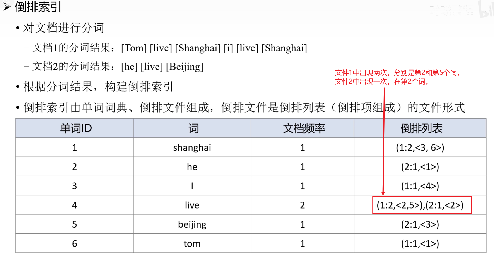

**词典（term → postings 指针）可以使用的数据结构？**

FST/Trie：压缩词典+快速定位词项；

排序块 + 稀疏索引：块内二分，块间跳转；

B+树（少数系统/存储引擎）。

**文档列表（postings）是怎么组织的？**

按 docID 递增存放 + 多流分离 + 块压缩 + 跳跃/块统计。

## 索引类型

### 按索引数据结构

常见索引结构包括上述的 B+ 树索引、哈希索引等。

### 按物理存储

- **聚集索引**：数据存储与索引合一。在 InnoDB 中主键索引就是聚集索引；一个表只能有一个聚集索引。
- **非聚集索引**（二级索引，辅助索引）：主键之外的索引。叶节点存储指向数据行的指针（通常为主键值）。当使用二级索引的 B+树即可查询到所需数据时，即形成:star:**覆盖索引**（只需查一次索引树即可获取数据）。

### 按字段特性

- **主键索引**：用于唯一标识记录，通常为聚集索引，每表仅有一个。
- **唯一索引**：提高查询速度，同时确保数据唯一性。每列允许单个 NULL 值。（一旦匹配成功，立即返回，不继续查找）
- **普通索引**：一般的非唯一索引，用于加速查询。
- **前缀索引**：对字符串类型字段的前几个字符建立的索引（用于长文本索引优化）。

### 按字段个数

- **单列索引**：索引由单个字段构成。
- **联合索引**：索引由多个字段组合构成。
  - :star:**索引区分度** = 不同值的数量 / 总记录数。联合索引应将**区分度高的列放在前列**。
  - :star:**索引下推：**可以在联合索引遍历过程中，对联合索引中包含的字段先做判断，直接过滤掉不满足条件的记录，减少回表次数。

## 索引操作语法

- **创建索引：** 使用 `CREATE INDEX 索引名 ON 表名(列名(length));`，或者在 `CREATE TABLE` / `ALTER TABLE` 语句中定义索引。
- **查看索引：** 使用 `SHOW INDEX FROM 表名;`，或 `SHOW CREATE TABLE 表名;` 查看表定义中索引信息。
- **删除索引：** 使用 `DROP INDEX 索引名 ON 表名;`，或 `ALTER TABLE 表名 DROP INDEX 索引名;` 删除索引。

## 索引使用原则

- **索引选择性：** 应选择区分度高（返回结果集较小）的列建立索引；如果查询需要返回的数据比例过大，索引作用有限。
- **索引失效情况：**
  - OR 条件：所有涉及 OR 的列都需要有索引，否则可能导致全表扫描。
  - 最左前缀法则：使用联合索引时必须从第一列开始匹配，跳过索引的最左列会导致索引失效。
  - 范围查询影响：在联合索引中，如果某一列的条件是范围查询（`<`、`>`、`BETWEEN`、`LIKE 'prefix%'`），则其后的列无法使用索引（注：若使用 `>=`，后续列仍可使用索引）。
  - LIKE 查询：
    - 前导通配符（`LIKE '%value'`）无法使用索引。
    - 非前导通配符（`LIKE 'value%'`）可以利用索引进行前缀匹配。
  - 索引列运算：对索引列进行函数或计算会使索引失效（MySQL 8.0 之后支持函数索引，可避免此问题）。
  - 数据类型匹配：查询时如果字段类型与给定常量类型不一致，会发生隐式类型转换，导致索引失效。
- **优化索引的方法：**
  - 使用前缀索引。
  - 使用覆盖索引。
  - 主键尽量自增且长度较短。
  - 将字段设置为 NOT NULL。

## 索引提示

可在查询中使用 `USE INDEX`、`IGNORE INDEX`、`FORCE INDEX` 提示优化器使用或忽略特定索引，但一般情况下尽量让优化器自动选择索引。

## 索引设计原则

根据查询需求、数据分布及维护成本选择合适的索引，避免索引过多或过少。

# SQL优化

## SQL性能分析方法

- **查询计数统计**：使用 `SHOW GLOBAL STATUS LIKE 'Com_%';` 或 `SHOW SESSION STATUS LIKE 'Com_%';` 查看各类 SQL（增删改查）的执行次数，评估操作分布。
- **慢查询日志**：启用慢查询日志（`slow_query_log`），记录执行时间超过 `long_query_time` 的 SQL 语句，从中找出性能瓶颈。
- **Profiling 分析**：在 MySQL 5.7 及以前可使用 Profiling（`SET profiling = 1;`），然后 `SHOW PROFILES;` 查看各阶段耗时；MySQL 5.7 以后版本可使用 Performance Schema 实现同类分析。
- **执行计划 (EXPLAIN)**：使用 `EXPLAIN SELECT ...;` 查看查询执行计划，重点分析 `key`、`rows`、`Extra` 等字段，判断索引使用情况和是否出现全表扫描。

## 插入操作优化

- **批量插入**：采用单条 INSERT 插入多行，或使用 `LOAD DATA INFILE`，减少通信次数和事务提交次数。
- **事务控制**：大量插入时显式开启事务，批量提交，降低事务提交带来的开销。
- **顺序插入**：按主键顺序插入数据，减少索引页分裂，提高插入性能。

## 主键优化

- **概念：**
  - 数据组织：InnoDB 存储引擎中，表数据按照主键顺序组织存放，此类表称为索引组织表（Index Organized Table, IOT）。
  - 页分裂：数据页可以为空、部分填充或完全填满（100%）。当数据页填满时，再插入新记录将触发页分裂。
  - 页合并：删除记录时记录不会物理删除，而是标记为删除，空间可供其它记录使用（必要时这些空闲空间可能被合并）。
- **主键设计原则：**
  - 在满足业务需求的前提下，尽量降低主键长度。
  - 插入数据时尽量顺序插入，使用 AUTO_INCREMENT 自增主键。
  - 尽量避免使用 UUID 或其他自然主键（如身份证号）作为主键。
  - 业务操作中，避免对主键值进行修改。

## ORDER BY 优化

- 利用有序索引避免额外排序。如果使用覆盖索引，可以在 Extra 字段看到 *Using index*，否则会出现 *Using filesort*（表示需要将数据取出在内存中排序，效率较低）。

## GROUP BY 优化

- 在分组字段上建立索引，利用索引的有序性直接完成分组，避免使用临时表和额外排序。

## :star:LIMIT 分页优化

### 大偏移量

OFFSET 很大导致扫描/跳过大量行

1. 使用聚簇索引时

当 OFFSET 很大时，直接使用

```sql
select * from page order by id limit 10000, 10;
```

效率低下，因为需要把10000条完整数据都返回给server层，再舍弃10000条。

可以改用**子查询**定位起点

```sql
select * from page  where id >= (select id from page order by id limit 10000, 1) order by id limit 10;
```

虽然还是要把10000条数据都返回给server层，但是**只需要返回id一列**。

2. 使用二级索引

使用子查询还可以减少回表次数

### 深度分页

**Keyset/Seek 分页**：用“上次末行的游标”而不是页码。

若必须支持“跳到第 N 页”：维护“**页起点索引表**”：定期把第 1、51、101… 行的主键存下（或分段采样），跳页先定位起点 id，再 Seek。

## COUNT 优化

- InnoDB 存储引擎没有行数计数器，执行 `COUNT(*)` 需要逐行扫描，可通过缓存计数或在应用层维护计数来优化。
- `COUNT(*)` 与 `COUNT(1)` 通常性能接近；`COUNT(列)` 只统计非 NULL 值；`COUNT(DISTINCT 列)` 开销较大。通常情况下：`COUNT(字段) < COUNT(主键) < COUNT(1) < COUNT(*)`。

## UPDATE 优化

- 确保 UPDATE 语句的过滤条件使用了索引，避免全表扫描和不必要的行锁。对于大批量更新操作，可以分批执行以降低锁竞争。
  - 例如：`UPDATE student SET no = '123' WHERE id = 1;` 因 `id` 有主键索引，只会锁定这一行。
  - 相反：`UPDATE student SET no = '123' WHERE name = 'test';` 因 `name` 无索引，会锁定整张表的所有行，解决办法是为 name 列添加索引。

# 视图

### 视图介绍

视图是基于 SQL 查询结果的虚拟表，不保存数据，仅存储查询定义，在使用时实时计算生成数据。

### 操作语法

- 创建视图：`CREATE VIEW 视图名 AS SELECT ...;`
- 查询视图：`SELECT * FROM 视图名;`
- 修改视图：`ALTER VIEW 视图名 AS SELECT ...;`
- 删除视图：`DROP VIEW 视图名;`

### 检查选项（Check Option）

- 在定义视图时可以使用 `WITH [CASCADED | LOCAL] CHECK OPTION`，确保通过视图插入或更新的数据满足视图定义的条件。
- **CASCADED**：级联检查所有依赖该视图的上层视图的条件。
- **LOCAL**：仅检查视图自身的定义条件。
- 注意：视图更新时，仅从当前视图开始，逐层向上的每个包含 `WITH CHECK OPTION` 的视图都会进行条件检查；`LOCAL` 只检查本视图的条件，`CASCADED` 会递归检查所有上层包含 CHECK OPTION 的视图；未使用 CHECK OPTION 的视图层不会被检查。

### 视图可更新性

- 只有满足特定条件的视图才可以更新：视图定义中不能包含聚合、`DISTINCT`、分组、`UNION` 或子查询，并且视图中的每一行都必须对应基础表中的唯一记录。

### 视图作用

- 简化复杂查询，避免重复编写复杂 SQL。
- 限制用户访问敏感数据，提高数据安全性。
- 为数据库结构变化提供抽象层，减少对应用程序的影响。

# 存储过程

### 简介

存储过程是储存在数据库中的一段 SQL 语句集合，可以接受参数并在服务器端执行，类似于程序中的子过程。

### 特点

- **封装复用**：将业务逻辑封装在数据库中，减少应用与数据库之间的交互次数，提高执行效率。
- **可接受参数**：支持 IN、OUT、INOUT 三种类型的参数，方便与调用方交换数据。
- **降低网络传输**：一次调用即可在服务器端执行多条语句，减少多次往返的网络开销。

### 基本语法

- 创建存储过程：

  ```sql
  DELIMITER $$
  CREATE PROCEDURE 存储过程名([IN | OUT | INOUT] 参数 数据类型, ...)
  BEGIN
      -- SQL 语句
  END $$
  DELIMITER ;
  ```

- 调用存储过程：`CALL 存储过程名(参数列表);`

- 查看存储过程：查询 `information_schema.ROUTINES`，或使用 `SHOW CREATE PROCEDURE 存储过程名 \G`

- 删除存储过程：`DROP PROCEDURE 存储过程名;`

### 变量

- **系统变量**：分为全局变量和会话变量，用于配置服务器行为。重启后恢复默认值（除非在配置文件中修改）。
- **用户变量**：以 @ 符号定义，作用于当前会话，多个语句共享，连接断开后自动释放。
- **局部变量**：在存储过程内部使用 DECLARE 声明，仅在过程内部有效。

### 流程控制

- 条件分支：使用 `IF ... THEN ... ELSE ... END IF;` 或 `CASE ... WHEN ... THEN ... END CASE;` 实现条件判断。
- 循环：支持 `WHILE ... DO ... END WHILE;`、`REPEAT ... UNTIL ... END REPEAT;`、`LOOP ... END LOOP;` 等循环控制（可使用 `LEAVE` 提前退出循环）。

### 游标

- **声明：** 使用 `DECLARE cursor_name CURSOR FOR <查询语句>;` 声明游标，并存储查询结果集。
- **使用：** 先 `OPEN` 游标，使用 `FETCH` 将数据行提取到变量中，循环处理完毕后 `CLOSE` 游标。其操作步骤：
  1. 声明游标并存储查询结果。
  2. 开启游标。
  3. 获取游标中的记录。
  4. 关闭游标。

### 异常处理（HANDLER）

- 声明处理程序：针对特定错误或条件（例如 `NOT FOUND`）设定 CONTINUE 或 EXIT 动作，避免存储过程异常中断。

# 存储函数

### 简介

存储函数与存储过程类似，但必须有返回值，且参数仅支持 IN 类型。

### 语法

- 创建函数：

  ```sql
  DELIMITER $$
  CREATE FUNCTION 函数名(参数 数据类型, ...)
  RETURNS 数据类型
  BEGIN
      -- 计算逻辑
      RETURN 返回值;
  END $$
  DELIMITER ;
  ```

- 调用函数：`SELECT 函数名(...);`

### 注意

避免在高频查询中滥用存储函数，否则每行数据的函数调用都会增加额外开销。

# 触发器

### 简介

触发器是在对某表执行 INSERT、UPDATE 或 DELETE 操作时自动触发的一段 SQL 代码。

### 作用

- 维护数据完整性，例如自动更新汇总数据。
- 记录审计日志，保存数据变更历史。
- 校验数据，阻止不符合业务规则的数据写入。

### 特点及限制

- 每个表针对每种事件（INSERT/UPDATE/DELETE）和时机（BEFORE/AFTER）最多可定义一个触发器（在较高版本中虽然支持多个同类型触发器，但其执行顺序不确定）。
- 触发器为行级触发，对受影响的每一行记录分别执行。
- 可通过 `NEW` 和 `OLD` 关键字访问触发前后的数据值。

### 基本语法

- 创建触发器：

  ```sql
  CREATE TRIGGER 触发器名
  BEFORE/AFTER INSERT/UPDATE/DELETE
  ON 表名 FOR EACH ROW
  BEGIN
      -- SQL 语句
  END;
  ```

- 查看触发器：`SHOW TRIGGERS LIKE '表名';`

- 删除触发器：`DROP TRIGGER 触发器名;`

# 锁机制

## 全局锁

- **语法：**

  ```sql
  FLUSH TABLES WITH READ LOCK;
  UNLOCK TABLES;
  ```

- **作用：** 让整个数据库实例进入只读状态（常用于全库逻辑备份），为了不影响业务，可以生成Read View。

## 表级锁

### 1. 表锁

其他引擎会使用，InnoDB用的比较少，颗粒度太大。

- 表独占写锁：`LOCK TABLES t WRITE;`
  - 当前线程可以对表 *t* 进行读和写。
  - 其他任何线程都不能访问表 *t*（无论读写）。
  - 其他线程申请 READ 或 WRITE 锁都会被阻塞。
- 表共享读锁：`LOCK TABLES t READ;`
  - 当前线程可以读取表 *t*。
  - 当前线程不能写表 *t*。
  - 其他线程也可获得 READ 锁继续读该表。
  - 但其他线程不能获得 WRITE 锁，也不能写该表。

- **一次性声明式加锁：** 在一次 `LOCK TABLES` 语句中必须声明需要锁定的所有表，锁定后在该会话中不能再锁定其他表（包括读锁或写锁）。

- **解锁：** 使用 `UNLOCK TABLES` 释放表级锁（会话退出时也会自动释放）。

### 2. 元数据锁 (MDL)

在执行 DDL 操作时会自动加上的表级锁，防止表结构变更与数据读写 (DML) 的冲突。:star:MDL 锁保证了 CRUD 操作期间**表的元数据（结构）**不被改变，而并发事务之间的数据操作冲突由 InnoDB 的行锁、MVCC 等机制处理。
  - **MDL读锁：** 当对一张表进行 CRUD 操作时，加的是 MDL 读锁（共享锁）。

  - **MDL写锁：** 当对一张表做结构变更操作时，加的是 MDL 写锁（排他锁）。

  - 读锁之间不冲突，读锁与写锁、写锁与写锁互相冲突。

  - MDL 锁在事务提交时释放。

  - 当读写锁冲突排队时，**写锁**优先：一旦有写锁在等待，后续所有读锁申请都会被阻塞。

### 3. 意向锁

**作用**

如果没有意向锁，当请求表级独占写锁时，需要遍历表中所有记录以确认没有记录锁，这会非常低效；而有了意向锁，可快速判断表中是否存在被加行锁的记录，大幅提升加锁判断的效率。

**如何加锁**

在对记录加共享锁 (S) 之前，需要先在表级加意向共享锁。

在对记录加独占锁 (X) 之前，需要先在表级加意向独占锁。

当执行插入、更新、删除操作时，会先给表加意向独占锁，然后再给相应记录加独占锁。

意向锁之间不会互相冲突，也不会与行级的 S 锁或 X 锁冲突。

但意向锁会与表级的共享读锁和独占写锁冲突。

### 4. AUTO-INC

InnoDB 在插入含 `AUTO_INCREMENT` 字段的记录时使用的一种特殊表级锁，用于保证多个线程并发插入时自增主键值的正确和唯一。该锁会在**语句执行完成后立即释放**（不同于其他锁持有到事务结束）。

## 行级锁（仅 InnoDB 支持）

### 记录锁（行锁）

>  锁定索引记录本身。

- 共享锁 (S, Shared)、排他锁 (X, Exclusive)
- S 与 S 兼容，除此之外其余锁之间均互相冲突。

### 间隙锁

>  锁定索引记录之间的空隙，防止其他事务在该空隙插入新记录以避免幻读。

- X 型间隙锁、S 型间隙锁
- 间隙锁彼此之间不冲突（互相兼容）。
- 插入意向锁是一种特殊的间隙锁，InnoDB 为提高并发插入性能在特定插入场景下引入。

### 临键锁

>  Next-Key 锁，是记录锁加上其后面的间隙锁组合（表示形式为 (a, b]），用于范围查询避免幻读。

- X 型临键锁、S 型临键锁。
- X 型临键锁之间存在冲突。

### 锁实现与规则

  - InnoDB 的行锁锁定的是索引记录。

  - :star:走哪个索引，就在哪加锁，如果还要回表，那么还要对聚簇索引加锁

  - 对于没有索引的字段进行锁操作时，InnoDB 会扫描全表（聚簇索引）并逐行加锁，效果等同于锁定整个表。

#### 加 S 锁还是加 X 锁？

-  普通 SELECT 不加锁。
-  SELECT ... LOCK IN SHARE MODE; 加 S 锁。
-  SELECT ... FOR UPDATE; 或者 INSERT、UPDATE、DELETE 语句加 X 锁。

#### 加哪种行级锁？

- InnoDB默认使用临键锁加锁，对于特定where条件和索引是否命中会退化成记录锁或者间隙锁。

- 唯一索引等值查询

  - 命中唯一索引的等值查到存在记录 → 记录锁。

  - 唯一等值但查不到记录 → 间隙锁。

- 非唯一索引等值查询

## 死锁


# 引擎

## InnoDB引擎

### 优点

事务、行级锁、外键（不推荐）

读密集，使用 MyISAM 也是合适的

### 当前读和快照读

**快照读**（一致性非锁定读）就是单纯的 `SELECT` 语句

**当前读** （一致性锁定读）就是给行记录加 X 锁或 S 锁

```sql
# 对读的记录加一个X锁
SELECT...FOR UPDATE
# 对读的记录加一个S锁
SELECT...LOCK IN SHARE MODE
# 对读的记录加一个S锁
SELECT...FOR SHARE
# 对修改的记录加一个X锁
INSERT...
UPDATE...
DELETE...
```

### 逻辑存储结构

- **表空间**：数据库的数据存储容器，可为共享表空间或独立表空间。
- **段**：段是表空间中管理数据的单元，例如数据段、索引段等。
- **区**：Extent，每个区通常大小为 1MB，由连续的页组成。
- **页**：Page，InnoDB 管理的最小存储单元，默认大小 16KB，每个页可存储多条记录。
- **行**：表中的一行记录。

### 内存架构

- **缓冲池（Buffer Pool）**：缓存数据页和索引页，减少磁盘 I/O。
- **日志缓冲**：缓存重做日志，在事务提交时将日志刷新到磁盘。
- **其它**：例如插入缓冲、锁信息、数据字典信息等内存区域。

### 磁盘文件

- **数据文件**：存储表空间数据（共享表空间或独立 `.ibd` 文件）。
- **重做日志文件**：记录事务的重做日志，如 ib_logfile 文件。
- **撤销日志（Undo 日志）**：记录事务修改前的数据版本，用于回滚和提供多版本并发控制 (MVCC)。

### 后台线程

- **Master Thread**：核心后台线程，负责刷新脏页、合并插入缓冲、回收 Undo 页等任务。
- **I/O Threads**：负责异步 I/O 操作的线程，包括读取、写入、日志等线程。
- **Purge Thread**：负责清理已提交事务不再需要的 Undo 日志记录。
- **Page Cleaner Thread**：专门负责刷新缓冲池中的脏页，将数据持久化到磁盘。

### 事务实现原理

- **Redo Log**：记录事务提交后的数据页物理修改，用于保证事务的**持久性**。
- **Undo Log**：记录数据修改前的信息，用于事务**回滚**和提供**MVCC**的多版本支持。
- **原子性**：通过 Undo Log 回滚未提交事务，保证事务要么全部执行成功要么全部撤销。
- **一致性**：通过数据库约束和事务机制，确保数据在事务前后的完整性约束不变。
- **隔离性**：通过锁机制和 MVCC 保证事务之间相互隔离，并发执行时互不干扰。
- **持久性**：通过将 Redo Log 写入磁盘确保事务提交后的修改持久化，即使发生崩溃也不会丢失。

### MVCC（多版本并发控制）

**引入：**锁是悲观锁机制，MVCC是**乐观锁**机制，Read View是MVCC的一种数据结构。

**概念：**InnoDB 通过保存数据的多个版本，使普通读取（快照读）无需加锁，从而在高并发场景下实现一致性读取，是实现事务隔离的关键机制。

**作用：**实现非阻塞读（Read）、提高并发性能、保证事务隔离性（通常是可重复读或读已提交）

**Read View：** 事务在执行一致性读取时创建的数据视图，记录当前活跃事务的快照，是 MVCC 的关键组成部分。利用 Read View 还可以实现热备份，例如使用 `mysqldump --single-transaction` 进行备份。

```c
class ReadView {
  /* ... */
private:
  trx_id_t m_low_limit_id;      /* 大于等于这个 ID 的事务均不可见 */

  trx_id_t m_up_limit_id;       /* 小于这个 ID 的事务均可见 */

  trx_id_t m_creator_trx_id;    /* 创建该 Read View 的事务ID */

  trx_id_t m_low_limit_no;      /* 事务 Number, 小于该 Number 的 Undo Logs 均可以被 Purge */

  ids_t m_ids;                  /* 创建 Read View 时的活跃事务列表 */

  m_closed;                     /* 标记 Read View 是否 close */
}
```

**热备份：**

1. 导出开始前启动一个事务，并在该事务中导出所有表数据；
2. 启动事务时，InnoDB 创建一个 Read View；
3. 在事务执行期间，所有查询都基于这个 Read View 获取数据，确保备份期间数据一致；
4. 由于是非锁定读，不会阻塞写操作（除非操作非 InnoDB 引擎的表，如 MyISAM）。

**MVCC实现依赖于：** Read View、Undo Log、记录中的事务字段（在创建 Read View 后，我们可以将**记录**中的 trx_id 划分三种情况：已提交，启动但未提交，未启动。）。

**RC和RR下MVCC的差异：**读已提交在每次读取时创建Read View，可重复读在事务开始时创建Read View。

## MyISAM

**没有**聚簇索引，不支持事务，离线读比较快。

https://juejin.cn/post/7160557698642083847#heading-10

# MySQL管理

### 系统数据库

- **mysql**：存储用户账号、权限、复制相关信息及部分系统配置。
- **information_schema**：提供只读视图访问数据库元数据，包括数据库、表、字段、权限等信息。
- **performance_schema**：收集数据库服务器性能数据，包括等待事件、锁定情况、执行统计等。
- **sys**：基于 performance_schema 和 information_schema 的汇总视图，方便 DBA 快速诊断性能问题。

### 常用管理工具/命令

- **mysql 客户端**：命令行工具，用于连接和操作数据库。
- **mysqladmin**：管理工具，可用于监控服务器状态、管理数据库、修改密码、关闭服务器等。
- **mysqlbinlog**：查看和处理二进制日志，用于数据恢复和主从复制。
- **mysqlshow**：显示数据库、表结构、索引及统计信息。
- **mysqldump**：逻辑备份工具，将数据库导出为 SQL 文件，支持导出表结构和数据。
- **mysqlimport**：数据导入工具，将文本或 CSV 文件快速导入数据库表中。

# 日志

:star:三大日志

服务层：binlog

引擎层：redolog、undolog

https://javaguide.cn/database/mysql/mysql-logs.html#%E5%86%99%E5%85%A5%E6%9C%BA%E5%88%B6

## 错误日志

记录 MySQL 服务器运行过程中出现的错误、警告和提示信息，用于故障排查。

## Redo Log

环形日志组

**作用：**崩溃恢复（防止缓存中的数据丢失）、将随机写变成顺序写、事务中的持久性。注：本来把数据直接写到数据库就行，但是这样频繁写，随机写太慢，所以用了缓存，写回频率可以降低，但是脏页的写回还是随机写。只是日志的写是顺序写。

如何理解redolog用于崩溃恢复？因为用了**缓存**，内存中的缓存脏页未写回时崩溃，会导致数据的不一致。但是由于redolog会刷盘，所以可以用于恢复。

**过程：**先修改buffer pool中数据，再写到redolog buffer，redo log刷盘，最后脏页写回磁盘（**日志先于数据落盘**（write-ahead），最后两步的机制叫做WAL）。

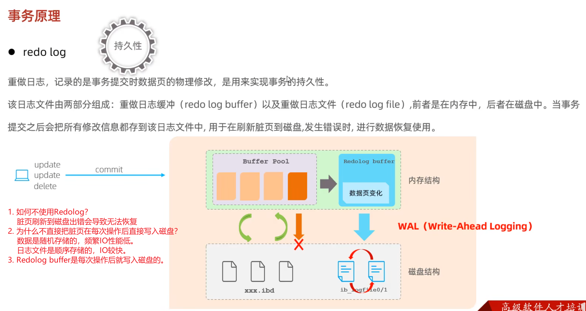

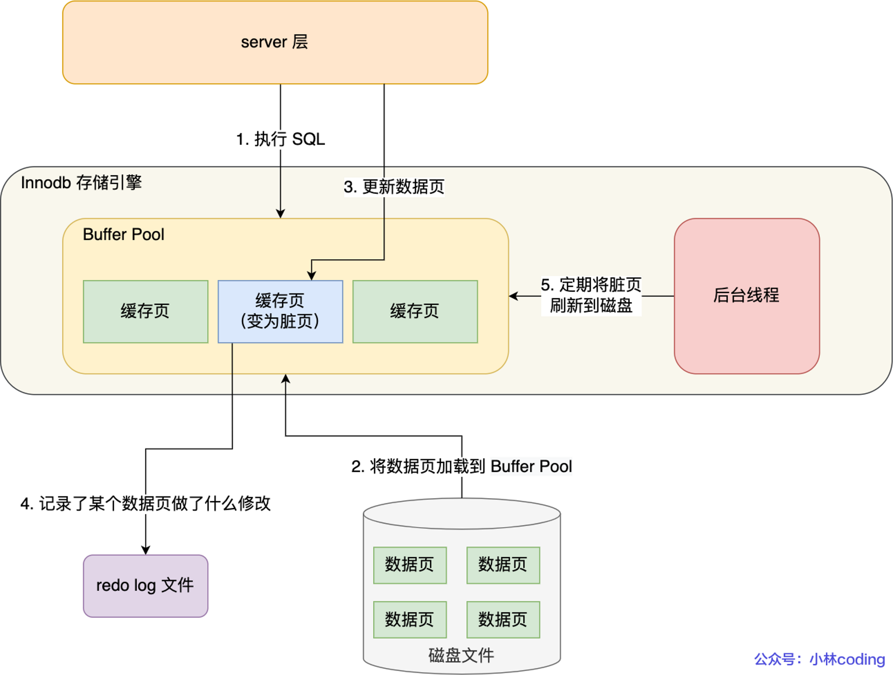

## Binlog（二进制日志）

追加写，不覆盖。

记录所有导致数据变化的 DML 和 DDL 操作，是**数据恢复和主从复制**的核心。

日志格式：可配置为 STATEMENT、ROW 或 MIXED 模式。

如果是statement模式，执行update t set update_time = now() where id = 1语句，由于now()会让数据不一致！

查看方式：使用 mysqlbinlog 工具读取日志内容。

日志清理：使用 `PURGE BINARY LOGS` 手动清理，或设置 `expire_logs_days` 参数让日志自动过期删除。

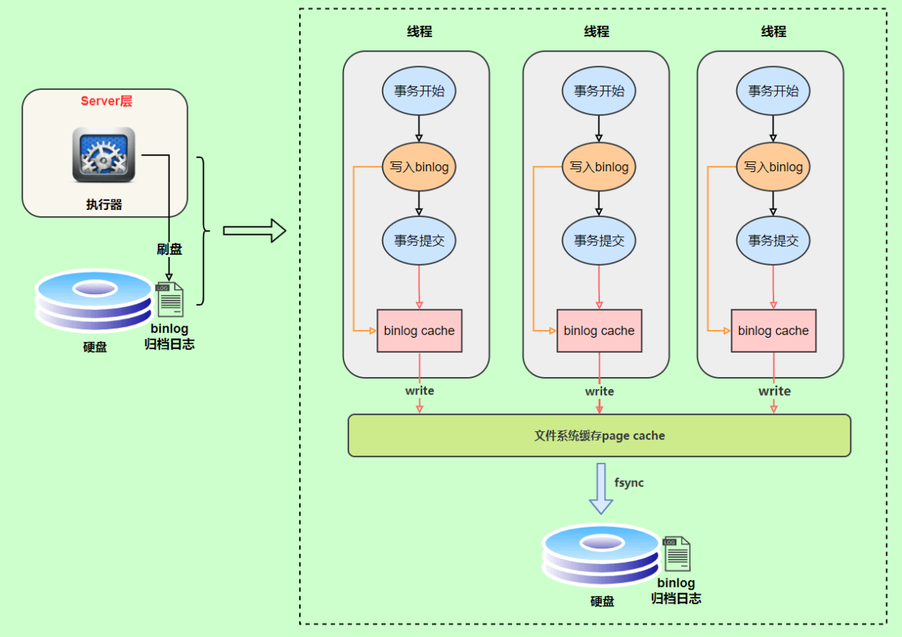

## 两阶段提交

问题产生：redolog和binlog都是用于保证数据的一致性，但是崩溃时这两个日志不一致怎么办？

这两个日志又为什么会不一致呢？redolog是每执行一条写一次redo log buffer，而**binlog是事务提交才写binlog buffer**。那么如果再redolog写完刷盘后，写binlog buffer或者对binlog刷盘时崩溃了，就会不一致。

用两阶段提交解决，就像2pc一样，redolog分为prepare和commit阶段，等binlog写完才是commit。

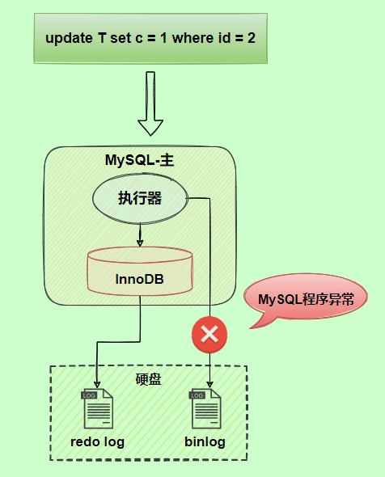

## Undo log

逻辑日志，记录相反的内容。

**作用：**原子性，MVCC。

**insert_undo：**只用于回滚，所以在事务提交后可以删除

**update_undo：**回滚+MVCC，提交后进history list，等待purge线程进行最后的删除。

**Undo log 是持久化的。** 它存放在 **undo tablespace**（回滚段/回滚段槽）里，属于真正的磁盘文件。

InnoDB 会把“对 undo 页的修改”**写入 redo log**（也就是对 undo 也做 WAL 保护）。这样即使宕机，恢复阶段先用 **redo** 把 undo 页也恢复到一致状态，再用这些 **undo 记录回滚未提交事务**。

## 通用查询日志

记录所有客户端的连接及执行的 SQL 语句（默认关闭，通常仅在调试时启用）。

## 慢查询日志

记录执行时间超过 `long_query_time` 的 SQL 语句，帮助定位性能瓶颈。

# 主从复制

主库将数据变更写入二进制日志，从库通过 IO 线程和 SQL 线程拉取并重放日志，实现数据同步。

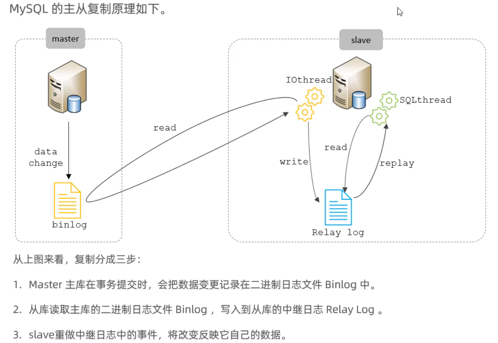

### 优点

- **故障切换：** 主库发生故障时可快速提升从库为主库，保证系统高可用性。
- **读写分离：** 主库承担写操作，从库承担读操作，大幅提高系统整体吞吐量。
- **备用备份：** 可在从库上进行备份或复杂查询，减轻主库压力。

### 搭建步骤

- **主库配置：**
  - 设置唯一的 `server-id`，启用二进制日志（`log-bin`）。
  - 创建复制用户并授予 `REPLICATION SLAVE` 权限。
  - 查询当前二进制日志文件名及位置（`SHOW MASTER STATUS;`）。
- **从库配置：**
  - 设置不同于主库的 `server-id`。
  - 使用 `CHANGE MASTER TO ...` 命令配置主库地址、用户、密码及起始 binlog 位点。
  - 启动复制（`START SLAVE;`），并使用 `SHOW SLAVE STATUS;` 检查复制状态。

### 主从复制模型

- **同步复制：** 主库提交事务后必须等待所有从库执行并返回确认，才能继续后续操作（几乎不采用）。
- **异步复制（默认）：** 主库提交事务后不等待从库响应，直接返回结果，可能存在少量延迟。
- **半同步复制：** 介于同步与异步之间，主库提交事务后等待至少一个从库确认收到日志再返回结果（MySQL 5.7 引入），在数据安全性和性能之间提供折中方案。

# 分库分表

### 简介

当单一数据库负载过高时，通过拆分将数据分布到多个数据库或表中，以缓解单库压力。

### 拆分策略

- **垂直分库：** 将不同业务模块的数据拆分到不同的数据库中。
- **垂直分表：** 将某个表按列拆分为多个表，减少单表的字段数量和宽度。
- **水平分库：** 将同一张表的数据按规则拆分到多个数据库中（各库中的表结构相同）。
- **水平分表：** 将同一张表的数据按规则拆分到同一数据库的多个表中。

### 实现技术

- **应用层拆分：** 由应用程序决定数据路由，直接操作不同库表，开发和维护成本较高。
- **数据库中间件：**
  - **Sharding-JDBC：** 以客户端库的形式嵌入应用，实现分库分表的透明化，负责 SQL 路由及结果归并等。
  - **MyCat：** 独立部署的代理中间件，应用只需连接 MyCat，由其负责 SQL 解析、路由、拆分和汇总结果。

### MyCat 相关

- **核心概念：**
  - **逻辑库：** MyCat 配置的虚拟数据库，对应用表现为单一库，但底层对应一个或多个物理库。
  - **逻辑表：** 在 MyCat 中定义的一张虚拟表，映射到后端多个实际的分表，对应用透明。
  - **分片规则：** 决定数据如何拆分存储的规则，如取模、范围、哈希、枚举或按时间区间等。
  - **分片节点：** 具体的数据片段存储位置，即物理库中的具体表。
- **配置文件：**
  - `schema.xml`：定义逻辑库、逻辑表及分片规则。
  - `server.xml`：定义 MyCat 服务器属性、用户权限、后端数据源等。
  - `rule.xml`：配置自定义分片函数（某些版本中使用）。
- **部署与测试：** 启动 MyCat 后，通过在其上创建表、插入和查询数据，验证数据是否按照分片规则正确路由至各个分片节点。
- **管理与监控：** 通过 SQL 命令（如 `SHOW @@DATASOURCE`）或 Web 控制台监控集群状态；可结合 ZooKeeper 实现高可用架构。

# 读写分离

### 简介

利用主从复制以及中间件实现读写分离架构，将写操作定向到主库，读操作定向到从库，从而提升系统的读写并发能力。

### 一主多从架构

由一个主库和多个从库组成。主库处理写请求，从库处理读请求。需要注意从库数据复制的延迟对读取最新数据的影响。

### 双主双从架构

由两个主库互为对方的从库，并各自拥有从库。通常仅启用其中一个主库对外提供写服务，另一个作为热备；该架构需要解决双主之间的数据同步和冲突问题。

# 其他问题

## 单表为什么不能太大

B+树的高度以及维护复杂，buffer pool的命中率会变低，事务备份难以进行。

## 深度分页问题

应用层面限制查询的页码，不能让用户随机，并记录上一次查询的最大id。

## InnoDB Buffer Pool

- 内存中的数据页缓存，用来减少磁盘 IO、提高读写性能。
- 大小用 `innodb_buffer_pool_size` 配置。

### 怎么管理页（3 张链表）

- **Free List（空闲页链表）**：记录还没被使用的空页；读入新页或页被淘汰时从这里分配/回收。
- **Flush List（脏页链表）**：记录被修改过（脏）的页，后台刷盘线程按顺序把它们写回磁盘。
- **LRU List（淘汰链表）**：缓存中的“已用页”（既包含干净页也包含脏页）都在这里，决定谁先被淘汰。

### LRU 的两段优化（young / old）

目的：避免顺序扫描或预读把热点页冲掉（缓存污染）。

- **两段策略**：新读入缓冲池的页**先放 old 段**。当页被访问时，才有机会进入 **young 段**（热点区）。
- **提升规则（防扫描污染）**：只有当该页在 old 段停留时间**超过** `innodb_old_blocks_time`（图中阈值默认 **1s**），并再次被访问，才**提升到 young**。否则仍停在 old 段，视为“一次性/批量访问”页面。
