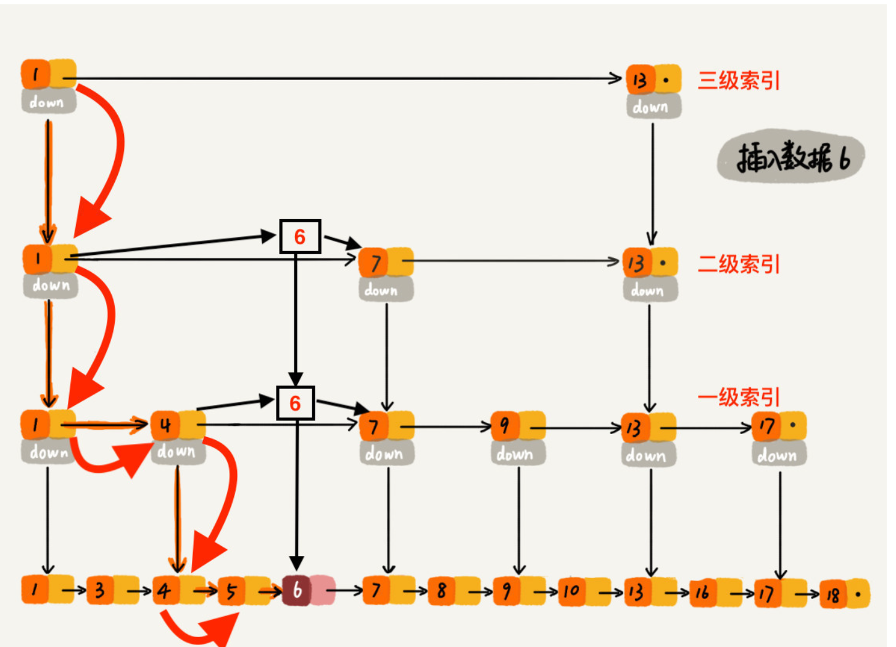
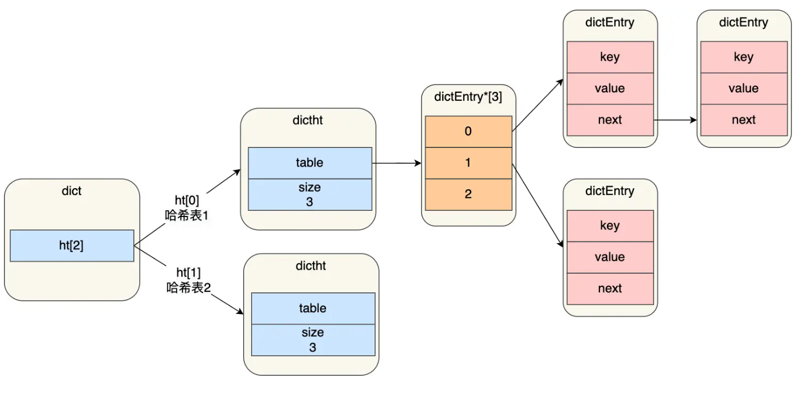
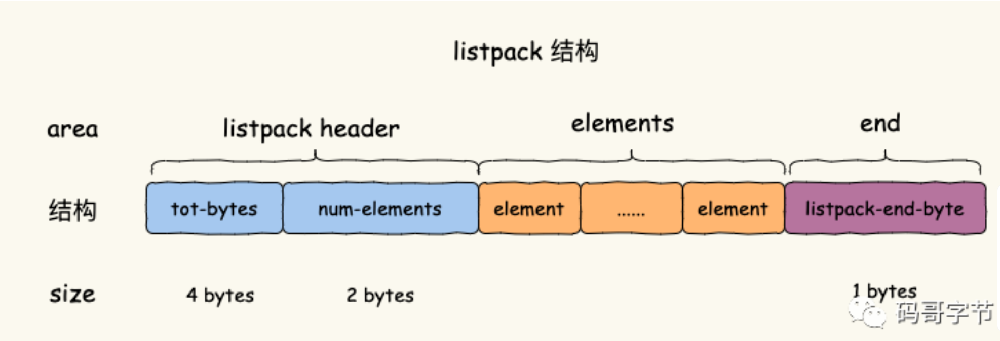
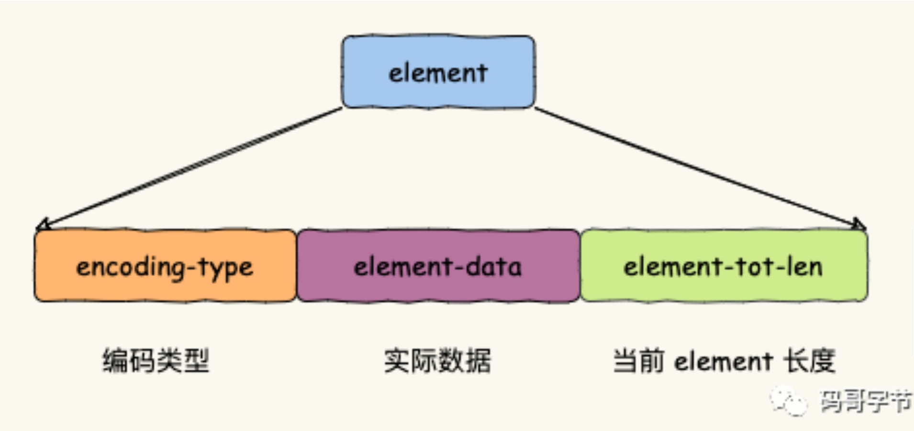
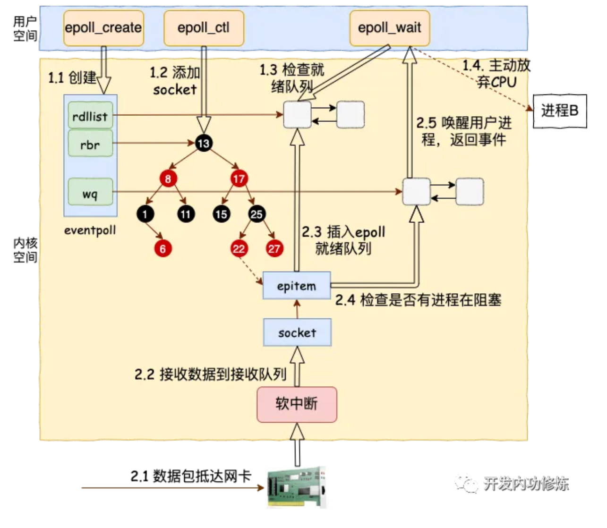
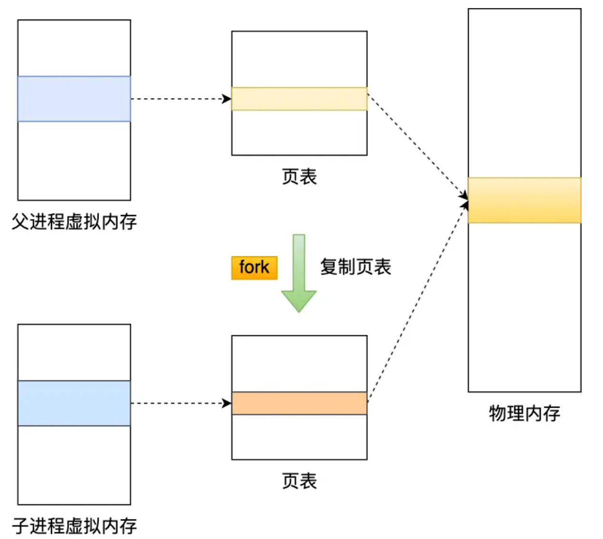
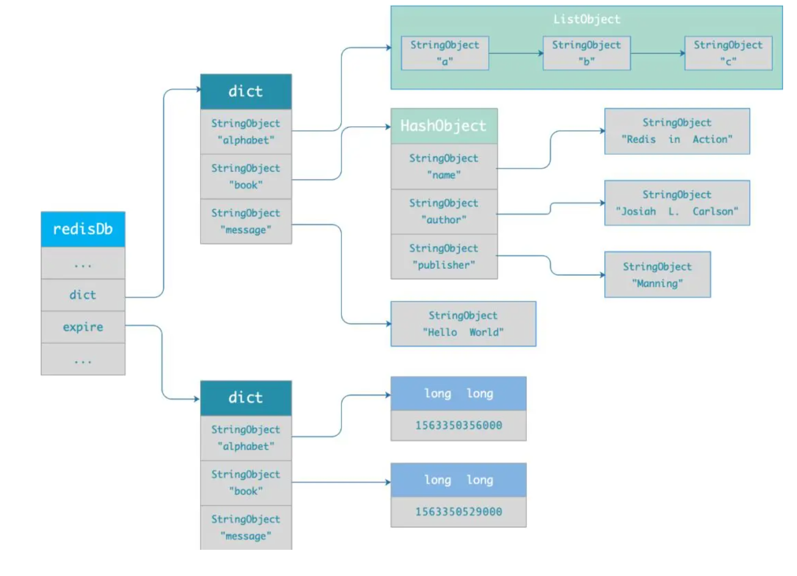

# 数据结构

## Redis数据结构

String：int, embstr, raw（对象头和SDS）

List：listpack，quicklist（7.0之后listpack作为节点）

Hash：listpack，dict

Set：intset，Hash的实现（listpack，dict）

ZSet：listpack，skiplist+dict

在 Redis 的 zset 跳表实现里，每个节点在每一层都有：

- forward：指向下一个节点；
- span：这条指针一次性“跨过”的底层节点数量（即 rank 意义上的步数）。

所以在使用命令查找zrange start stop的时候，时间复杂度是O(log start + (stop - start  + 1))

BitMap：SDS

GEO：ZSet+GeoHash

Stream：listpack+radix-tree

| Redis 基础类型 | 数据量／特征                                                 | **当前默认底层实现**                              | 关键点                                                       |
| -------------- | ------------------------------------------------------------ | ------------------------------------------------- | ------------------------------------------------------------ |
| **String**     | 长度 ≤ 44 B                                                  | **embstr**（对象头 + SDS 连续存储）               | 单内存块，CPU cache 友好                                     |
|                | 可解析为 64‑bit 整数                                         | **int**（直接把整型值放在对象 ptr 字段）          | 节省 16 B 以上间接指针开销                                   |
|                | 其他情况                                                     | **raw**（对象头 + 独立 SDS）                      | 支持修改、惰性空间回收                                       |
| **List**       | 元素数、总长度均低于list‑max‑listpack-*                      | **listpack**（压缩表）                            | Ziplist 已淘汰；写入 O(1)，空间再省 15‑30 %                  |
|                | 普通 / 大列表                                                | **quicklist** = **双向链表 + 多个 listpack 节点** | 每个 quicklistNode 对应 1 个 listpack，读写在 O(α·log n) 与 O(1) 间折中，避免极端内存碎片 |
| **Hash**       | 键值对数 ≤ hash‑max‑listpack‑entries且每个字段 ≤ hash‑max‑listpack‑value | **listpack**                                      | 删除 Ziplist 后统一到 listpack，完全消除了级联更新           |
|                | 超出阈值                                                     | **dict（哈希表）**                                | dict = 两张渐进 rehash 的指针表                              |
| **Set**        | 全为整数且元素数 ≤ set‑max‑intset‑entries                    | **intset**                                        | 压缩按位存储；只支持整数                                     |
|                | 含字符串或元素数 ≤ set‑max‑listpack‑entries                  | **listpack**                                      | 对小字符串集合的进一步压缩                                   |
|                | 其他情况                                                     | **dict（哈希表）**                                | 与 Hash 类型公用实现                                         |
| **Sorted Set** | 元素数 ≤ zset‑max‑listpack‑entries且每个成员≤zset‑max‑listpack‑value | **listpack**                                      | 取代 Ziplist，按member                                       |
|                | 超出阈值                                                     | **skiplist + dict**                               | dict 做 *member→score* 索引；跳表按 score 排序，O(log n)     |
| **Stream**     | 始终                                                         | **radix‑tree (art) + listpack**                   | 每个节点保存 1 个 listpack 做消息块，自动裁剪                |

[注]

在「小 Hash」场景下，Redis 7 以后默认使用 **listpack** 编码保存键值对，这时：

| 维度     | listpack 编码的小 Hash                                       |
| -------- | ------------------------------------------------------------ |
| 物理结构 | 一个连续内存块，按 *field*、*value*、*field*、*value*… 顺序排布 |
| 查找方式 | 从**头顺序扫描（线性）**(CPU局部性好)，遇到目标字段后再取紧跟其后的 value |
| 逻辑语义 | 在命令层面仍然是 `HSET/HGET/HMGET…`，对客户端完全透明        |

List、Stream、专业消息队列对比：

List：客户端重启不能读取历史消息；不能重复消费一个消息；需要自己实现全局唯一ID。

Stream：Redis本省的持久化会有延迟，导致消息丢失；消息挤压导致内存爆炸。

## 底层数据结构

### Redis数据库结构


```c
typedef struct redisDb {
    dict *dict;           // 保存真正的 key-value
    dict *expires;        // 保存设置了过期时间的 key
    dict *blocking_keys;  // 阻塞客户端正在等待的 key
    dict *ready_keys;     // 已经 ready、可以唤醒阻塞客户端的 key
    dict *watched_keys;   // 被 WATCH 的 key

    int id;               // DB 编号
    long long avg_ttl;    // 平均 TTL
    ...
} redisDb;
```

### SDS

**对比C语言**字符串：O(1)获取长度，不需要\0（\0是C语言字符串结束的标志）也就可以读\0，更加安全，会自动扩容。

### skiplist

博客https://blog.csdn.net/Zhouzi_heng/article/details/127554294

ZSet为什么使用跳表？（与其他数据结构的对比）

对比B+树：实现简单，插入删除稳定；b+树按页分配没有优势反而有碎片。

对比平衡树：简单；范围查找。



### dict



- 每个dict是两张hash表，另一张的作用是扩容时使用。

- 解决hash冲突的方法是链表。

- 扩容时触发**渐进式rehash**：写时复制，添加也是在新表。

- 扩容触发条件：没有持久化时负载因子1，持久化时负载因子5。

### listpack

listpack的对比ziplist的优势有：额外空间占用小，不会因为存着前一个节点的长度而导致级联更新。但是ziplist 和 listpack 都是连续内存结构，所以在中间插入/删除导致长度变化时，都可能需要移动后面的那一段内存





### intset

就是一个数组，如果都是8位以内，用8位存储，如果出现16位，则全部**升级**为16位存储，不支持降级。

### GEOHash

范围查询过程

```
Beijing
   ↓
从已有 ZSet 中取 Beijing 的 score
   ↓
score 解码
   ↓
得到 Beijing 经纬度
   ↓
根据 圆心 + 100km
计算需要搜索的 geohash 区域
```

这一步会**临时计算一些 geohash 范围**，例如概念上：

```
              北
        ┌────┬────┬────┐
        │ NW │ N  │ NE │
        ├────┼────┼────┤
        │ W  │中心│ E  │
        ├────┼────┼────┤
        │ SW │ S  │ SE │
        └────┴────┴────┘
```

每个格子对应某一段 geohash，而 geohash 又可以转换成：

```
score 最小值 ~ score 最大值
```

然后 Redis 直接去 ZSet 中把候选元素选出


## 数据结构常见应用

| 数据结构              | 典型业务场景                                                 |
| --------------------- | ------------------------------------------------------------ |
| **String**            | **① 缓存 KV**（用户资料、商品详情）② 计数器/限流（浏览量、点赞数、令牌桶）③ 分布式锁（SETNX + 过期） |
| **Hash**              | **① 对象缓存**（JSON 拆分成字段，更新局部字段）② 会话/配置（动态参数表） |
| **List**              | **① 消息队列/任务列表**（秒杀下单、日志收集）② 时间轴/评论流（反向时间序） |
| **Set**               | **① 标签/兴趣集合**（快速求交集推荐）② 去重计数（IP 去重）③ 抽奖随机 (`SRANDMEMBER`) |
| **Sorted Set (ZSet)** | **① 排行榜/排行榜**（积分榜、热搜）② 有序延迟队列（分数 = 时间戳）③ 限时优惠/库存排序 |
| **Bitmap**            | **① 活跃/签到日历**（按用户 ID 定位 bit）② 布隆过滤器底层位图③ 精细限流（滑动窗口算法） |
| **HyperLogLog**       | **① UV/独立访客统计**② 大规模去重计数（日志分析）            |
| **Geo**               | **① 附近的人/门店 LBS**② 车辆调度、外卖配送范围检索          |
| **Stream**            | **① 高可用消息队列**（事务日志、订单事件）② 审计/监控日志③ 实时 ETL/数据管道 |

# Redis线程

Redis 今日仍坚持 **“数据修改单线程”** 的设计，但为了把慢 I/O、文件系统操作和内存回收从关键路径中剥离，额外开启六个线程，三个后台线程，分别异步处理关闭文件任务、AOF刷盘任务、释放内存任务；三个网络I/O线程

## Redis为什么快

1. 单线程，线程竞争和切换开销小，io多路复用

**为什么选用单线程：**CPU不是瓶颈，多线程增加了系统复杂度、同时可能存在线程切换、甚至加锁解锁、死锁造成的性能损耗。

**为什么后来增加了后台线程：**瓶颈有时会出现在网络 I/O 的处理上。

2. 内存操作

3. 高效数据结构

## I/O 多路复用--Reactor模型

Redis 的主线程只做一件事：在事件循环里调用 `epoll_wait()`（抽象层叫 `aeApiPoll`），**阻塞等待“就绪的那一小撮 fd”**。内核一旦发现某些 fd 变成可读/可写，就把它们放进“就绪集合”，唤醒主线程并返回这批就绪事件。

epoll 的整个工作路程

https://mp.weixin.qq.com/s?__biz=MjM5Njg5NDgwNA==&mid=2247484905&idx=1&sn=a74ed5d7551c4fb80a8abe057405ea5e&scene=21&poc_token=HFDpq2ijilAqBGh0L95AL3scSEgUc10NgLlKMqmX



**epoll 实例（内核里的 eventpoll）**会把被 ADD 的所有“可轮询”的 fd 存在它的 **rbr 红黑树**里（键一般是 `struct file*` 指针地址），这当然可以包含：

真正发生就绪时，对应条目会被放到 **rdllist 就绪链表**，`epoll_wait()` 从这里取事件返回。

# 持久化

>  AOF(Append Only File\)，RDB（Redis DataBase file）

## AOF

优点：需要持久化时刷盘快，写部分日志就行，宕机时丢失少。

:star:**先执行写命令，再写到AOF内存缓冲**（与MySQL的wal机制区别，MySQL是先对buffer pool中缓存执行命令，再写日志，日志刷盘，最后把脏页写回，**WAL指的是对于磁盘**，也就是后面两步），AOF缓冲经过write() 写入内核页缓存，内核页缓存经过fsync()函数落盘。

内核页缓冲落盘策略，fsync()函数的时机不同：always，everysec，no（则由操作系统决定）

### AOF文件的重写机制

AOF文件太大，触发重写，读取当前数据库每条kv ，然后用一条最新命令记录到新的 AOF 文件。

### AOF文件的后台重写

fork()+COW，这是常见的搭配组合

fork：生成 bgrewriteaof 子进程，只复制页表并设为只读

**对于主进程：**继续对外提供服务，如果执行写操作，触发COW+记到 AOF 重写缓冲，主进程可以看到新内存，子进程只能看到旧内存。

**对于子进程：**子进程遍历旧内存键空间（dict、robj 等），按 fork 当时的快照生成最简指令集（SET/SADD/ZADD…）并写入自己的新的临时 AOF 文件。

:star: COW：真正写入时才按页拷贝物理页数据，并设置新内存为可读写，然后在新内存写。

COW过程显示会有不一致，怎么解决？再增加一个AOF文件的重写的缓冲区。

## RDB快照

优点：文件很小，适合做数据的备份，灾难恢复。直接解析，不用执行，恢复快

生成RDB文件，RDB 文件的内容是二进制数据。

save 命令，就会在主线程生成 RDB 文件。

bgsave 命令，会创建一个子进程来生成 RDB 文件。

执行**bgsave**过程中，修改数据使用fork()+COW。主进程在新内存写，子进程依旧对旧内存做RDB，会有不一致。



## 混合持久化

使用了混合持久化，AOF 文件的**前半部分是 RDB 格式的全量数据，后半部分是 AOF 格式的增量数据**。

RDB‑AOF 混合只在:star:**AOF 重写（含首次生成）** 时发生；平时向 AOF 的追加并不会再把数据重新写成 RDB 片段。

Redis 4.0+ 通过让重写后的 AOF 先保存一份 RDB 快照、再追加少量增量命令，把 **RDB 的加载速度** 和 **AOF 的高实时性** 拼成了一份文件，启动更快、文件更小，而实时持久化特性完全保留。

## AOF和RDB校验

AOF：加载时靠协议逐条解析

RDB：64位CRC64校验和

## 过期键持久化策略

只有从服务器加载RDB时候会不做过期判断，写入过期键，这是为什么？

1. 从库删了，主库可能还没删，下次传递DEL命令该怎么办
2. 时钟不一定同步
3. 删除操作应该只有主库才能驱动

# 场景

## 大key

大key问题指的是某个key对应的**value值**所占的内存比较大，导致Redis的性能下降、内存不足、数据不均衡以及主从同步延迟等问题。

### 找大Key

1) `redis-cli --bigkeys`（快速采样）

2) `redis-cli --memkeys`（按真实内存大小找前几名）
2) 结合“慢日志/延迟”侧证
2) 离线从 RDB 分析（最安全，对线上零影响）

### 影响

| 影响面                       | 具体表现                                                     | 说明 / 场景                                                |
| ---------------------------- | ------------------------------------------------------------ | ---------------------------------------------------------- |
| **① 单线程阻塞**             | `HGETALL huge_hash`、`LRANGE big_list 0 -1` 等 O(N) 命令，一次操作跑几百 ms～数秒，**阻塞整个实例**，所有请求排队 | 大部分卡顿现象的罪魁                                       |
| **② 删除/过期卡顿**          | `DEL big_list` 或键过期时要逐元素 free；在 4.0 之前直接阻塞主线程 | 4.0+ 可用 `UNLINK`、`lazyfree-lazy-*` 异步释放，但仍耗 CPU |
| **③ 持久化放大**             | - **RDB**：子进程序列化大 Key，CPU & I/O 峰值- **AOF**：写入或重写生成巨型命令- COW：父进程后写同页触发复制，**RSS 暴增** | 容易让 `BGSAVE/BGREWRITEAOF` 失败或耗尽内存                |
| **④ 主从复制 / 备份慢**      | 初次全量同步、AOF 日志同步都要传输大块数据，网络带宽被打满，延迟升高 | 低带宽链路尤为明显                                         |
| **⑤ 集群迁移困难**           | `MIGRATE`、reshard 遇到单 Key > 512 MB 会直接失败；Key 很大也导致迁移时长不可控 | 集群水平扩容时常见                                         |
| **⑥ 内存碎片与容量预测失真** | Redis 内部分配大块、后又分裂回收，造成 **frag_ratio** 升高；单 Key 太大也让 LRU/LFU 估算、内存淘汰不均衡 | 内存 hit 降低，OOM 风险增大                                |

### 解决方案

- 模型拆分
- 异步删除：unlink 命令

## 热key

### 找热Key

1. 应用侧埋点（最稳妥）
    按 *key 前缀/业务维度* 打点计数（Prometheus/StatsD），做 TopN。必要时对完整 key 采样（例如 1‰ 采样）再聚合。

   :star:拦命令 → 采样 → 归一化 → 指标上报 → PromQL/告警做 TopN

   这是生产里**最准**的方法：无侵入 Redis、本身就能区分读/写。

2. `redis-cli --hotkeys`（需要 LFU 才精准）

- 前提：实例的 `maxmemory-policy` 为 `allkeys-lfu` 或 `volatile-lfu`，Redis 才会维护访问频次计数。
- 用法：`redis-cli -h <host> -p <port> --hotkeys`

3. `OBJECT FREQ <key>` 验证可疑对象
    LFU 开启后，可对怀疑 key 单点查看其频次计数，作为交叉验证。

4. 短时抓流量：`MONITOR`（只在从库/压测窗口用）

- `redis-cli MONITOR` 抓取实时命令流，配合 grep/awk 统计 TopN key/前缀。
- 开销大、会放大负载→只在从库或极短时间抓样本。

5. 慢日志/延迟侧证

- `SLOWLOG GET` 看是否有重复出现的 O(N) 命令（`HGETALL/SMEMBERS/ZRANGE 0 -1` 等）集中在同一 key/前缀——多为写热/重命令热。
- `LATENCY LATEST`、`INFO commandstats` 可判断是否某类命令飙升，再回溯到具体 key。

6. Cluster 场景

- 对每个主分片重复上述方法；同时观察分片 OPS/TPS 是否槽位倾斜（某 slot QPS 明显更高）。
- 可用 `CLUSTER KEYSLOT <key>` 验证热点 key 是否集中在少数 slot。

### 读热点 vs 写热点

| 类型         | 典型症状                        | 关键瓶颈                        |
| ------------ | ------------------------------- | ------------------------------- |
| **读热 Key** | 某 Key QPS→万级，CPU/网络爆表   | 同一个节点回包带宽、CPU 层度量  |
| **写热 Key** | 同一个 Key 高频写、不断淘汰副本 | 锁 + 主从同步延迟、AOF 重写膨胀 |

### 读热 Key 的应对策略

> 原则：**把同一份数据复制到更多“离用户近”的地方**，或者**让单节点并发更高**。

| 做法                                       | 适用场景                     | 关键点 / 注意                                                |
| ------------------------------------------ | ---------------------------- | ------------------------------------------------------------ |
| **本地二级缓存（Guava/Caffeine/Ehcache）** | 读多写少，且对一致性要求不高 | JVM 内存命中，大部分请求不落 Redis；TTL + 主动失效机制避免脏数据。 |
| **多副本读**                               | Redis Cluster / 主从架构     | 增加从节点数量；Proxy 做读写分离；热点被分摊到多个副本。     |
| **CDN / Edge Cache**                       | 图片、配置、小文件           | HTTP-Cache 或 Varnish、Nginx-Proxy；根本不上 Redis。         |
| **开启 allkeys-LFU + maxmemory**           | 无法改代码 & 轻量热点        | Redis 内部把常访问的数据留在内存，淘汰冷 Key。               |

###  写热 Key 的应对策略

> 原则：**让写请求分散到多个 Key，再用“汇总”补偿一致性**。

| 做法                    | 思路                                                         | Demo 说明                                                    |
| ----------------------- | ------------------------------------------------------------ | ------------------------------------------------------------ |
| **Key 分片 / 拆 Key**   | 把 `counter` 拆成 `counter_{0..n-1}`，客户端随机选择桶；定时 `Lua` 或后台线程把各桶 `SUM` 到总值 | `lua  -- 汇总脚本  return redis.call('INCRBY', 'counter_total', diff) ` |
| **Hash 结构分散**       | 对象很大时把字段拆成 `Hash` 的多个 field，减少单节点锁冲突   | 适用于排行榜、用户属性等                                     |
| **写合并队列**          | 先写到消息队列 → Worker 批量落 Redis                         | 高并发下避免频繁 `INCR` / `HSET`                             |
| **乐观更新 + 延迟双删** | 必须保持单 Key 核心一致性场景                                | 先改 DB → 删除缓存；再延迟一次删，降低并发写脏读             |

## 慢查询

命令执行时间较长的命令

**99% 的慢查询都是“指令选错 + 数据模型失控”**：定位到具体 *键* 和 *命令* 后，先改数据结构，再评估是否需要分片。

## Redis过期

### 过期字典的数据结构

用hash，为每一个键存一个过期时间。



### 过期删除策略

- 定时事件

- 惰性删除，访问时过期再删

- 定期抽样，随机抽查20个直到过期比例低于25%

Redis采用**惰性+定期**

## 内存淘汰策略

- 不淘汰
- 淘汰：在设置了过期时间的数据中淘汰或者从所有数据中淘汰。淘汰算法都是常见的那些。

## 性能优化

### 使用批量操作减少网络传输

| 手段                                     | 关键点                                                 | 适用场景                                                     | 原子性                          | 网络往返 (RTT)                          | 额外成本 / 限制                                              |
| ---------------------------------------- | ------------------------------------------------------ | ------------------------------------------------------------ | ------------------------------- | --------------------------------------- | ------------------------------------------------------------ |
| **原生批量指令**`MGET/MSET/HMGET/SADD …` | 单条指令一次性处理 **多 Key 或多元素**                 | 数据组织能天然凑到同一条指令里，例如一次取 50 个 Key、一次加 100 个成员 | ✔（单条命令天然原子）           | **1 次**                                | 受指令本身能力限制；跨槽 Key 在 Cluster 里需要走 `ASK` 或拆分 |
| **Pipeline**                             | **把多条指令打包**，一次发给 Redis，随后一次性取回结果 | 逻辑上是多次操作，但不需要强原子；高 QPS 读写、批量导入      | ✖（顺序执行但可被其他命令插队） | **1 次**（请求） + **1 次**（批量响应） | 客户端要缓存全部结果，包太大可能撑爆 netty / socket 缓冲；出现错误难定位是哪条命令 |
| **Lua 脚本**`EVAL/EVALSHA`               | 在**服务器内部执行脚本**，一次网络交互完成整段业务     | 需要原子性、逻辑复杂或依赖状态的批量操作（如排行榜 Top-N 更新、库存扣减+记录流水） | ✔（脚本整体原子）               | **1 次**                                | 编写/维护脚本成本；脚本执行时间必须 < `lua-time-limit` 默认 5s，否则阻塞主线程 |

# Redis实战

## 消息队列

> 基本覆盖了业务中“简单 → 可靠 → 延时/优先级 → 高并发流式” 的全部需求层级。

| #     | 实现模型                     | 关键数据结构 / 命令                                          | 特点 & 适用场景                                              |
| ----- | ---------------------------- | ------------------------------------------------------------ | ------------------------------------------------------------ |
| **1** | **简单 FIFO 队列**           | `LPUSH + RPOP` （或反向）                                    | 极简、轻量，适合日志收集、任务堆积不大且容错要求低的场景     |
| **2** | **阻塞队列**                 | `LPUSH` + `BRPOP` / `BLPOP`                                  | 消费端长轮询阻塞等待消息，保证低延迟且不空转；常用在普通任务消费 |
| **3** | **可靠队列（ACK 模式）**     | `BRPOPLPUSH src -> processing` + 消费成功后 `LREM processing item`（失败可再入原队） | 任务一旦弹出立即转存到“工作队列”，避免宕机丢失；适合电商下单、视频转码等必须处理一次且允许重试的场景 |
| **4** | **延时队列**                 | `ZADD delay_zset score=执行时间 msg` + 定时 `ZRANGEBYSCORE` 抓取到期任务 | 精度毫秒级，可做定时取消订单、超时提醒等；配合 Lua / 原子脚本可保证抢占式取任务 |
| **5** | **优先级队列**               | `ZADD priority_zset score=权重 msg` + `ZPOPMIN`              | Score 越小/大优先级越高，抢占式消费；适合异步通知、调度中心  |
| **6** | **Pub/Sub 广播**             | `PUBLISH chan msg` + `SUBSCRIBE`                             | 无持久化、无 ACK，火‑并‑忘；适合实时推送、在线 IM、热配置刷新 |
| **7** | **Redis Streams（高阶 MQ）** | `XADD`, `XREADGROUP`, `XACK`, 消费者组                       | 内部顺序日志 + 消费者组偏移管理 + 持久化：同时支持 **可靠传递、回溯（重放）、多订阅者**；场景上可取代 Kafka 小型用例，如订单流水、埋点采集、高并发日志管道 |

## 基于Redis的延迟队列

1. Redis 过期事件监听：使用pub/sub，`__keyevent@0__:expired` 就是一个默认的 channel，负责监听 key 的过期事件。

2. Redisson 内置的延时队列：使用RDelayedQueue，**减少了丢消息的可能、消息不存在重复消费问题**。

3. ZSET + 定时搬运器 + 就绪队列（最常用）

   **思路**

   - 用一个 `ZSET` 做“时间桶”，member=消息ID，score=投递时间戳（ms）。
   - 一个“搬运器”（定时任务）把 `score ≤ now` 的消息**原子地**从 ZSET 挪到“就绪队列”（List 或 Stream）。
   - 消费者从“就绪队列”取出并处理。

   **数据结构**

   - `dq:bucket`（ZSET）：延时桶，`score = readyAt`
   - `dq:ready`（LIST/STREAM）：就绪队列
   - `msg:{id}`（HASH/STRING）：消息体（可选）

# 集群

## Redis集群——分片

**Redis Cluster：**给数据分片存储，存相同内容浪费内存。

采用哈希槽（Hash Slot），来处理数据和实例之间的映射关系。节点C负责10923~**16383**号哈希槽...

**节点之间通信：**Gossip协议（JavaGuide分布式），每个节点周期性地从节点列表中选择 k 个节点，将本节点存储的信息传播出去，直到所有节点信息一致。Gossip协议相当于”自带“了sentinel机制，Cluster Bus具备「监控‑投票‑自动故障转移」这些 **Sentinel 的核心职能**。

节点之间交换的信息内容：包括节点出现故障、新节点加入、主从节点变更信息、slot信息等等。

每个节点也可以是主从模式

## Redis集群——副本

### 第一次同步

- 第一阶段是建立链接、协商同步。
- 第二阶段是主服务器同步数据（RDB文件）给从服务器，为了一致性，新命令写在replication buffer缓冲区。
- (master为每一个slave单独开辟一块replication buffer（复制缓存区）来记录RDB文件生成后master收到的所有写命令)
- 第三阶段是主服务器发送缓冲区里所记录的写操作命令给从服务器。

### 之后的同步

主从服务器在完成第一次同步后，双方之间就会维护一个 TCP 连接，后续主服务器可以通过这个连接继续将写命令传播给从服务器。

### 断开重连后的同步

使用**增量同步**，环形缓冲区repl_backlog_buffer的指针来确定哪些是增量数据。

在网络恢复时，如果从服务器想读的数据已经被覆盖了（环形缓冲区写完一圈了），主服务器就会采用全量同步。

所以应该适当增大环形缓冲区的大小。大小 = 断开时间 * 每秒写命令数据量

### sentinel哨兵机制

> :star: 解决主从节点**故障转移**：单哨兵判 SDOWN → 多哨兵投票得 ODOWN → 选 Leader → 选最新副本晋升 → 重配其余副本 → 广播新主信息

**Sentinel作用：**监控、故障转移、通知、配置提供

**Redis Sentinel 故障转移：**

1. **单哨兵判 SDOWN**
    每个 Sentinel 定时 PING 主节点。 连续 `down-after-milliseconds` 无响应就把它标成“主观下线”。
2. **多哨兵判 ODOWN**
    Sentinel 把 SDOWN 消息广播给同伴。 当收到的同意票 ≥ quorum 时，该主被定为“客观下线”。
3. **选出“领袖Sentinel”**
    进入新 epoch 后，所有 Sentinel 互投选票。 获得多数票的那个成为本轮故障转移的领导者。
4. **挑选最好副本**
    领袖按 `replica‑priority` 和复制偏移量选出最优从节点。 如果没有合格副本，本轮转移终止等待下一次。
5. **晋升新主**
    领袖向该副本发送 `REPLICAOF NO ONE`。 副本立即切换为新的 Master。
6. **重配置其他副本**
    领袖按 `parallel-syncs` 并发度下发 `REPLICAOF <new‑master>`。 其他副本依次改跟随对象并开始同步。
7. **刷新配置并通知客户端**
    所有 Sentinel 把新主信息写入 `sentinel.conf` 并通过 `hello` 频道广播。 客户端用 Sentinel API 获取到新主地址后自动重连。
8. **旧主复活时降级**
    如果旧 Master 重新上线，Sentinel 在 `failover-timeout` 窗口内把它改成从节点。 这样避免出现双主（split‑brain）。

### 脑裂

有一个主节点挂了之后，选出另一个主节点，旧的主节点又上线。旧主在复归时会被新主覆盖数据，隔离期间的写入会被“回滚”掉。

