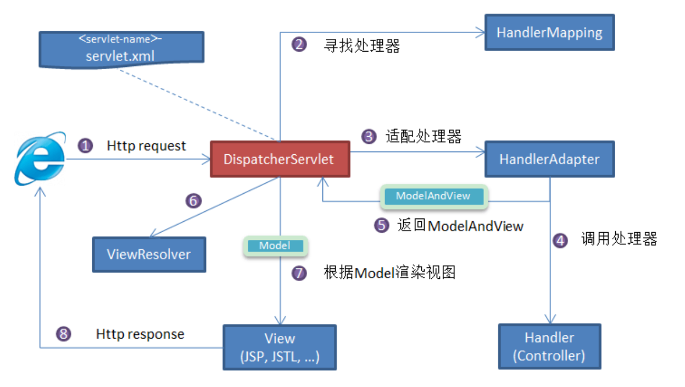
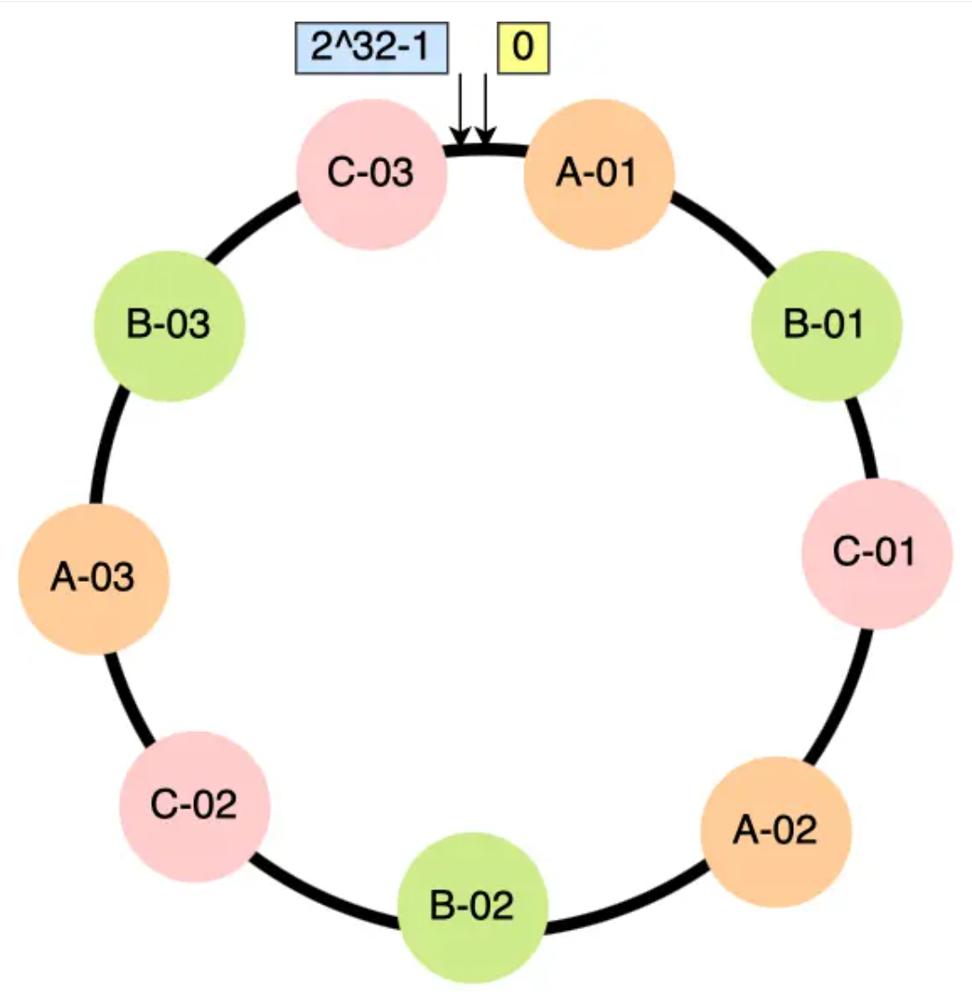

### Spring框架的作用

1. 诞生背景 & 解决的问题

早期 Java EE（尤其是 EJB）开发**复杂、重量、强侵入**，对象创建、事务、安全等样板代码多、测试困难。**Spring 通过 IoC/AOP 把业务代码与基础设施解耦**，让我们写 POJO 就能享受企业级能力。

2. 核心能力（必须说的三件事）

1. **IoC / DI（控制反转/依赖注入）**
   - 容器负责对象的创建、装配、生命周期管理，**降低耦合、提升可测试性**。
2. **AOP（面向切面编程）**
   - 把事务、日志、权限、监控等**横切关注点统一下沉**，让业务代码保持“干净”。
3. **声明式事务管理**
   - 通过 `@Transactional` 等注解即可优雅地控制事务边界，一致、可配置、易维护。

3. 生态（体现你对 Spring 的全面理解）

- **Spring Boot**：自动装配、Starter 体系、约定优于配置，极大提升开发效率。
- **Spring MVC / WebFlux**：同步 & 响应式 Web 开发。
- **Spring Data**：统一数据访问抽象（JPA、Mongo、Redis 等）。
- **Spring Security**：认证、鉴权的标准方案。
- **Spring Cloud**：微服务全家桶（注册发现、配置中心、熔断、网关、链路追踪等）。
- **Spring Batch / Integration**：批处理、集成中间件。

4. 设计理念（面试官喜欢听的关键词）

- **轻量、非侵入、面向接口编程、关注点分离、约定优于配置、模块化、可测试性**。
- **扩展点丰富（BeanPostProcessor、BeanFactoryPostProcessor、Condition、Starter）**，框架本身“可插拔”。

5. 团队收益（用业务价值收尾）

- **开发效率高**、**样板代码少**、**架构一致性强**、**易于测试与维护**、**支持从单体到微服务的演进**。


### 声明为一个Bean的注解


### 向容器注册一个对象的方式

**静态配置 → 注解/JavaConfig → 基于 @Import 的高级方式 → Boot 自动装配 → 运行期编程式注册**

#### 1. XML 方式（早期/遗留系统常见）

1.1 `<bean>` 明确声明

```xml
<!-- applicationContext.xml -->
<bean id="userService" class="com.xxx.UserService"/>
```

1.2 `<context:component-scan>` 配合注解扫描

```xml
<context:component-scan base-package="com.xxx"/>
```

#### 2. 基于注解扫描（最常用）

> 需要有 **@ComponentScan**（或 Spring Boot 的默认扫描）

- `@Component` / `@Service` / `@Repository` / `@Controller` / `@Configuration`
- @Repository额外异常转换，@Service没有变化，@Controller额外请求映射

```java
@Component
public class UserService {}
@SpringBootApplication  // 内含 @ComponentScan
public class App {}
```

#### 3. JavaConfig：`@Configuration + @Bean`

> 适合第三方类、无法加注解的类、需要可控的 Bean 构造逻辑

```java
@Configuration
public class AppConfig {
    @Bean
    public OrderService orderService(UserService userService) {
        return new OrderService(userService);
    }
}
```

#### 4. 基于 `@Import` 的多种注册姿势（高级 & 扩展框架时常用）

#### 5. Spring Boot 自动装配（约定优于配置）

#### 6. 编程式 / 运行期动态注册

#### 7. `FactoryBean`（“注册工厂，产出目标bean”）

> 注册的是 **FactoryBean** 实例，容器最终暴露它 `getObject()` 产生的 bean

```java
public class MyFactoryBean implements FactoryBean<UserService> {
    @Override
    public UserService getObject() { return new UserService(); }
    @Override
    public Class<?> getObjectType() { return UserService.class; }
}
@Bean
public MyFactoryBean userService() { return new MyFactoryBean(); }
```

> 想拿到 **工厂本身** 用 `&beanName`：`ctx.getBean("&userService")`


### 注入bean使用的注解

`@Autowired` 是 Spring 提供的注解，`@Resource` 是 JDK 提供的注解。

`Autowired` 默认的注入方式为先byType再byName，`@Resource`默认注入方式为byName

```java
// 报错，byName 和 byType 都无法匹配到 bean
@Autowired
private SmsService smsService;

// 正确注入 SmsServiceImpl1 对象对应的 bean
@Autowired
private SmsService smsServiceImpl1;

// 正确注入  SmsServiceImpl1 对象对应的 bean
// smsServiceImpl1 就是我们上面所说的名称
@Autowired
@Qualifier(value = "smsServiceImpl1")
private SmsService smsService;

// 报错，byName 和 byType 都无法匹配到 bean
@Resource
private SmsService smsService;

// 正确注入 SmsServiceImpl1 对象对应的 bean
@Resource
private SmsService smsServiceImpl1;

// 正确注入 SmsServiceImpl1 对象对应的 bean（比较推荐这种方式）
@Resource(name = "smsServiceImpl1")
private SmsService smsService;
```


### 注入方式

#### 1) 构造器注入（**最推荐**）

```java
@Service
public class OrderService {
    private final UserService userService;
    public OrderService(UserService userService) {   // 必需依赖
        this.userService = userService;
    }
}
```

- **优点**：依赖不可变、天然适配单元测试、循环依赖容易被及时暴露。
- Spring 4.3+：**单构造器可省略 `@Autowired`**。

#### 2) Setter / 普通方法注入（适合“可选依赖/后置装配”）

```java
@Service
public class OrderService {
    private PayClient payClient;
    @Autowired
    public void setPayClient(PayClient payClient) {  // 可选/可替换依赖常用
        this.payClient = payClient;
    }
}
```

#### 3) 字段注入（**不推荐用于业务代码**）

```java
@Autowired
private UserService userService;
```

**不可变性差**
 字段不能设成 `final`，Bean 创建后依赖仍是可变的；而构造器注入能把依赖声明为 `final`，对象更安全、更健壮。

**可测试性差**
 想单元测试一个用字段注入的类，必须：

- 启动 Spring 容器，或
- 反射 `setAccessible(true)`/`ReflectionTestUtils.setField(...)` 去塞 mock
   构造器注入则可以 **直接 `new` + 传入 mock**，TDD 友好。

**依赖不透明，难以做静态检查**
 字段注入把依赖“藏在类体里”，读构造器签名/方法签名看不到真实依赖；构造器注入能让 **IDE / 代码审查 / 设计评审** 一眼看清“这个类到底依赖了谁”。

#### 4) `@Bean` 方法参数注入（JavaConfig 里常见）

```java
@Configuration
class AppConfig {
    @Bean
    OrderService orderService(UserService userService) { // 参数同样走容器注入
        return new OrderService(userService);
    }
}
```

#### 5) `@Lookup` / `ObjectProvider` / `Provider`

- 解决 **单例中需要按需获取 prototype / 条件性依赖** 的问题。

```java
@Autowired
private ObjectProvider<DiscountService> discountServiceProvider;

public void doPay() {
    DiscountService ds = discountServiceProvider.getIfAvailable();
}
```


### bean作用域选择

| 使用场景                             | 推荐作用域          | 说明                   |
| ------------------------------------ | ------------------- | ---------------------- |
| **无状态服务类、工具类**             | `singleton`（默认） | 性能最好，避免重复创建 |
| **带有用户状态的对象（如购物车）**   | `session`           | 每个用户独立状态       |
| **处理一次性输入输出的封装对象**     | `prototype`         | 避免线程安全问题       |
| **Controller 中注入 request 参数类** | `request`           | 每个请求独立           |
| **实时通信、WebSocket 聊天服务**     | `websocket`         | 每个连接独立实例       |


### Spring AOP

切面编程是基于动态代理、字节码操作

动态代理的实现由：JDK Proxy、CGLIB

也可以直接使用现成的AOP框架AspectJ（字节码操作）


### MVC和Spring MVC

#### **MVC 是一种架构模式**

- 全称：**Model-View-Controller**
- 本质：将“业务逻辑、用户界面、用户输入”三者分离，提高系统的可维护性和可扩展性。

#### **Spring MVC 是 Spring 框架对 MVC 的具体实现**



**`DispatcherServlet` 是前端控制器**：所有请求**先到它**，它**不直接做业务**，而是**根据映射表把请求分发给真正的处理器（Controller 方法）**，再把返回结果“交给视图解析器/消息转换器”渲染成 HTML 或 JSON，最后写回浏览器。

#### ① 浏览器发起 **HTTP Request** 进入 `DispatcherServlet`

- 容器（Tomcat/Jetty/Undertow）根据 URL 映射，把请求交给 `DispatcherServlet.service()`。
- Spring MVC 的主流程在 `DispatcherServlet#doDispatch()` 中完成。

> 这里你可以把 `DispatcherServlet` 看成“总调度员”。

#### ② `DispatcherServlet` 找 **HandlerMapping**（找“谁来处理这个请求”）

- 核心接口：`HandlerMapping`。Spring MVC 会准备好多种实现，常见：
  - **`RequestMappingHandlerMapping`**：处理 `@RequestMapping/@GetMapping/...` 标注的方法（现代最常用）。
  - `BeanNameUrlHandlerMapping`：用 beanName 当 URL（较少见）。
- 这一步会得到一个 **HandlerExecutionChain**：
  - **handler**：真正的处理器（在现代 Spring MVC 中通常是一个 `HandlerMethod`，也就是“某个 `@Controller` 的某个方法”）。
  - **interceptors**：与该 handler 绑定的**拦截器链**（`preHandle/postHandle/afterCompletion`）。

> **图里“寻找处理器（HandlerMapping）” 对应步骤 ②。**

#### ③ 选一个 **HandlerAdapter**（“如何去调用这个 handler”）

- 因为不同年代/风格的 handler 形式不一样（方法、Controller 接口实现类、函数式等），需要用适配器来“统一调用方式”。
- 现代 Spring MVC 里最常用的是 **`RequestMappingHandlerAdapter`**，它知道如何：
  - 参数解析（`@RequestParam/@PathVariable/@RequestBody/...`）
  - 数据绑定、校验（`BindingResult`、`@Validated`）
  - 返回值处理（`ModelAndView`、`@ResponseBody` 等）

> **图里“适配处理器（HandlerAdapter）” 是步骤 ③。**

#### ④ 执行 Handler（也就是 Controller 方法）

1. **执行拦截器的 `preHandle`**（可以在这里做权限、登录校验；返回 `false` 可短路请求）。
2. **调用 Controller 方法**：
   - 方法参数的每一个位置，都会被 `HandlerMethodArgumentResolver` 解析（如 `@PathVariable Long id`、`@RequestBody UserDTO dto` 等）。
   - 方法内部完成业务逻辑。
3. **返回值**转换：
   - **返回 `ModelAndView`**：老派方式，包含逻辑视图名 + 模型数据。
   - **返回字符串（视图名）** + `Model` 参数：也会被包装成 `ModelAndView`。
   - **返回对象（`@ResponseBody`/`@RestController`）**：**不会走视图解析器**，而是由 **`HttpMessageConverter`** 序列化为 JSON/XML，直接写回响应。
   - **返回 `ResponseEntity`**：自行控制 HTTP 状态码、Header、Body，同样通过 `HttpMessageConverter` 序列化 Body。

> **图里“调用处理器（Handler）” 是步骤 ④。**

#### ⑤ Controller 返回 **ModelAndView**（或等价物）给 `DispatcherServlet`

- 这是图中“返回 ModelAndView”的 ⑤。
- 如果是 `@ResponseBody/RestController` 的 JSON 返回，这里通常会得到一个 **空视图（或特殊标记）**，随后直接走 **消息转换器写回响应**，不再进入视图解析（ViewResolver）流程。

#### ⑥ `DispatcherServlet` 找 **ViewResolver** 解析逻辑视图名

- **核心接口：`ViewResolver`**。常见实现：
  - `InternalResourceViewResolver`（JSP）
  - `ThymeleafViewResolver`
  - `FreeMarkerViewResolver`
- **作用**：把逻辑视图名（如 `"user/list"`）拼上前后缀（`/WEB-INF/views/` + `user/list` + `.jsp`），最终得到一个具体的 **View** 对象。

> **图中“根据逻辑 View 查找实际的 View” 是步骤 ⑥。**

#### ⑦ 视图渲染（`view.render(model, request, response)`）

- **`DispatcherServlet` 把 Model（模型数据）交给 View，调用 `render()` 渲染**：
  - JSP：转发到具体 JSP，由 JSP 引擎把 `model` 中的数据放进 `request`，然后用 JSTL/EL 渲染。
  - Thymeleaf：模板引擎把 model “填入”模板，生成 HTML。
  - 若是 `@ResponseBody`：此步骤被 **`HttpMessageConverters`** 替代，直接把对象序列化为 JSON（或其它媒体类型）写回 `HttpServletResponse`。

> **图中“根据 Model 渲染视图” 是步骤 ⑦。**

#### ⑧ 返回 **HTTP Response** 给浏览器

- 拦截器 `postHandle`（在渲染前）和 `afterCompletion`（请求彻底完成后）会被依次调用，做资源清理、日志收尾等。
- 最终，容器把响应返回给客户端。

#### MVC 在现代后端项目中的具体体现（以 Spring Boot 项目为例）

| MVC 部分       | 角色/文件                                                    | 说明                                    |
| -------------- | ------------------------------------------------------------ | --------------------------------------- |
| **Model**      | `Entity`（实体类） `DTO`（传输对象） `DAO/Repository`（数据访问） `Service`（业务逻辑） | 负责表示数据结构和业务逻辑              |
| **View**       | `Thymeleaf`、`JSP`、`HTML`、`JSON`（前端）                   | 展示结果页面或数据（接口时代多为 JSON） |
| **Controller** | `@Controller` 或 `@RestController`                           | 接收请求、调用业务、返回数据或视图      |


### 统一异常处理

@ControllerAdvice + @ExceptionHandler


### 循环依赖

**没有 Spring 时**，靠这种**字段直接 `new` 对方**的方式形成循环依赖，会导致无限递归构造，从而StackOverflowError。

```java
public class CircularDependencyA {
    private CircularDependencyB circB = new CircularDependencyB();
}

public class CircularDependencyB {
    private CircularDependencyA circA = new CircularDependencyA();
}
```

使用spring后

```java
@Component
public class CircularDependencyA {
    @Autowired
    private CircularDependencyB circB;
}

@Component
public class CircularDependencyB {
    @Autowired
    private CircularDependencyA circA;
}
```

Spring 解决单例循环依赖的关键是“三级缓存”搬运：当容器 `new` 出 A 时先把生成 A-早期引用的 `ObjectFactory` 放入 **三级缓存**；A 进入属性注入阶段需要 B，于是同样 `new` 出 B 并把 B 的 `ObjectFactory` 放进三级缓存；给 B 注入 `a` 时，先从一级、二级缓存查不到，再调用三级缓存里的 `ObjectFactory` 获取 **早期 A**（仅实例化，尚未依赖注入/初始化），将其移入 **二级缓存** 并删除对应的工厂，这样 B 可以完成注入并初始化成 **完全体**，进入 **一级缓存**；随后回到 A，给它注入已完整的 B，A 也完成初始化并进入一级缓存，至此循环依赖解除，最终只有一级缓存保留完整 Bean。

**使用 `@Lazy` 的情况下**：Spring 不会立即创建 `B`，而是会注入一个 `B` 的代理对象。由于此时 `B` 仍未被真正初始化，`A` 的初始化可以顺利完成。等到 `A` 实例实际调用 `B` 的方法时，代理对象才会触发 `B` 的真正初始化。

最佳实践仍然是尽量避免设计上的循环依赖。


#### 重构循环依赖

循环依赖

```java
@Service
class OrderService {
    @Autowired private PaymentService paymentService;
    public void placeOrder(...) { paymentService.pay(...); }
}

@Service
class PaymentService {
    @Autowired private OrderService orderService;
    public void pay(...) { orderService.updateOrderStatus(...); }
}
```

重构：抽出 Orchestrator / 事件

```java
@Service
@RequiredArgsConstructor
class OrderFacade {
    private final OrderService orderService;
    private final PaymentService paymentService;

    public void placeOrder(...) {
        orderService.create(...);
        paymentService.pay(...);
        orderService.updateStatus(...);
    }
}
```

#### 不能解决的循环依赖

> 前两种：构造器注入，原型模式作用域

| 场景                                                         | 为什么解决不了                                               |
| ------------------------------------------------------------ | ------------------------------------------------------------ |
| **① 构造器注入环**（A⇄B 都写在构造方法）                     | 构造器里必须拿到**完整体**，Spring 在 `new` 出第一只 Bean 时就要把依赖全部准备好，三级缓存还来不及介入 |
| **② Prototype 作用域相互引用**                               | 原型 Bean 不进单例池，Spring **不会缓存**早期实例，无法 “提前暴露” |
| **③ 已显式关闭 allowCircularReferences**（Spring Boot 2.6+ 默认就是 false） | `DefaultListableBeanFactory#setAllowCircularReferences(false)` 会跳过三级缓存逻辑；Boot 2.6 起若不手动打开 `spring.main.allow-circular-references=true`，任何循环都会阻止启动 |
| **④ 需要 AOP 代理且两边都互依**                              | 早期暴露的是“裸对象”，初始化后又被 CGLIB/JDK 动态代理包了一层；Spring 检测到 **原始引用 ≠ 最终代理** 时，会认为依赖链不一致而报错 |
| **⑤ AOT / 原生映像上下文**                                   | Spring AOT 编译时会生成固定的实例化路径，无法在运行时再插入“提前曝光”，因此**任何显式循环依赖都会导致启动失败** |


### 事务


#### 事务是什么

用了 `@Transactional` 注解，但它本质上做的是：

1. **Spring AOP 拦截方法**
2. **调用数据库连接的 setAutoCommit(false)**，开始事务
3. **方法执行成功后调用 commit**
4. **方法抛异常时调用 rollback**

```java
@Transactional
public void transferMoney() {
    // update 账户A 减钱
    // update 账户B 加钱
    // 如果失败，则 rollback
}
```

#### 为什么需要数据库事务的支持

Spring 事务只是**“声明、传播、拦截、决定何时提交/回滚”**的**协调者/门面**；真正把一系列 SQL 原子化、隔离化并持久化（ACID）的，是**数据库（或其他资源管理器）本身的事务机制**。没有底层数据库的事务，Spring 就没法把已经发送出去并生效的更改“卷回去”。

#### 事务的常用属性

| 属性名          | 作用说明                                     | 常用取值/类型                                                | 说明/备注                                |
| --------------- | -------------------------------------------- | ------------------------------------------------------------ | ---------------------------------------- |
| `propagation`   | 事务**传播行为**：方法遇到事务时如何处理     | `REQUIRED`（默认）、`REQUIRES_NEW`、`NESTED`、`SUPPORTS`、`NOT_SUPPORTED`、`NEVER`、`MANDATORY` | 控制是否新建事务、加入已有事务等         |
| `isolation`     | 事务**隔离级别**：控制并发事务间的可见性问题 | `DEFAULT`、`READ_COMMITTED`、`REPEATABLE_READ`（MySQL默认）、`SERIALIZABLE` 等 | 防止脏读、不可重复读、幻读               |
| `rollbackFor`   | 指定哪些**异常**会触发回滚                   | 类名数组，如 `Exception.class`                               | 默认只回滚 `RuntimeException` 和 `Error` |
| `noRollbackFor` | 指定哪些异常不会触发回滚                     | 类名数组，如 `IllegalArgumentException.class`                | 和 `rollbackFor` 相反                    |
| `timeout`       | 设置事务超时时间（单位：秒）                 | 整数值（如 `5` 表示5秒）                                     | 超时未完成则自动回滚                     |
| `readOnly`      | 设置事务是否为只读                           | `true` / `false`（默认）                                     | `true` 提升查询性能，禁止写操作          |

#### 事务传播行为

> 记前三种：加入、新建、嵌套

| 传播行为           | 简要说明                                       | 典型用途                           |
| ------------------ | ---------------------------------------------- | ---------------------------------- |
| `REQUIRED`（默认） | 有事务就加入，没有就新建事务                   | 常规业务逻辑                       |
| `REQUIRES_NEW`     | 总是新建事务，挂起当前事务                     | 日志记录、补偿操作等需要隔离的逻辑 |
| `NESTED`           | 嵌套事务，当前有事务则建立保存点，否则新建事务 | 子事务可以单独回滚，主事务不受影响 |
| `SUPPORTS`         | 有事务就用，没有就非事务方式运行               | 查询逻辑可用                       |
| `NOT_SUPPORTED`    | 强制非事务运行，挂起当前事务                   | 发送MQ、调用外部服务不希望在事务中 |
| `NEVER`            | 强制无事务运行，当前有事务则抛异常             | 严禁在事务中执行的方法             |
| `MANDATORY`        | 必须在事务中运行，否则抛异常                   | 必须依附已有事务的逻辑             |


### Spring Data JPA

Java Persistence API，简化对象和数据库之间的操作。


## Spring Boot

### 配置类

1 `@Configuration + @Bean`：显式声明 Bean

```java
@Configuration
public class AppConfig {

    @Bean
    public RestTemplate restTemplate() {
        return new RestTemplate();
    }

    // 线程池示例
    @Bean
    public ThreadPoolTaskExecutor taskExecutor(AppThreadPoolProperties props) {
        ThreadPoolTaskExecutor ex = new ThreadPoolTaskExecutor();
        ex.setCorePoolSize(props.getCoreSize());
        ex.setMaxPoolSize(props.getMaxSize());
        ex.setQueueCapacity(props.getQueueCapacity());
        ex.initialize();
        return ex;
    }
}
```

2 `@ConfigurationProperties`：把 yml 配置绑定成一个“配置对象”

**配置类（POJO）**：

```java
@Data
@ConfigurationProperties(prefix = "app.thread-pool")
// Boot 2.2+ 推荐再配合 @ConfigurationPropertiesScan 或 @EnableConfigurationProperties
public class AppThreadPoolProperties {
    private int coreSize = 4;
    private int maxSize = 8;
    private int queueCapacity = 100;
}
```

**配置文件 `application.yml`：**

```yaml
app:
  thread-pool:
    core-size: 10
    max-size: 20
    queue-capacity: 200
```

**让它生效的两种方式（二选一）：**

1. **在任意 `@Configuration` 类或 `@SpringBootApplication` 上开启扫描**

```java
@SpringBootApplication
@ConfigurationPropertiesScan // 自动扫描同包及子包下的 @ConfigurationProperties 类
public class DemoApplication { }
```

1. **或者显式开启**

```java
@Configuration
@EnableConfigurationProperties(AppThreadPoolProperties.class)
public class PropsConfig { }
```

然后你就可以在其他 Bean 里直接注入 `AppThreadPoolProperties` 使用。


#### 什么是自动装配

当你启动 Spring Boot 应用时，**Spring Boot 会自动检查你项目中依赖的库（比如数据库、消息队列、Web 相关库等）**，然后自动为你配置所需的 Bean。例如，如果你引入了数据库相关的依赖，Spring Boot 会自动帮你配置好数据源、事务管理等必要的组件。

#####  1. Web 应用的 DispatcherServlet（核心前端控制器）

- **传统方式：**

  ```xml
  <servlet>
      <servlet-name>dispatcher</servlet-name>
      <servlet-class>org.springframework.web.servlet.DispatcherServlet</servlet-class>
  </servlet>
  <servlet-mapping>
      <servlet-name>dispatcher</servlet-name>
      <url-pattern>/</url-pattern>
  </servlet-mapping>
  ```

- **Spring Boot：**什么都不写，Spring Boot 自动注册 DispatcherServlet，并映射到 "/"

------

##### 2.  配置 Thymeleaf 作为模板引擎

- **传统方式：**

  ```xml
  <bean id="templateResolver" class="org.thymeleaf.spring5.templateresolver.SpringResourceTemplateResolver">
      <property name="prefix" value="/WEB-INF/templates/"/>
      <property name="suffix" value=".html"/>
      ...
  </bean>
  ```

- **Spring Boot：**

  ```xml
  <!-- 只需要引入依赖 -->
  <dependency>
      <groupId>org.springframework.boot</groupId>
      <artifactId>spring-boot-starter-thymeleaf</artifactId>
  </dependency>
  ```

  自动装配类 `ThymeleafAutoConfiguration` 检测到了类路径中有 Thymeleaf，就帮你配置好了模板解析器等 Bean。

------

##### 3. 配置数据库连接池（如 HikariCP）

- **传统方式：**

  ```xml
  <bean id="dataSource" class="com.zaxxer.hikari.HikariDataSource">
      <property name="jdbcUrl" value="jdbc:mysql://localhost:3306/test"/>
      <property name="username" value="root"/>
      <property name="password" value="1234"/>
  </bean>
  ```

- **Spring Boot：**

  ```yaml
  spring.datasource.url: jdbc:mysql://localhost:3306/test
  spring.datasource.username: root
  spring.datasource.password: 1234
  ```

  Spring Boot 检测到配置后，自动通过 `DataSourceAutoConfiguration` 装配了 HikariDataSource。

#### 自动装配的原理是什么

Spring Boot 通过 `@EnableAutoConfiguration` 开启自动装配机制，底层通过 `SpringFactoriesLoader` 加载 `META-INF/spring.factories` 中声明的自动配置类。这些自动配置类本质上是使用了 `@Conditional` 系列注解的配置类，会根据当前类路径、Bean 状态、配置属性等条件按需生效。为了触发这些自动配置类的加载，通常需要通过引入 `spring-boot-starter-xxx` 起步依赖，间接引入相关依赖和自动配置模块。

#### Spring Boot 启动器

**Spring Boot 启动器**（`starter`）是一个约定优于配置的概念，Spring Boot 提供了一些预配置的模块，来让开发者能够快速使用常见的功能。每个启动器会自动引入一些常用的库依赖，并做适当的配置，减少了开发者在项目中手动配置和引入依赖的繁琐。

**spring-boot-starter-web**：用于构建 Web 应用，自动引入了 Spring MVC、Tomcat 等依赖。

**spring-boot-starter-data-jpa**：用于使用 Spring Data JPA 进行数据库操作，自动引入 Hibernate、Spring Data JPA 等相关依赖。

**spring-boot-starter-thymeleaf**：用于构建基于 Thymeleaf 模板引擎的 Web 应用。

**spring-boot-starter-test**：用于测试的启动器，自动引入 JUnit、Mockito、Spring Test 等依赖。

**spring-boot-starter-actuator**：用于应用监控、度量、管理的启动器，自动提供多种应用健康检查功能。

### 什么是`@Async` 

`@Async` 由 Spring 框架提供，被该注解标注的类或方法会在 **异步线程** 中执行。这意味着当方法被调用时，调用者将不会等待该方法执行完成，而是可以继续执行后续的代码。

`@Async` 注解的使用非常简单，需要两个步骤：

1. 在**启动类**上添加注解 `@EnableAsync` ，开启异步任务。
2. 在需要异步执行的方法或类上添加注解 `@Async` 。

`@Async` 注解原理：

`@Async` 可以异步执行任务，本质上是使用 **动态代理** 来实现的。通过 Spring 中的后置处理器 `BeanPostProcessor` 为使用 `@Async` 注解的类创建动态代理，之后 `@Async` 注解方法的调用会被动态代理拦截，在拦截器中将方法的执行封装为异步任务提交给线程池处理。


## Spring Cloud

### 负载均衡算法

#### 一致性哈希算法

在某些分布式系统中，数据是分片存储的，那么不能使用轮询算法，需要将特定的数据映射到固定的节点。

最容易想到的就是哈希算法，但是普通哈希有个缺点，在节点增删之后映射会变。

一致性哈希的思路是固定哈希的模，把节点绑定到环上，查找时找顺时针最近的节点。

这样还有一个问题，个节点之间不一定均衡，解决办法是采用虚拟节点，每个物理节点对于几个虚拟节点。



### 服务熔断

**服务熔断**（Service Circuit Breaker）是指在分布式系统中，当某个服务出现故障或性能下降时，通过一定的机制（如熔断器模式）来防止故障进一步扩展，保护系统其他部分不受到影响，最终提高系统的稳定性和可靠性。

服务熔断的原理：

服务熔断的核心思想借鉴了 **电路断路器** 的原理。在电路中，当发生电流过大或发生短路时，断路器会自动切断电流，防止电流过大造成电路损坏。在微服务架构中，服务熔断起到类似的作用，它在检测到服务异常时，自动停止请求该服务，避免因持续调用失败的服务而加剧系统压力。

### 服务降级

**服务降级**（Service Degradation）是指在分布式系统或微服务架构中，当某个服务无法正常响应时，采取一定措施，提供一种相对简化、有限的功能来保证系统的基本可用性，从而避免因部分服务不可用而导致整个系统的瘫痪。服务降级通常是与**熔断**结合使用的一个重要概念。

服务降级的方式

1. **功能降级**：
   - 降级某些不影响核心业务流程的功能，例如，电商系统中的推荐服务可能会被降级，当系统检测到异常时，依然可以让用户完成购买流程，而不去展示个性化推荐。
2. **数据降级**：
   - 当后端数据库或者外部依赖服务不可用时，可以使用缓存或者静态数据替代动态获取的数据，例如，提供“最后一次成功的数据”或者“默认的推荐列表”。
3. **服务降级**：
   - 通过限制一些非核心功能的访问来降低系统的负载。比如限制某些流量大的服务或接口的调用，降低它们的优先级。
4. **接口降级**：
   - 当接口调用失败时，可以返回一个固定的默认值或错误信息，避免进一步的请求重试。例如，在支付失败时，系统返回一个错误提示并建议用户稍后重试，而不是完全中断支付服务。
5. **流量控制**：
   - 在高并发的情况下，减少处理请求的数量，通过限流、排队等方式将请求数量控制在合理范围内。

