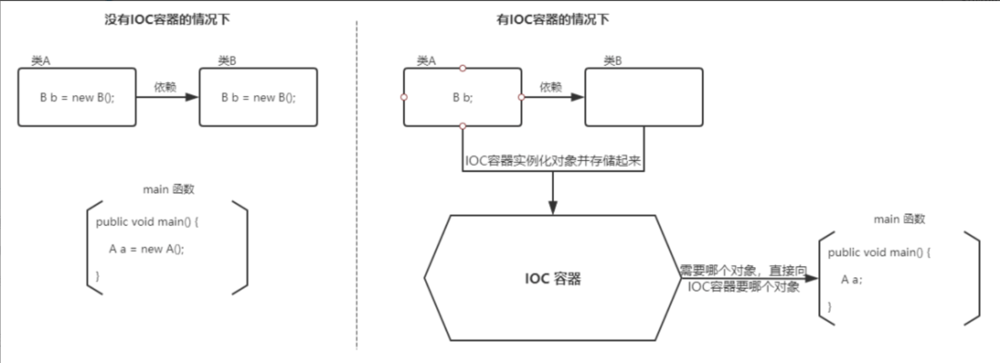
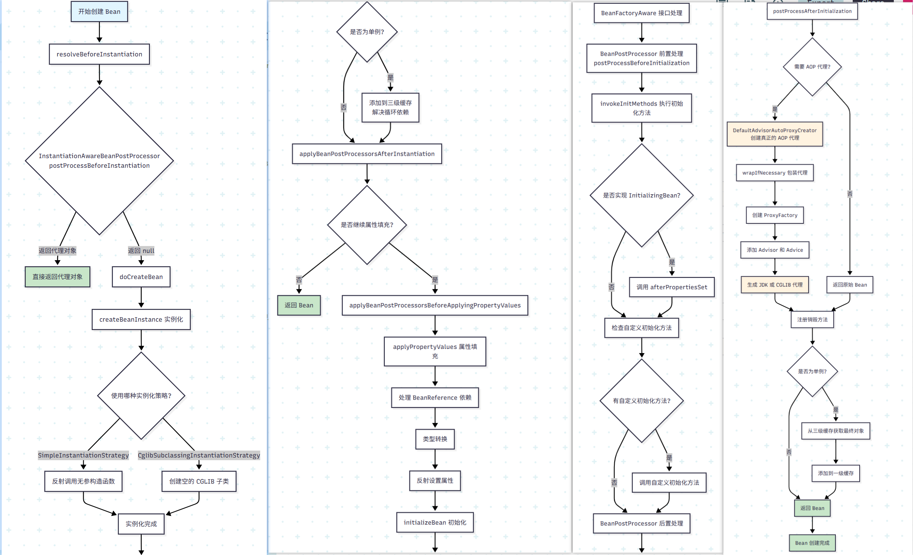
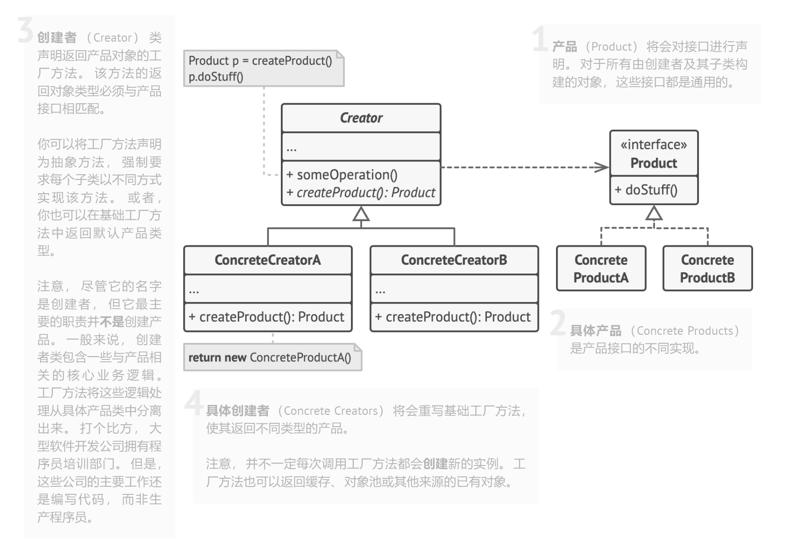
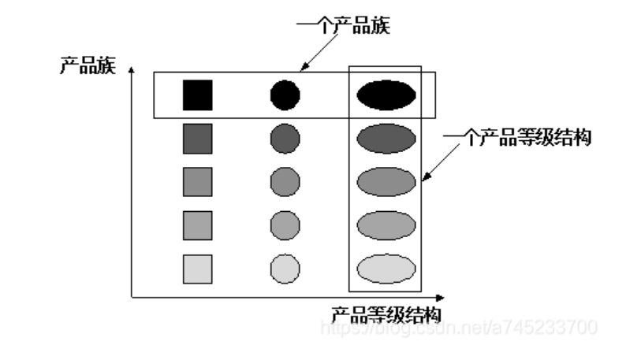
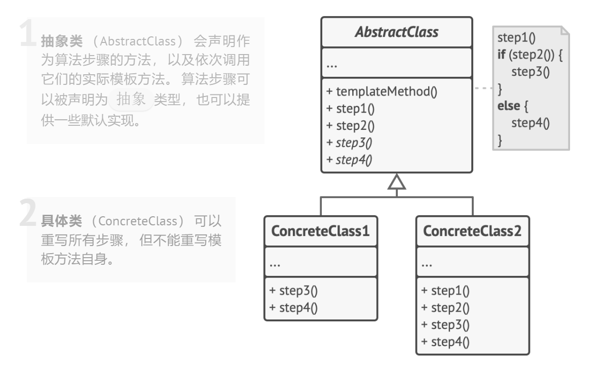
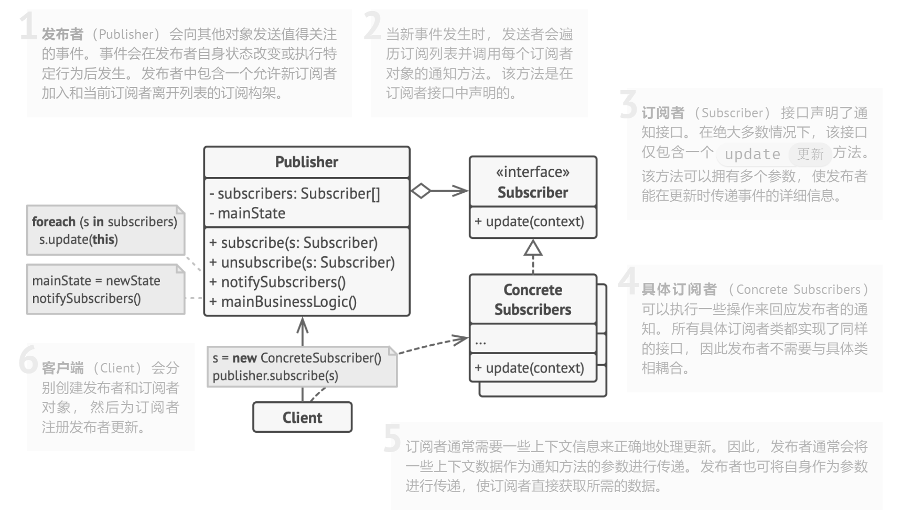
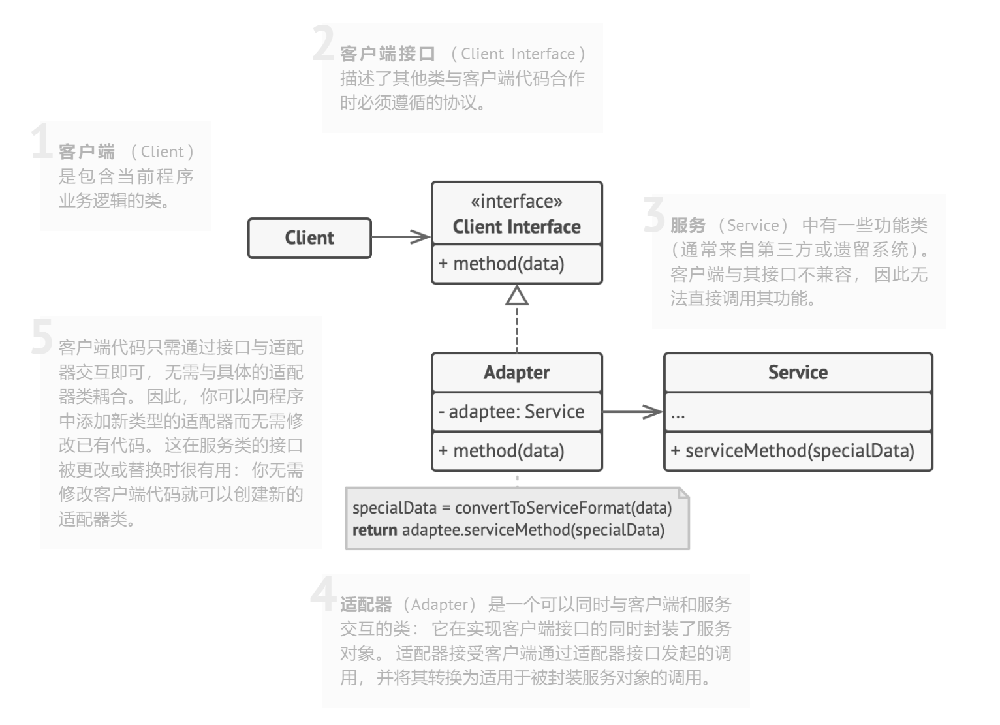
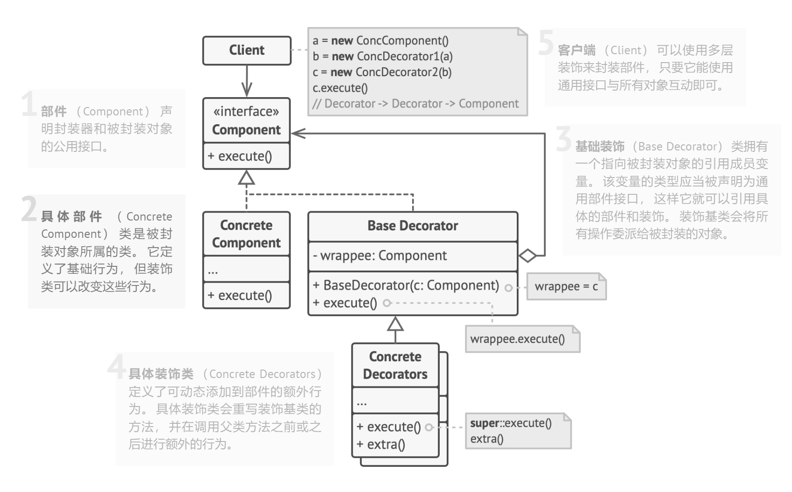
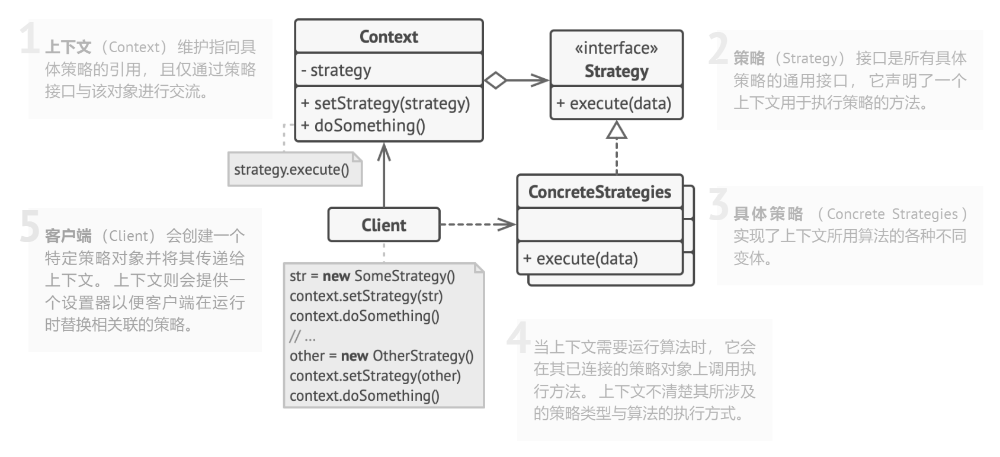

## 一、项目介绍

### 什么是IoC

https://www.cnblogs.com/xdp-gacl/p/4249939.html

IoC叫做控制反转，指的是**获得依赖对象**的过程被反转了，本来是由自己管理的，变为了由IoC容器主动注入。传统的应用中，我们通常在类内部使用new来创建依赖对象（比如某个服务），这导致类与类之间耦合度过高，改变依赖或进行单元测试都很困难。每个类不仅负责自己的业务逻辑，还要管理与其他类的依赖关系，结果就是组件之间紧密耦合，代码难以维护。

DI是实现IoC的一种方式。



### IoC相较于传统的优势

- 对象之间不互相依赖，由第三方容器来管理相关资源，**对象之间的耦合度**降低。
- **资源变的容易管理**，比如用Spring容器很容易实现单例、懒加载。

### IoC解决的问题

```java
public interface PaymentService {          // 抽象接口
    void pay(long orderId, int cents);
}
```

#### 问题一：硬编码实现

痛点 「切换实现要改源码」

```java
public class PayPalPaymentService implements PaymentService {
    public void pay(long orderId, int cents) {
        System.out.println("PayPal 支付成功");
    }
}

public class OrderService {
    // ❶ 业务类自己决定 *具体* 实现
    private final PaymentService paymentService = new PayPalPaymentService();

    public void createOrder(long id, int cents) {
        // …保存订单…
        paymentService.pay(id, cents);      // ❷ 直接使用
    }
}
```

现在不用 PayPal，改用 Stripe。只能打开 OrderService 把 new PayPalPaymentService() 改成new StripePaymentService()，然后重新编译&部署整个项目。

解决办法：业务类不再 `new`，而是「声明依赖」

```java
@Service
@RequiredArgsConstructor          // Lombok 生成构造器注入
public class OrderService {
    private final PaymentService paymentService; // 只关心接口
}
```

```yml
# application-prod.yml
payment:
  provider: paypal
  paypal:
    api-key: sk_live_prod

# application-test.yml
payment:
  provider: fake
```

```java
@Configuration
@EnableConfigurationProperties(PaymentProps.class)
public class PaymentConfig {

    @Bean
    @ConditionalOnProperty(name = "payment.provider", havingValue = "paypal", matchIfMissing = true)
    public PaymentService paypal(PaymentProps props) {
        return new PayPalPaymentService(props.getPaypal().getApiKey());
    }

    @Bean
    @ConditionalOnProperty(name = "payment.provider", havingValue = "stripe")
    public PaymentService stripe(PaymentProps props) {
        return new StripePaymentService(props.getStripe().getApiKey());
    }

    @Bean
    @ConditionalOnProperty(name = "payment.provider", havingValue = "fake")
    public PaymentService fake() {
        return orderId -> System.out.println("【Fake】skip real payment");
    }
}
```

**切换实现**：

把 `@Primary` 从 PayPal 实现移到 Stripe 实现（这个是要轻微改动代码）。

或在 `application.yml` 指定 `payment.type=stripe`，业务代码 **零改动**。

**单元测试同理**

「无法注入假实现 / Mock」

```java
// 想写一个仅打日志、不真正扣费的 Fake 实现
public class FakePaymentService implements PaymentService {
    public void pay(long orderId, int cents) {
        System.out.println("【测试环境】假扣费：" + orderId);
    }
}

public class OrderServiceTest {
    @Test
    void testCreateOrder() {
        OrderService orderService = new OrderService(); // ← 内部仍然 new PayPal
        orderService.createOrder(1L, 100);
        // 想验证 “被调用一次”，却拿不到内部的 PaymentService
    }
}
```

因为 `OrderService` **写死** 了 `new PayPalPaymentService()`，测试时你没办法塞入 `FakePaymentService` 或 Mockito 的 `Mock`。

如果坚持要测，只好：临时改源码再改回，或用反射把 `paymentService` 字段覆盖（Hack）。

```java
@SpringBootTest
class OrderServiceTest {

    @MockBean PaymentService paymentService; // Spring 替换真实 Bean
    @Autowired OrderService orderService;

    @Test
    void testCreateOrder() {
        orderService.createOrder(1L, 100);
        verify(paymentService).pay(1L, 100); // 断言被调用一次
    }
}
```

`MockBean` 会在启动测试容器时 **自动注入** `OrderService`，原本的真实实现被替换；不用反射、不改源码。

#### 问题二：配置分散且写死

```java
public class PayPalPaymentService implements PaymentService {
    // ❶ 把“敏感配置”硬写在类里
    private static final String API_KEY = "sk_live_abcdef";
    private final HttpClient client = new HttpClient("https://api.paypal.com", API_KEY);

    public void pay(long orderId, int cents) {
        client.post("/v1/pay", /* 省略 */);
    }
}
```

想在 **测试环境** 换成沙箱地址、换 API_KEY？*又要改源码* 或者写 if/else 读系统属性；随实现类数量增长，配置散落各处，难以统一管理。

**解决办法：配置集中化**

```yaml
# application.yml
payment:
  provider: paypal   # or stripe
  paypal:
    api-key: sk_live_abcdef
  stripe:
    api-key: sk_live_xyz
```

```java
@Configuration
@EnableConfigurationProperties(PaymentProps.class)
public class PaymentConfig {

    @Bean
    @ConditionalOnProperty(name = "payment.provider", havingValue = "paypal", matchIfMissing = true)
    public PaymentService paypal(PaymentProps props) {
        return new PayPalPaymentService(props.getPaypal().getApiKey());
    }
    
    @Bean
    @ConditionalOnProperty(name = "payment.provider", havingValue = "stripe")
    public PaymentService stripe(PaymentProps props) {
        return new StripePaymentService(props.getStripe().getApiKey());
    }
}
```

敏感信息和环境差异都放在配置文件，容器按条件装配，代码 **0 修改**。

#### 问题三：依赖树非常复杂

需要按顺序创建对象，相当于手工拓扑排序。

```java
public class OrderService {
    private final PaymentGateway gateway;
    private final OrderRepository orderRepo;

    public OrderService(PaymentGateway gateway, OrderRepository orderRepo) {
        this.gateway = gateway;
        this.orderRepo = orderRepo;
    }
}

// 如果所有依赖都要自己 new，会变成这样：
DataSource ds = new DataSource(url, user, pwd);
JdbcTemplate jdbc = new JdbcTemplate(ds);
OrderRepository repo = new OrderRepository(jdbc);

HttpClient http = new HttpClient(timeOut, proxy);
PaymentGateway gateway = new StripeGateway(http);

OrderService service = new OrderService(gateway, repo);
```

**IoC解决**

```java
@Service
public class OrderService {
    private final PaymentGateway gateway;
    private final OrderRepository orderRepo;
    public OrderService(PaymentGateway gateway, OrderRepository orderRepo) {
        this.gateway = gateway;
        this.orderRepo = orderRepo;
    }
}

@Repository
public class OrderRepository {
    private final JdbcTemplate jdbc;
    public OrderRepository(JdbcTemplate jdbc) { this.jdbc = jdbc; }
}
```

然后把**基础设施**声明为 Bean（自己写或用 Boot 的自动配置）：

```java
@Configuration
public class InfraConfig {

    @Bean
    DataSource dataSource(AppDataSourceProps p) {
        return DataSourceBuilder.create()
                .url(p.getUrl()).username(p.getUser()).password(p.getPwd()).build();
    }

    @Bean
    JdbcTemplate jdbcTemplate(DataSource ds) {
        return new JdbcTemplate(ds);
    }

    @Bean
    HttpClient httpClient(HttpProps p) {
        return HttpClient.newBuilder()
                .connectTimeout(Duration.ofMillis(p.getTimeout()))
                .proxy(p.buildProxy()).build();
    }

    @Bean
    PaymentGateway paymentGateway(HttpClient http, PaymentProps p) {
        return new StripeGateway(http, p.apiKey());
    }
}
```

关键点：构造器参数/@Bean 方法参数就是你的“依赖声明”。容器会据此自动计算出创建顺序。

### 什么是AOP

**<u>AOP 的目的是将横切关注点从核心业务逻辑中分离出来</u>**，通过动态代理、字节码操作等技术，通过将横切关注点（例如日志记录、事务管理、安全验证等）与业务逻辑分离，从而提高代码的模块化程度。AOP的核心思想是将通用功能提取成独立的模块，称为**切面（Aspect）**，然后在合适的地方将这些切面动态地应用到目标对象上，而无需改变目标对象的代码。

**横切关注点（cross-cutting concerns）** ：多个类或对象中的公共行为（如日志记录、事务管理、权限控制、接口限流、接口幂等等）。

**切面（Aspect）**：对横切关注点进行封装的类，一个切面是一个类。切面可以定义多个通知，用来实现具体的功能。

**连接点（JoinPoint）**：连接点是方法调用或者方法执行时的某个特定时刻（如方法调用、异常抛出等）。

**通知（Advice）**：通知就是切面在某个连接点要执行的操作。通知有五种类型，分别是前置通知（Before）、后置通知（After）、返回通知（AfterReturning）、异常通知（AfterThrowing）和环绕通知（Around）。前四种通知都是在目标方法的前后执行，而环绕通知可以控制目标方法的执行过程。

**切点（Pointcut）**：一个切点是一个表达式，它用来匹配哪些连接点需要被切面所增强。切点可以通过注解、正则表达式、逻辑运算等方式来定义。比如 `execution(* com.xyz.service..*(..))`匹配 `com.xyz.service` 包及其子包下的类或接口。

**织入（Weaving）**：织入是将切面和目标对象连接起来的过程，也就是将通知应用到切点匹配的连接点上。常见的织入时机有两种，分别是编译期织入（Compile-Time Weaving 如：AspectJ）和运行期织入（Runtime Weaving 如：AspectJ、Spring AOP）。

### 实现AOP的方式

- Spring AOP就是基于**动态代理**的，如果要代理的对象，实现了某个接口，那么Spring AOP会使用 **JDK Proxy**，去创建代理对象，而对于没有实现接口的对象，就无法使用JDK Proxy去进行代理了，这时候 Spring AOP 会使用 **Cglib** 生成一个被代理对象的子类来作为代理。

- 基于**操作字节码**的Aspectj，功能多，性能强大。
- Spring AOP 属于运行时增强，而 AspectJ 是编译时增强。
- 动态代理的实现也是反射技术。CGLIB 动态代理使用的是 ASM 技术，而这种技术大致原理是运行时直接在内存中生成并加载修改后的字节码文件也就是 `.class` 文件。

### 什么是循环依赖

循环依赖（circular dependency）指的是**Bean A 依赖 Bean B，而 Bean B 又依赖 Bean A**（或更长的环 A→B→C→A）。在 IoC 容器创建 Bean 时，如果不做特殊处理，就会出现“实例化 A → 需要 B → 实例化 B → 需要 A → …”的无限递归，最终栈溢出或抛出“正在创建中的 Bean”之类的异常。

### 如何解决循环依赖

Spring容器只是解决了单例模式下的非构造函数注入的循环依赖问题，其他循环依赖会报错。

### Bean的生命周期

```mermaid
graph TD
    A[开始创建 Bean] --> B[resolveBeforeInstantiation]
    B --> C{InstantiationAwareBeanPostProcessor<br/>postProcessBeforeInstantiation}
    C -->|返回代理对象| D[直接返回代理对象]
    C -->|返回 null| E[doCreateBean]
    
    E --> F[createBeanInstance 实例化]
    F --> G{使用哪种实例化策略?}
    G -->|SimpleInstantiationStrategy| H[反射调用无参构造函数]
    G -->|CglibSubclassingInstantiationStrategy| I[创建空的 CGLIB 子类]
    
    H --> J[实例化完成]
    I --> J
    
    J --> K{是否为单例?}
    K -->|是| L[添加到三级缓存<br/>解决循环依赖]
    K -->|否| M[属性填充前处理]
    
    L --> M[applyBeanPostProcessorsAfterInstantiation]
    M --> N{是否继续属性填充?}
    N -->|否| O[返回 Bean]
    N -->|是| P[applyBeanPostProcessorsBeforeApplyingPropertyValues]
    
    P --> Q[applyPropertyValues 属性填充]
    Q --> R[处理 BeanReference 依赖]
    R --> S[类型转换]
    S --> T[反射设置属性]
    
    T --> U[initializeBean 初始化]
    U --> V[BeanFactoryAware 接口处理]
    V --> W[BeanPostProcessor 前置处理<br/>postProcessBeforeInitialization]
    
    W --> X[invokeInitMethods 执行初始化方法]
    X --> Y{是否实现 InitializingBean?}
    Y -->|是| Z[调用 afterPropertiesSet]
    Y -->|否| AA[检查自定义初始化方法]
    Z --> AA
    AA --> BB{有自定义初始化方法?}
    BB -->|是| CC[调用自定义初始化方法]
    BB -->|否| DD[BeanPostProcessor 后置处理]
    CC --> DD
    
    DD --> EE[postProcessAfterInitialization]
    EE --> FF{需要 AOP 代理?}
    FF -->|是| GG[DefaultAdvisorAutoProxyCreator<br/>创建真正的 AOP 代理]
    FF -->|否| HH[返回原始 Bean]
    
    GG --> II[wrapIfNecessary 包装代理]
    II --> JJ[创建 ProxyFactory]
    JJ --> KK[添加 Advisor 和 Advice]
    KK --> LL[生成 JDK 或 CGLIB 代理]
    
    LL --> MM[注册销毁方法]
    HH --> MM
    MM --> NN{是否为单例?}
    NN -->|是| OO[从三级缓存获取最终对象]
    NN -->|否| PP[返回 Bean]
    OO --> QQ[添加到一级缓存]
    QQ --> PP
    
    PP --> RR[Bean 创建完成]
    
    style A fill:#e1f5fe
    style D fill:#c8e6c9
    style O fill:#c8e6c9
    style PP fill:#c8e6c9
    style RR fill:#c8e6c9
    style GG fill:#fff3e0
    style LL fill:#fff3e0
```





## 二、设计模式

### 1. 工厂模式

https://blog.csdn.net/a745233700/article/details/120253639

**解耦对象的创建与使用**，它通过将构造逻辑抽象成“工厂”，使得我们可以**灵活替换实现类、隐藏复杂创建过程**。客户端不需知道所创建的具体产品类的类名以及创建过程，只需知道具体产品类所对应的参数即可。

通过引入配置文件，可以在不修改任何客户端代码的情况下更换和增加新的具体产品类，在一定程度上提高了系统的灵活性。

#### 简单工厂/静态工厂

**优点：**

- 灵活的替换实现类，指的是在配置文件中修改参数。

- 隐藏负责的创建过程，参考SimpleFactory#createFruit方法，在返回对象的时候可以增加逻辑。

**缺点：**

- 不符合“开闭原则”，每次添加新产品就需要修改工厂类。

```java
// ---------- Fruit.java ----------
/**
 * 抽象产品接口
 */
public interface Fruit {
    /**
     * 吃水果的方法
     */
    void eat();
}

// ---------- Apple.java ----------
/**
 * 具体产品：苹果
 */
public class Apple implements Fruit {
    @Override
    public void eat() {
        System.out.println("正在吃苹果 🍎");
    }
}

// ---------- Banana.java ----------
/**
 * 具体产品：香蕉
 */
public class Banana implements Fruit {
    @Override
    public void eat() {
        System.out.println("正在吃香蕉 🍌");
    }
}

// ---------- SimpleFactory.java ----------
/**
 * 简单工厂类：根据入参生产不同的 Fruit 实例
 */
public class SimpleFactory {
    /**
     * 静态工厂方法
     * @param type 水果类型标识，如 "apple"、"banana"
     * @return Fruit 实例
     */
    public static Fruit createFruit(String type) {
        if ("apple".equalsIgnoreCase(type)) {
            return new Apple(); // 如果有复杂的构造逻辑，在此次添加
        } else if ("banana".equalsIgnoreCase(type)) {
            return new Banana();
        } else {
            throw new IllegalArgumentException("无法识别的水果类型：" + type);
        }
    }
}

// ---------- Main.java ----------
/**
 * 客户端测试
 */
public class Main {
    public static void main(String[] args) {
        // 测试生产苹果
        Fruit apple = SimpleFactory.createFruit("apple");
        apple.eat();    // 输出：正在吃苹果 🍎

        // 测试生产香蕉
        Fruit banana = SimpleFactory.createFruit("banana");
        banana.eat();   // 输出：正在吃香蕉 🍌

        // 测试未知类型
        // Fruit unknown = SimpleFactory.createFruit("pear"); // 会抛出 IllegalArgumentException
    }
}
```

#### 工厂方法

:star:将工厂抽象化，并定义一个**创建对象**的接口，工厂方法是指Creator#createProduct，返回值类型必须是 Product。

每增加新产品，只需增加该产品以及对应的具体实现工厂类，由具体工厂类决定要实例化的产品是哪个，将对象的创建与实例化延迟到子类，这样工厂的设计就符合“开闭原则”了，扩展时不必去修改原来的代码。

在使用时，用于只需知道产品对应的具体工厂，关注具体的创建过程，甚至不需要知道具体产品类的类名，当我们选择哪个具体工厂时，就已经决定了实际创建的产品是哪个了。

但**缺点**在于，每增加一个产品都需要增加一个具体产品类和实现工厂类，使得系统中类的个数成倍增加。



示例代码：

```java
/**
 * 1) 产品接口 —— Product
 *    所有具体产品都必须实现它并提供业务功能（这里是 doStuff）。
 */
interface Product {
    void doStuff();
}

/**
 * 2) 具体产品 —— ConcreteProductA、ConcreteProductB
 *    它们只是实现了 doStuff，各自表现不同。
 */
class ConcreteProductA implements Product {
    @Override
    public void doStuff() {
        System.out.println("ConcreteProductA is doing its stuff...");
    }
}

class ConcreteProductB implements Product {
    @Override
    public void doStuff() {
        System.out.println("ConcreteProductB is doing its stuff...");
    }
}

/**
 * 3) 抽象创建者 —— Creator
 *    - 定义了工厂方法 createProduct()，返回值类型必须是 Product；
 *    - 提供一个高层业务算法 someOperation()，算法中需要“某种产品”，
 *      但把真正的实例化延迟到子类。
 */
abstract class Creator {

    /** 子类必须实现的 *工厂方法* —— 返回某种具体产品 */
    protected abstract Product createProduct();

    /** 业务算法 —— 展示“创建 + 复用”流程 */
    public void someOperation() {
        // 通过工厂方法拿到产品
        Product p = createProduct();
        // 使用产品完成业务
        p.doStuff();
    }
}

/**
 * 4) 具体创建者 —— ConcreteCreatorA、ConcreteCreatorB
 *    - 重写 createProduct()，决定返回哪一种产品。
 *    - 一般来说，Creator 家族还会包含与“产品”密切相关的其他业务逻辑。
 */
class ConcreteCreatorA extends Creator {
    @Override
    protected Product createProduct() {
        // 👇 这里可以是更复杂的构造逻辑、缓存复用、对象池等
        return new ConcreteProductA();
    }
}

class ConcreteCreatorB extends Creator {
    @Override
    protected Product createProduct() {
        return new ConcreteProductB();
    }
}

/** ✨ 客户端示例 —— 随意切换 Creator，体验“开闭原则” */
public class FactoryMethodDemo {
    public static void main(String[] args) {
        // 想要 A 类产品
        Creator creatorA = new ConcreteCreatorA();
        creatorA.someOperation();

        // 想要 B 类产品
        Creator creatorB = new ConcreteCreatorB();
        creatorB.someOperation();
    }
}
```

#### *抽象工厂

在工厂方法模式中，我们使用一个工厂创建一个产品，一个具体工厂对应一个具体产品，但有时候我们需要一个工厂能够提供多个产品对象，而不是单一的对象，这个时候我们就需要使用抽象工厂模式。

在介绍抽象工厂模式前，我们先厘清两个概念：

产品等级结构：产品等级结构指的是产品的继承结构，例如一个空调抽象类，它有海尔空调、格力空调、美的空调等一系列的子类，那么这个空调抽象类和他的子类就构成了一个产品等级结构。

产品族：产品族是指由同一个工厂生产的，位于不同产品等级结构中的一组产品。比如，海尔工厂生产海尔空调、海尔冰箱，那么海尔空调则位于空调产品族中。

产品等级结构和产品族结构示意图如下：



抽象工厂模式主要用于创建相关对象的家族。当一个产品族中需要被设计在一起工作时，通过抽象工厂模式，能够保证客户端始终只使用同一个产品族中的对象；并且通过隔离具体类的生成，使得客户端不需要明确指定具体生成类；所有的具体工厂都实现了抽象工厂中定义的公共接口，因此只需要改变具体工厂的实例，就可以在某种程度上改变整个软件系统的行为。

```java
// ====== 产品族的两个维度 ======
interface ProductA { void workA(); }
interface ProductB { void workB(); }

// ====== Alpha 风格的一组产品 ======
class AlphaProductA implements ProductA {
    @Override public void workA() { System.out.println("Alpha A working"); }
}
class AlphaProductB implements ProductB {
    @Override public void workB() { System.out.println("Alpha B working"); }
}

// ====== Beta 风格的一组产品 ======
class BetaProductA implements ProductA {
    @Override public void workA() { System.out.println("Beta A working"); }
}
class BetaProductB implements ProductB {
    @Override public void workB() { System.out.println("Beta B working"); }
}

// ====== 抽象工厂：定义“成套创建接口” ======
interface AbstractFactory {
    ProductA createProductA();
    ProductB createProductB();
}

// ====== 具体工厂：各自产出同一风格的一整套产品 ======
class AlphaFactory implements AbstractFactory {
    @Override public ProductA createProductA() {
        System.out.println("create Alpha A");
        return new AlphaProductA();
    }
    @Override public ProductB createProductB() {
        System.out.println("create Alpha B");
        return new AlphaProductB();
    }
}

class BetaFactory implements AbstractFactory {
    @Override public ProductA createProductA() {
        System.out.println("create Beta A");
        return new BetaProductA();
    }
    @Override public ProductB createProductB() {
        System.out.println("create Beta B");
        return new BetaProductB();
    }
}

// ====== 工厂选择器（可按配置/环境切换整套风格） ======
enum Theme { ALPHA, BETA; }

final class FactoryProvider {
    static AbstractFactory get(Theme theme) {
        if (theme == null) {
            throw new IllegalArgumentException("theme == null");
        }
        switch (theme) {
            case ALPHA:
                return new AlphaFactory();
            case BETA:
                return new BetaFactory();
            default:
                throw new IllegalArgumentException("Unknown theme: " + theme);
        }
    }
}

// ====== 客户端：拿到一套兼容的产品一起用 ======
class Client {
    public static void main(String[] args) {
        AbstractFactory f = FactoryProvider.get(Theme.ALPHA);
        ProductA a = f.createProductA();
        ProductB b = f.createProductB();
        a.workA();
        b.workB();

        // 一键切换另一套风格
        AbstractFactory f2 = FactoryProvider.get(Theme.BETA);
        f2.createProductA().workA();
        f2.createProductB().workB();
    }
}
```

#### 项目中的应用

1. **`BeanFactory` / `ApplicationContext`（简单工厂模式）**

- Spring 容器本质就是一个“超级工厂”，你向它要什么 Bean，它就能根据配置帮你创建出来。

- 你调用：

  ```java
  ApplicationContext context = new ClassPathXmlApplicationContext("beans.xml");
  MyService service = context.getBean(MyService.class);
  ```

  实际上就是在用 `context` 这个“工厂”来生产一个你要的对象。

**工厂职责：**

- 读取配置文件或注解元数据；
- 创建 Bean 实例（构造、依赖注入、初始化）；
- 管理 Bean 的生命周期、作用域、AOP 代理等。


2. **`FactoryBean<T>`（工厂方法模式）**

- Spring 中你可以定义一个类，实现 `FactoryBean<T>` 接口，告诉 Spring 如何创建一个复杂 Bean。

- Spring 容器在创建这个 Bean 时，会调用你的 `getObject()` 方法，返回你自定义的实例。

- 示例代码：

  ```java
  public class MyFactoryBean implements FactoryBean<MyBean> {
      @Override
      public MyBean getObject() {
          return new MyBean("自定义参数", true);
      }
  
      @Override
      public Class<?> getObjectType() {
          return MyBean.class;
      }
  }
  ```

**典型应用场景：**

- 整合第三方框架（如 MyBatis 的 `SqlSessionFactoryBean`）；
- 创建代理对象（如 AOP 中的 JDK 动态代理）；
- 创建连接池、复杂配置对象等。


**3. `ObjectFactory<T>` / `Provider<T>`（延迟加载工厂）**

- `ObjectFactory` 是 Spring 提供的延迟获取 Bean 的接口，常用于懒加载或解决循环依赖问题。

- 使用方式：

  ```java
  @Autowired
  private ObjectFactory<MyBean> myBeanFactory;
  
  public void doSomething() {
      MyBean bean = myBeanFactory.getObject(); // 延迟创建
  }
  ```

**作用：**

- 避免在容器启动时就创建所有 Bean，节省资源；
- 可以解决 A 依赖 B，B 依赖 A 的循环依赖问题；
- 搭配 `@Lazy` 注解按需初始化。

**4. 代理工厂**

```java
public class ProxyFactory {
	private AdvisedSupport advisedSupport;

	public ProxyFactory(AdvisedSupport advisedSupport) {
		this.advisedSupport = advisedSupport;
	}

	public Object getProxy() {
		return createAopProxy().getProxy();
	}

	private AopProxy createAopProxy() {
		if (advisedSupport.isProxyTargetClass()) {
			return new CglibAopProxy(advisedSupport);
		}

		return new JdkDynamicAopProxy(advisedSupport);
	}
}
```

5. **类型转化体系**

使用了工厂方法模式

```java
public class StringToNumberConverterFactory implements ConverterFactory<String, Number> {

    @Override
    public <T extends Number> Converter<String, T> getConverter(Class<T> targetType) {
        return new StringToNumber<T>(targetType);
    }

    private static final class StringToNumber<T extends Number> implements Converter<String, T> {

        private final Class<T> targetType;

        public StringToNumber(Class<T> targetType) {
            this.targetType = targetType;
        }

        @Override
        public T convert(String source) {
            if (source.length() == 0) {
                return null;
            }

            if (targetType.equals(Integer.class)) {
                return (T) Integer.valueOf(source);
            } else if (targetType.equals(Long.class)) {
                return (T) Long.valueOf(source);
            }
            //TODO 其他数字类型

            else {
                throw new IllegalArgumentException(
                        "Cannot convert String [" + source + "] to target class [" + targetType.getName() + "]");
            }
        }
    }

}
```

### 2. 单例模式

```java
/**
* 双重检查锁（DCL, Double-Checked Locking） 实现的单例模式的标准写法
* 适用于多线程环境，且兼顾性能与线程安全。
*/
public class Singleton {

    // 使用 volatile 禁止指令重排，确保线程安全
    private static volatile Singleton instance;

    // 私有构造方法，防止外部 new
    private Singleton() {}

    public static Singleton getInstance() {
        // 第一次检查：不加锁，提高性能
        if (instance == null) {
            synchronized (Singleton.class) {
                // 第二次检查：加锁后仍要判断是否为空，防止重复创建
                if (instance == null) {
                    instance = new Singleton();
                }
            }
        }
        return instance;
    }
}
```

### 3. 代理模式

参考AOP的实现

### *4. 模板方法



Spring 的 `JdbcTemplate`、`RestTemplate`、`TransactionTemplate` 都是典型的**模板方法模式**应用：

- 固定通用流程（如数据库操作、HTTP 调用、事务处理）
- 变化部分通过**回调**或**子类扩展点**让开发者自定义

一般情况下，我们都是使用**继承**的方式来实现模板模式，但是 Spring 并没有使用这种方式，而是使用 **Callback 模式**与模板方法模式配合，既达到了代码复用的效果，同时增加了灵活性。

继承方式

```java
abstract class AbstractTemplate {
    // 模板方法
    public final void execute() {
        step1();
        step2();      // 可变的部分
        step3();
    }

    void step1() { System.out.println("step1"); }

    abstract void step2(); // 由子类实现

    void step3() { System.out.println("step3"); }
}

class SubClass extends AbstractTemplate {
    @Override
    void step2() {
        System.out.println("SubClass step2");
    }
}
```

回调模式：你写好一段逻辑交给别人，由别人在合适的时机来调用

````java
public interface TaskCallback {
    void doTask();  // 这个就是“回调函数” —— 你想让别人帮你做的事情
}

public class TaskTemplate {

    // 这个方法就是模板方法：它定义了整个流程的骨架
    public void execute(TaskCallback callback) {
        System.out.println("1. 打开资源");

        try {
            // 中间这一步就是变化的地方：调用外部传进来的逻辑
            callback.doTask();  // 回调方法
        } finally {
            System.out.println("3. 关闭资源");
        }
    }
}

public class Main {
    public static void main(String[] args) {
        TaskTemplate template = new TaskTemplate();

        // 使用匿名内部类实现 TaskCallback 接口回调
        template.execute(new TaskCallback() {
            @Override
            public void doTask() {
                System.out.println("2. 执行我自己的任务，比如查询数据库");
            }
        });
    }
}


public class Main {
    public static void main(String[] args) {
        TaskTemplate template = new TaskTemplate();

        // 使用 lambda 实现TaskCallback 接口回调
        template.execute(() -> {
            System.out.println("2. 执行自定义任务逻辑");
        });
    }
}

````
### 5. 观察者模式

观察者模式是行为型模式：定义一对多依赖，当主题（Subject）状态变化时，自动通知所有观察者（Observer）并让它们更新。比如本项目中容器的刷新完成，容器关闭等事件等。观察者模式的实现包括，主题维护观察者列表（订阅/退订），变更后遍历通知；可分**推模型**（直接把数据推给观察者）和**拉模型**（只告诉变更，观察者自己来拉取）。

**优点：**

**解耦一对多**：发布者（Subject）只负责“发布事件”，完全不依赖任何具体观察者（Observer）实现；新增/删除观察者无需改发布者代码，符合**开闭原则**与**依赖倒置**。

**扩展性高**：功能以“监听器”方式插件化接入，按需增减，天然支持**横向扩展**（多个监听器并行响应同一事件）。

**职责清晰**：发布者聚焦核心流程，旁路功能（缓存预热、日志、审计、告警等）被拆成独立监听器，**单一职责**落地。

**容器刷新完成**

触发点：所有单例 Bean 完成创建、依赖注入、BPP/AOP 生效后 → 容器“就绪”。

典型应用（基础设施）

- 缓存预热：把字典/配置/热点数据从 DB 读入本地/Redis，避免冷启动抖动。
- 启动后台组件：初始化 ScheduledExecutor/Quartz 定时任务、启动 MQ 消费者（Kafka/RabbitMQ）。
- 外部集成就绪：建立到下游的连接池、准备好 gRPC/HTTP 客户端、加载模型/规则文件。
- 可用性信号：上报“应用已就绪”指标/心跳，或向注册中心（Nacos/Eureka）完成注册。

典型应用（业务侧）

- 规则/黑白名单/路由表加载。
- 本地内存索引构建（如商品索引、标签倒排表）。
- 预编译/预热模板与脚本（Groovy/Freemarker等）。

**容器关闭**

触发点：应用关闭钩子/显式 close，进入“优雅下线”。

典型应用（基础设施）

- 优雅停机：停止接收新请求（如关闭 Netty/Undertow 接入）、从注册中心下线。
- 资源回收：关闭线程池（awaitTermination）、关闭连接池（DataSource/Redis）、关闭 MQ 消费者并提交 offset。
- 数据落盘与刷盘：flush 缓冲、落持久化队列、刷新日志与指标。
- 释放分布式资源：释放分布式锁、删除临时节点/会话（如 ZK/Etcd）。

典型应用（业务侧）

- 归档/快照：把内存态统计、队列剩余任务做最后一轮持久化。
- 发送下线通知：发送钉钉/企业微信告警或运维事件。



在 `event-and-event-listener` 分支中，也就是容器事件和事件监听器这一节：

实现了：

- 自定义事件类（如 `CustomEvent`）
- 事件发布器 `ApplicationEventMulticaster`
- 事件监听器接口及实现（如 `CustomEventListener`）

并且在 `AbstractApplicationContext#refresh()` 中发布了：

- 容器刷新事件 `ContextRefreshedEvent`
- 容器关闭事件 `ContextClosedEvent`

从设计模式角度来看：

- **被观察者（Subject）**：`ApplicationEventMulticaster`
- **观察者（Observer）**：`ApplicationListener` 的各个实现类（如 `CustomEventListener`）
- **通知行为**：`publishEvent()` 方法，遍历所有监听器并调用对应逻辑

Spring框架中的应用

**ApplicationContext事件机制**

**核心组件**：

- `ApplicationEvent`：事件对象（如 `ContextRefreshedEvent`）
- `ApplicationListener<T extends ApplicationEvent>`：监听器接口
- `ApplicationEventPublisher`：事件发布器，容器自动实现

容器刷新、关闭、启动后执行特定逻辑（加载缓存、日志记录等）

### 6. 适配器模式

#### 使用场景

- 接口不兼容，但想复用已有类的功能（**最常用**）

- 使用第三方库，但该库的接口与系统不一致

- 系统升级，新旧接口不统一，希望逐步替换旧系统

- **想统一多个类的接口，实现多态调用**

- 不同格式的数据转换器（如 JSON ↔️ XML）

#### 如何使用

- 遇到上述使用场景
- 确定客户端使用的接口
- 确定**已有的类**（它的接口不兼容）
- 编写**适配器类**，创建旧类的对象，使用新接口调用旧类方法（桥接新旧接口）
- 客户端使用新接口



#### 示例代码1

```java
// 目标接口
public interface Target {
    void request();
}

// 被适配者（现有类）
public class Adaptee {
    public void specificRequest() {
        System.out.println("被适配者的方法");
    }
}

// 适配器
public class Adapter implements Target {
    private Adaptee adaptee;

    public Adapter(Adaptee adaptee) {
        this.adaptee = adaptee;
    }

    @Override
    public void request() {
        // 将客户端调用的 request() 转换为 Adaptee 的 specificRequest()
        adaptee.specificRequest();
    }
}
public class Client {
    public static void main(String[] args) {
        Target target = new Adapter(new Adaptee());
        target.request(); // 输出：被适配者的方法
    }
}
```

#### 示例代码2

```java
// 假设你有一个旧的日志类
public class OldLogger {
    public void writeLog(String msg) {
        System.out.println("Old log: " + msg);
    }
}
// 现在你新系统中要求使用统一的日志接口
public interface Logger {
    void log(String message);
}

// 但你不想改动旧的 OldLogger，就可以用适配器模式来兼容它

// 适配器
public class LoggerAdapter implements Logger {
    private OldLogger oldLogger;

    public LoggerAdapter(OldLogger oldLogger) {
        this.oldLogger = oldLogger;
    }

    @Override
    public void log(String message) {
        // 调用旧方法实现新接口
        oldLogger.writeLog(message);
    }
}
// 使用
public class Application {
    public static void main(String[] args) {
        OldLogger oldLogger = new OldLogger();
        Logger logger = new LoggerAdapter(oldLogger);

        logger.log("Hello Adapter!");  // 实际输出：Old log: Hello Adapter!
    }
}
```

#### 项目中应用一

| 角色                    | 在 Spring 销毁流程中的对应类/概念                            | 说明                                                         |
| ----------------------- | ------------------------------------------------------------ | ------------------------------------------------------------ |
| **Target（目标接口）**  | `DisposableBean`                                             | 容器关闭时希望统一调用的「销毁回调」规范：`void destroy()`   |
| **Adaptee（被适配者）** | ① 实际业务 bean 上自定义的 `destroy-method`② 可能本身就实现了 `DisposableBean` | 容器并不知道它们的签名、名字，也可能没有实现目标接口         |
| **Adapter（适配器）**   | `DisposableBeanAdapter`                                      | 实现 `DisposableBean`，内部持有 *任意* bean；在 `destroy()` 中把“各种销毁写法”转成一次统一调用 |

**动机**：ApplicationContext 只想维护一个 `Map<String, DisposableBean>`，关闭时遍历调用 `destroy()` 即可——但用户既可以用接口，也可以在 XML/注解里随意写 `destroy-method`。
 `DisposableBeanAdapter` 把这些“非标准格式”**适配**成标准接口，屏蔽差异。

适配逻辑

```java
@Override
public void destroy() {
    // 1) 如果 bean 本身就实现了 DisposableBean，直接委托
    if (bean instanceof DisposableBean) {
        ((DisposableBean) bean).destroy();
    }
    // 2) 如果配置了 destroy-method，就反射调用
    if (hasCustomDestroyMethod() && !isDuplicateCall()) {
        Method m = bean.getClass().getMethod(destroyMethodName);
        m.invoke(bean);
    }
}
```

#### 项目中应用二

在该项目中，“**适配器模式（Adapter Pattern）**”的典型应用场景出现在 **Spring AOP 的 Advice 与 MethodInterceptor 的衔接处**。

- `MethodInterceptor` 是 AOP 的统一拦截器接口；
- `MethodBeforeAdvice` 是 Spring 提供的前置增强接口；
- `MethodBeforeAdviceInterceptor` 实现 `MethodInterceptor`，通过组合方式调用 `MethodBeforeAdvice`，将其“适配”为统一拦截器。

**适配器的作用：**
 将 Spring 自定义的 Advice（例如 BeforeAdvice、AfterReturningAdvice）“适配”为统一的 `MethodInterceptor`，以便 AOP 框架统一调用。

### *7. 装饰者模式



装饰者模式可以动态地给对象添加一些额外的属性或行为。相比于使用继承，装饰者模式更加灵活。简单点儿说就是当我们需要修改原有的功能，但我们又不愿直接去修改原有的代码时，设计一个 Decorator 套在原有代码外面。其实在 JDK 中就有很多地方用到了装饰者模式，比如 `InputStream`家族，`InputStream` 类下有 `FileInputStream` (读取文件)、`BufferedInputStream` (增加缓存,使读取文件速度大大提升)等子类都在不修改`InputStream` 代码的情况下扩展了它的功能。

### 8. 策略模式

**工厂模式（Factory）**：解决“**创建谁**”的问题——把**对象创建**从调用方剥离出来。

**策略模式（Strategy）**：解决“**怎么做**”的问题——把**可替换的算法/流程**从调用方剥离出来。

策略模式解决的是“**同一接口、多种算法**”的可插拔问题。在我的项目里，**Bean 实例化**、**AOP 代理生成**、**类型转换**都用到了策略模式：调用方只依赖抽象，选择具体实现由框架在装配/运行时决定，实现了低耦合、易扩展和可测试的工程目标。



#### 1. Bean 实例化策略——InstantiationStrategy

- **策略接口：**

  ```java
  public interface InstantiationStrategy {
      Object instantiate(BeanDefinition beanDefinition) throws BeansException;
  }
  ```

- **具体策略实现：**

  - SimpleInstantiationStrategy：直接使用反射构造函数实例化。
  - CglibSubclassingInstantiationStrategy：使用 CGLIB 生成子类实例化。

- **应用点：**
   AbstractAutowireCapableBeanFactory#doCreateBean 方法中根据配置选择策略，完成实例化过程。


#### 2. 资源加载策略——ResourceLoade

- 策略接口：

  ```java
  public interface Resource {
      InputStream getInputStream() throws IOException;
  }
  ```

- 不同资源实现：ClassPathResource、FileSystemResource、UrlResource

- 应用点：DefaultResourceLoader#getResource(String location)中根据前缀（如 classpath:、http:）策略选择资源类型。

### *9. 责任链模式

`embeddedValueResolvers` 做成 **列表**，让 Spring 能把 **多种字符串解析策略** 串成一条可扩展的责任链：

1. **占位符 → 真值**
2. **SpEL → 运行时计算结果**
3. **自定义扩展（加密、国际化…）**

这样任何组件都能“插队”参与解析，而核心容器逻辑保持稳定，实现了高度可插拔的设计。

## 三、设计原则

也叫 SOLID 原则 + 迪米特法则 + 合成复用原则

| 原则         | 英文缩写 | 核心思想           | 目的                     |
| ------------ | -------- | ------------------ | ------------------------ |
| 单一职责原则 | SRP      | 一个类只负责一件事 | 降低复杂度，提高可维护性 |
| 开放封闭原则 | OCP      | 扩展开放，修改封闭 | 提高系统扩展性           |
| 里氏替换原则 | LSP      | 子类可替换父类     | 保证继承体系的健壮性     |
| 依赖倒置原则 | DIP      | 依赖抽象不依赖具体 | 降低耦合，增强可拓展性   |
| 接口隔离原则 | ISP      | 接口要小而专       | 降低冗余，提高灵活性     |
| 迪米特法则   | LoD      | 只与直接朋友通信   | 降低耦合，增强模块独立性 |

------

### 1. **单一职责原则（SRP，Single Responsibility Principle）**

> **定义**：一个类应该仅有一个引起它变化的原因。
>  **目的**：降低类的复杂度，提高可维护性。

**示例**：

```java
// 不符合SRP：一个类处理用户数据和日志
public class UserManager {
    public void addUser(String name) { /* 添加用户 */ }
    public void log(String message) { /* 记录日志 */ }
}

// 符合SRP：分离职责
public class UserService {
    public void addUser(String name) { /* 添加用户 */ }
}

public class Logger {
    public void log(String message) { /* 记录日志 */ }
}
```

------

### 2. **开放-封闭原则（OCP，Open-Closed Principle）**

> **定义**：对扩展开放，对修改封闭。
>  **目的**：在不修改已有代码的情况下扩展功能，防止引入新 bug。

**示例**：

```java
// 不符合OCP：每次加新类型都要改方法
public class Shape {
    public int type;
}

public class GraphicEditor {
    public void drawShape(Shape s) {
        if (s.type == 1) { /* 画圆 */ }
        else if (s.type == 2) { /* 画矩形 */ }
    }
}

// 符合OCP：用多态扩展
public interface Shape {
    void draw();
}

public class Circle implements Shape {
    public void draw() { /* 画圆 */ }
}

public class Rectangle implements Shape {
    public void draw() { /* 画矩形 */ }
}

public class GraphicEditor {
    public void drawShape(Shape shape) {
        shape.draw();
    }
}
```

------

### 3. **里氏替换原则（LSP，Liskov Substitution Principle）**

> **定义**：子类对象应能替换父类对象并且行为一致。
>  **目的**：保证继承的正确性，不破坏程序的正确逻辑。

**示例**：

```java
class Bird {
    public void fly() { }
}

class Sparrow extends Bird { }

class Ostrich extends Bird { // 鸵鸟不会飞，不符合里氏替换
    public void fly() { throw new UnsupportedOperationException(); }
}

// 更合理方式：用接口拆分
interface Bird { }
interface Flyable {
    void fly();
}
```

------

### 4. **依赖倒置原则（DIP，Dependency Inversion Principle）**

> **定义**：高层模块不应该依赖低层模块，二者都应依赖其抽象。抽象不应该依赖细节，细节应该依赖抽象。
>  **目的**：降低模块之间的耦合，增强系统可扩展性。

**示例**：

```java
// 不符合DIP
class Email {
    public void send() { }
}
class Notification {
    private Email email = new Email();
    public void notifyUser() { email.send(); }
}

// 符合DIP
interface Message {
    void send();
}

class Email implements Message {
    public void send() { }
}

class Notification {
    private Message message;
    public Notification(Message message) {
        this.message = message;
    }
    public void notifyUser() { message.send(); }
}
```

------

### 5. **接口隔离原则（ISP，Interface Segregation Principle）**

> **定义**：不应该强迫客户依赖它们不使用的方法。
>  **目的**：接口要职责单一，避免“胖接口”。

**示例**：

```java
// 不符合ISP：一个大接口
interface Animal {
    void eat();
    void fly();
    void swim();
}

// 符合ISP：小而专的接口
interface Eater {
    void eat();
}
interface Flyer {
    void fly();
}
interface Swimmer {
    void swim();
}
```

------

### 6. **迪米特法则（LoD，Law of Demeter）**

> **定义**：一个对象应当对其他对象保持最少了解（只与直接朋友通信）。
>  **目的**：降低类之间的耦合。

**示例**：

```java
// 不符合LoD：直接操作陌生对象
class TeamLeader {
    public void checkNumberOfTasks(List<Task> tasks) {
        System.out.println(tasks.size());
    }
}

class Manager {
    public void getTaskInfo(TeamLeader teamLeader) {
        List<Task> tasks = new ArrayList<>();
        teamLeader.checkNumberOfTasks(tasks); // 尽量避免这样传递陌生对象
    }
}
```

## 四、其他

### 回调

回调主要解决的痛点

1. **避免阻塞线程（异步 I/O）**

- 网络/磁盘很慢，若用同步调用会卡住线程（如 UI 线程或宝贵的服务器工作线程）。

- 回调让任务在后台执行，线程可去干别的，**提升吞吐/保持UI流畅**。

  ```java
  // 阻塞（不推荐在UI/少量线程环境）
  String body = http.get(url);          // 卡住线程到返回
  render(body);
  
  // 回调（非阻塞）
  http.getAsync(url, new Callback() {
      public void onSuccess(String body) { render(body); }
      public void onFailure(Throwable t) { showError(t); }
  });
  ```

  上述代码的解释

  **同步阻塞版：`http.get(url)`**

  1. 你所在的线程（比如 UI 线程或业务线程）进入 `get`。
  2. 底层调用 `connect() / read()` 等阻塞 I/O。
  3. 如果数据没到，线程就被内核挂起（blocked），直到有数据可读/超时/错误。
  4. 返回时才拿到 `body`，后续 `render(body)` 才能执行。
      :star:**调用线程被“卡住”**，期间它做不了其它工作。

  **异步回调版：`http.getAsync(url, cb)`**

  1. 你所在的线程把请求登记后马上返回（例如提交到线程池，或注册到 NIO 的 `Selector/epoll`）。
  2. 请求在后台执行：
     - 如果是线程池实现：后台工作线程去做阻塞 I/O；
     - 如果是NIO实现：不阻塞线程，等“就绪事件”到来再读写。
  3. 当结果可用，框架在线程池或事件循环中调用你的回调。
  4. 你的调用线程从头到尾没有被占着。
      **对调用方来说是“非阻塞”的**：发起就走，结果异步送达。

2. **事件驱动/钩子扩展**

- 当“某事件发生时做点事”（按钮点击、连接断开、消息到达），回调是最自然的表达。
- 框架提供**生命周期钩子**（如 Spring 的各种回调、Servlet Filter、Netty handler），让你在特定时机插入逻辑，**解耦框架与业务**。

3. **解耦与可复用**

- 库只负责“什么时候触发”；**至于触发后做什么，由回调方决定**。
- 让通用组件（定时器、网络库、观察者）和具体业务分离，**复用性大**。

4. **避免轮询/忙等**

- 没有回调会倾向于“检查好了没？”的轮询，浪费CPU、增加延迟。
- 回调让**数据就绪即触发**，响应更及时、资源更省。

5. **协作并发的基础**

- 在单线程事件循环（如 Node.js/Android 主线程）里，回调是并发“错峰”的基本手段；
- 在多线程服务器中，回调也是 NIO/reactor（Netty）这类高吞吐模型的常见接口形式。
