# AOP部分

## 十五、切点表达式

> 分支：pointcut-expression

### AOP概念

| 概念                        | **在 AOP 中的职责**                                          | 关键要点                                              |
| --------------------------- | ------------------------------------------------------------ | ----------------------------------------------------- |
| **Join Point（连接点）**    | 程序执行过程里可以被切面“插入”的点（Spring AOP 只支持 **方法执行** 级别） | “潜在拦截点”——还没说要不要拦截，只是 *可以* 拦截      |
| **Pointcut（切点）**        | 用表达式选出一组 Join Point                                  | 真正决定“拦截哪些方法”                                |
| **Advice（增强）**          | 在 Join Point 前/后/异常等时机运行的代码                     | **做什么**：日志、事务、权限、重试等横切逻辑          |
| **Aspect（切面）**          | Pointcut + Advice 的组合体，横切关注点的模块化单元           | 把 “拦截哪些” 和 “拦截后干啥” 封装在一起              |
| **Advisor**                 | Spring 内部把 Pointcut 与单个 Advice 组合的对象              | 方便框架统一处理拦截链                                |
| **AopProxy**                | 真正生成代理对象的策略                                       | 通过 **代理** 将增强织入目标对象                      |
| **TargetSource**            | 封装被代理的“目标对象 + 获取策略”                            | 允许懒加载、池化等高级场景                            |
| **Interceptor（拦截器）链** | 把多个 Advice 串起来并保持调用顺序                           | Spring 用 **责任链** 保证环绕、前置、后置顺序正确     |
| **Weaving（织入）**         | 把 Advice 应用到 Join Point 的过程                           | 不改字节码，低侵入、调试友好                          |
| **Introduction（引介）**    | 动态给目标类型添加新方法/接口                                | CGLIB 子类才能做到（JDK 代理无法加新方法）            |
| **AspectJ 表达式**          | 切面语言DSL，用于描述Pointcut                                | Spring AOP 支持完整 AspectJ 语法，但只拦截 *方法执行* |

### AOP的解决方案

- Spring AOP：**运行期“代理式”AOP**（Spring AOP 的主流做法）
- 完善的AspectJ：**编译期 / 类加载期织入**
- JavaAgent 字节码插桩（Byte Buddy / ASM / Javassist）
- 框架层“拦截器链 / 过滤器” （局部 AOP 化）

**什么是 AspectJ**

- AspectJ 是由 Eclipse 基金会维护的AOP扩展，它在 Java 语法之上增加了专门描述“横切关注点”的语言元素和编译/织入工具链。

- 本质：一套语言 + 编译器 + 织入器。
- 目标：把日志、事务、安全、缓存等横切逻辑“模块化”写在 *aspect* 里，再在编译期 / 类加载期 / 运行期自动织入业务代码。

**Spring AOP**

 只借用了 **AspectJ 的“切点表达式 DSL”**（Pointcut Expression Language）来写 execution(...) && @annotation(...)之类的选择器；真正的**字节码织入仍由 Spring 的代理机制完成**，而不是 AspectJ 编译器。

### 引入的依赖

**aopalliance（AOP Alliance）**

**是什么**：一个非常小的标准化接口包，定义了 AOP 的最小抽象：

- `org.aopalliance.aop.Advice`
- `org.aopalliance.intercept.MethodInterceptor` / `MethodInvocation`
- `ConstructorInterceptor` / `Invocation` 等

**作用**：给“切面/拦截器链”提供统一 **SPI**。Spring AOP 在运行期把 `Advisor` 转成一个个 **MethodInterceptor**，按顺序调用 `invoke()`，通过 `invocation.proceed()` 串起调用链。

**好处**：拦截器写法标准、可在不同框架间复用（日志、事务、缓存、限流等都可以实现成 `MethodInterceptor`）。

**aspectjweaver**

**是什么**：AspectJ 的“织入器”库，包含 **类加载期织入（LTW）代理**与织入实现。常见搭配：

- 运行带 `-javaagent:aspectjweaver.jar` → **载入时织入（LTW）**
- 结合 `META-INF/aop.xml` 或 Spring 的 `@EnableLoadTimeWeaving` / `<context:load-time-weaver/>`

**作用**：把切面直接织入 **字节码**（类加载期或编译期产物的运行支撑），可拦截：

- 方法执行、构造器调用、字段读写、异常处理、控制流等；
- **非 Spring 管理对象、第三方库类** 也能织入。

### 设计过程

- 最常用的切点表达式是AspectJ的切点表达式。

- 需要匹配类，定义ClassFilter接口；
- 匹配方法，定义MethodMatcher接口。
- PointCut需要同时匹配类和方法，包含ClassFilter和MethodMatcher
- AspectJExpressionPointcut是支持AspectJ切点表达式的PointCut实现，简单实现仅支持execution函数。

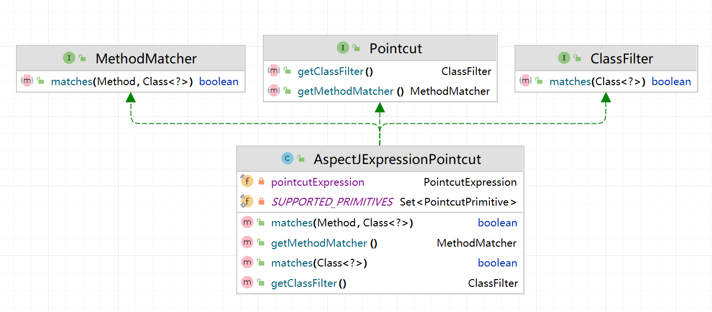


```java
public interface ClassFilter {
	boolean matches(Class<?> clazz);
}

import java.lang.reflect.Method;
public interface MethodMatcher {
	boolean matches(Method method, Class<?> targetClass);
}

public interface Pointcut {
	ClassFilter getClassFilter();
	MethodMatcher getMethodMatcher();
}

public class AspectJExpressionPointcut implements Pointcut, ClassFilter, MethodMatcher {
    // 定义当前切点表达式解析器所支持的语法关键字（Pointcut Primitive），即允许使用AspectJ的哪些部分。
    private static final Set<PointcutPrimitive> SUPPORTED_PRIMITIVES = new HashSet<PointcutPrimitive>();
    // 目前支持表达式
    static {
        SUPPORTED_PRIMITIVES.add(PointcutPrimitive.EXECUTION);
    }
    
    private final PointcutExpression pointcutExpression;
    /**...*/
}
```

### 测试

```java
public class PointcutExpressionTest {

	@Test
	public void testPointcutExpression() throws Exception {
        // 切点表达式
		AspectJExpressionPointcut pointcut = new AspectJExpressionPointcut("execution(* org.springframework.test.service.HelloService.*(..))");
		Class<HelloService> clazz = HelloService.class;
		Method method = clazz.getDeclaredMethod("sayHello");
		// 是否匹配类
		assertThat(pointcut.matches(clazz)).isTrue();
        // 是否匹配方法
		assertThat(pointcut.matches(method, clazz)).isTrue();
	}
}
```

## 十六、基于JDK的动态代理

> 分支：jdk-dynamic-proxy

### JDK中原来的动态代理

https://juejin.cn/post/7363176766787895306

```java
import java.lang.reflect.InvocationHandler;
import java.lang.reflect.Method;
import java.lang.reflect.Proxy;

interface GreetingService {
    void sayHello();
}

public class DynamicProxyExample {
    public static void main(String[] args) {
        // 创建被代理对象
        GreetingService greetingService = new GreetingServiceImpl();

        // 创建动态代理对象
        GreetingService proxy = (GreetingService) Proxy.newProxyInstance(
                GreetingService.class.getClassLoader(),
                new Class<?>[]{GreetingService.class},
                new MyInvocationHandler(greetingService)
        );

        // 通过代理对象调用方法
        proxy.sayHello();
    }

    static class GreetingServiceImpl implements GreetingService {
        public void sayHello() {
            System.out.println("Hello, World!");
        }
    }

    static class MyInvocationHandler implements InvocationHandler {
        private final GreetingService target;

        public MyInvocationHandler(GreetingService target) {
            this.target = target;
        }

        @Override
        public Object invoke(Object proxy, Method method, Object[] args) throws Throwable {
            System.out.println("Before the method call");
            method.invoke(target, args); // 调用真实对象的方法
            System.out.println("After the method call");
            return null;
        }
    }
}
```

### 设计过程

- AopProxy是获取代理对象的抽象接口，JdkDynamicAopProxy的基于JDK动态代理的具体实现。
- JdkDynamicAopProxy含有AdvisedSupport，简单来说，就是按照AdvisedSupport这个“配置”来生成一个代理。

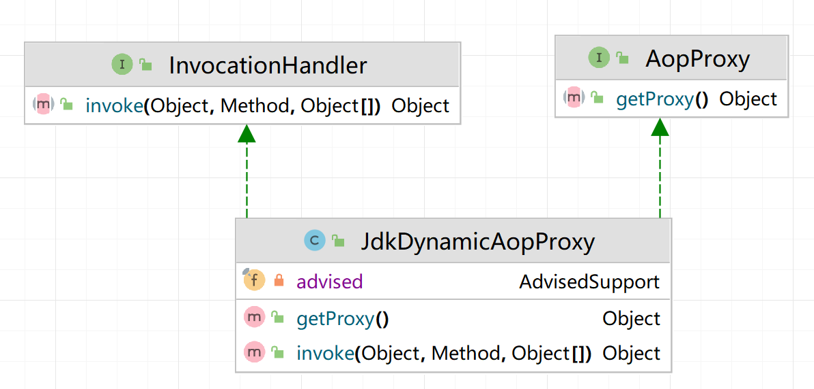

- 而AdvisedSupport包含TargetSource，MethodInterceptor，MethodMatcher

```java
public class AdvisedSupport {
	private TargetSource targetSource;
	private MethodInterceptor methodInterceptor;
	private MethodMatcher methodMatcher;
}
```

- TargetSource是被代理对象的封装
- MethodInterceptor是Advice的具体逻辑实现器，简单来说，Spring 在创建代理时，会把所有 MethodBeforeAdvice / AfterReturningAdvice / ThrowsAdvice … **自动适配**成 MethodInterceptor。

```
Advice   ->  Advisor            ->  MethodInterceptor
(声明意图)    (包装切点+Advice)     (真正插到链里执行)
```

示例：

```java
// ① 业务目标类 —— 真正要被调用的方法
public class OrderService {
    public String create(String user) {
        System.out.println("🎯  [Target] 真实业务: 创建订单 for " + user);
        return "OK";
    }
}

/* ② 一个 Before 类型的 Advice —— 只是“声明要做什么” */
public class LogBeforeAdvice implements MethodBeforeAdvice {
    @Override
    public void before(Method method, Object[] args, Object target) {
        System.out.println("👀  [BeforeAdvice] 方法即将执行: " + method.getName());
    }
}

/* ③ 一个 Around 类型的 Advice（直接实现 MethodInterceptor） */
public class TimeAroundInterceptor implements MethodInterceptor {
    @Override
    public Object invoke(MethodInvocation invocation) throws Throwable {
        long t1 = System.currentTimeMillis();
        System.out.println("⏱️  [Around-before] start");
        Object ret = invocation.proceed();               // ➜ 继续下一个拦截器/目标
        System.out.println("⏱️  [Around-after] cost = "
                           + (System.currentTimeMillis() - t1) + " ms");
        return ret;
    }
}

/* ④ 组装代理并调用 */
public static void main(String[] args) {
    OrderService target = new OrderService();

    // 使用 Spring 的工具类手动创建代理（不依赖 XML/注解）
    ProxyFactory pf = new ProxyFactory(target);
    pf.addAdvice(new LogBeforeAdvice());     // BeforeAdvice
    pf.addAdvice(new TimeAroundInterceptor()); // 已是 MethodInterceptor

    OrderService proxy = (OrderService) pf.getProxy();
    proxy.create("Alice");
}
```

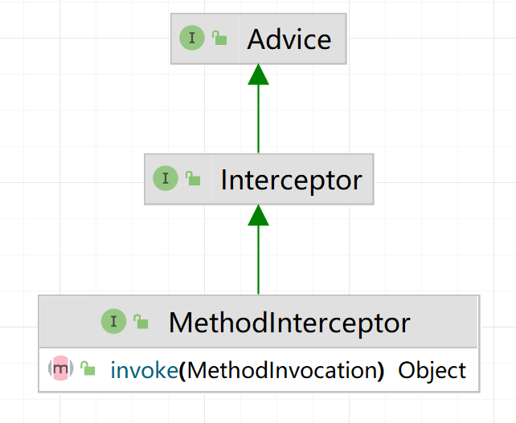

- 然后串成一条 ReflectiveMethodInvocation责任链，再利用Invocation进行调用。

- ReflectiveMethodInvocation负责**驱动整条拦截器链**，并允许各切面在执行过程中读写**共享数据**，核心任务如下

| 职责                | 关键字段 / 方法                                              | 摘要                                                         |
| ------------------- | ------------------------------------------------------------ | ------------------------------------------------------------ |
| **1. 链路调度**     | `interceptorsAndDynamicMethodMatchers` + `currentInterceptorIndex` + `proceed()` | 保存 **所有 MethodInterceptor**（及动态匹配器）列表，并用 `currentInterceptorIndex` 指针记录“我现在执行到第几个”。`proceed()` 递增指针 → 取出下一个拦截器 → 调用其 `invoke()`；当指针到链尾时才 `invokeJoinpoint()` 真正执行目标方法。 |
| **2. 调用目标方法** | `invokeJoinpoint()`                                          | 缺省实现就是 `method.invoke(target, arguments)`，但单独封装成 Protected 方法，允许子类覆写（比如为了性能直接调用 CGLIB FastMethod）。 |
| **3. 中间数据共享** | `userAttributes : Map<String,Object>` + `setUserAttribute()` / `getUserAttribute()` | 拦截器链内可以临时塞/取数据（如缓存 key、计时结果、事务资源等），避免把额外参数硬塞到业务代码。 |

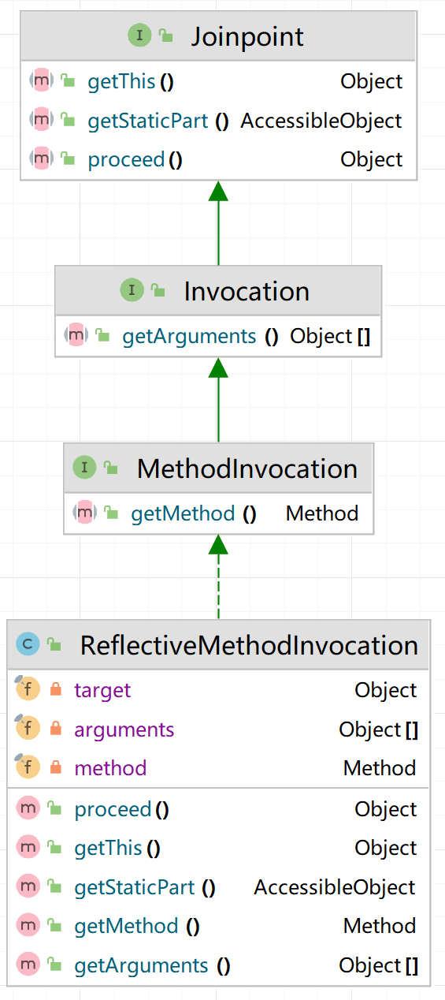

### 测试

```java
public class DynamicProxyTest {
	@Test
	public void testJdkDynamicProxy() throws Exception {
		WorldService worldService = new WorldServiceImpl();

		AdvisedSupport advisedSupport = new AdvisedSupport();
		TargetSource targetSource = new TargetSource(worldService);
		WorldServiceInterceptor methodInterceptor = new WorldServiceInterceptor();
		MethodMatcher methodMatcher = new AspectJExpressionPointcut("execution(* org.springframework.test.service.WorldService.explode(..))").getMethodMatcher();
		advisedSupport.setTargetSource(targetSource);
		advisedSupport.setMethodInterceptor(methodInterceptor);
		advisedSupport.setMethodMatcher(methodMatcher);

		WorldService proxy = (WorldService) new JdkDynamicAopProxy(advisedSupport).getProxy();
		proxy.explode();
	}
}
```

## 十七、基于CGLIB的动态代理

> 分支：cglib-dynamic-proxy

基于CGLIB的动态代理实现逻辑也比较简单，查看CglibAopProxy。

与基于JDK的动态代理在运行期间为接口生成对象的代理对象不同，基于CGLIB的动态代理能在运行期间动态构建字节码的class文件，为类生成子类，因此被**代理类不需要继承自任何接口**。

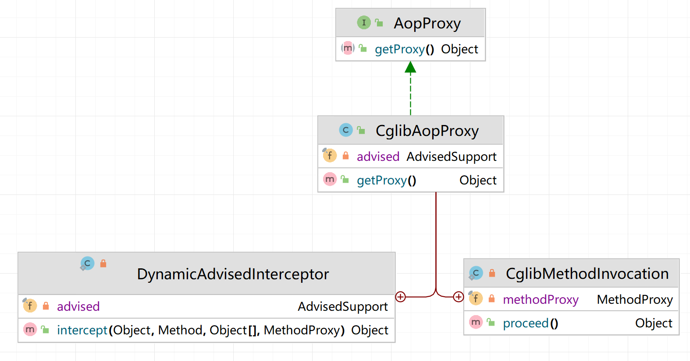

## 十八、AOP代理工厂

> 分支：proxy-factory

增加AOP代理工厂ProxyFactory

AdvisedSupport增加proxyTargetClass属性决定使用JDK动态代理还是CGLIB动态代理。

```java
public class ProxyFactory {
	private AdvisedSupport advisedSupport;

	public ProxyFactory(AdvisedSupport advisedSupport) {
		this.advisedSupport = advisedSupport;
	}

	public Object getProxy() {
		return createAopProxy().getProxy();
	}

	private AopProxy createAopProxy() {
		if (advisedSupport.isProxyTargetClass()) {
			return new CglibAopProxy(advisedSupport);
		}

		return new JdkDynamicAopProxy(advisedSupport);
	}
}
```

## 十九、几种常用的Advice
> 分支： common-advice

BeforeAdvice/AfterAdvice/AfterReturningAdvice/ThrowsAdvice...

### 设计过程

Spring将AOP联盟中的Advice细化出各种类型的Advice，常用的有BeforeAdvice/AfterAdvice/AfterReturningAdvice/ThrowsAdvice，我们可以通过扩展MethodInterceptor来实现。

只简单实现BeforeAdvice，定义MethodBeforeAdviceInterceptor拦截器，在执行被代理方法之前，先执行BeforeAdvice的方法。

:star:注意：这个代码分支用一个Interceptor合并了多个Advice，源码中不是这样的。这里只是取巧，最大的问题在于每种增强只能有一个。如何解决，每种增强用List存，这样解决又会带来新问题。

**List 方案适合 Demo / 单一功能场景**：写起来直观，但一旦切面数量、种类、场景复杂度上来，维护成本陡增。

**Spring 方案本质是“分层 + 适配 + 不可变链”**：

1. 用 *Advisor* 解耦 *匹配逻辑* 与 *增强逻辑*；
2. 把全部 Advice 适配成统一接口 (`MethodInterceptor`)；
3. 生成 **顺序可控、线程安全、易于组合** 的拦截器链。

```java
public class GenericInterceptor implements MethodInterceptor {
    private BeforeAdvice beforeAdvice;
    private AfterAdvice afterAdvice;
    private AfterReturningAdvice afterReturningAdvice;
    private ThrowsAdvice throwsAdvice;

    @Override
    public Object invoke(MethodInvocation invocation) throws Throwable {
        Object result = null;
        try {
            // 前置通知
            if (beforeAdvice != null) {
                beforeAdvice.before(invocation.getMethod(), invocation.getArguments(), invocation.getThis());
            }
            result = invocation.proceed();
        } catch (Exception throwable) {
            //异常通知
            if (throwsAdvice != null) {
                throwsAdvice.throwsHandle(throwable, invocation.getMethod(), invocation.getArguments(), invocation.getThis());
            }
        } finally {
            //后置通知
            if (afterAdvice != null) {
                afterAdvice.after(invocation.getMethod(), invocation.getArguments(), invocation.getThis());
            }
        }
        // 返回通知
        if (afterReturningAdvice != null) {
            afterReturningAdvice.afterReturning(result, invocation.getMethod(), invocation.getArguments(), invocation.getThis());
        }
        return result;
    }

    public void setBeforeAdvice(BeforeAdvice beforeAdvice) {
        this.beforeAdvice = beforeAdvice;
    }

    public void setAfterReturningAdvice(AfterReturningAdvice afterReturningAdvice) {
        this.afterReturningAdvice = afterReturningAdvice;
    }

    public void setThrowsAdvice(ThrowsAdvice throwsAdvice) {
        this.throwsAdvice = throwsAdvice;
    }

    public void setAfterAdvice(AfterAdvice afterAdvice) {
        this.afterAdvice = afterAdvice;
    }
}
```

### 测试

```java
public class WorldServiceBeforeAdvice implements MethodBeforeAdvice {

	@Override
	public void before(Method method, Object[] args, Object target) throws Throwable {
		System.out.println("BeforeAdvice: do something before the earth explodes");
	}
}
```

```java
public class DynamicProxyTest {

	private AdvisedSupport advisedSupport;

	@Before
	public void setup() {
		WorldService worldService = new WorldServiceImpl();

		advisedSupport = new AdvisedSupport();
		TargetSource targetSource = new TargetSource(worldService);
		MethodMatcher methodMatcher = new AspectJExpressionPointcut("execution(* org.springframework.test.service.WorldService.explode(..))").getMethodMatcher();
		advisedSupport.setTargetSource(targetSource);
		advisedSupport.setMethodMatcher(methodMatcher);
	}

	@Test
	public void testBeforeAdvice() throws Exception {
		//设置BeforeAdvice
		WorldServiceBeforeAdvice beforeAdvice = new WorldServiceBeforeAdvice();
        // 这里将Advice->Interceptor
		MethodBeforeAdviceInterceptor methodInterceptor = new MethodBeforeAdviceInterceptor(beforeAdvice);
		advisedSupport.setMethodInterceptor(methodInterceptor);

		WorldService proxy = (WorldService) new ProxyFactory(advisedSupport).getProxy();
		proxy.explode();
	}
}
```

## 二十、PointcutAdvisor

> 分支：pointcut-advisor

### Advisor介绍

Advisor是包含一个Pointcut（切点，哪些方法）和一个Advice（增强）的组合，Pointcut用于捕获JoinPoint，Advice决定在JoinPoint执行某种操作。

它让 Spring 只操心“一串 Advisor”就能完成 **匹配、排序、适配、执行** 全流程，既提高框架实现的 *内聚度*，也让使用者在配置、扩展时更直观、更易复用。

PointcutAdvisor这一层是因为还是有其他Advisor子接口。比如IntroductionAdvisor，它负责“引入增强（Introduction）”，也就是在不改源码的前提下，给目标对象动态地添加新的接口及其实现。

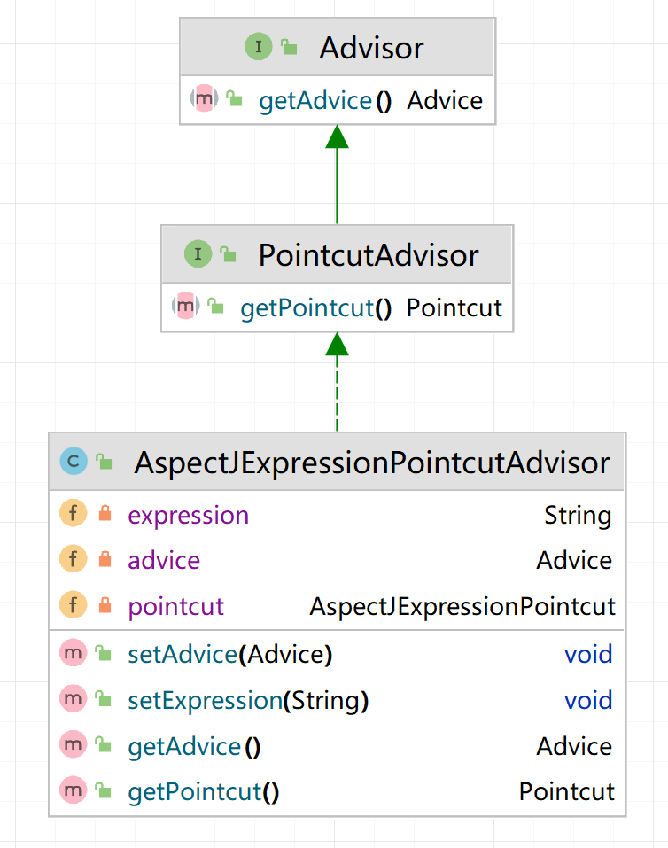


## 二十一、动态代理融入bean生命周期

> 分支：auto-proxy

当 Spring 正在实例化一个 Bean 时，就判断它是否需要织入切面，如果需要，就直接**返回代理对象**，后面的“正常”实例化流程被短路——容器里最终放进去的就是被增强后的代理。

结合前面讲解的bean的生命周期，BeanPostProcessor处理阶段可以修改和替换bean，正好可以在此阶段返回代理对象替换原对象。不过我们引入一种特殊的BeanPostProcessor——InstantiationAwareBeanPostProcessor，如果InstantiationAwareBeanPostProcessor处理阶段返回代理对象，会导致短路，不会继续走原来的创建bean的流程，具体实现查看AbstractAutowireCapableBeanFactory#resolveBeforeInstantiation。

DefaultAdvisorAutoProxyCreator是处理横切逻辑的织入返回代理对象的InstantiationAwareBeanPostProcessor实现类，当对象实例化时，生成代理对象并返回。大致逻辑为：拿到当前 Bean 的 Class，遍历容器中已经注册的Advisor，判断哪些 Advisor 的 *Pointcut* 能匹配当前 Class/Method，如果至少匹配一个返回代理对象，触发短路。

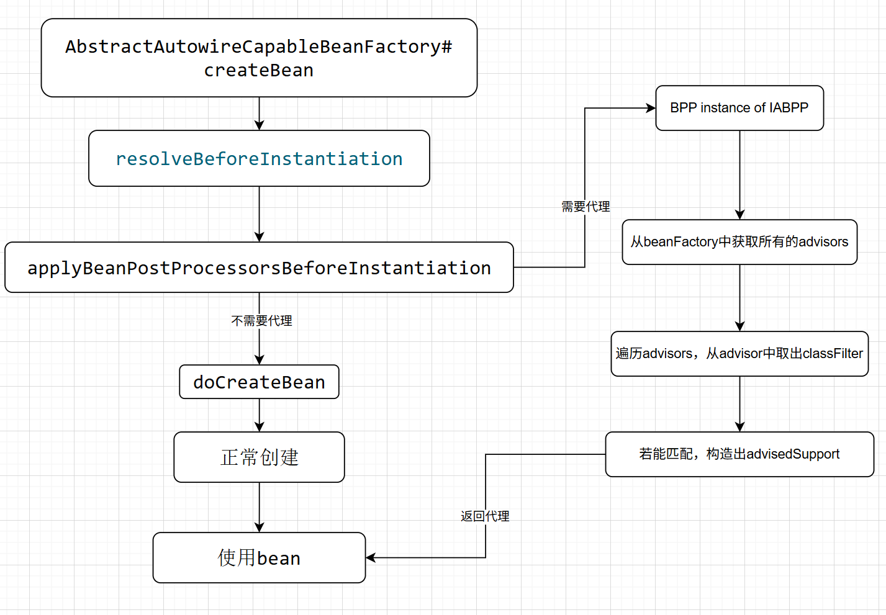

:star:代理位置不对导致不能设置属性

- 这里先在 **实例化前** 返回了代理，**属性还没注入**；
- 如果你的 Advice/Interceptor 用不到目标 Bean 的字段，一切正常；
- 但一旦代理对象里也想用到填充后的属性，就会出现“属性是空”的问题。
- 所以后面做了 **迁移到 `postProcessAfterInitialization` 的修复**： “populate-proxy-bean-with-property-values” 分支解决
  - 先正常实例化 & 填充属性
  - 再返回代理
  - 既保住了可替换能力，又拿到了完整属性。

测试：
auto-proxy.xml

```xml
<?xml version="1.0" encoding="UTF-8"?>
<beans>
    <bean id="worldService" class="org.springframework.test.service.WorldServiceImpl"/>

    <bean class="org.springframework.aop.framework.autoproxy.DefaultAdvisorAutoProxyCreator"/>

    <bean id="pointcutAdvisor" class="org.springframework.aop.aspectj.AspectJExpressionPointcutAdvisor">
        <property name="expression" value="execution(* org.springframework.test.service.WorldService.explode(..))"/>
        <property name="advice" ref="methodInterceptor"/>
    </bean>


    <bean id="methodInterceptor" class="org.springframework.aop.framework.adapter.MethodBeforeAdviceInterceptor">
        <property name="advice" ref="beforeAdvice"/>
    </bean>

    <bean id="beforeAdvice" class="org.springframework.test.common.WorldServiceBeforeAdvice"/>

</beans>
```

```java
public class AutoProxyTest {

	@Test
	public void testAutoProxy() throws Exception {
		ClassPathXmlApplicationContext applicationContext = new ClassPathXmlApplicationContext("classpath:auto-proxy.xml");

		//获取代理对象
		WorldService worldService = applicationContext.getBean("worldService", WorldService.class);
		worldService.explode();
	}
}
```

# 拓展篇

## 二十二、PropertyPlaceholderConfigurer

> 分支：property-placeholder-configurer

Placeholder：占位符

Configurer：配置编辑器

经常需要将配置信息配置在properties文件中，然后在XML文件中以占位符的方式引用。

实现思路很简单，在bean实例化之前，编辑BeanDefinition，解析XML文件中的占位符，然后用properties文件中的配置值替换占位符。而**BeanFactoryPostProcessor具有编辑BeanDefinition的能力**，因此PropertyPlaceholderConfigurer继承自BeanFactoryPostProcessor。

是如何融入到bean生命周期中的？

首先这是一个BFPP，所以容器会自动处理这个拓展类，这里也体现了这种拓展的优势。

这个PropertyPlaceholderConfigurer的设计思路，加载替换属性的键值对，location是用xml配置的，加载调用框架中的类就可以完成，然后对占位符的属性进行替换，这里用到了简单的字符串拼接。有缺陷是只能替换一个占位符，多个和嵌套均未实现。

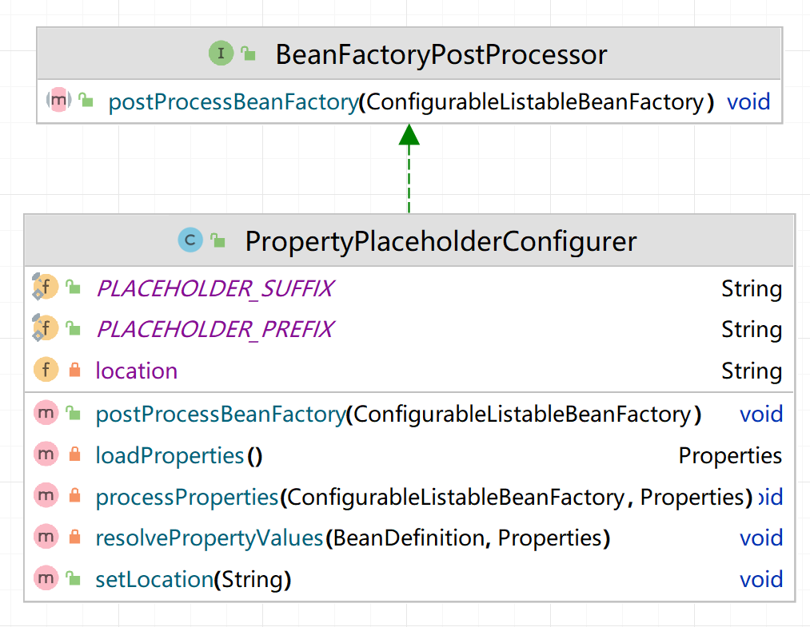

测试：
car.properties

```properties
brand=lamborghini
```

```xml
<?xml version="1.0" encoding="UTF-8"?>
<beans>
    <bean class="org.springframework.beans.factory.PropertyPlaceholderConfigurer">
        <property name="location" value="classpath:car.properties" />
    </bean>

    <bean id="car" class="org.springframework.test.bean.Car">
        <property name="brand" value="${brand}" />
    </bean>

</beans>
```

**改进：**官方把“字符串占位符解析”封装成 **PropertyPlaceholderHelper**，通过 **递归 + while 扫描** 的算法支持 **任意数量、多层嵌套** 的占位符替换。

## 二十三、包扫描

> 分支：package-scan

**作用：**结合bean的生命周期，包扫描只不过是扫描特定注解的类，提取类的相关信息组装成BeanDefinition注册到容器中。

**加载流程**

package-scan.xml中配置一个或者多个需要被扫描的路径

```xml
<beans>
    <context:component-scan base-package="org.springframework.test.bean"/>
</beans>
```

在XmlBeanDefinitionReader中解析<context:component-scan />标签。

base-package可能有多个，这里用","分隔。

和之前普通的bean标签下的逻辑不冲突，只需要扫描这些路径即可。

再使用ClassPathBeanDefinitionScanner#doScan(basePackages)扫描所有指定包下面标有@Component的类，**组装BeanDefinition并注册到容器**。怎么扫描？使用了 Hutool 提供的工具类：ClassUtil，在指定包路径下，扫描出所有加了 @Component 注解的类。

```java
@Component
public class Car {
	/**...*/
}
```

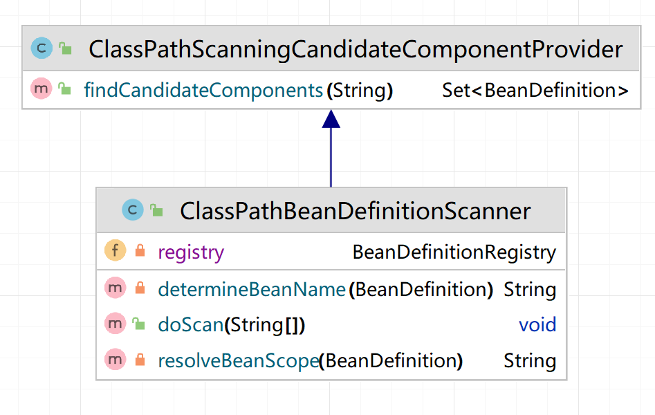

两个关键的函数

```java
// ClassPathBeanDefinitionScanner
public void doScan(String... basePackages) {
    for (String basePackage : basePackages) {
        Set<BeanDefinition> candidates = findCandidateComponents(basePackage);
        for (BeanDefinition candidate : candidates) {
            // 解析bean的作用域
            String beanScope = resolveBeanScope(candidate);
            if (StrUtil.isNotEmpty(beanScope)) {
                candidate.setScope(beanScope);
            }
            //生成bean的名称
            String beanName = determineBeanName(candidate);
            //注册BeanDefinition
            registry.registerBeanDefinition(beanName, candidate);
        }
    }
}

// ClassPathScanningCandidateComponentProvider
public Set<BeanDefinition> findCandidateComponents(String basePackage) {
    Set<BeanDefinition> candidates = new LinkedHashSet<BeanDefinition>();
    // 扫描有org.springframework.stereotype.Component注解的类
    // 使用了 Hutool 提供的工具类：ClassUtil，在指定包路径下，扫描出所有加了 @Component 注解的类
    Set<Class<?>> classes = ClassUtil.scanPackageByAnnotation(basePackage, Component.class);
    for (Class<?> clazz : classes) {
        BeanDefinition beanDefinition = new BeanDefinition(clazz);
        candidates.add(beanDefinition);
    }
    return candidates;
}
```

测试：

```java
public class PackageScanTest {

	@Test
	public void testScanPackage() throws Exception {
		ClassPathXmlApplicationContext applicationContext = new ClassPathXmlApplicationContext("classpath:package-scan.xml");

		Car car = applicationContext.getBean("car", Car.class);
		assertThat(car).isNotNull();
	}
}
```

## 二十四、@Value注解

> 代码分支：value-annotation

### @Value的常见用法

https://juejin.cn/post/6998688624237625374

| 功能               | 说明                                                         | 常见写法示例                        |
| ------------------ | ------------------------------------------------------------ | ----------------------------------- |
| **1. 字面量注入**  | 直接把一个固定值写进字段 / 构造参数                          | @Value("8080") private int port;    |
| **2. 占位符解析**  | 读取 *application.properties*、-D启动参数、System.getenv()等外部配置源 | @Value("${server.port}")            |
| **3. SpEL 表达式** | 运行时执行Spring Expression Language，允许调用方法、Bean、数学运算 | @Value("#{T(Math).random() * 100}") |

@Value和PropertyPlaceholderConfigurer：都是修改属性值，时机不同。

### 设计过程

注解@Value和@Autowired通过**BeanPostProcessor**处理。InstantiationAwareBeanPostProcessor增加postProcessPropertyValues方法，在bean实例化之后设置属性之前执行。调用时机在AbstractAutowireCapableBeanFactory#doCreateBean方法的设置属性前。

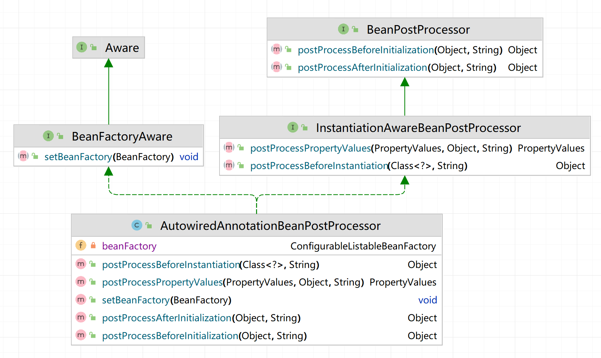

AutowiredAnnotationBeanPostProcessor是一个BeanPostProcessor，在上一节包扫描的doScan方法中注册进容器。

AutowiredAnnotationBeanPostProcessor#postProcessPropertyValues方法完成了@Value，@Autowired的依次处理。

其中**字符解析器StringValueResolver**在PropertyPlaceholderConfigurer中添加到BeanFactory中。

### 测试

```java
@Component
public class Car {

	@Value("${brand}")
	private String brand;
}
```

value-annotation.xml

包扫描，并且location属性的值是classpath:car.properties。因为包扫描不能把PropertyPlaceholderConfigurer解析成bean，所以需要另外配置。

```xml
<?xml version="1.0" encoding="UTF-8"?>
<beans>

    <bean class="org.springframework.beans.factory.PropertyPlaceholderConfigurer">
        <property name="location" value="classpath:car.properties" />
    </bean>

    <context:component-scan base-package="org.springframework.test.bean"/>

</beans>
```

car.properties

```properties
brand=lamborghini
```

```java
public class ValueAnnotationTest {

	@Test
	public void testValueAnnotation() throws Exception {
		ClassPathXmlApplicationContext applicationContext = new ClassPathXmlApplicationContext("classpath:value-annotation.xml");

		Car car = applicationContext.getBean("car", Car.class);
		assertThat(car.getBrand()).isEqualTo("lamborghini");
	}
}
```

## 二十五、@Autowired注解

> 代码分支：autowired-annotation

作用：@Autowired解析并完成**按类型优先**的依赖装配，可设置必需/可选，支持字段、构造器、方法多种注入点

实现：遍历所有字段，若发现字段标注了**@Autowired**，则判断是否同时标注了**@Qualifier**，如果有则按**名称**从容器中获取指定 Bean，否则按字段类型查找；查到依赖对象后，通过反射将其注入到字段中，实现自动装配。

```java
// AutowiredAnnotationBeanPostProcessor#postProcessPropertyValues
for (Field field : fields) {
    Autowired autowiredAnnotation = field.getAnnotation(Autowired.class);
    if (autowiredAnnotation != null) {
        Class<?> fieldType = field.getType();
        String dependentBeanName = null;
        Qualifier qualifierAnnotation = field.getAnnotation(Qualifier.class);
        Object dependentBean = null;
        if (qualifierAnnotation != null) {
            dependentBeanName = qualifierAnnotation.value();
            dependentBean = beanFactory.getBean(dependentBeanName, fieldType);
        } else {
            dependentBean = beanFactory.getBean(fieldType);
        }
        BeanUtil.setFieldValue(bean, field.getName(), dependentBean);
    }
}
```

测试：

```java
@Component
public class Car {

}

@Component
public class Person implements InitializingBean, DisposableBean {

	@Autowired
	private Car car;
}
```

autowired-annotation.xml

```xml
<?xml version="1.0" encoding="UTF-8"?>
<beans>
    <context:component-scan base-package="org.springframework.test.bean"/>
</beans>
```

```java
public class AutowiredAnnotationTest {

	@Test
	public void testAutowiredAnnotation() throws Exception {
		ClassPathXmlApplicationContext applicationContext = new ClassPathXmlApplicationContext("classpath:autowired-annotation.xml");

		Person person = applicationContext.getBean(Person.class);
		assertThat(person.getCar()).isNotNull();
	}
}
```

## 二十六、bug fix：没有为代理bean设置属性

> 代码分支: populate-proxy-bean-with-property-values

### 问题

这一小节的核心就是**把代理生成的时机从“实例化之前”挪到“实例化之后”**，从而保证代理对象也能走完整的属性填充流程。

- **旧流程**
  1. postProcessBeforeInstantiation()返回代理 ⇒ 创建早，触发短路；
  2. applyPropertyValues()被跳过 ⇒ 代理 Bean 无属性。
- **新流程**
  1. 先正常实例化并完成populateBean()（属性注入）；
  2. 在postProcessAfterInitialization() 里再织入代理 ⇒ 代理包裹的是已注入好属性的原始对象。

问题：不能为代理bean设置属性，参考二十一节的流程。

问题原因：织入逻辑在InstantiationAwareBeanPostProcessor#postProcessBeforeInstantiation中执行，而该方法如果返回非null，会导致"短路"，不会执行后面的设置属性逻辑。因此如果该方法中返回代理bean后，不会为代理bean设置属性。

修复方案：跟spring保持一致，将织入逻辑迁移到BeanPostProcessor#postProcessAfterInitialization，即将DefaultAdvisorAutoProxyCreator#postProcessBeforeInstantiation的内容迁移到DefaultAdvisorAutoProxyCreator#postProcessAfterInitialization中。

### 设计过程

顺便完善spring的扩展机制，为InstantiationAwareBeanPostProcessor增加postProcessAfterInstantiation方法，该方法在bean实例化之后设置属性之前执行。**本节没有使用，只是为之后的拓展做准备。**

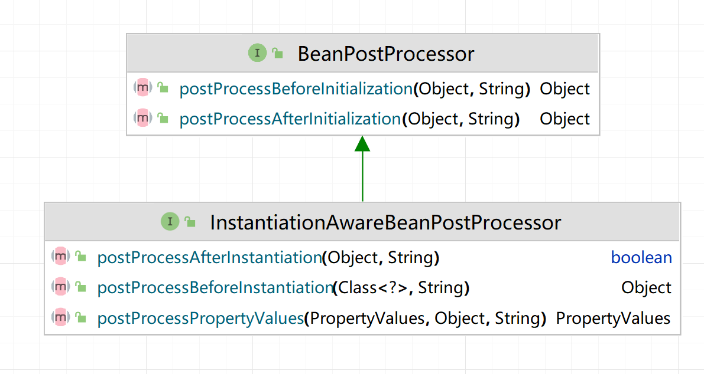

解决问题，就如上面的描述，把实例化前的代理过程放到初始化之后。实例化前的方法直接返回null，这样就不会短路，就会执行doCreateBean方法。

```java
public class DefaultAdvisorAutoProxyCreator implements InstantiationAwareBeanPostProcessor, BeanFactoryAware {

    private DefaultListableBeanFactory beanFactory;

    // 初始化之后
    @Override
    public Object postProcessAfterInitialization(Object bean, String beanName) throws BeansException {
        //避免死循环
        if (isInfrastructureClass(bean.getClass())) {
            return bean;
        }

        Collection<AspectJExpressionPointcutAdvisor> advisors = beanFactory.getBeansOfType(AspectJExpressionPointcutAdvisor.class).values();
        try {
            for (AspectJExpressionPointcutAdvisor advisor : advisors) {
                ClassFilter classFilter = advisor.getPointcut().getClassFilter();
                if (classFilter.matches(bean.getClass())) {
                    AdvisedSupport advisedSupport = new AdvisedSupport();
                    TargetSource targetSource = new TargetSource(bean);
                    advisedSupport.setTargetSource(targetSource);
                    advisedSupport.setMethodInterceptor((MethodInterceptor) advisor.getAdvice());
                    advisedSupport.setMethodMatcher(advisor.getPointcut().getMethodMatcher());

                    //返回代理对象
                    return new ProxyFactory(advisedSupport).getProxy();
                }
            }
        } catch (Exception ex) {
            throw new BeansException("Error create proxy bean for: " + beanName, ex);
        }
        return bean;
    }

    // 初始化之前
    @Override
    public Object postProcessBeforeInstantiation(Class<?> beanClass, String beanName) throws BeansException {
        return null;
    }

    // 实例化之后
    @Override
    public boolean postProcessAfterInstantiation(Object bean, String beanName) throws BeansException {
        return true;
    }

    // 实例化之前
    @Override
    public Object postProcessBeforeInitialization(Object bean, String beanName) throws BeansException {
        return bean;
    }
}
```

### 完整生命周期

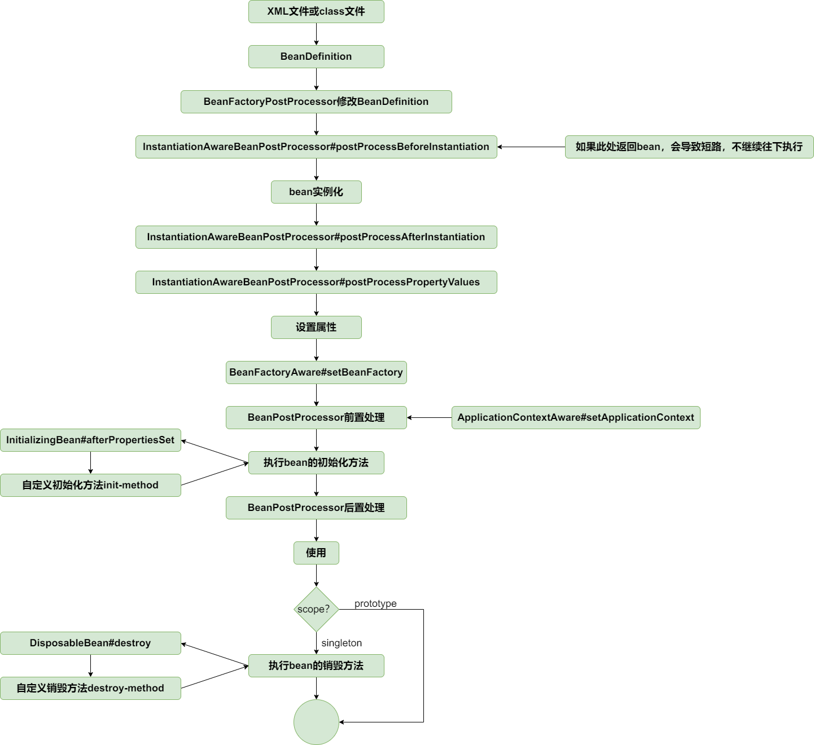

测试：

populate-proxy-bean-with-property-values.xml

```xml
<?xml version="1.0" encoding="UTF-8"?>
<beans>
    <bean id="worldService" class="org.springframework.test.service.WorldServiceImpl">
        <property name="name" value="earth"/>
    </bean>

    <bean class="org.springframework.aop.framework.autoproxy.DefaultAdvisorAutoProxyCreator"/>

    <bean id="pointcutAdvisor" class="org.springframework.aop.aspectj.AspectJExpressionPointcutAdvisor">
        <property name="expression" value="execution(* org.springframework.test.service.WorldService.explode(..))"/>
        <property name="advice" ref="methodInterceptor"/>
    </bean>


    <bean id="methodInterceptor" class="org.springframework.aop.framework.adapter.MethodBeforeAdviceInterceptor">
        <property name="advice" ref="beforeAdvice"/>
    </bean>

    <bean id="beforeAdvice" class="org.springframework.test.common.WorldServiceBeforeAdvice"/>
</beans>
```

```java
public class AutoProxyTest {

	@Test
	public void testPopulateProxyBeanWithPropertyValues() throws Exception {
		ClassPathXmlApplicationContext applicationContext = new ClassPathXmlApplicationContext("classpath:populate-proxy-bean-with-property-values.xml");

		//获取代理对象
		WorldService worldService = applicationContext.getBean("worldService", WorldService.class);
		worldService.explode();
		assertThat(worldService.getName()).isEqualTo("earth");
	}
}
```

## 二十七、类型转换（一）

> 代码分支：type-conversion-first-part

### 类型转换器体系介绍

把“外界给你的各种字符串配置/请求参数”等，**在正确的时机**、**按目标字段的真实类型**，安全地转换成 `int/LocalDate/List<Foo>/…`，并且允许你**扩展自定义规则**。这套能力由 `Converter` 家族 + `ConversionService` 组成，并在容器和更高层框架里广泛使用。

作用：

1. **把“外部表示”安全地映射成“运行时对象”**

   - **XML / 注解属性注入**
      在 `<property value="1000000"/>` 或 `@Value("${price}")` 里，配置文件只能写字符串；但运行期 `Car.price` 是 `int`。类型转换器负责把 `"1000000"` 变成 `Integer`，再交给反射去 `setPrice`。如果没有统一的转换体系，你就得在每个属性注入点手写 `Integer.parseInt(…)`。
   - **数据绑定**
      在 Spring MVC / WebFlux 中，请求参数、Header、Path Variable、表单字段等都以字符串进来；控制器方法里往往声明为 `LocalDate`, `Enum`, `List<Long>` 等复杂类型。`ConversionService` 把它们批量转成目标类型，配合 `@InitBinder` 和 `Formatter` 再做格式化。

2. **统一、可插拔、可组合的转换模型**
    Spring 最早依赖 `java.beans.PropertyEditor`。它只能“字符串 ↔︎ 单一目标类型”，线程不安全，而且注册方式笨重。

   - **`Converter<S,T>`**：一对一转换（如 `String → Integer`）。
   - **`ConverterFactory<S,R>`**：一对多（如同一 `String` 源，目标是 `Integer` / `Long` / `BigDecimal` 等 `Number` 子类）。
   - **`GenericConverter`**：完全开放的“多源 × 多目标”矩阵，甚至可根据运行时上下文决定能否转换（如 `String` ↔︎ `Enum<?>`）。
      这三种接口被 `GenericConversionService` 统一管理，调用者通过一个门面 `ConversionService#convert(Object, Class<?>)` 就搞定，替你挑选最佳路径并做缓存。

3. **让 IoC 容器和框架各层解耦**

   - **IoC 容器**：`AbstractAutowireCapableBeanFactory#applyPropertyValues` 在填充属性时，先询问 `ConversionService` 是否能把当前值转成 setter 需要的类型；不能则回退到旧的 `PropertyEditor` 逻辑。
   - **@Value / SpEL**：解析完表达式得到的结果再次交给 `ConversionService`，保证注入的是正确类型，而不是“半成品”的 `String` 或 `TypedStringValue`。
   - **Spring Message / Integration / Batch …**：几乎所有需要“把消息载体 ⇌ 业务 POJO” 的地方，都复用这套机制。

4. **易扩展，契合业务语义**
    你可以：

   ```java
   @Component
   public class StringToLocalDateConverter implements Converter<String, LocalDate> {
       private final DateTimeFormatter fmt = DateTimeFormatter.ofPattern("yyyy-MM-dd");
       public LocalDate convert(String s) { return LocalDate.parse(s, fmt); }
   }
   ```

   把它交给 `ConversionServiceFactoryBean` 或 `FormattingConversionService`，整个 Spring 应用（IoC、MVC、SpEL …）立刻认识 `"2025-06-22"` 是一天，而不是普通字符串。业务重用度高，也避免散落的手动 `parse`。

### Converter

```java
public interface Converter<S, T> {

	/**
	 * 类型转换
	 */
	T convert(S source);
}
```

Converter能将S类型的对象转换为T类型的对象，比如将String类型的对象转换为Integer类型的对象的实现类：

```java
public class StringToIntegerConverter implements Converter<String, Integer> {
	@Override
	public Integer convert(String source) {
		return Integer.valueOf(source);
	}
}
```

使用：

```java
Integer num = new StringToIntegerConverter().convert("8888");
```

### ConverterFactory

```java
public interface ConverterFactory<S, R> {

	<T extends R> Converter<S, T> getConverter(Class<T> targetType);
}
```

Converter<S,T>接口适合**一对一**的类型转换，如果要将String类型转换为Integer/Long/Float/Double/Decimal等类型，就要实现一系列的StringToInteger/StringToLongConverter/StringToFloatConverter转换器，非常不优雅。

ConverterFactory接口则适合**一对多**的类型转换，可以**将一种类型转换为另一种类型及其子类**。比如将String类型转换为Ineger/Long/Float/Double/Decimal等Number类型时，只需定义一个ConverterFactory转换器：这里使用了**工厂方法**模式

```java
public class StringToNumberConverterFactory implements ConverterFactory<String, Number> {

	@Override
	public <T extends Number> Converter<String, T> getConverter(Class<T> targetType) {
		return new StringToNumber<T>(targetType);
	}

	private static final class StringToNumber<T extends Number> implements Converter<String, T> {

		private final Class<T> targetType;

		public StringToNumber(Class<T> targetType) {
			this.targetType = targetType;
		}

		@Override
		public T convert(String source) {
			if (source.length() == 0) {
				return null;
			}

			if (targetType.equals(Integer.class)) {
				return (T) Integer.valueOf(source);
			} else if (targetType.equals(Long.class)) {
				return (T) Long.valueOf(source);
			}
			//TODO 其他数字类型

			else {
				throw new IllegalArgumentException(
						"Cannot convert String [" + source + "] to target class [" + targetType.getName() + "]");
			}
		}
	}

}
```

使用：

```java
StringToNumberConverterFactory converterFactory = new StringToNumberConverterFactory();
Converter<String, Integer> stringToIntegerConverter = converterFactory.getConverter(Integer.class);
Integer num = stringToIntegerConverter.convert("8888");
```

### GenericConverter

介绍：

`GenericConverter` 是 Spring 类型转换体系里**最灵活**的 SPI。它比 `Converter<S,T>`/`ConverterFactory` 更强，能拿到**目标字段的上下文信息**（泛型、注解等），一次性支持**多组源/目标类型**，特别适合 **集合/数组/Map 的元素级转换**，以及**需要读取注解或泛型信息**才能决定如何转换的场景。

使用举例：

**集合/数组/Map 的层级转换**：
 比如 `List<String> -> List<Integer>`、`String[] -> Set<Long>`、`Map<String,String> -> Map<Integer,Date>`。
 Spring 会用 `GenericConverter` 读取目标的**元素泛型**，然后**逐个元素**用 `ConversionService` 再递归转换。

简单代码示例：

```java
public interface GenericConverter {

	Set<ConvertiblePair> getConvertibleTypes();

	Object convert(Object source, Class sourceType, Class targetType);
}
```

String类型转换为Boolean类型的实现类：

```java
public class StringToBooleanConverter implements GenericConverter {
	@Override
	public Set<ConvertiblePair> getConvertibleTypes() {
		return Collections.singleton(new ConvertiblePair(String.class, Boolean.class));
	}

	@Override
	public Object convert(Object source, Class sourceType, Class targetType) {
		return Boolean.valueOf((String) source);
	}
}
```

使用:

```java
Boolean flag = new StringToBooleanConverter().convert("true", String.class, Boolean.class);
```

### ConversionService

是 Spring 的**统一类型转换门面**。所有“把 A 变 B”的需求（属性注入、配置绑定、SpEL、Web 参数绑定、格式化等）最终都会走它；它负责**挑选合适的 Converter/GenericConverter/Formatter** 并执行转换。

为外界提供了接口canConvert和convert，这里实现了其中的两个。

```java
boolean canConvert(Class<?> sourceType, Class<?> targetType);
boolean canConvert(TypeDescriptor sourceType, TypeDescriptor targetType);

<T> T convert(Object source, Class<T> targetType);
Object convert(Object source, TypeDescriptor sourceType, TypeDescriptor targetType);
```

### GenericConversionService

是ConversionService实现类，将三种适配器统一封装成Adapter。

DefaultConversionService在GenericConversionService的基础上添加内置转换器，比如添加了StringToNumberConverterFactory。

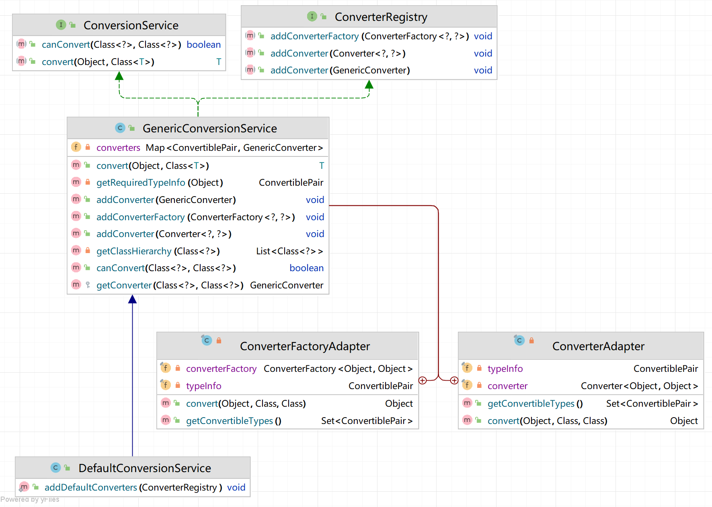

#### 它在做什么

- 统一对外暴露 `ConversionService` 能力（`canConvert/convert`）。
- 注册三类转换器：`Converter`、`ConverterFactory`、`GenericConverter`。
- 查找匹配的转换器并执行转换（带“:star:父类回退”）。

#### 核心数据结构与流程

**1 注册表**

```java
private Map<ConvertiblePair, GenericConverter> converters = new HashMap<>();
```

- key：`ConvertiblePair(source, target)`
- value：最终都适配成 `GenericConverter`（你用 `ConverterAdapter`、`ConverterFactoryAdapter` 做了桥接）。

**2 查找算法（`getConverter`）**

```java
List<Class<?>> sourceCandidates = getClassHierarchy(sourceType);
List<Class<?>> targetCandidates = getClassHierarchy(targetType);

for (Class<?> s : sourceCandidates) {
  for (Class<?> t : targetCandidates) {
    GenericConverter c = converters.get(new ConvertiblePair(s, t));
    if (c != null) return c;
  }
}
```

- 对**源类型、目标类型**分别拿**继承链**（自身→父类→…→`Object`），两层嵌套扫描。
- 从最具体的类型开始找，找不到再退到父类（这就实现了“越具体越优先”的自然选择）。

> 例：注册 `String -> Number`（`ConverterFactory`）。
>  查询 `String -> Integer` 会命中 `(String, Number)` 这对键（因为目标候选里包含 `Integer, Number, Object`）。

**3 两个适配器**

ConverterAdapter

把 `Converter<S,T>` 包装成 `GenericConverter`：

- `getConvertibleTypes()` 返回唯一 pair：`(S,T)`
- `convert(source, sourceType, targetType)` 里直接 `converter.convert(source)`（忽略类型参数；因为 `Converter` 本身只需要 `S -> T`）

ConverterFactoryAdapter

把 `ConverterFactory<S,R>` 包装成 `GenericConverter`：

- `getConvertibleTypes()` 只声明 `(S,R)`（如 `(String, Number)`）
- 真正转换时用 `converterFactory.getConverter(targetType)` 拿到 `S -> targetType` 的具体 `Converter` 再转。

**4 反射抽取泛型（`getRequiredTypeInfo`）**

- 假设**第一个**接口就是 `Converter` 或 `ConverterFactory`，取其**两个泛型参数**当作 `(S,T/R)`。
- 这能工作，但假设比较强（见“坑”）。

### 测试

```java
public class StringToBooleanConverter implements GenericConverter {
	@Override
	public Set<ConvertiblePair> getConvertibleTypes() {
		return Collections.singleton(new ConvertiblePair(String.class, Boolean.class));
	}

	@Override
	public Object convert(Object source, Class sourceType, Class targetType) {
		return Boolean.valueOf((String) source);
	}
}
```

```java
public class StringToIntegerConverter implements Converter<String, Integer> {
	@Override
	public Integer convert(String source) {
		return Integer.valueOf(source);
	}
}
```

```java
public class TypeConversionFirstPartTest {

	@Test
	public void testStringToIntegerConverter() throws Exception {
		StringToIntegerConverter converter = new StringToIntegerConverter();
		Integer num = converter.convert("8888");
		assertThat(num).isEqualTo(8888);
	}

	@Test
	public void testStringToNumberConverterFactory() throws Exception {
		StringToNumberConverterFactory converterFactory = new StringToNumberConverterFactory();

		Converter<String, Integer> stringToIntegerConverter = converterFactory.getConverter(Integer.class);
		Integer intNum = stringToIntegerConverter.convert("8888");
		assertThat(intNum).isEqualTo(8888);

		Converter<String, Long> stringToLongConverter = converterFactory.getConverter(Long.class);
		Long longNum = stringToLongConverter.convert("8888");
		assertThat(longNum).isEqualTo(8888L);
	}

	@Test
	public void testGenericConverter() throws Exception {
		StringToBooleanConverter converter = new StringToBooleanConverter();

		Boolean flag = (Boolean) converter.convert("true", String.class, Boolean.class);
		assertThat(flag).isTrue();
	}

	@Test
	public void testGenericConversionService() throws Exception {
		GenericConversionService conversionService = new GenericConversionService();
		conversionService.addConverter(new StringToIntegerConverter());

		Integer intNum = conversionService.convert("8888", Integer.class);
		assertThat(conversionService.canConvert(String.class, Integer.class)).isTrue();
		assertThat(intNum).isEqualTo(8888);

		conversionService.addConverterFactory(new StringToNumberConverterFactory());
		assertThat(conversionService.canConvert(String.class, Long.class)).isTrue();
		Long longNum = conversionService.convert("8888", Long.class);
		assertThat(longNum).isEqualTo(8888L);

		conversionService.addConverter(new StringToBooleanConverter());
		assertThat(conversionService.canConvert(String.class, Boolean.class)).isTrue();
		Boolean flag = conversionService.convert("true", Boolean.class);
		assertThat(flag).isTrue();
	}
}
```

## 二十八、类型转换（二）

> 代码分支：type-conversion-second-part

### 介绍

上一节实现了spring中的类型转换体系，本节将类型转换的能力**整合到容器**中。

为了方便使用，提供了创建ConversionService的FactoryBean——ConversionServiceFactoryBean。

如果有定义ConversionService，在AbstractApplicationContext#finishBeanFactoryInitialization方法中设置到容器中。

**为什么要有这个工厂bean类？**

参考为什么要有FactoryBean，我们真正想要获取的对象是GenericConversionService，但是这个对象的构建过程比较复杂。

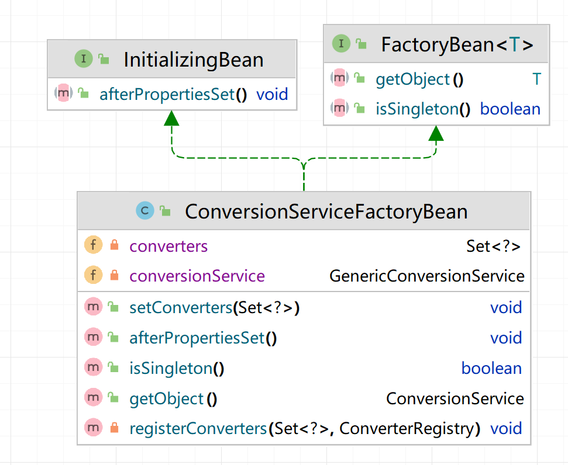

**类型转换的时机**有两个：

- xml文件读取bean，为bean填充属性时，见AbstractAutowireCapableBeanFactory#applyPropertyValues 
- 处理@Value注解时，见AutowiredAnnotationBeanPostProcessor#postProcessPropertyValues

你可能会有疑问，如果没有定义ConversionService，是怎么进行基本类型的转换的？其实spring为了向下兼容保留了一套比较旧的类型转换机制，没有定义ConversionService时会使用其进行基本类型的转换工作，不必关注旧的类型转换机制。

### 流程梳理

- 为了类型转换器的复用，给AbstractBeanFactory添加属性ConversionService（以下简称CS）

- 在容器初始化refresh的过程中注册CS，也就是给CS设置值时需要先获得CS这个bean

- 也就是在容器内部进行getBean(CS)，出发CS的bean的构建过程（定义在xml中配置了）

- 构建过程中，而CS是ConversionServiceFactoryBean的产品（简称CSFB），给CSFB设置属性converters时，发现converters是引用类型，需要先初始化引用的对象

- 所以要先getBean(converters)，而converters实现了FactoryBean接口，重写了getObject方法，可以添加一些自定义的converter，并返回converters集合

- 此时CSFB的属性converters设置好了，因为CSFB又实现了InitializingBean接口，所以可以在设置属性后拓展，也就是在afterPropertiesSet中操作

- ```java
  @Override
  public void afterPropertiesSet() throws Exception {
      conversionService = new DefaultConversionService(); // 里面含有默认的converter
      registerConverters(converters, conversionService); // 添加自定义的converter
  }
  ```

- CS构建好了之后，传给BeanFactory就可以正式使用了

### 测试

```java
public class Car {

	private int price;

	private LocalDate produceDate;
}
```

```java
public class StringToLocalDateConverter implements Converter<String, LocalDate> {

	private final DateTimeFormatter DATE_TIME_FORMATTER;

	public StringToLocalDateConverter(String pattern) {
		DATE_TIME_FORMATTER = DateTimeFormatter.ofPattern(pattern);
	}

	@Override
	public LocalDate convert(String source) {
		return LocalDate.parse(source, DATE_TIME_FORMATTER);
	}
}
```

type-conversion-second-part.xml

```xml
<?xml version="1.0" encoding="UTF-8"?>
<beans>
    <bean id="car" class="org.springframework.test.bean.Car">
        <property name="price" value="1000000"/>
        <property name="produceDate" value="2021-01-01"/>
    </bean>

    <bean id="conversionService" class="org.springframework.context.support.ConversionServiceFactoryBean">
        <property name="converters" ref="converters"/>
    </bean>

    <bean id="converters" class="org.springframework.test.common.ConvertersFactoryBean"/>
</beans>
```

```java
public class TypeConversionSecondPartTest {

	@Test
	public void testConversionService() throws Exception {
		ClassPathXmlApplicationContext applicationContext = new ClassPathXmlApplicationContext("classpath:type-conversion-second-part.xml");

		Car car = applicationContext.getBean("car", Car.class);
		assertThat(car.getPrice()).isEqualTo(1000000);
		assertThat(car.getProduceDate()).isEqualTo(LocalDate.of(2021, 1, 1));
	}
}
```

# 高级篇

## 二十九、解决循环依赖问题（一）：没有代理对象

> 代码分支：circular-reference-without-proxy-bean

### 为什么会循环依赖

先理解spring中为什么会有循环依赖的问题。比如如下的代码

```java
public class A {

	private B b;

	//getter and setter
}
```

```java
public class B {

	private A a;

	//getter and setter
}
```

```xml
<beans>
    <bean id="a" class="org.springframework.test.bean.A">
        <property name="b" ref="b"/>
    </bean>
    <bean id="b" class="org.springframework.test.bean.B">
        <property name="a" ref="a"/>
    </bean>
</beans>
```

A依赖B，B又依赖A，循环依赖。容器加载时会执行依赖流程：

- 实例化A，发现依赖B，然后实例化B
- 实例化B，发现依赖A，然后实例化A
- 实例化A，发现依赖B，然后实例化B
- ...

死循环直至栈溢出。

解决该问题的关键在于何时将实例化后的bean放进容器中，设置属性前还是设置属性后。现有的执行流程，bean实例化后并且设置属性后会被放进singletonObjects单例缓存中。如果我们调整一下顺序，当bean实例化后就放进singletonObjects单例缓存中，提前暴露引用，然后再设置属性，就能解决上面的循环依赖问题，执行流程变为：

- 步骤一：getBean(a)，检查singletonObjects是否包含a，singletonObjects不包含a，实例化A放进singletonObjects，设置属性b，发现依赖B，尝试getBean(b)
- 步骤二：getBean(b)，检查singletonObjects是否包含b，singletonObjects不包含b，实例化B放进singletonObjects，设置属性a，发现依赖A，尝试getBean(a)
- 步骤三：getBean(a)，检查singletonObjects是否包含a，singletonObjects包含a，返回a
- 步骤四：步骤二中的b拿到a，设置属性a，然后返回b
- 步骤五：步骤一中的a拿到b，设置属性b，然后返回a

可见调整bean放进singletonObjects（人称一级缓存）的时机到bean实例化后即可解决循环依赖问题。但为了和spring保持一致，我们增加一个二级缓存earlySingletonObjects，在bean实例化后将bean放进earlySingletonObjects中（见AbstractAutowireCapableBeanFactory#doCreateBean方法第6行），getBean()时检查一级缓存singletonObjects和二级缓存earlySingletonObjects中是否包含该bean，包含则直接返回（见AbstractBeanFactory#getBean第1行）。

单测见CircularReferenceWithoutProxyBeanTest#testCircularReference。

增加二级缓存，不能解决有代理对象时的循环依赖。原因是放进二级缓存earlySingletonObjects中的bean是实例化后的bean，而放进一级缓存singletonObjects中的bean是代理对象（代理对象在BeanPostProcessor#postProcessAfterInitialization中返回），两个缓存中的bean不一致。比如上面的例子，如果A被代理，那么B拿到的a是实例化后的A，而a是被代理后的对象，即b.getA() != a，见单测CircularReferenceWithProxyBeanTest。

下一节填坑。

### :star::star:全流程

创建a-->a加入二级缓存-->给a的属性b设置值-->触发创建b-->b加入二级缓存-->给b的属性a设置值-->调用getBean-->调用getSingleton-->拿到a二级缓存-->b的属性a设置完成-->继续b的创建-->成功创建b并放入一级缓存-->a的b属性设置完成-->继续a的创建-->成功创建a并放入一级缓存

## 三十、解决循环依赖问题（二）：有代理对象

> 代码分支：circular-reference-with-proxy-bean

解决有代理对象时的循环依赖问题，需要提前暴露代理对象的引用，而不是暴露实例化后的bean的引用。

spring中用singletonFactories（一般称第三级缓存）解决有代理对象时的循环依赖问题。

**第三级缓存 `singletonFactories` 里放的是一个 `ObjectFactory`，本质就是“回调/延迟提供者”**。

```java
/** Cache of singleton objects: bean name --> bean instance */
/** 一级缓存：用于存放完全初始化好的 bean **/
private final Map<String, Object> singletonObjects = new ConcurrentHashMap<String, Object>(256);
 
/** Cache of early singleton objects: bean name --> bean instance */
/** 二级缓存：存放原始的 bean 对象（尚未填充属性） */
private final Map<String, Object> earlySingletonObjects = new HashMap<String, Object>(16);

/** Cache of singleton factories: bean name --> ObjectFactory */
/** 三级级缓存：存放 bean 工厂对象 */
private final Map<String, ObjectFactory<?>> singletonFactories = new HashMap<String, ObjectFactory<?>>(16);
```

:star:**Spring 的设计原则是在 Bean 初始化完成之后才为其创建代理。但是为了解决循环依赖问题，会提前生成代理对象，提前到有bean设置属性需要调用它的时候生成代理**

```csharp
BeanPostProcessor前置处理
    ↓
InitializingBean / init-method
    ↓
BeanPostProcessor后置处理（★ 这里通常 wrapIfNecessary ⇒ 生成代理 ★）
    ↓
   使用
```

**核心流程**

用 A 依赖 B、B 又依赖 A 的经典环为例（两者都可能被 AOP 代理）。

### :star::star:全流程

以下每一步都附上三个缓存里的状态变化（`1级|2级|3级`）。

1.创建 a：只实例化，还没装配

- a 实例化出来，标记“正在创建”；

- 向**三级缓存**登记早期工厂：:star::star:这里的ObjectFactory是函数式接口，此时并没有调用getObject方法，等真正需要的时候才来调用。

  ```java
  addSingletonFactory("a", new ObjectFactory<Object>() {
      @Override
      public Object getObject() throws BeansException {
          return getEarlyBeanReference("a", beanDefinition, finalBean);
      }
  });
  ```

- 状态：`{} | {} | {A: factory}`

2.给 a 填属性需要 b → 去创建 b

- b 实例化出来，登记三级工厂：
  - 状态：`{} | {} | {A: factory, B: factory}`

3.给 b 填属性需要 a → 触发“早期引用”链

```java
public Object getSingleton(String beanName) {
    Object singletonObject = singletonObjects.get(beanName);
    if (singletonObject == null) {
        singletonObject = earlySingletonObjects.get(beanName);
        if (singletonObject == null) {
            ObjectFactory<?> singletonFactory = singletonFactories.get(beanName);
            if (singletonFactory != null) {
                singletonObject = singletonFactory.getObject();
                //从三级缓存放进二级缓存
                earlySingletonObjects.put(beanName, singletonObject);
                singletonFactories.remove(beanName);
            }
        }
    }
    return singletonObject;
}
```

- :star::star::star:getBean("a") 时：一级无；二级无；**启用三级**：执行singletonFactory.getObject()

- 这里会调用AbstractAutowireCapableBeanFactory#getEarlyBeanReference()

  ```java
  // AbstractAutowireCapableBeanFactory
  protected Object getEarlyBeanReference(String beanName, BeanDefinition beanDefinition, Object bean) {
      Object exposedObject = bean;
      for (BeanPostProcessor bp : getBeanPostProcessors()) {
          if (bp instanceof InstantiationAwareBeanPostProcessor) {
              exposedObject = ((InstantiationAwareBeanPostProcessor) bp).getEarlyBeanReference(exposedObject, beanName);
              if (exposedObject == null) {
                  return exposedObject;
              }
          }
      }
  
      return exposedObject;
  }
  
  // 继续调用DefaultAdvisorAutoProxyCreator重写IABPP的getEarlyBeanReference
  public Object getEarlyBeanReference(Object bean, String beanName) throws BeansException {
      earlyProxyReferences.add(beanName);
      return wrapIfNecessary(bean, beanName);
  }
  // wrapIfNecessary就是生成代理对象的
  ```

  :star::star::star:b getBean("a")后，调用上面的getSingleton方法，把a从三级缓存移动到二级缓存。

  ```java
  // AbstractBeanFactory
  public Object getBean(String name) throws BeansException {
      Object sharedInstance = getSingleton(name);
      if (sharedInstance != null) {
          //如果是FactoryBean，从FactoryBean#getObject中创建bean
          return getObjectForBeanInstance(sharedInstance, name);
      }
  
      BeanDefinition beanDefinition = getBeanDefinition(name);
      Object bean = createBean(name, beanDefinition);
      return getObjectForBeanInstance(bean, name);
  }
  ```

- 状态：`{} | {A: earlyRef} | {B: factory}`（b 拿到的就是 a 的早期引用 `earlyRef`）

4.完成 b 的初始化

- 走初始化和 postProcessAfterInitialization，此时可能对 b也创建代理 b’；
- doCreate中会调用addSingleton，把 **最终 b（b 或 b’）** 放入一级；清理二/三级中 b 的条目；

```java
public void addSingleton(String beanName, Object singletonObject) {
    singletonObjects.put(beanName, singletonObject);
    earlySingletonObjects.remove(beanName);
    singletonFactories.remove(beanName);
}
```

- 状态：`{B: B’} | {A: earlyRef} | {}`

5.回到 a，完成 a 的属性填充与初始化

- 此时 a 拿到的 a 是“成品 b（通常是 b’）”；
- 进入 `postProcessAfterInitialization(A)`：
  - 如果**已经在3中提前生成了代理 a’**，`AbstractAutoProxyCreator` 会识别到“此 Bean 已做**早期代理**”，从而**避免再次代理/替换**（靠一个内部的 `earlyProxyReferences` 集合实现“不要二次代理/保持同一实例”）。
  - 如果3没提前代理（例如没有切点命中），那现在按常规是否需要代理来决定是否包装。
- 将 **最终 a（与 earlyRef 同一引用）** 放入一级；清理二/三级中 A 的条目；
- 状态：`{B: B’, A: A’} | {} | {}`

### 测试

circular-reference-with-proxy-bean.xml

```xml
<?xml version="1.0" encoding="UTF-8"?>
<beans>
    <bean id="b" class="org.springframework.test.bean.B">
        <property name="a" ref="a"/>
    </bean>

    <!-- a被代理 -->
    <bean id="a" class="org.springframework.test.bean.A">
        <property name="b" ref="b"/>
    </bean>

    <bean class="org.springframework.aop.framework.autoproxy.DefaultAdvisorAutoProxyCreator"/>

    <bean id="pointcutAdvisor" class="org.springframework.aop.aspectj.AspectJExpressionPointcutAdvisor">
        <property name="expression" value="execution(* org.springframework.test.bean.A.func(..))"/>
        <property name="advice" ref="methodInterceptor"/>
    </bean>


    <bean id="methodInterceptor" class="org.springframework.aop.framework.adapter.MethodBeforeAdviceInterceptor">
        <property name="advice" ref="beforeAdvice"/>
    </bean>

    <bean id="beforeAdvice" class="org.springframework.test.common.ABeforeAdvice"/>
</beans>
```

```java
public class CircularReferenceWithProxyBeanTest {

	@Test
	public void testCircularReference() throws Exception {
		ClassPathXmlApplicationContext applicationContext = new ClassPathXmlApplicationContext("classpath:circular-reference-with-proxy-bean.xml");
		A a = applicationContext.getBean("a", A.class);
		B b = applicationContext.getBean("b", B.class);

		assertThat(b.getA() == a).isTrue();
	}
}
```

## 三十一、懒加载和多切面增强

> 代码分支:  lazy-init-and-multi-advice

### 懒加载

事实上，并不是所有的bean在初始化容器的时候都会创建。随着项目规模的不断扩大，bean的数目也越来越多。如果每次启动容器都需要加载大量的bean，这无疑会带来大量的资源浪费。所有spring提供了懒加载机制，我们可以将我们认为暂时用不到的bean设为懒加载，这样只有在我们需要这个bean的时候这个bean才会被创建。

测试

lazy-test.xml

```java
	// 只有当bean是单例且不为懒加载才会被创建	
	public void preInstantiateSingletons() throws BeansException {
		beanDefinitionMap.forEach((beanName, beanDefinition) -> {
			if(beanDefinition.isSingleton()&&!beanDefinition.isLazyInit()){
				getBean(beanName);
			}
		});
	}
```

```java
public class LazyInitTest {
    @Test
    public void testLazyInit() throws InterruptedException {
        ClassPathXmlApplicationContext applicationContext = new ClassPathXmlApplicationContext("classpath:lazy-test.xml");
        System.out.println(System.currentTimeMillis()+":applicationContext-over");
        TimeUnit.SECONDS.sleep(1);
        Car c= (Car) applicationContext.getBean("car");
        c.showTime();//显示bean的创建时间
    }
}
```

```xml
<?xml version="1.0" encoding="UTF-8"?>
<beans>
    <bean id="car" class="org.springframework.test.bean.Car" lazyInit="true" init-method="init">
        <property name="brand" value="porsche"/>
    </bean>
</beans>
```

关闭懒加载的输出:

```
1671698959957:applicationContext-over
1671698959951:bean create
```

开启懒加载：

```
1671699030293:applicationContext-over
1671699031328:bean create
```

可以清楚的看到开启和不开启懒加载bean的创建时机的差异

### 多切面增强

虽然在前面我们完成了对方法的增强，但并不完美。我们的目前的代码只能支持对方法的单个增强。作为spring的核心功能如果不支持多切面的话有点太别扭了。spring利用了拦截器链来完成了对多个切面的支持。

#### 总体设计

- **统一模型**：把所有 Advice 适配为 `MethodInterceptor`（`AdvisorAdapterRegistry` → 适配器模式）。
- **链式执行**：用 **拦截器链（责任链模式）** 承载多个切面；执行由 `MethodInvocation.proceed()` 逐个推进。
- **匹配筛选**：对候选 `Advisor` 做 **ClassFilter + MethodMatcher**（静态 + 运行期）两段式匹配，得到本方法专属的链。
- **方法级缓存**：用 `(Method, targetClass)` 作为 key 缓存链。

#### ProxyFactory

让我们从ProxyFactory开始，来看一下代理对象的整个创建流程。至于为什么从ProxyFactory开，这是因为代理对象最终是用ProxyFactory的getProxy()函数来获得的。

```java
public class ProxyFactory extends AdvisedSupport{


	public ProxyFactory() {
	}

	public Object getProxy() {
		return createAopProxy().getProxy();
	}

	private AopProxy createAopProxy() {
		if (this.isProxyTargetClass()||this.getTargetSource().getTargetClass().length==0) {
			return new CglibAopProxy(this);
		}
		return new JdkDynamicAopProxy(this);
	}
}
```

为了更贴合spring的实现，这里更改了ProxyFactory使其继承了AdvisedSupport，正如spring源码中做的那样。

#### 基于JDK动态代理

ProxyFactory只是简单的做了下选择，当我们设置proxyTargetClass属性或者被代理对象没有接口时会调用cjlib动态代理，否则调用jdk动态代理。二者实现并没有太大区别，这里只贴出jdk动态代理的实现。

```java
	public Object getProxy() {
		return Proxy.newProxyInstance(getClass().getClassLoader(), advised.getTargetSource().getTargetClass(), this);
	}

	@Override
	public Object invoke(Object proxy, Method method, Object[] args) throws Throwable {
		// 获取目标对象
		Object target=advised.getTargetSource().getTarget();
		Class<?> targetClass = target.getClass();
		Object retVal = null;
		// 获取拦截器链
		List<Object> chain = this.advised.getInterceptorsAndDynamicInterceptionAdvice(method, targetClass);
		if(chain==null||chain.isEmpty()){
			return method.invoke(target, args);
		}else{
			// 将拦截器统一封装成ReflectiveMethodInvocation
			MethodInvocation invocation =
					new ReflectiveMethodInvocation(proxy, target, method, args, targetClass, chain);
			// Proceed to the joinpoint through the interceptor chain.
			// 执行拦截器链
			retVal = invocation.proceed();
		}
		return retVal;
	}
```

jdk动态代理可以分为获取拦截器链，将拦截器统一封装成ReflectiveMethodInvocation，执行拦截器链三部分。我们来逐一看一下这三部分。

##### 1.获取拦截器链

首先将获取到所有与当前method匹配的advice(增强)，跟踪getInterceptorsAndDynamicInterceptionAdvice代码，我们发现Spring AOP也使用缓存进行提高性能，如果该方法已经获取过拦截器，则直接取缓存，否则通过advisorChainFactory获取拦截器链。AdvisorChainFactory是用来获得拦截器链接口。它的一个实现类为DefaultAdvisorChainFactory

AdvisedSupport#getInterceptorsAndDynamicInterceptionAdvice：

```java
	public List<Object> getInterceptorsAndDynamicInterceptionAdvice(Method method, Class<?> targetClass) {
		Integer cacheKey=method.hashCode();
		List<Object> cached = this.methodCache.get(cacheKey);
		if (cached == null) {
			cached = this.advisorChainFactory.getInterceptorsAndDynamicInterceptionAdvice(
					this, method, targetClass);
			this.methodCache.put(cacheKey, cached);
		}
		return cached;
	}
```

整体代码并不复杂，首先获取所有Advisor(切面)，通过pointcutAdvisor.getPointcut().getClassFilter().matches(actualClass)校验当前代理对象是否匹配该Advisor，再通过pointcutAdvisor.getPointcut().getMethodMatcher()校验是否匹配当前调用method。如果通过校验，则提取advisor中的interceptors增强，添加到interceptorList中。这里可能有读者会疑惑，我们明明是要获取MethodInterceptor，可AdvisedSupport的getAdvice()返回的是Advice(增强),其实如果我们点开MethodInterceptor的源码，我们会发现MethodInterceptor继承了Interceptor接口，而Interceptor又继承了Advice接口。因为这里的Advice和MethodInterceptor我们都是用的AOP联盟的接口，所以特此说明一下。

DefultAdvisorChainFactory#getInterceptorsAndDynamicInterceptionAdvice

```java
public List<Object> getInterceptorsAndDynamicInterceptionAdvice(AdvisedSupport config, Method method, Class<?> targetClass) {
        Advisor[] advisors = config.getAdvisors().toArray(new Advisor[0]);
        List<Object> interceptorList = new ArrayList<>(advisors.length);
        Class<?> actualClass = (targetClass != null ? targetClass : method.getDeclaringClass());
        for (Advisor advisor : advisors) {
            if (advisor instanceof PointcutAdvisor) {
                // Add it conditionally.
                PointcutAdvisor pointcutAdvisor = (PointcutAdvisor) advisor;
                // 校验当前Advisor是否适用于当前对象
                if (pointcutAdvisor.getPointcut().getClassFilter().matches(actualClass)) {
                    MethodMatcher mm = pointcutAdvisor.getPointcut().getMethodMatcher();
                    boolean match;
                    // 校验Advisor是否应用到当前方法上
                    match = mm.matches(method,actualClass);
                    if (match) {
                        MethodInterceptor interceptor = (MethodInterceptor) advisor.getAdvice();
                            interceptorList.add(interceptor);
                    }
                }
            }
        }
        return interceptorList;
    }
```

##### 2.将拦截器封装成ReflectiveMethodInvocation

这里也是重写了ReflectiveMethodInvocation的实现，来支持多切面。

```java
	public ReflectiveMethodInvocation(Object proxy,Object target, Method method, Object[] arguments,Class<?> targetClass,List<Object> chain) {
		this.proxy=proxy;
		this.target = target;
		this.method = method;
		this.arguments = arguments;
		this.targetClass=targetClass;
		this.interceptorsAndDynamicMethodMatchers=chain;
	}
```

##### 3.执行拦截器链

spring能够保证多个切面同时匹配同一方法的而不出现乱序的关键就在下面一段代码了。

:star:ReflectiveMethodInvocation#proceed()，这里是Spring 6.x 的核心代码

**普通拦截器**：签名静态匹配，一旦加入链条就始终生效。

**动态拦截器**：携带额外的运行时匹配器，每次调用按需“开闸”。

:star:弄清楚调用逻辑：打断点在proxy.explode();

```java
@Override
@Nullable
public Object proceed() throws Throwable {
    // ① 链底：所有拦截器都跑完，真正调用业务方法
    if (this.currentInterceptorIndex ==
            this.interceptorsAndDynamicMethodMatchers.size() - 1) {
        return invokeJoinpoint();          // ← 注意这里不是直接 method.invoke
    }

    // ② 取下一位“选手”
    Object interceptorOrInterceptionAdvice =
            this.interceptorsAndDynamicMethodMatchers.get(++this.currentInterceptorIndex);

    // ③ 如果是“动态匹配”型拦截器，需要先做一次运行时匹配
    if (interceptorOrInterceptionAdvice instanceof InterceptorAndDynamicMethodMatcher dm) {
        if (dm.methodMatcher.matches(this.method, this.targetClass, this.arguments)) {
            return dm.interceptor.invoke(this);
        }
        else {
            // 匹配失败就“跳过”，继续递归调用链
            return proceed();
        }
    }
    else {
        // 普通拦截器，直接执行
        return ((MethodInterceptor) interceptorOrInterceptionAdvice).invoke(this);
    }
}
```

我们看到，MethodInvocation只是简单的将拦截器链的所有拦截器一一执行，最后再触发当前的method方法。这是很简单高效的方法，但问题是我们希望某些增强比如AfterReturningAdvice能够在方法执行完才被执行，这就涉及到不同增强的执行顺序的问题了。而MethodInvocation显然没有考虑顺序的问题，一个AfterReturningAdvice很可能在BeforeAdvice之前被调用。那么该如何保证顺序问题呢？

答案是，控制增强的调用顺序其实由每个拦截器负责，所以我们需要分析`MethodBeforeAdviceInterceptor`和`AfterReturningAdviceInterceptor`

```java
public class MethodBeforeAdviceInterceptor implements MethodInterceptor, BeforeAdvice {

	private MethodBeforeAdvice advice;

	public MethodBeforeAdviceInterceptor() {
	}

	public MethodBeforeAdviceInterceptor(MethodBeforeAdvice advice) {
		this.advice = advice;
	}

	public void setAdvice(MethodBeforeAdvice advice) {
		this.advice = advice;
	}

	@Override
	public Object invoke(MethodInvocation mi) throws Throwable {
		this.advice.before(mi.getMethod(), mi.getArguments(), mi.getThis());
		return mi.proceed();
	}
}
```

```java
package org.springframework.aop.framework.adapter;

import org.aopalliance.intercept.MethodInterceptor;
import org.aopalliance.intercept.MethodInvocation;
import org.springframework.aop.AfterAdvice;
import org.springframework.aop.AfterReturningAdvice;

public class AfterReturningAdviceInterceptor implements MethodInterceptor, AfterAdvice {

    private  AfterReturningAdvice advice;

    public AfterReturningAdviceInterceptor() {
    }

    public AfterReturningAdviceInterceptor(AfterReturningAdvice advice) {
        this.advice = advice;
    }


    @Override
    public Object invoke(MethodInvocation mi) throws Throwable {
        Object retVal = mi.proceed();
        this.advice.afterReturning(retVal, mi.getMethod(), mi.getArguments(), mi.getThis());
        return retVal;
    }
}
```

看了源码大家应该就清楚了，拦截器链执行的顺序正时在各个拦截器的`invoke`方法中实现的。`before`会先执行`advice`增强方法再链式调用，这个比较好理解而`after`则是先执行链式调用，再调用`advice`增强方法，也就是一个:star:**迭代索引 + 调用栈回卷**。

```
A.invoke(inv) {
  // before(A)
  inv.proceed() ──▶ B.invoke(inv) {
                      // before(B)
                      inv.proceed() ──▶ C.invoke(inv) {
                                          // before(C)
                                          inv.proceed() ──▶ invokeJoinpoint() // 目标方法
                                          // after(C)
                                        }
                      // after(B)
                    }
  // after(A)
}

```

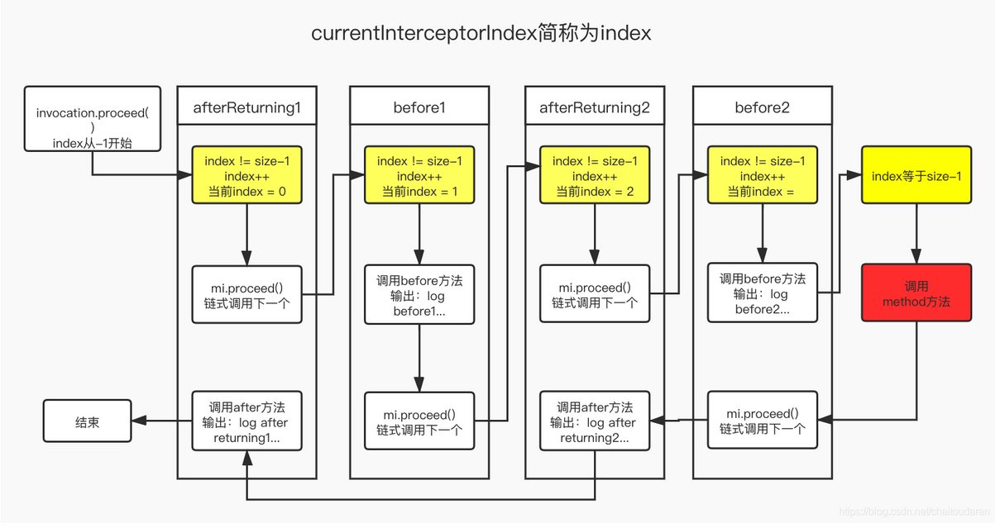

#### 测试

！！！！！！！注意，使用过高版本的java可以因为java版本和cjlib冲突导致报错。建议使用java8进行测试

```java
public class WorldServiceImpl implements WorldService {

	private String name;

	@Override
	public void explode() {
		System.out.println("The " + name + " is going to explode");
	}

	@Override
	public String getName() {
		return name;
	}

	public void setName(String name) {
		this.name = name;
	}
}
```

前置增强：

```java
public class WorldServiceBeforeAdvice implements MethodBeforeAdvice {

	@Override
	public void before(Method method, Object[] args, Object target) throws Throwable {
		System.out.println("BeforeAdvice: do something before the earth explodes");
	}
}
```

后置返回增强：

```java
public class WorldServiceAfterReturnAdvice implements AfterReturningAdvice {
    @Override
    public void afterReturning(Object returnValue, Method method, Object[] args, Object target) throws Throwable {
        System.out.println("AfterAdvice: do something after the earth explodes");
    }
}
```

测试代码：

```java
public class ProxyFactoryTest {
    @Test
    public void testAdvisor() throws Exception {
        WorldService worldService = new WorldServiceImpl();

        //Advisor是Pointcut和Advice的组合
        String expression = "execution(* org.springframework.test.service.WorldService.explode(..))";
        //第一个切面
        AspectJExpressionPointcutAdvisor advisor = new AspectJExpressionPointcutAdvisor();
        advisor.setExpression(expression);
        MethodBeforeAdviceInterceptor methodInterceptor = new MethodBeforeAdviceInterceptor(new WorldServiceBeforeAdvice());
        advisor.setAdvice(methodInterceptor);
        //第二个切面
        AspectJExpressionPointcutAdvisor advisor1=new AspectJExpressionPointcutAdvisor();
        advisor1.setExpression(expression);
        AfterReturningAdviceInterceptor afterReturningAdviceInterceptor=new AfterReturningAdviceInterceptor(new WorldServiceAfterReturnAdvice());
        advisor1.setAdvice(afterReturningAdviceInterceptor);
        //通过ProxyFactory来获得代理
        ProxyFactory factory = new ProxyFactory();
        TargetSource targetSource = new TargetSource(worldService);
        factory.setTargetSource(targetSource);
        factory.setProxyTargetClass(true);
        factory.addAdvisor(advisor);
        factory.addAdvisor(advisor1);
        WorldService proxy = (WorldService) factory.getProxy();
        proxy.explode();
    }
}
```

输出：

```
BeforeAdvice: do something before the earth explodes
The null is going to explode
AfterAdvice: do something after the earth explodes

进程已结束，退出代码为 0
```

#### 多切面动态代理融入bean生命周期

```java
	public void testAutoProxy() throws Exception {
		ClassPathXmlApplicationContext applicationContext = new ClassPathXmlApplicationContext("classpath:auto-proxy.xml");

		//获取代理对象
		WorldService worldService = applicationContext.getBean("worldService", WorldService.class);
		worldService.explode();
	}
```

auto-proxy.xml：

```xml
<?xml version="1.0" encoding="UTF-8"?>
<beans>
    <bean id="worldService" class="org.springframework.test.service.WorldServiceImpl"/>

    <bean class="org.springframework.aop.framework.autoproxy.DefaultAdvisorAutoProxyCreator"/>

    <bean id="pointcutAdvisor" class="org.springframework.aop.aspectj.AspectJExpressionPointcutAdvisor">
        <property name="expression" value="execution(* org.springframework.test.service.WorldService.explode(..))"/>
        <property name="advice" ref="methodInterceptor"/>
    </bean>
    <bean id="pointcutAdvisor2" class="org.springframework.aop.aspectj.AspectJExpressionPointcutAdvisor">
        <property name="expression" value="execution(* org.springframework.test.service.WorldService.explode(..))"/>
        <property name="advice" ref="methodInterceptor2"/>
    </bean>

    <bean id="methodInterceptor" class="org.springframework.aop.framework.adapter.MethodBeforeAdviceInterceptor">
        <property name="advice" ref="beforeAdvice"/>
    </bean>
    <bean id="methodInterceptor2" class="org.springframework.aop.framework.adapter.AfterReturningAdviceInterceptor">
        <property name="advice" ref="afterAdvice"/>
    </bean>
    <bean id="afterAdvice" class="org.springframework.test.common.WorldServiceAfterReturnAdvice"/>
    <bean id="beforeAdvice" class="org.springframework.test.common.WorldServiceBeforeAdvice"/>
</beans>
```

输出：

```
BeforeAdvice: do something before the earth explodes
The null is going to explode
AfterAdvice: do something after the earth explodes

进程已结束，退出代码为 0
```

至此，我们已经解决多切面匹配同一方法的问题。

