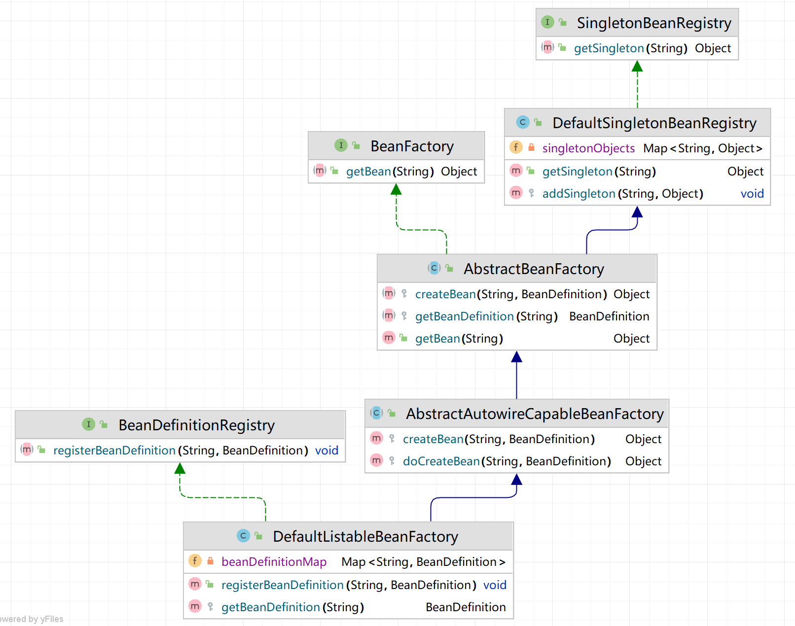
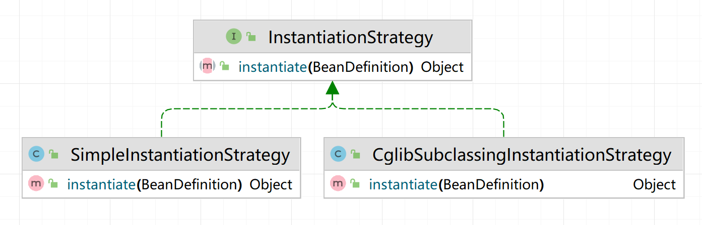
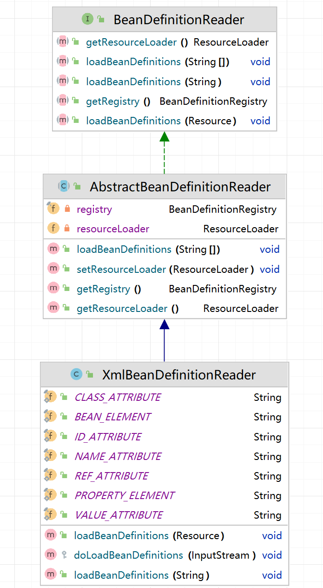
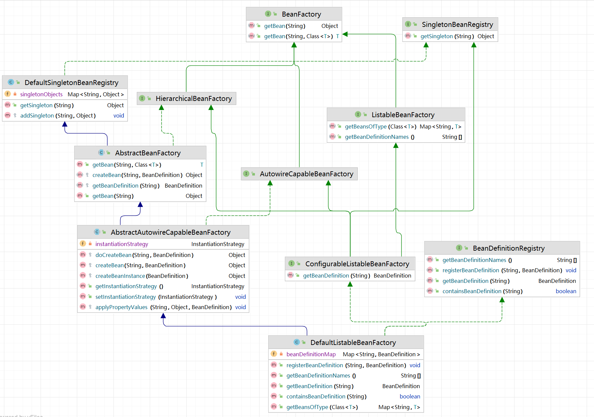
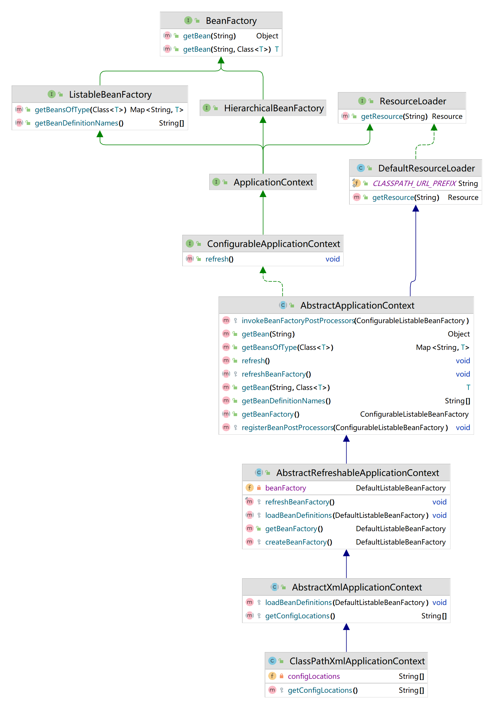
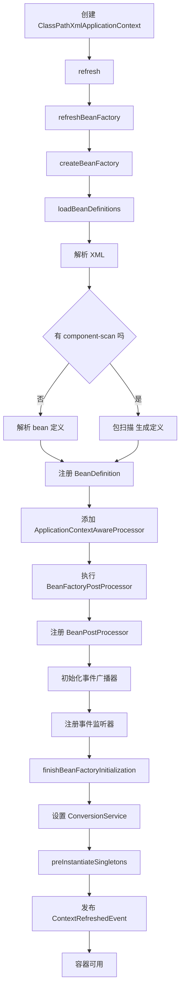
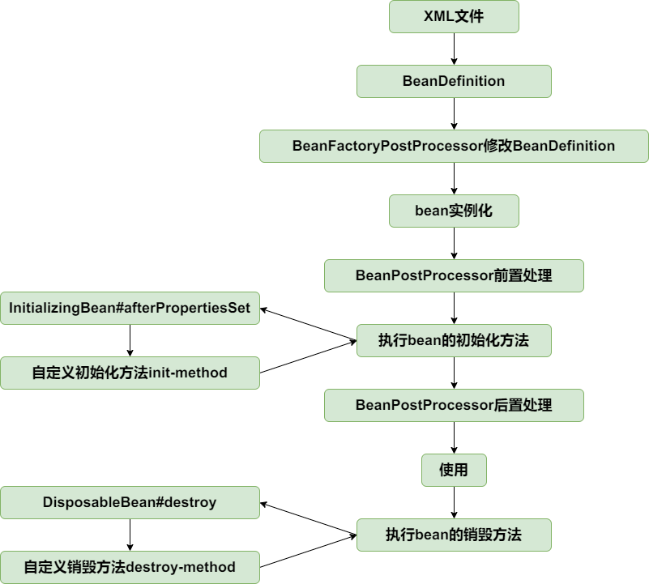
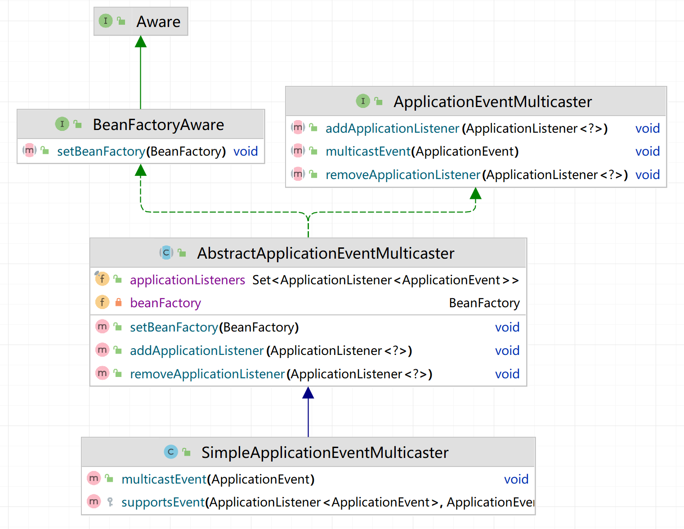
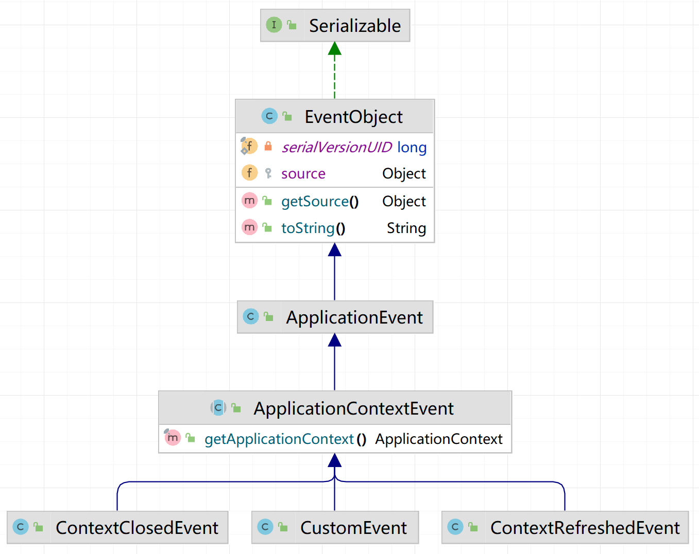

 # IoC部分

 ## 一、最简单的bean容器

 > 分支：01-simple-bean-container

```java
public class BeanFactory {
    private Map<String, Object> beanMap = new HashMap<>();

    public void registerBean(String name, Object bean) {
        beanMap.put(name, bean);
    }

    public Object getBean(String name) {
        return beanMap.get(name);
    }
}
```

### 概念

#### 1. 容器（Container）

- 创建、配置、管理对象（Bean）的生命周期；
- 处理依赖关系；
- 提供扩展机制（如 AOP、事件、资源加载等）。

Spring 提供的容器主要有两个层级：

- `BeanFactory`：最基础的 IoC 容器，提供基本的 Bean 管理；
- `ApplicationContext`：是 `BeanFactory` 的超集，增加了更强大的功能（事件、国际化、自动装配、AOP 支持等），开发中一般都使用 `ApplicationContext`。

#### 2. 组件（Component / Bean）

**Bean** 是容器中受管理的对象，Spring 会根据配置（XML、注解或Java配置类）自动创建和管理它们。

**组件（Component）** 是一个更“语义化”的说法，指的是具有业务功能的单元，在Spring中通常通过注解（如 `@Component`, `@Service`, `@Controller`, `@Repository`）标记，然后变成一个Bean交由容器管理。

所以，“组件” 是业务角度的说法，“Bean” 是容器角度的说法，实质上指的是同一个对象。

#### 3. IoC（Inversion of Control）

**控制反转**：程序中的对象由容器创建和管理，而不是代码中自己 new 出来，控制权从程序员“反转”到框架（容器）手中。

**实现IoC的方式有：依赖查找、依赖注入**

#### 4. DI（Dependency Injection）

依赖注入：容器在创建 Bean 时自动为其注入它依赖的其他 Bean。实现DI的技术是反射？，参考第四节，第五节。常见注入方式有：

- 构造器注入
- Setter 方法注入
- 字段注入（如 `@Autowired`）

## 二、BeanDefinition和BeanDefinitionRegistry

### 概念

**BeanDefinition：**用于定义bean信息的类，包含bean的class类型、构造参数、属性值等信息（项目后期补充），每个bean对应一个BeanDefinition的实例。BeanDefinition就像JVM方法区中的class metadata一样，集成了创建一个bean所需要的所有信息。

**BeanDefinitionRegistry：**定义了注册（添加）BeanDefinition的方法，存储BeanDefinition的位置在DefaultListableBeanFactory容器中。

**SingletonBeanRegistry：**用于注册和获取已经实例化好的单例对象。

### 结构梳理

DefaultSingletonBeanRegistry工厂/容器存着实例化后的单例bean的Map。

DefaultListableBeanFactory容器继承了BeanDefinitionRegistry，具备了添加bean定义，存着BeanDefinition的Map。此时的定义是需要手动添加的。

AbstractBeanFactory#getBean方法实现按名字返回相应的bean，如果还没创建，则获取定义，按照定义实例化。



测试：

```java
public class BeanDefinitionAndBeanDefinitionRegistryTest {

    @Test
    public void testBeanFactory() throws Exception {
        DefaultListableBeanFactory beanFactory = new DefaultListableBeanFactory();
        BeanDefinition beanDefinition = new BeanDefinition(HelloService.class);
        beanFactory.registerBeanDefinition("helloService", beanDefinition);

        HelloService helloService = (HelloService) beanFactory.getBean("helloService");
        System.out.println(helloService);
        HelloService helloService2 = (HelloService) beanFactory.getBean("helloService");
        System.out.println(helloService2);
        helloService.sayHello();
    }
}
```

## 三、Bean实例化策略InstantiationStrategy

- **SimpleInstantiationStrategy（反射构造）**：99% 的普通 Bean 都用它。
- **CglibSubclassingInstantiationStrategy（CGLIB 子类化）**：主要为“方法注入（method injection）/方法替换”这类需要**运行期覆写方法**的场景服务（如 `@Lookup`、`<lookup-method>`、`<replaced-method>`），否则没必要上它。



### 简单策略

取出BeanDefinition种的class，利用反射取出**无参构造函数**，再调用newInstance()创建实例。

```java
public class SimpleInstantiationStrategy implements InstantiationStrategy {
	@Override
	public Object instantiate(BeanDefinition beanDefinition) throws BeansException {
		Class beanClass = beanDefinition.getBeanClass();
		try {
			Constructor constructor = beanClass.getDeclaredConstructor();
			return constructor.newInstance();
		} catch (Exception e) {
			throw new BeansException("Failed to instantiate [" + beanClass.getName() + "]", e);
		}
	}
}
```

### cglib策略

**解决无参构造函数问题**

这个策略只是创建一个空的 CGLIB 子类，它：

- 不包含任何 AOP 增强逻辑

- 只是简单地调用父类方法

- 不是真正的 AOP 代理

:star:AOP 代理是在 BeanPostProcessor 的后置处理阶段创建的

```java
public class CglibSubclassingInstantiationStrategy implements InstantiationStrategy {

    @Override
    public Object instantiate(BeanDefinition beanDefinition) throws BeansException {
        // 1) 准备一个 Enhancer —— CGLIB 的核心工具类
        Enhancer enhancer = new Enhancer();

        // 2) 指定“我要给谁生成子类”
        enhancer.setSuperclass(beanDefinition.getBeanClass());

        // 3) 指定子类里每次调用方法时要执行的“拦截器”
        enhancer.setCallback((MethodInterceptor) (obj, method, args, proxy) ->
                proxy.invokeSuper(obj, args));

        // 4) 真正创建子类实例（底层：ASM 拼字节码 → ClassLoader#defineClass → new）
        return enhancer.create();
    }
}
```

## 四、为bean的属性填充值

> 分支：populate-bean-with-property-values

这一小节的作用：整个 IoC 容器补上“属性注入”这一核心能力。（注入：让容器用**反射**去完成对属性的赋值）

- 增加类PropertyValue，增加类PropertyValues

- 在BeanDefinition中增加和bean属性对应的PropertyValues

实例化bean之后，为bean填充属性(AbstractAutowireCapableBeanFactory#applyPropertyValues)。

PropertyValues 使用 List 而不是 Map 的原因：

- 保持顺序性：配置解析和 Bean 创建需要保持属性顺序

- 支持覆盖：同名属性覆盖时保持原有位置

- 简化合并：父子 Bean 定义合并更简单

- 内存效率：对于少量属性，List 更节省内存

- 扩展性：支持 BeanFactoryPostProcessor 动态修改

```java
protected void applyPropertyValues(String beanName, Object bean, BeanDefinition beanDefinition) {
    try {
        for (PropertyValue propertyValue : beanDefinition.getPropertyValues().getPropertyValues()) {
            String name = propertyValue.getName();
            Object value = propertyValue.getValue();

            //通过反射设置属性
            BeanUtil.setFieldValue(bean, name, value);
        }
    } catch (Exception ex) {
        throw new BeansException("Error setting property values for bean: " + beanName, ex);
    }
}
```

## 五、为bean注入bean

> 分支：populate-bean-with-bean

增加BeanReference类，包装一个bean对另一个bean的引用。

```java
public class BeanReference {
	private final String beanName;
	
	public BeanReference(String beanName) {
		this.beanName = beanName;
	}

	public String getBeanName() {
		return beanName;
	}
}
```

BeanReference作用：

1. :star:**标记引用类型**：表示一个bean的属性是对另一个bean的引用，属性注入时特殊处理。
2. **动态注入**：通过getBean方法获取被引用的bean，并填充到目标bean的属性中。
3. 实际上也支持了一种“**延迟解析（lazy resolution）**”的机制，比如下面例子的person的Car属性是对car的引用，在获取person这个bean的时候，发现属性是引用类型，此时才会去加载car。

由于不想增加代码的复杂度提高理解难度，暂时不支持循环依赖，后面会在高级篇中解决该问题。

```java
protected void applyPropertyValues(String beanName, Object bean, BeanDefinition beanDefinition) {
    try {
        for (PropertyValue propertyValue : beanDefinition.getPropertyValues().getPropertyValues()) {
            String name = propertyValue.getName();
            Object value = propertyValue.getValue();
            // 为什么能判断对另一个bean的引用，可以看测试代码
            if (value instanceof BeanReference) {
                // beanA依赖beanB，先实例化beanB
                BeanReference beanReference = (BeanReference) value;
                value = getBean(beanReference.getBeanName());
            }

            //通过反射设置属性
            BeanUtil.setFieldValue(bean, name, value);
        }
    } catch (Exception ex) {
        throw new BeansException("Error setting property values for bean: " + beanName, ex);
    }
}
```

测试：

```java
public class PopulateBeanWithPropertyValuesTest {
	@Test
	public void testPopulateBeanWithBean() throws Exception {
		DefaultListableBeanFactory beanFactory = new DefaultListableBeanFactory();

		//注册Car实例
		PropertyValues propertyValuesForCar = new PropertyValues();
		propertyValuesForCar.addPropertyValue(new PropertyValue("brand", "porsche"));
		BeanDefinition carBeanDefinition = new BeanDefinition(Car.class, propertyValuesForCar);
		beanFactory.registerBeanDefinition("car", carBeanDefinition);

		//注册Person实例
		PropertyValues propertyValuesForPerson = new PropertyValues();
		propertyValuesForPerson.addPropertyValue(new PropertyValue("name", "derek"));
		propertyValuesForPerson.addPropertyValue(new PropertyValue("age", 18));
		//Person实例依赖Car实例
		propertyValuesForPerson.addPropertyValue(new PropertyValue("car", new BeanReference("car")));
		BeanDefinition beanDefinition = new BeanDefinition(Person.class, propertyValuesForPerson);
		beanFactory.registerBeanDefinition("person", beanDefinition);

		Person person = (Person) beanFactory.getBean("person");
		System.out.println(person);
		assertThat(person.getName()).isEqualTo("derek");
		assertThat(person.getAge()).isEqualTo(18);
		Car car = person.getCar();
		assertThat(car).isNotNull();
		assertThat(car.getBrand()).isEqualTo("porsche");
	}
}
```

## 六、资源和资源加载器

> 分支：resource-and-resource-loader

### 资源加载器使用场景

**组件扫描（常用）**：`classpath*:**/*.class` 扫描并按注解元数据筛选候选组件。

**外部化配置**：`@PropertySource`、Boot 的 `application.yml/properties` 加载到 `Environment`。

**国际化消息**：`ReloadableResourceBundleMessageSource` 从多种位置加载并可热刷新。

**Web 静态资源**：MVC/WebFlux 的 `ResourceHttpRequestHandler/ResourceWebHandler` 统一处理静态文件与版本指纹。

**视图/模板**：Thymeleaf/FreeMarker/JSP 模板定位与读取。

**脚本与数据初始化**：`schema.sql`、`data.sql`、自定义脚本读取与执行。

**测试支持**：`@ContextConfiguration`, `@TestPropertySource` 指定位置由 `ResourceLoader` 解析。

**安全/密钥等**：如加载 `classpath:keystore.jks`、证书文件。

### 实现

这一节的实现用到了**策略模式**，传入一个String，可能是文件系统地址，也可能是网络地址，经过ResourceLoader变成相应的Resource类去处理。

Resource是资源的抽象和访问接口，有三个实现类：

- FileSystemResource，文件系统资源的实现类
- ClassPathResource，classpath下资源的实现类
- UrlResource，对java.net.URL进行资源定位的实现类

ResourceLoader接口则是资源查找定位策略的抽象，DefaultResourceLoader是其默认实现类。

```java
public class DefaultResourceLoader implements ResourceLoader {

	public static final String CLASSPATH_URL_PREFIX = "classpath:";

	@Override
	public Resource getResource(String location) {
		if (location.startsWith(CLASSPATH_URL_PREFIX)) {
			//classpath下的资源
			return new ClassPathResource(location.substring(CLASSPATH_URL_PREFIX.length()));
		} else {
			try {
				//尝试当成url来处理
				URL url = new URL(location);
				return new UrlResource(url);
			} catch (MalformedURLException ex) {
				//当成文件系统下的资源处理
				return new FileSystemResource(location);
			}
		}
	}
}
```

测试：

```java
public class ResourceAndResourceLoaderTest {

	@Test
	public void testResourceLoader() throws Exception {
		DefaultResourceLoader resourceLoader = new DefaultResourceLoader();

		//加载classpath下的资源
		Resource resource = resourceLoader.getResource("classpath:hello.txt");
		InputStream inputStream = resource.getInputStream();
		String content = IoUtil.readUtf8(inputStream);
		System.out.println(content);
		assertThat(content).isEqualTo("hello world");

		//加载文件系统资源
		resource = resourceLoader.getResource("src/test/resources/hello.txt");
		assertThat(resource instanceof FileSystemResource).isTrue();
		inputStream = resource.getInputStream();
		content = IoUtil.readUtf8(inputStream);
		System.out.println(content);
		assertThat(content).isEqualTo("hello world");

		//加载url资源
		resource = resourceLoader.getResource("https://www.baidu.com");
		assertThat(resource instanceof UrlResource).isTrue();
		inputStream = resource.getInputStream();
		content = IoUtil.readUtf8(inputStream);
		System.out.println(content);
	}
}
```

## 七、在xml文件中定义bean

> 分支：xml-file-define-bean

**XML → ResourceLoader → BeanDefinitionReader** 只是 Spring 注册 bean 的“第一代方案”。Spring 4/5/6 又引入了注解扫描、Java Config、函数式 DSL、Boot 自动配置等多条“管道”，它们最终都把 **元数据** 转成BeanDefinition。

### Spring中定义bean的方式

| 注册管道                      | 入口类 / 关键 API                                            | 典型声明方式                                             |
| ----------------------------- | ------------------------------------------------------------ | -------------------------------------------------------- |
| **XML**                       | `XmlBeanDefinitionReader`                                    | `<beans><bean id="" class=""/></beans>`                  |
| **Properties**                | `PropertiesBeanDefinitionReader`                             | `jdbc.datasource.driver=com.mysql…`                      |
| **Groovy DSL**                | `GroovyBeanDefinitionReader`                                 | `beans { dataSource(DriverManagerDS) {…} }`              |
| **注解扫描**                  | `ClassPathBeanDefinitionScanner` + `AnnotatedBeanDefinitionReader` | `@Component/@Service`                                    |
| **@Configuration + @Bean**    | `AnnotationConfigApplicationContext` 内置 `AnnotatedBeanDefinitionReader` | `java @Configuration class App { @Bean Foo foo() {…} } ` |
| **Spring Boot 自动配置**      | `spring.factories` / `AutoConfiguration.imports` / `@EnableAutoConfiguration` | 依赖坐标即生效                                           |
| **ServiceLoader 机制（SPI）** | `SpringFactoriesLoader`                                      | 第三方框架提供 starter                                   |
| **FactoryBean**               | 实现 `FactoryBean<T>`                                        | `class="…MyFactoryBean"`                                 |

**现在实现从xml向Spring中注册bean：**

- BeanDefinition目前有两个属性，一个是bean的**class对象**，一个是**属性集合**（键值对形式）。
- 把BeanDefinition注册进容器，需要bean的**name**和**BeanDefinition**。
- class对象是Java类，好获取，属性集合怎么获取？
- BeanDefinitionReader需要有**获取资源**的能力，且读取bean定义信息后需要往容器中**注册**BeanDefinition。
- 抽象实现类AbstractBeanDefinitionReader拥有:star:ResourceLoader和BeanDefinitionRegistry两个属性
- :star: 所以在实现类XmlBeanDefinitionReader中能够读取id（bean的name），还有class（根据class能获得class对象），最后是获取属性集合，也就是集齐了BeanDefinition，再利用BeanDefinitionRegistry注册BeanDefinition。
- 解析xml使用的是**DOM （Document Object Model）解析**的方式。

实例：

```xml
<bean id="person" class="org.springframework.test.ioc.bean.Person">
    <property name="name" value="derek"/>
    <property name="car" ref="car"/>
</bean>

<bean id="car" class="org.springframework.test.ioc.bean.Car">
    <property name="brand" value="porsche"/>
</bean>
```

原作者解释：

有了资源加载器，就可以在xml格式配置文件中声明式地定义bean的信息，资源加载器读取xml文件，解析出bean的信息，然后往容器中注册BeanDefinition。

BeanDefinitionReader是读取bean定义信息的抽象接口，XmlBeanDefinitionReader是从xml文件中读取的实现类。BeanDefinitionReader需要有获取资源的能力，且读取bean定义信息后需要往容器中注册BeanDefinition，因此BeanDefinitionReader的抽象实现类AbstractBeanDefinitionReader拥有ResourceLoader和BeanDefinitionRegistry两个属性。

由于从xml文件中读取的内容是String类型，所以属性仅支持String类型和引用其他Bean。后面会讲到属性编辑器PropertyEditor，实现类型转换。

为了方便后面的讲解和功能实现，并且尽量保持和spring中BeanFactory的继承层次一致，对BeanFactory的继承层次稍微做了调整。





ListableBeanFactory#getBeansOfType 按 *类型* 从容器中批量检索 **所有某类型（接口或父类）的 实例**，结果以
 `Map<beanName, beanInstance>` 形式返回。常用于批量注入、自动发现扩展点，是 IoC 容器的核心能力之一。

原Spring中 bean 名称解析优先级

| 优先级 | 来源                                | 示例                                                    |
| ------ | ----------------------------------- | ------------------------------------------------------- |
| 1      | 显式指定（XML 中 id / 注解中 name） | `@Component("myBean")` 或 `<bean id="myBean"/>`         |
| 2      | @Bean 方法名                        | `@Bean public UserService userService()`                |
| 3      | 类名首字母小写                      | `@Component public class OrderService` → `orderService` |
| 4      | 多别名的主名和别名                  | `@Component({"main", "alias1"})`                        |
| 5      | `&name` 表示获取 FactoryBean 本身   |                                                         |

对比原生 Spring：

- 原生 Spring 支持“**主名称 + 多个别名**”。XML 的 name 属性可写多个别名（逗号/分号/空格分隔），并会注册到别名表，最终一个“canonical name”+若干 alias。

- 本项目**未实现别名**功能，BeanDefinitionRegistry 只按单一 beanName 存取，且重名直接报错。

实现xml注册Bean之后，就可以直接在xml中直接定义Bean信息，并直接getBean()就可以使用，参考测试代码：

```java
public class XmlFileDefineBeanTest {

	@Test
	public void testXmlFile() throws Exception {
		DefaultListableBeanFactory beanFactory = new DefaultListableBeanFactory();
		XmlBeanDefinitionReader beanDefinitionReader = new XmlBeanDefinitionReader(beanFactory);
		beanDefinitionReader.loadBeanDefinitions("classpath:spring.xml");

		Person person = (Person) beanFactory.getBean("person");
		System.out.println(person);
		assertThat(person.getName()).isEqualTo("derek");
		assertThat(person.getCar().getBrand()).isEqualTo("porsche");

		Car car = (Car) beanFactory.getBean("car");
		System.out.println(car);
		assertThat(car.getBrand()).isEqualTo("porsche");
	}
}
```

## 八、BeanFactoryPostProcess和BeanPostProcessor

> 分支：bean-factory-post-processor-and-bean-post-processor

### 有哪些拓展机制

- BeanFactoryPostProcess和BeanPostProcessor是**重量级**地位接口，这两个接口是 **Spring IoC 容器扩展机制的关键**，是理解 Spring **生命周期钩子、AOP、属性注入、类型转换等机制的核心入口**。

- **FactoryBean**：通过定义一个“工厂 Bean”来**自定义复杂对象的创建**（取 `&fooFactory` 是工厂本身，取 `fooFactory` 是其 `getObject()` 产品）。

- **`Aware` 接口**：`BeanNameAware`、`BeanFactoryAware`、`ApplicationContextAware` 等，容器会注入自身资源。

- **SmartInitializingSingleton**：所有单例创建完成后回调（适合在“全容器就绪”后做一次性动作）。

- **SmartLifecycle**：更高级的生命周期管理（分阶段启动/停止、自动启动等，常用于集成外部系统）。

- **ApplicationListener / 事件机制**：监听容器事件或自定义事件。

- **自定义 Scope**：例如基于线程、请求会话等上下文的 Bean 生命周期。

- **（Spring Boot）EnvironmentPostProcessor / ApplicationContextInitializer**：在 `refresh()` 之前扩展环境或上下文（属于 Boot 层面的“更早期”扩展）。

### 在生命周期中的位置

以 `ApplicationContext#refresh()` 为主线，关键阶段与排序大致如下：

1. **注册并调用 BeanFactoryPostProcessor**
   - **BeanDefinitionRegistryPostProcessor**（BDRPP，是BFPP 的子接口）**先**执行：可**动态注册新的 BeanDefinition**（如解析 `@Configuration/@ComponentScan/@Import`）。
   - 普通 **BeanFactoryPostProcessor** **后**执行：可**修改已有 BeanDefinition**（如解析 `${…}` 占位符、修改作用域）。
2. **注册 BeanPostProcessor**
   - 这里只是把 BPP 自身注册到工厂，尚未对业务 Bean 生效。
3. **实例化非懒加载单例 Bean**

### BeanFactoryPostProcessor

允许我们**在bean实例化之前修改BeanDefinition**（如类名、属性、scope、lazy 等）。

为什么要修改？

1. 有些决策只能在实例化前做，实例化后就晚了。比如**作用域、懒加载**。
2. **占位符解析**，若不提前替换，可能会把字面量 `"${…}"` 当成构造参数/属性注入进 Bean，直接造出“残次品”。
3. 把“声明式配置”展开为可实例化的 BeanDefinition，大量注解/声明式配置本身不是 Bean，它们需要在**定义阶段**“编译”为一堆真实 BeanDefinition。
   - `@Configuration` / `@Bean` / `@ComponentScan` / `@Import` / `@Conditional` 等，都是靠 `ConfigurationClassPostProcessor`（是BDRPP）去扫描、解析并注册新的BeanDefinition。
   - Spring Boot 自动配置（Starter）也是在这个阶段按“classpath 是否存在某类 / 某属性是否满足来条件注册若干 BeanDefinition 的。

示例：实现类有PropertyPlaceholderConfigurer和CustomEditorConfigurer

**PropertyPlaceholderConfigurer**

作用：将 XML 中的占位符 `${}` 替换成 `*.properties` 文件中的值。

1. `user.properties`

```properties
user.name=张三
user.age=30
```

2. `UserService` 类

```java
public class UserService {
    private String name;
    private int age;

    // setters & getters
}
```

3. XML 配置

```xml
<bean id="userService" class="com.example.UserService">
    <property name="name" value="${user.name}"/>
    <property name="age" value="${user.age}"/>
</bean>
```

4. 自定义 `PropertyPlaceholderConfigurer`

**CustomEditorConfigurer**

作用：注册自定义属性类型转换器，将 String 转为 Date 等非基本类型。

1. 目标类 `User`：

```java
public class User {
    private Date birth;

    // setter & getter
}
```

2. XML 配置

```xml
<bean id="user" class="com.example.User">
    <property name="birth" value="2025-06-10"/>
</bean>
```

默认无法将字符串 `2025-06-10` 转成 `java.util.Date`，需要注册一个转换器。

3. 自定义属性编辑器

**Spring 框架中其他 BeanFactoryPostProcessor 实现类**

| 实现类                                                    | 主要功能                                                     | 常见用途                            |
| --------------------------------------------------------- | ------------------------------------------------------------ | ----------------------------------- |
| **PropertyPlaceholderConfigurer**                         | 用 properties 文件中的值替换 `${}` 占位符                    | 外部化配置（Spring 3 之前常用）     |
| **PropertySourcesPlaceholderConfigurer**                  | 替代上面的类，支持 Spring 3+ 的 `Environment` 配置体系       | 注解项目中 `@Value("${xxx}")`       |
| **CustomEditorConfigurer**                                | 注册类型转换器（PropertyEditor）                             | 将字符串转成日期、URL、自定义类型等 |
| **ConfigurationClassPostProcessor**                       | 处理 `@Configuration`, `@ComponentScan`, `@Import` 等注解配置 | Spring 注解驱动的核心               |
| **AutowiredAnnotationBeanPostProcessor**                  | 虽然它是 `BeanPostProcessor`，但通常与上面一起用，用于处理 `@Autowired`、`@Value` 注入 | 注解自动注入依赖                    |
| **ContextAnnotationAutowireCandidateResolver**（内部类）  | 配合处理 `@Value` 表达式注入                                 | 与 `Environment` 配合使用           |
| **ConfigurationWarningsPostProcessor**                    | 检查不合规范的配置，发出警告（如未启用注解支持）             | 帮助排查配置问题                    |
| **CacheAnnotationParser**（间接注册）                     | 用于分析 `@Cacheable` 等注解                                 | 缓存相关处理                        |
| **PersistenceAnnotationBeanPostProcessor**（与 JPA 配合） | 虽然是 `BeanPostProcessor`，但启动也依赖容器提前配置         | 处理 `@PersistenceContext` 等       |

### BeanPostProcessor

过程：当每一个 Bean 实例化后，容器会在**初始化前后**把这个 Bean 交给所有已注册的 BPP 过一遍，你可以**改造这个实例**（做依赖注入、执行回调、校验、包装成代理、打埋点等），然后把改造后的对象再交还容器。

BeanPostProcessor在**bean实例化后**修改bean或替换bean。

BeanPostProcessor接口的两个方法分别在bean执行初始化方法（后面实现）**之前和之后**执行。

```java
public interface BeanPostProcessor {
	/**
	 * 在bean执行初始化方法之前执行此方法
	 */
	Object postProcessBeforeInitialization(Object bean, String beanName) throws BeansException;

	/**
	 * 在bean执行初始化方法之后执行此方法
	 */
	Object postProcessAfterInitialization(Object bean, String beanName) throws BeansException;
}
```

#### postProcessBeforeInitialization

- **调用声明式生命周期回调**：执行 **`@PostConstruct`** 方法（由 `CommonAnnotationBeanPostProcessor` 完成）。

- **注入容器基础设施资源**：为实现了 `ApplicationContextAware` / `EnvironmentAware` / `ResourceLoaderAware` 等的 Bean 注入对应对象（`ApplicationContextAwareProcessor` 完成）。

- **轻量级的校验与默认值补齐**：检查必填属性是否已注入；根据已注入的属性**派生或规范化**一些配置（如把路径补成绝对路径，把逗号分隔字符串转成集合等）。

- **注册回调/监听关系（轻便型）**：把 Bean 注册到某个内部注册表、事件发布器、度量系统，**不涉及重型启动动作**。

- **埋点/调试/日志**：为后续 init 过程打标记或记录创建轨迹，便于定位问题。

示例：

```java
@Override
public Object postProcessBeforeInitialization(Object bean, String beanName) {
    if (bean instanceof MyAware) {
        ((MyAware) bean).setContext(this.applicationContext);
    }
    return bean;
}
```

> 注意：如果你返回 `null`，这个 Bean 就不会被注册到容器中了（除非你手动处理），所以通常需要 `return bean;`。

#### postProcessAfterInitialization

- :star:**AOP / 代理包装（最常见）**：`AnnotationAwareAspectJAutoProxyCreator` / `DefaultAdvisorAutoProxyCreator` 会判断该 Bean 是否匹配切点，若匹配则**返回一个代理对象**（JDK/CGLIB）。后续容器与其他 Bean 看到的就是**代理**。

- **@Async / @Transactional / @Cacheable 等声明式特性**：本质都是**返回一个包装后的代理**，在方法调用前后织入拦截器链。

- **监控/限流/熔断包装**：你也可以在这里为某类 Bean 统一加拦截器。

- **不可变封装/防御性代理**：初始化完成后把原始对象包一层只读代理，保证运行期不被误改。

示例：创建代理对象实现日志功能

```java
@Override
public Object postProcessAfterInitialization(Object bean, String beanName) {
    if (bean instanceof MyService) {
        return Proxy.newProxyInstance(
            bean.getClass().getClassLoader(),
            bean.getClass().getInterfaces(),
            (proxy, method, args) -> {
                System.out.println("方法调用前日志...");
                Object result = method.invoke(bean, args);
                System.out.println("方法调用后日志...");
                return result;
            }
        );
    }
    return bean;
}
```

下一节将引入ApplicationContext，能自动识别BeanFactoryPostProcessor和BeanPostProcessor，就可以在xml文件中配置而不需要手动添加到BeanFactory了。

测试：

```java
public class CustomBeanFactoryPostProcessor implements BeanFactoryPostProcessor {

	@Override
	public void postProcessBeanFactory(ConfigurableListableBeanFactory beanFactory) throws BeansException {
		BeanDefinition personBeanDefiniton = beanFactory.getBeanDefinition("person");
		PropertyValues propertyValues = personBeanDefiniton.getPropertyValues();
		//将person的name属性改为ivy
		propertyValues.addPropertyValue(new PropertyValue("name", "ivy"));
	}
}

public class CustomerBeanPostProcessor implements BeanPostProcessor {
	@Override
	public Object postProcessBeforeInitialization(Object bean, String beanName) throws BeansException {
		System.out.println("CustomerBeanPostProcessor#postProcessBeforeInitialization");
		//换兰博基尼
		if ("car".equals(beanName)) {
			((Car) bean).setBrand("lamborghini");
		}
		return bean;
	}

	@Override
	public Object postProcessAfterInitialization(Object bean, String beanName) throws BeansException {
		System.out.println("CustomerBeanPostProcessor#postProcessAfterInitialization");
		return bean;
	}
}

public class BeanFactoryProcessorAndBeanPostProcessorTest {

	@Test
	public void testBeanFactoryPostProcessor() throws Exception {
		DefaultListableBeanFactory beanFactory = new DefaultListableBeanFactory();
		XmlBeanDefinitionReader beanDefinitionReader = new XmlBeanDefinitionReader(beanFactory);
		beanDefinitionReader.loadBeanDefinitions("classpath:spring.xml");

		//在所有BeanDefintion加载完成后，但在bean实例化之前，修改BeanDefinition的属性值
		CustomBeanFactoryPostProcessor beanFactoryPostProcessor = new CustomBeanFactoryPostProcessor();
		beanFactoryPostProcessor.postProcessBeanFactory(beanFactory);

		Person person = (Person) beanFactory.getBean("person");
		System.out.println(person);
		//name属性在CustomBeanFactoryPostProcessor中被修改为ivy
		assertThat(person.getName()).isEqualTo("ivy");
	}

	@Test
	public void testBeanPostProcessor() throws Exception {
		DefaultListableBeanFactory beanFactory = new DefaultListableBeanFactory();
		XmlBeanDefinitionReader beanDefinitionReader = new XmlBeanDefinitionReader(beanFactory);
		beanDefinitionReader.loadBeanDefinitions("classpath:spring.xml");

		//添加bean实例化后的处理器
		CustomerBeanPostProcessor customerBeanPostProcessor = new CustomerBeanPostProcessor();
		beanFactory.addBeanPostProcessor(customerBeanPostProcessor);

		Car car = (Car) beanFactory.getBean("car");
		System.out.println(car);
		//brand属性在CustomerBeanPostProcessor中被修改为lamborghini
		assertThat(car.getBrand()).isEqualTo("lamborghini");
	}
}
```


疑问：为什么new XmlBeanDefinitionReader(beanFactory)可以传入容器？

```java
public XmlBeanDefinitionReader(BeanDefinitionRegistry registry)
// 因为容器实现了registry接口
public class DefaultListableBeanFactory extends AbstractAutowireCapableBeanFactory
        implements BeanDefinitionRegistry {
    // ...
}
```


## 九、应用上下文ApplicationContext

> 分支：application-context
>
> 在这个分支的容器初始化和getBean方法打断点更加清晰。

### 介绍ApplicationContext

应用上下文ApplicationContext是spring中较之于BeanFactory更为先进的IOC**容器**，ApplicationContext除了拥有BeanFactory的所有功能外，还支持特殊类型bean如上一节中的BeanFactoryPostProcessor和BeanPostProcessor的自动识别、资源加载、容器事件和监听器、国际化支持、单例bean自动初始化等。

BeanFactory是spring的基础设施，面向spring本身；而**ApplicationContext面向spring的使用者**，应用场合使用ApplicationContext。

具体实现查看AbstractApplicationContext#refresh方法即可。注意BeanFactoryPostProcessor和BeanPostProcessor的自动识别，这样就可以在xml文件中配置二者而不需要像上一节一样手动添加到容器中了。

如何入手下面这张类结构图，最重要的类是**AbstractApplicationContext**，这个类目前的refresh()方法：

:star:当容器创建完成后，BeanDefinition都加载好了，所以BFPP可以执行了，如何执行的？这些扩展也都在beanDefinitionMap存着，调用getBeansOfType，返回容器中指定类型的所有实例，如果实例还没创建，会**立即触发创建**。然后因为BPP还不能执行，就先完成注册。

```java
public void refresh() throws BeansException {
    //refreshBeanFactory()创建BeanFactory，并加载BeanDefinition
    refreshBeanFactory();
    ConfigurableListableBeanFactory beanFactory = getBeanFactory();

    //在bean实例化之前，执行BeanFactoryPostProcessor
    invokeBeanFactoryPostProcessors(beanFactory);

    //BeanPostProcessor需要提前在其他bean实例化之前注册
    registerBeanPostProcessors(beanFactory);

    //提前实例化单例bean
    beanFactory.preInstantiateSingletons();
}
```



### ApplicationContext组合BeanFactory

AbstractRefreshableApplicationContext中有DefaultListableBeanFactory这个属性，也就是说这里采用了**组合而不是继承**的方式。为什么？

- **DefaultListableBeanFactory**：只关心 Bean 定义注册、实例化、依赖注入等核心 IoC 逻辑。
- **AbstractApplicationContext** 及其子类：负责容器生命周期、事件、多语言、资源解析、环境管理等“应用级”功能，并把 IoC 细节委托出去。

便于替换或扩展 BeanFactory 实现（GenericApplicationContext就允许你传入自定义的DefaultListableBeanFactory子类）。

### 完整refresh()方法

refresh() 是ApplicationContext启动或重新加载的总入口。在 Spring里调用它，会**从零到一**把整个IoC/AOP容器重新构建并启动起来，主要完成下面几件事：

:star: **一句话理解**：
 refresh()  = **（重新）构造 BeanFactory ➜ 加载所有 Bean 定义 ➜ 做配置扩展 ➜ 实例化单例 ➜ 广播启动完成**。




### refresh()使用场景

1. **初次启动**
    `ClassPathXmlApplicationContext ctx = new ClassPathXmlApplicationContext("spring.xml");`
    构造函数里就隐式调用了 `refresh()`。

2. **手动刷新**

   ```java
   GenericApplicationContext ctx = new GenericApplicationContext();
   new XmlBeanDefinitionReader(ctx).loadBeanDefinitions("beans.xml");
   ctx.refresh();   // 真正启动
   ```

3. **运行时重新加载**（较少见）
    某些桌面应用或 IDE 插件希望在不重启 JVM 的情况下重新扫描配置，可先 `ctx.close()`，再改完配置后再 `ctx.refresh()`（或新建一个新的 ApplicationContext）。

### 设计模式

使用了**模板方法**和工厂方法设计模式：

模板方法：AbstractApplicationContext#refresh()

把启动流程拆成十多个受保护的方法（模板骨架 + 钩子），子类只覆盖差异点（如 XML、Annotation、Web）。

工厂方法：AbstractRefreshableApplicationContext#createBeanFactory()

抽象父类定义“如何创建 BeanFactory”，默认返回 `DefaultListableBeanFactory`；子类可替换自定义实现。

### 测试

```xml
<beans>
    <bean id="person" class="org.springframework.test.ioc.bean.Person">
        <property name="name" value="derek"/>
        <property name="car" ref="car"/>
    </bean>

    <bean id="car" class="org.springframework.test.ioc.bean.Car">
        <property name="brand" value="porsche"/>
    </bean>

    <!-- 让ApplicationContext 容器在调用 refresh() 时自动识别它们。而不是手动配置。 -->
    <bean class="org.springframework.test.ioc.common.CustomBeanFactoryPostProcessor"/>

    <bean class="org.springframework.test.ioc.common.CustomerBeanPostProcessor"/>
</beans>
```

1. 这个xml文件中定义了四个bean，其中两个作为拓展bean

```java
public void testApplicationContext() throws Exception {
        ClassPathXmlApplicationContext applicationContext = new ClassPathXmlApplicationContext("classpath:spring.xml");

        Person person = applicationContext.getBean("person", Person.class);
        System.out.println(person);
        //name属性在CustomBeanFactoryPostProcessor中被修改为ivy
        assertThat(person.getName()).isEqualTo("ivy");

        Car car = applicationContext.getBean("car", Car.class);
        System.out.println(car);
        //brand属性在CustomerBeanPostProcessor中被修改为lamborghini
        assertThat(car.getBrand()).isEqualTo("lamborghini");
    }
}
```

2. 创建了ApplicationContext，构造方法中直接调用refresh()方法对bean进行初始化。

## 十、bean的初始化和销毁方法

> 分支：init-and-destroy-method

### 为什么要定义初始化/销毁方法

**初始化方法的作用**

1. **确保依赖已注入**
    所有 `@Autowired` / `setXxx()` 已完成，这时 Bean 可以放心使用它们做进一步配置。
2. **推迟昂贵操作直到真正需要时机**
    例如数据库连接池的创建、第三方 SDK 的初始化，如果放在构造器里就会阻塞整个容器启动；放在 init 阶段可以让 DI 先完成，再做耗时操作，同时可以捕获并报告初始化失败。
3. **保持业务代码与框架解耦**
    不必在业务逻辑里显式调用 `bean.open()`，交给容器统一触发，可关闭时同理对称。

**销毁方法的作用**

1. **统一、可靠地释放资源**
    JVM 退出时依赖 `finalize()` 不可靠（已废弃），`try-with-resources` 又只能处理方法级别资源。容器集中管理，让 **所有单例** 在关闭时依次回调，避免资源泄漏或端口占用。
2. **保证数据一致性**
    刷新缓存、刷盘、提交事务、发送“下线”事件等，都要在进程退出前完成。
3. **优雅停机**
    线程池 / 定时任务可以接收 `shutdown` 信号，等待任务完成；WebSocket、Netty、MQ 消费者可以安全断开，防止半处理数据。

### 如何定义初始化/销毁

在spring中，定义bean的初始化和销毁方法有三种方法：

- 在xml文件中制定init-method和destroy-method
- 继承自InitializingBean和DisposableBean
- 在方法上加注解PostConstruct和PreDestroy

第三种通过BeanPostProcessor实现，在扩展篇中实现，本节只实现前两种。

#### 1. XML属性

什么时候触发

- **init-method**：在依赖注入完成、`BeanPostProcessor#postProcessBeforeInitialization` 链结束 **之后**，但 **在** `postProcessAfterInitialization` 链之前调用。
- **destroy-method**：容器关闭 (`ApplicationContext#close()` / `registerShutdownHook`) 时，执行 `DisposableBeanAdapter` 的 `destroy()`，依次调 `DisposableBean#destroy` → `destroy-method`。

如何声明

```xml
<bean id="car" class="com.example.Car" init-method="customInit" destroy-method="customDestroy"/>
```

```java
public class Car {
    public void customInit()   { … }   // 必须是 `public void`、无参数
    public void customDestroy(){ … }
}
```

#### 2. 实现接口

什么时候触发

- **`afterPropertiesSet()`**：与1中的 init-method 处于同一阶段，但它 **先执行**。
- **`destroy()`**：在1的destroy-method **之前** 执行。

如何声明

```java
public class Car implements InitializingBean, DisposableBean {
    @Override
    public void afterPropertiesSet() { … }  // 初始化完成后的回调
    @Override
    public void destroy()            { … }  // Bean 销毁前回调
}
```

#### 3. 注解（JSR-250）

什么时候触发

- **`@PostConstruct`**：在 `afterPropertiesSet()` **之后**、init-method **之前**，由 `CommonAnnotationBeanPostProcessor` 在 `postProcessBeforeInitialization` 阶段调用。
- **`@PreDestroy`**：由同一个 `BeanPostProcessor` 在销毁时调用，先于 destroy-method，晚于 `DisposableBean#destroy()`。

如何声明

```java
@Component
public class Car {
    @PostConstruct
    private void init() {
        // 业务初始化逻辑
    }

    @PreDestroy
    private void cleanup() {
        // 资源释放
    }
}
```

> 需要在配置里启用 JSR-250 处理器：
>
> - JavaConfig：`@Configuration @ComponentScan` 已自动注册
> - XML：`<context:annotation-config/>` 或 `<context:component-scan/>`

### 三种方式执行次序

| 阶段        | 触发顺序（从先到后）                                         |
| ----------- | ------------------------------------------------------------ |
| **init**    | `afterPropertiesSet()` → `@PostConstruct` → `init-method`    |
| **destroy** | `DisposableBean#destroy()` → `@PreDestroy` → `destroy-method` |

> **谁声明谁生效**：如果类同时实现接口、声明注解、且在 XML 配置了 `init-method` / `destroy-method`，Spring 会严格按照上表顺序全部执行；如某个钩子没写就跳过。

### 设计过程

这里先:star:**实现了xml和接口两种方式**

针对第一种在xml文件中指定初始化和销毁方法的方式，在BeanDefinition中增加属性initMethodName和destroyMethodName。

针对第二种实现接口的方式比较简单，增加两个接口就可以了。

初始化方法在AbstractAutowireCapableBeanFactory#invokeInitMethods执行。DefaultSingletonBeanRegistry中增加属性disposableBeans保存拥有销毁方法的bean，拥有销毁方法的bean在AbstractAutowireCapableBeanFactory#registerDisposableBeanIfNecessary中注册到disposableBeans中。

初始化的执行和销毁方法的注册时机代码：

```java
protected Object doCreateBean(String beanName, BeanDefinition beanDefinition) {
    Object bean = null;
    try {
        bean = createBeanInstance(beanDefinition);
        // 为bean填充属性
        applyPropertyValues(beanName, bean, beanDefinition);
        // 执行bean的初始化方法和BeanPostProcessor的前置和后置处理方法
        bean = initializeBean(beanName, bean, beanDefinition);
    } catch (Exception e) {
        throw new BeansException("Instantiation of bean failed", e);
    }

    // 注册有销毁方法的bean
    registerDisposableBeanIfNecessary(beanName, bean, beanDefinition);

    addSingleton(beanName, bean);
    return bean;
}
```

销毁方法的设计：

注意点一：xml中定义的销毁方法名destroy()和实现接口的方法名相同时，避免执行两次销毁方法。

注意点二：这里使用了适配器设计模式，因为xml中方法名不好控制，这里相当于统一适配成destroy()。

```java
public class DisposableBeanAdapter implements DisposableBean {

    private final Object bean;

    private final String beanName;

    private final String destroyMethodName;

    public DisposableBeanAdapter(Object bean, String beanName, BeanDefinition beanDefinition) {
        this.bean = bean;
        this.beanName = beanName;
        this.destroyMethodName = beanDefinition.getDestroyMethodName();
    }

    @Override
    public void destroy() throws Exception {
        // 销毁方式一：如果这个 bean 实现了 DisposableBean 接口，那么调用其 destroy() 方法，属于接口方式的销毁。
        if (bean instanceof DisposableBean) {
            ((DisposableBean) bean).destroy();
        }
        // 销毁方式二：自定义销毁
        // 避免同时继承自DisposableBean，且自定义方法与DisposableBean方法同名，销毁方法执行两次的情况
        if (StrUtil.isNotEmpty(destroyMethodName) && !(bean instanceof DisposableBean && "destroy".equals(this.destroyMethodName))) {
            //执行自定义方法
            Method destroyMethod = ClassUtil.getPublicMethod(bean.getClass(), destroyMethodName);
            if (destroyMethod == null) {
                throw new BeansException("Couldn't find a destroy method named '" + destroyMethodName + "' on bean with name '" + beanName + "'");
            }
            destroyMethod.invoke(bean);
        }
    }
}
```

**钩子方法**

为了确保销毁方法在虚拟机关闭之前执行，向虚拟机中注册一个**钩子方法**，查看AbstractApplicationContext#registerShutdownHook（非web应用需要手动调用该方法）。当然也可以手动调用ApplicationContext#close方法关闭容器。

```java
public void close() {
    doClose();
}

public void registerShutdownHook() {
    Thread shutdownHook = new Thread() {
        public void run() {
            doClose();
        }
    };
    Runtime.getRuntime().addShutdownHook(shutdownHook);

}

protected void doClose() {
    destroyBeans();
}
```

**什么叫向虚拟机中注册一个钩子方法？**

就是向 Java 虚拟机注册Shutdown Hook。它的作用是在 **JVM 终止之前**（收到 `SIGTERM`、用户按 `Ctrl + C`、调用 `System.exit()` 等场景）自动回调一段你提供的代码，用来做“最后的清理工作”。

```java
public class ShutdownHookDemo {

    public static void main(String[] args) throws Exception {
        // ① 构造钩子线程
        Thread hook = new Thread(() -> {
            System.out.println("JVM 即将关闭，开始清理资源 …");
            // 释放资源、保存数据……
            System.out.println("清理完毕，再见！");
        });

        // ② 注册到 JVM
        Runtime.getRuntime().addShutdownHook(hook);

        // 模拟应用逻辑
        System.out.println("业务运行中 …");
        Thread.sleep(10_000);
    }
}
```

到此为止，bean的生命周期如下：




测试：

```java
public class InitAndDestoryMethodTest {

	@Test
	public void testInitAndDestroyMethod() throws Exception {
		ClassPathXmlApplicationContext applicationContext = new ClassPathXmlApplicationContext("classpath:init-and-destroy-method.xml");
		applicationContext.registerShutdownHook();  //或者手动关闭 applicationContext.close();
	}
}
```

## 十一、Aware接口

> 分支：aware-interface

https://juejin.cn/post/7110856807039369246

### Aware介绍

Spring官方注释：Aware 接口是一个具有标识作用的超级接口，指示 bean 是具有**被 Spring 容器通知**的能力，通知的方式是采用**回调**的方式。Aware 接口是一个空接口，具体的实现由各个子接口决定。

- Aware是感知、意识的意思，Aware接口是**标记性接口**，其实现的子类能感知容器相关的对象。

- Aware 不是用来「主动拿容器」的，而是让容器「把自己推给你」——典型的回调思路。

- 只要实现对应子接口，Spring 就会在**正确的生命周期**节点**自动**注入所需对象。
- Aware家族的主要目标是**让 Bean 能够“感知”并使用容器内部的关键基础设施**。

### Aware作用

- **感知容器资源**（如 BeanFactory, ApplicationContext）；

- **获取上下文信息**（如当前 Bean 的名字、类加载器）；

- **接收 Spring 提供的辅助对象**（如 `Environment`, `ResourceLoader`, `ApplicationEventPublisher`）；

- **无需手动从容器中查找依赖**，Spring 会在初始化阶段自动注入所需对象。

### 常用Aware子接口

| 接口                             | 示例用途                                                |
| -------------------------------- | ------------------------------------------------------- |
| `ApplicationContextAware`        | `ctx.publishEvent(...)` 解耦业务通知                    |
| `BeanFactoryAware`               | `beanFactory.getBean("strategyA")` 实现策略工厂         |
| `EnvironmentAware`               | 读取 `application.yml` 中的 `spring.profiles.active`    |
| `ResourceLoaderAware`            | 加载 `classpath:/templates/email.txt`                   |
| `BeanNameAware`                  | 多数据源 Bean 自识别命名 `dataSource-A`、`dataSource-B` |
| `ApplicationEventPublisherAware` | 异步通知系统状态变更等                                  |

### Aware示例

- :star:Aware 本身=**标记**/归类。

- :star:各 Aware 子接口=带**回调**方法的契约，容器据此在生命周期中注入相应基础设施。

设计BeanFactoryAware，让其实现者感知所属的BeanFactory。

```java
// 回调方法
public interface BeanFactoryAware extends Aware {
	void setBeanFactory(BeanFactory beanFactory) throws BeansException;
}

// AbstractAutowireCapableBeanFactory#initializeBean
if (bean instanceof BeanFactoryAware) {
    ((BeanFactoryAware) bean).setBeanFactory(this);
}
```
设计ApplicationContextAware，让其实现者感知所属的ApplicationContext。这里需要借助ApplicationContextAwareProcessor在生命周期的相应阶段设置容器。

```java
public interface ApplicationContextAware extends Aware {

	void setApplicationContext(ApplicationContext applicationContext) throws BeansException;
}

public class ApplicationContextAwareProcessor implements BeanPostProcessor {

	private final ApplicationContext applicationContext;

	public ApplicationContextAwareProcessor(ApplicationContext applicationContext) {
		this.applicationContext = applicationContext;
	}

	@Override
	public Object postProcessBeforeInitialization(Object bean, String beanName) throws BeansException {
		if (bean instanceof ApplicationContextAware) {
			((ApplicationContextAware) bean).setApplicationContext(applicationContext);
		}
		return bean;
	}

	@Override
	public Object postProcessAfterInitialization(Object bean, String beanName) throws BeansException {
		return bean;
	}
}
```

测试：

```java
// 需要感知的类
public class HelloService implements ApplicationContextAware, BeanFactoryAware {
	private ApplicationContext applicationContext;
	private BeanFactory beanFactory;
    /**...*/
}

public class AwareInterfaceTest {
    @Test
    public void test() throws Exception {
        ClassPathXmlApplicationContext applicationContext = new ClassPathXmlApplicationContext("classpath:spring.xml");
        HelloService helloService = applicationContext.getBean("helloService", HelloService.class);
        assertThat(helloService.getApplicationContext()).isNotNull();
        assertThat(helloService.getBeanFactory()).isNotNull();
    }
}
```

注意：本小节XmlBeanDefinitionReader改用dom4j解析xml文件。

## 十二、bean作用域

> 分支：prototype-bean

每次向容器获取prototype作用域bean时，容器都会创建一个新的实例，spring仅负责实例化和依赖注入，不再管理完整的生命周期。

在BeanDefinition中增加描述bean的作用域的字段scope。

:star:**创建**prototype作用域bean时，不往singletonObjects这个存单例bean容器中增加该bean，这样就每次都会去创建bean。

:star:prototype作用域bean不执行**销毁**方法。

```java
protected Object doCreateBean(String beanName, BeanDefinition beanDefinition) {
    /**...*/
	// 注册有销毁方法的bean
    registerDisposableBeanIfNecessary(beanName, bean, beanDefinition);

    if (beanDefinition.isSingleton()) {
        addSingleton(beanName, bean);
    }
    return bean;
}
protected void registerDisposableBeanIfNecessary(String beanName, Object bean, BeanDefinition beanDefinition) {
    // 只有singleton类型bean会执行销毁方法
    if (beanDefinition.isSingleton()) {
        if (bean instanceof DisposableBean || StrUtil.isNotEmpty(beanDefinition.getDestroyMethodName())) {
            registerDisposableBean(beanName, new DisposableBeanAdapter(bean, beanName, beanDefinition));
        }
    }
}
```

### prototype应用场景

> prototype = 独享/一次性/状态隔离

1. **带有可变状态的业务对象**

| 何时用                                                  | 举例                                                       | 关键点                                                       |
| ------------------------------------------------------- | ---------------------------------------------------------- | ------------------------------------------------------------ |
| 对象内部保存请求级 / 会话级数据，且并发访问必须彼此隔离 | - Web 表单绑定对象 - 报表生成参数对象 - 数据导出任务描述符 | 单例共享会导致线程-不安全或脏数据；prototype 保证“每个请求一份” |

------

2. **一次性任务或命令对象（Command / Job）**

- **工作流节点、批处理步骤**
   每个节点/步骤都有自己独立的执行状态（进度、统计信息）。
- **策略模式中的策略实例**
   需要根据运行时条件动态选择并实例化不同策略，而不是重用同一个单例。

------

3. **多线程环境下的独立工作单元**

当你把 bean 交给线程池、`CompletableFuture` 或 RxJava 流里异步执行时，使用单例可能造成并发写共享字段；改成 prototype 可确保线程拿到的是私有副本。

```java
@Component
@Scope("prototype")
public class TaskProcessor implements Runnable {
    private String taskId;
    public void setTaskId(String taskId){ this.taskId = taskId; }

    @Override
    public void run() {
        // 处理任务...
    }
}
```

## 十三、FactoryBean

> 分支：factory-bean

### 介绍

一般情况下，Spring通过反射机制利用&lt;bean&gt;的class属性指定实现类实例化Bean，在某些情况下，**实例化Bean过程比较复杂**，如果按照传统的方式，则需要在&lt;bean&gt;中提供大量的配置信息。配置方式的灵活性是受限的，这时采用编码的方式可能会得到一个简单的方案。Spring为此提供了一个org.springframework.bean.factory.FactoryBean的工厂类接口，用户可以通过实现该接口定制实例化Bean的逻辑。FactoryBean接口对于Spring框架来说占用重要的地位，Spring自身就提供了70多个FactoryBean的实现。它们隐藏了实例化一些复杂Bean的细节，给上层应用带来了便利。从Spring3.0开始，FactoryBean开始支持泛型，即接口声明改为FactoryBean&lt;T&gt;的形式。

FactoryBean是一种特殊的bean，当向容器获取该bean时，容器不是返回其本身，而是**返回其FactoryBean#getObject方法的返回值**，可通过编码方式定义复杂的bean。

实现逻辑比较简单，当容器发现bean为FactoryBean类型时，调用其getObject方法返回最终bean。

当FactoryBean#isSingleton==true，将最终bean放进缓存中，下次从缓存中获取。

```java
public interface FactoryBean<T> {
    T getObject() throws Exception;   // 生产真正的 bean
    boolean isSingleton();            // 产物是否单例
    default Class<?> getObjectType() { return null; } // (未实现) 产物类型预测
}
```

普通单例bean和单例FactoryBean走下面代码的过程：

普通bean：容器初始化，对每个definition执行getBean，还没有缓存，经过createBean，加入singletonObjects缓存，之后直接可以获取。

FactoryBean：容器初始化，对每个definition执行getBean，还没有缓存，经过createBean，FactoryBean加入singletonObjects缓存，紧接着执行getObjectForBeanInstance，对于**单例产物**进行初始化，加入factoryBeanObjectCache，之后可以直接获取。

```java
// AbstractBeanFactory
// 专门存放单例的FactoryBean产物
private final Map<String, Object> factoryBeanObjectCache = new HashMap<>();

@Override
public Object getBean(String name) throws BeansException {
    Object sharedInstance = getSingleton(name);
    if (sharedInstance != null) {
        //如果是FactoryBean，从FactoryBean#getObject中创建bean
        return getObjectForBeanInstance(sharedInstance, name);
    }

    BeanDefinition beanDefinition = getBeanDefinition(name);
    Object bean = createBean(name, beanDefinition);
    return getObjectForBeanInstance(bean, name);
}

protected Object getObjectForBeanInstance(Object beanInstance, String beanName) {
    Object object = beanInstance;
    if (beanInstance instanceof FactoryBean) {
        FactoryBean factoryBean = (FactoryBean) beanInstance;
        try {
            if (factoryBean.isSingleton()) {
                //singleton作用域bean，从缓存中获取
                object = this.factoryBeanObjectCache.get(beanName);
                if (object == null) {
                    object = factoryBean.getObject();
                    this.factoryBeanObjectCache.put(beanName, object);
                }
            } else {
                //prototype作用域bean，新创建bean
                object = factoryBean.getObject();
            }
        } catch (Exception ex) {
            throw new BeansException("FactoryBean threw exception on object[" + beanName + "] creation", ex);
        }
    }

    return object;
}
```

注：我没有实现的部分

```java
applicationContext.getBean("&car")   // 返回 CarFactoryBean 本身
applicationContext.getBean("car")    // 返回 CarFactoryBean#getObject() 产出的 Car
```

### 使用场景

**1. 先要握手外部系统才能得到客户端**

例子：Redisson Client、KafkaProducer、ElasticSearch RestClient。

这些连接必须先读多环境配置、鉴权、ping 一下集群，甚至按 Profile 动态选择单机或集群模式。把全部前戏写进 `getObject()`，成功后再把客户端交给 Spring 缓存为单例，启动和关闭都和容器同步。

**2. 接口 → 运行时代理 / 远程桩**

例子：MyBatis Mapper、Feign、gRPC Stub、Dubbo Reference。

你拿的是一个 Java 接口，真正的实现要靠解析注解或元数据再拼出字节码代理。FactoryBean 天生就是“工厂方法”，`getObject()` 里可以随便生成代理，业务层完全感觉不到自己用的是 FactoryBean。

**3. 构建步骤太长 / 依赖动态脚本或 Builder 链**

例子：复杂的报表引擎、规则引擎、由 YAML/JSON 驱动的对象创建。

如果一条链式 Builder 写下来要十几行，还得先把脚本解析成 DTO，再根据环境置换参数，这些冗长代码统统塞进工厂，实现清爽、配置也简洁。

**4. 实现在运行期可切换**

例子：多租户隔离的 DataSource、灰度发布的 Service 实现、热更脚本驱动的策略对象。

FactoryBean 可以在内部维护版本号或租户上下文，按需返回不同实例；配合 `isSingleton()` 和自定义同步，既能缓存也能安全地做热切换。

### 示例

下面用 **Redisson Client**（Redis 的高级客户端）做一个示范。
 真实项目中创建 `RedissonClient` 通常要：

1. 解析 YAML/JSON 或从 Nacos、Apollo 拉取分布式配置；
2. 根据运行环境（dev / test / prod）调整集群节点、超时、线程池大小；
3. 做一次 `ping` 或 `CLUSTER INFO` 健康检查；
4. 把结果对象暴露给其他 Bean 注入。

这套“先折腾一圈再 new” 的逻辑就非常适合抽成 **FactoryBean**。

```java
/**
 * 把 RedissonClient 的创建逻辑封装到 FactoryBean 里
 *  - InitializingBean：在属性注入完后执行 init
 *  - DisposableBean：让 Spring 关机时帮我们 shutdown
 */
public class RedissonClientFactoryBean
        implements FactoryBean<RedissonClient>,
                   InitializingBean, DisposableBean, EnvironmentAware {

    private Environment env;            // 拿 profile / 配置中心地址
    private RedissonClient redisson;    // 真正要交给业务注入的对象
    private String nacosNamespace;      // 支持注入自定义属性

    // === 可选：让 Spring 注入 Nacos 客户端 / DataSource / etc. ===
    private final ConfigService nacos;

    public RedissonClientFactoryBean(ConfigService nacos) {
        this.nacos = nacos;
    }

    // --- FactoryBean 必须实现的方法 -------------------------

    /** 业务拿 bean 时最终得到的对象 */
    @Override
    public RedissonClient getObject() {
        return redisson;
    }

    /** 告诉 Spring 产出的类型，方便依赖查找 */
    @Override
    public Class<?> getObjectType() {
        return RedissonClient.class;
    }

    /** true = 单例；由 Spring 缓存，不必自己做双检锁 */
    @Override
    public boolean isSingleton() {
        return true;
    }

    // --- 生命周期回调 ----------------------------------------

    /** 所有属性注入完后由 Spring 调用，用来“真正创建”客户端 */
    @Override
    public void afterPropertiesSet() throws Exception {
        // 1. 读取动态配置（本例直接用 Nacos）
        String json = nacos.getConfig("redisson.yaml", nacosNamespace, 3_000);
        Config config = Config.fromJSON(json);

        // 2. 根据 profile 做差异化调整
        String active = env.getProperty("spring.profiles.active", "dev");
        if ("dev".equals(active)) {
            config.setThreads(2).setNettyThreads(2);
        }

        // 3. 创建并做一次健康检查
        redisson = Redisson.create(config);
        redisson.getKeys().count();   // 简单 ping 一下，有异常则抛出

        System.out.println("✅  RedissonClient 初始化完成");
    }

    /** 容器关闭时确保资源释放 */
    @Override
    public void destroy() {
        if (redisson != null) {
            redisson.shutdown();
            System.out.println("🛑  RedissonClient 已关闭");
        }
    }

    // --- EnvironmentAware：拿到 Spring 的 Environment ----------
    @Override
    public void setEnvironment(Environment environment) {
        this.env = environment;
    }

    // --- setter 供 XML/注解注入 -------------------------------
    public void setNacosNamespace(String nacosNamespace) {
        this.nacosNamespace = nacosNamespace;
    }
}
```

**使用方式**

1. Java Config

```java
@Configuration
public class RedisConfig {

    @Bean
    public RedissonClientFactoryBean redissonFactory(ConfigService nacos) {
        RedissonClientFactoryBean fb = new RedissonClientFactoryBean(nacos);
        fb.setNacosNamespace("prod");
        return fb;          // 注意：返回的是 *FactoryBean* 本身
    }
}
```

2. 业务层注入

```java
@Service
public class CouponService {

    // 直接拿到 RedissonClient，完全感知不到背后用了 FactoryBean
    private final RedissonClient redisson;

    public CouponService(RedissonClient redisson) {
        this.redisson = redisson;
    }
}
```

3. 如需获取“工厂本身”

```java
RedissonClientFactoryBean factory =
        (RedissonClientFactoryBean) ctx.getBean("&redissonFactory");
```

**为什么不用 BPP/BFPP？**

| 方案                         | 为什么不合适                                                 |
| ---------------------------- | ------------------------------------------------------------ |
| **BeanFactoryPostProcessor** | 只能改 BeanDefinition，没有外部资源，也无法做健康检查。      |
| **BeanPostProcessor**        | Bean 已 new 完才介入，你只能再包一层代理，无法决定“怎么 new”。而且还会多浪费一次 RedissonClient 构造。 |

:star:**总结**：当创建过程需要 *外部配置*、*健康检查*、*复杂 Builder/Proxy*，并且最终希望把“成品”托管给 Spring 单例池时，`FactoryBean` 是最干净、最符合语义的做法。

### 测试

factory-bean.xml

```xml
<beans>
    <bean id="car" class="org.springframework.test.common.CarFactoryBean">
        <property name="brand" value="porsche"/>
    </bean>
</beans>
```

```java
public class CarFactoryBean implements FactoryBean<Car> {

	private String brand;

	@Override
	public Car getObject() throws Exception {
		Car car = new Car();
		car.setBrand(brand);
		return car;
	}

	@Override
	public boolean isSingleton() {
		return true;
	}

	public void setBrand(String brand) {
		this.brand = brand;
	}
}
```

```java
public class FactoryBeanTest {

	@Test
	public void testFactoryBean() throws Exception {
		ClassPathXmlApplicationContext applicationContext = new ClassPathXmlApplicationContext("classpath:factory-bean.xml");

		Car car = applicationContext.getBean("car", Car.class);
		applicationContext.getBean("car");
		assertThat(car.getBrand()).isEqualTo("porsche");
	}
}
```

### 设计模式

| 维度     | 设计模式                              | 在 `FactoryBean` 里的体现                                    |
| -------- | ------------------------------------- | ------------------------------------------------------------ |
| **核心** | **Factory Method**                    | GoF 定义：*“让子类决定实例化哪一个产品对象。”*——Spring 提供统一的 `FactoryBean#getObject()` 钩子，**把“具体怎么造对象”下放给你的工厂实现类**。容器自己只知道去调 `getObject()`，而不知道也不关心你内部 new 了什么。 |
| **伴随** | **Template Method**                   | Spring 内部的 `AbstractAutowireCapableBeanFactory#doCreateBean()` 是一个大模板；当检测到目标 bean 是 `FactoryBean` 时，会走到 `getObjectForBeanInstance()` 的模板钩子 **回调你的 `getObject()`**。 |
|          | **Singleton**（可选）                 | 你在 `isSingleton()` 返回 `true` 时，Spring 会把产品对象放进 Singleton 缓存——把单例管理这件事从业务代码抽离出来。 |
|          | **Proxy / Decorator**（使用体验层面） | 业务侧 `getBean("myService")` 得到的是产品；`getBean("&myService")` 得到的是工厂本身。Spring 利用“& 前缀”做了一层 **名字级别的代理/门面**，让调用者可以无痛切换要拿的是“工厂”还是“成品”。 |
|          | **Adapter**                           | `FactoryBean` 充当了 **Spring IOC 体系↔️第三方构造逻辑** 的适配器：一端是统一的 Bean 获取流程，另一端是千差万别的外部资源 / builder / 代理生成代码。 |

## 十四、容器事件和事件监听器

> 分支：event-and-event-listener

### 介绍

https://juejin.cn/post/7355830701348716596

链接介绍了框架外面使用event的示例，这一节实现了框架内部特别是容器相关的事件，这里面的Multicaster相当于是对事件、监听器（注意没有发布者）的集成。

ApplicationContext容器提供了完善的事件Event发布、定义、监听功能。

本章节需要以**观察者模式**的方式，设计和实现 Spring Event 的定义、监听功能，最终可以让我们在现有实现的 Spring 框架中可以定义、监听和发布自己的事件信息。比如：注册成功之后会发送短信、邮箱、站内信等通知。

### 使用场景

- **生命周期管理**：对容器启动/关闭/刷新等关键节点做钩子。
- **业务解耦**：领域事件、事务后钩子、模块间通信，降低直接依赖。
- **横切能力**：监控、审计、测试 insert points——“监听器比 AOP 更轻、更可控”。

#### 1 框架级（容器生命周期与运行时管理）

| 场景                              | 说明                                                         | 常见事件                     |
| --------------------------------- | ------------------------------------------------------------ | ---------------------------- |
| **容器启动完毕后做收尾动作**      | Bean 都已实例化，但 Web 端口还没被占用或业务线程尚未跑起来，此时最安全地执行一次性初始化、预热缓存、打印 banner 等 | `ContextRefreshedEvent`      |
| **平滑关闭前清理资源**            | 关闭线程池、刷写缓冲、优雅下线；把逻辑放监听器里避免在 `destroy()` 里和 Bean 依赖顺序打架 | `ContextClosedEvent`         |
| **动态刷新配置 / 热加载**         | Spring Cloud `/actuator/refresh` 会发布 `RefreshScopeRefreshedEvent`，监听器收到后销毁并重建 `@RefreshScope` Bean，实现零停机更新配置 | `RefreshScopeRefreshedEvent` |
| **跨线程池异步执行但仍在 JVM 内** | 设置一个线程池给 `SimpleApplicationEventMulticaster`，发布事件后立即返回，让监听器在后台做“可丢”或“慢一点也行”的工作 |                              |

#### 2 业务级（解耦服务/模块）

| 场景                              | 说明                                                         | 价值                                        |
| --------------------------------- | ------------------------------------------------------------ | ------------------------------------------- |
| **领域事件（DDD）**               | 聚合根内 `order.pay()` 成功后 `publishEvent(new OrderPaidEvent(orderId))`；其他模块（积分、营销、短信）自己订阅 | 业务层彻底去掉直接依赖，**低耦合 / 可演进** |
| **事务后再做事**                  | `@TransactionalEventListener(phase = AFTER_COMMIT)` 内发 MQ 消息或写审计表，确保只在事务真正提交后发生 | 避免“DB 回滚但消息已发”                     |
| **模块化单体（Spring Modulith）** | 官方建议模块间仅靠事件交互，便于模块级集成测试和重构         | `@EventListener` API 天然支持               |
| **扩展点/插件化**                 | 主流程通过事件暴露“钩子”，第三方 jar 只需注册监听器就能插入逻辑，主项目零改动 |                                             |

#### 3 非功能性（监控、测试、审计）

| 场景                | 说明                                                         |
| ------------------- | ------------------------------------------------------------ |
| **监控与审计**      | 统一在监听器里记录重要业务事件到 ELK 或打 Metrics，主流程保持纯净 |
| **单元 / 集成测试** | 测试代码可注入 `ApplicationEventPublisher` 手动触发边界场景；也可捕获容器发布的事件断言 side-effect，完全不依赖具体 Bean 调用 |

### 代码范例

```java
// 1. 业务代码发布领域事件
@Service
class OrderService {
    @Autowired private final ApplicationEventPublisher publisher;

    @Transactional
    public void pay(Long orderId) {
        // ...支付逻辑...
        publisher.publishEvent(new OrderPaidEvent(this, orderId));
    }
}

// 2. 监听并异步处理
@Component
class CouponListener {
    @Async          // 或给 Multicaster 配置 Executor
    @EventListener
    public void handle(OrderPaidEvent e) {
        couponService.sendCoupon(e.getOrderId());
    }
}
```

### 相关概念

| 角色           | 关键接口/类                                                  | 责任                               |
| -------------- | ------------------------------------------------------------ | ---------------------------------- |
| **事件**       | ApplicationEvent（抽象类）／任意 POJO（@EventListener）      | 只是一个值对象，携带上下文数据     |
| **发布者**     | ApplicationEventPublisher（ApplicationContext自己实现）      | publishEvent(event)                |
| **监听器**     | ApplicationListener&lt;T&gt;、@EventListener 注解方法、SmartApplicationListener | 处理匹配类型的事件，可声明 *order* |
| **事件分发器** | ApplicationEventMulticaster                                  | 维护监听器列表，真正做“广播”       |
| **异步执行器** | TaskExecutor（可注入线程池）                                 | 决定同步 / 异步                    |

区别publisher和multicaster

- 业务代码 or Spring 自己 调 publishEvent(Event)

- ApplicationContext 作为 publisher 把调用 **委托** 给 `applicationEventMulticaster`

- **Multicaster** 根据事件类型过滤出监听器列表，按同步/异步策略逐个回调

```java
import java.util.EventObject;
public abstract class ApplicationEvent extends EventObject {
	public ApplicationEvent(Object source) { super(source); }
}

public interface ApplicationEventPublisher {
	void publishEvent(ApplicationEvent event);
}

import java.util.EventListener;
public interface ApplicationListener<E extends ApplicationEvent> extends EventListener {
	void onApplicationEvent(E event);
}
```





ApplicationEventMulticaster（广播器）接口是注册监听器和发布事件的抽象接口，AbstractApplicationContext包含其实现类实例作为其属性，使得ApplicationContext**容器**具有**注册监听器**和**发布事件**的能力。在AbstractApplicationContext#refresh方法中，会实例化ApplicationEventMulticaster、注册监听器并发布容器刷新事件ContextRefreshedEvent；在AbstractApplicationContext#doClose方法中，发布容器关闭事件ContextClosedEvent。

事件依赖了JDK自带的事件对象。

### :star:Event的过程

:star:定义事件/监听器 → 注册 → 发布 → 匹配回调

Listener刚开始是定义在xml中，那么会加载进beanDefinitionMap

初始化Multicaster，添加进单例缓存，并且把Listener都添加进Set中

当有事件发生时（事件是一次性的），遍历Listener，匹配接口完成对事件的回调。

#### 1) 定义事件与监听器（业务侧怎么写）
- 自定义事件：继承 `ApplicationContextEvent`（或更底层的 `ApplicationEvent`）
```java
public class CustomEvent extends ApplicationContextEvent {

	public CustomEvent(ApplicationContext source) {
		super(source);
	}
}
```

- 自定义监听器：实现 `ApplicationListener<YourEvent>`
```java
public class CustomEventListener implements ApplicationListener<CustomEvent> {

	@Override
	public void onApplicationEvent(CustomEvent event) {
		System.out.println(this.getClass().getName());
	}
}
```

- 监听容器内置事件（示例：刷新完成、关闭事件）
```java
public class ContextRefreshedEventListener implements ApplicationListener<ContextRefreshedEvent> {

	@Override
	public void onApplicationEvent(ContextRefreshedEvent event) {
		System.out.println(this.getClass().getName());
	}
}
```

```java
public class ContextClosedEventListener implements ApplicationListener<ContextClosedEvent> {
	@Override
	public void onApplicationEvent(ContextClosedEvent event) {
		System.out.println(this.getClass().getName());
	}
}
```

- 在 XML 中把监听器注册为 Bean 即可（容器会自动发现）
```java
<?xml version="1.0" encoding="UTF-8"?>
<beans ...>
    <bean class="org.springframework.test.common.event.ContextRefreshedEventListener"/>
    <bean class="org.springframework.test.common.event.CustomEventListener"/>
    <bean class="org.springframework.test.common.event.ContextClosedEventListener"/>
</beans>
```

#### 2) 监听器接口与事件基类（框架抽象）
```java
public interface ApplicationListener<E extends ApplicationEvent> extends EventListener {

	void onApplicationEvent(E event);
}
```

```java
public abstract class ApplicationEvent extends EventObject {

	public ApplicationEvent(Object source) {
		super(source);
	}
}
```

#### 3) 容器启动时如何装配事件系统
- 在 `refresh()` 流程中：创建多播器、注册监听器、最后发布“刷新完成”事件
```java
@Override
public void refresh() throws BeansException {
	//...
	//初始化事件发布者
	initApplicationEventMulticaster();

	//注册事件监听器
	registerListeners();

	//发布容器刷新完成事件
	finishRefresh();
}
```

- 初始化事件多播器，并作为单例放进容器
```java
protected void initApplicationEventMulticaster() {
	ConfigurableListableBeanFactory beanFactory = getBeanFactory();
	applicationEventMulticaster = new SimpleApplicationEventMulticaster(beanFactory);
	beanFactory.addSingleton(APPLICATION_EVENT_MULTICASTER_BEAN_NAME, applicationEventMulticaster);
}
```

- 收集容器里所有的 `ApplicationListener` 并注册到多播器
```java
protected void registerListeners() {
	Collection<ApplicationListener> applicationListeners = getBeansOfType(ApplicationListener.class).values();
	for (ApplicationListener applicationListener : applicationListeners) {
		applicationEventMulticaster.addApplicationListener(applicationListener);
	}
}
```

- 发布“刷新完成”事件
```java
protected void finishRefresh() {
	publishEvent(new ContextRefreshedEvent(this));
}
```

#### 4) 运行期/关闭时发布事件（发布入口）
- 容器对外暴露发布接口：`publishEvent`
```java
@Override
public void publishEvent(ApplicationEvent event) {
	applicationEventMulticaster.multicastEvent(event);
}
```

- 关闭容器时发布 `ContextClosedEvent`
```java
protected void doClose() {
	//发布容器关闭事件
	publishEvent(new ContextClosedEvent(this));

	//执行单例bean的销毁方法
	destroyBeans();
}
```

#### 5) 多播器如何筛选并回调监听器（匹配逻辑）
- 多播（遍历监听器，做类型匹配，匹配则回调）
```java
@Override
public void multicastEvent(ApplicationEvent event) {
	for (ApplicationListener<ApplicationEvent> applicationListener : applicationListeners) {
		if (supportsEvent(applicationListener, event)) {
			applicationListener.onApplicationEvent(event);
		}
	}
}
```

- 类型匹配（基于监听器泛型参数与事件类型做 `isAssignableFrom` 判断）
```java
protected boolean supportsEvent(ApplicationListener<ApplicationEvent> applicationListener, ApplicationEvent event) {
	Type type = applicationListener.getClass().getGenericInterfaces()[0];
	Type actualTypeArgument = ((ParameterizedType) type).getActualTypeArguments()[0];
	String className = actualTypeArgument.getTypeName();
	Class<?> eventClassName;
	try {
		eventClassName = Class.forName(className);
	} catch (ClassNotFoundException e) {
		throw new BeansException("wrong event class name: " + className);
	}
	return eventClassName.isAssignableFrom(event.getClass());
}
```

- 多播器注册接口与基础实现（持有监听器集合）
```java
public interface ApplicationEventMulticaster {

	void addApplicationListener(ApplicationListener<?> listener);

	void removeApplicationListener(ApplicationListener<?> listener);

	void multicastEvent(ApplicationEvent event);

}
```

```java
public abstract class AbstractApplicationEventMulticaster implements ApplicationEventMulticaster, BeanFactoryAware {

	public final Set<ApplicationListener<ApplicationEvent>> applicationListeners = new HashSet<>();

	private BeanFactory beanFactory;

	@Override
	public void addApplicationListener(ApplicationListener<?> listener) {
		applicationListeners.add((ApplicationListener<ApplicationEvent>) listener);
	}

	@Override
	public void removeApplicationListener(ApplicationListener<?> listener) {
		applicationListeners.remove(listener);
	}

	@Override
	public void setBeanFactory(BeanFactory beanFactory) throws BeansException {
		this.beanFactory = beanFactory;
	}
}
```

### 测试

事件 (ApplicationEvent)只是一次性的消息对象，不需要、也不应该作为bean写进 XML；而监听器 (ApplicationListener)必须是bean，才能被容器发现并接入广播链。

```xml
<beans>
    <bean class="org.springframework.test.common.event.ContextRefreshedEventListener"/>
    <bean class="org.springframework.test.common.event.CustomEventListener"/>
    <bean class="org.springframework.test.common.event.ContextClosedEventListener"/>
</beans>
```

```java
public class EventAndEventListenerTest {

	@Test
	public void testEventListener() throws Exception {
		ClassPathXmlApplicationContext applicationContext = new ClassPathXmlApplicationContext("classpath:event-and-event-listener.xml");
		applicationContext.publishEvent(new CustomEvent(applicationContext));

		applicationContext.registerShutdownHook(); //或者applicationContext.close()主动关闭容器;
	}
}
```

观察输出：

```
org.springframework.test.common.event.ContextRefreshedEventListener
org.springframework.test.common.event.CustomEventListener
org.springframework.test.common.event.ContextClosedEventListener
```
