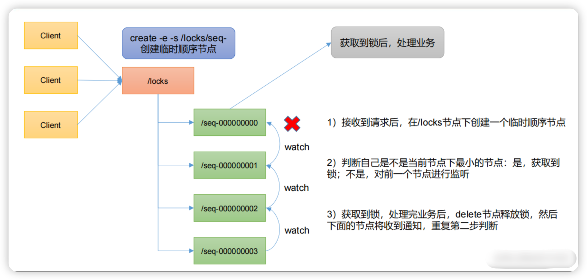
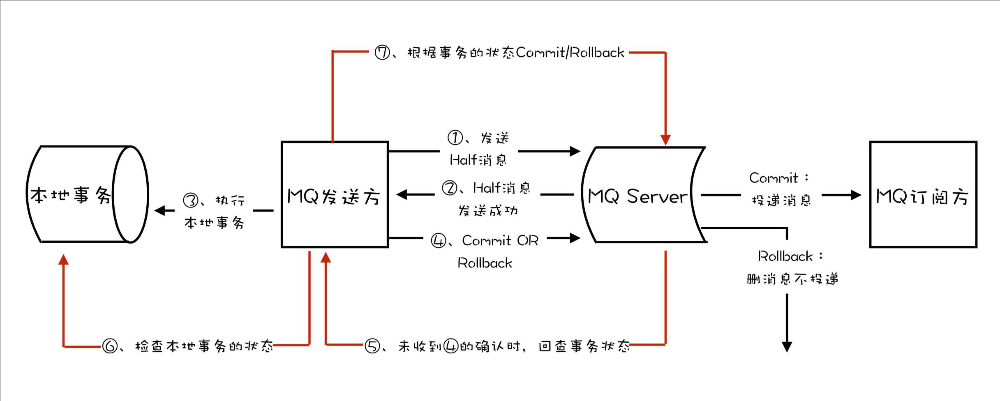
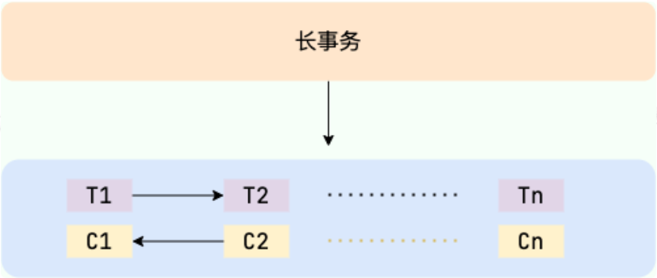

## 理论

### CAP理论

https://cloud.tencent.com/developer/article/1860632

一个分布式系统最多只能同时满足一致性（Consistency）、可用性（Availability）和分区容错性（Partition tolerance）这三项中的两项。

**一致性**

- 是指整个分布式系统的数据应该是一致的。

- 什么时候数据会变？增删改，统称写请求。
- 什么叫数据一起变化？
  - 写请求成功，那么不同节点都应该返回变化后的数据。
  - 有机器故障，那么**不应该返回数据**。

**可用性**

- 合理时间内给出响应结果（不能是报错、超时）

**分区容错性**

- 节点间因为网络故障或机器宕机，导致分区。
- 出现分区后，整个系统还应该正常运行。

**如何选择**

- CP：订单、支付、库存
- AP：搜索、推荐、浏览

### CAP到BASE

CAP最大的问题是一致性和可用性不应该是二选一。

CAP本身是没有考虑网络延迟的问题的，它认为一致性是立即生效的，但是，要保持一致性，是需要时间成本的，这就导致往往分布式系统多选择 AP 。

引申出BASE，即使无法做到**强一致性**，但应用可以采用适合的方式达到**最终一致性**。

### BASE

Basically Available(基本可用)，Soft State（软状态）和Eventually Consistent（最终一致性）

**基本可用**：允许损失部分的可用性（时间/功能）。

**软状态**：允许系统中的数据存在中间状态，并认为该状态不影响系统的整体可用性。

**最终一致性**：在期限过后，应当保证所有副本保持数据一致性状态。

## 分布式共识算法

让分布式系统中的多个节点之间对某个提案达到一致的看法

### Basic Paxos

三种角色，三个阶段

1. Prepare：Proposer需要收获半数以上的Acceptor的支持
2. Accept：获得支持的Proposer拟定一个提案，同样也需要获得半数以上的Acceptor支持
3. Learn：决议形成，发送给所有的Learner

提案编号：分布式ID

Acceptor接受条件：提案编号越大越好

**问题**：1. 只能对**一个值**形成决议。2. 两个Proposer提案交替号交替变大，形成**活锁**。

### Multi Paxos

1. 需要共识的每个值对应一个Paxos实例，用InstanceID标识。
2. Proposer中选取一个Leader，唯一地提交Proposal，解决了活锁。

### Raft

正确性源于复制状态机地性质，只要日志的命令一致，顺序一致，状态机就是一致的。因此我们维护日志的一致性即可。

每个节点都属于三种状态之一：Leader,Candidate,Follower

**算法流程**

Raft中，Follower在选举超时后变为 Candidate并递增 term，向所有节点发送 （投票）RequestVote；获过半数选票后升级为 Leader。

Leader 通过定期心跳 (AppendEntries空消息) 维持任期，并把客户端指令作为日志条目附在后续AppendEntries中发送给 Followers。

当日志在多数节点落盘后，Leader将该索引标记为已提交并下发Apply，所有节点按序应用到状态机，从而保证一致性；若出现冲突，Follower 根据 Leader 的前置索引‑任期回滚并覆盖旧日志。 

### Gossip协议

优点：去中心化、简单、拓展性

缺点：最终一致性、不允许恶意节点、消息冗余

过程：当一个节点有状态需要更新到网络中的其他节点时，它会**随机**（增加容错）的选择周围几个节点散播消息，收到消息的节点也会重复该过程，直至最终网络中所有的节点都收到了消息。这个过程可能需要一定的时间，由于不能保证某个时刻所有节点都收到消息，但是理论上最终所有节点都会收到消息，因此它是一个最终一致性协议。

设计了两种传播模式

- 反熵：每隔段时间就随机选择某个其他节点，然后通过互相交换自己的所有数据来消除两者之间的差异，实现数据的最终一致性。
- 传谣：一个节点一旦有了新数据之后，就会变为活跃节点，活跃节点会周期性地联系其他节点向其发送新数据，直到所有的节点都存储了该新数据。（适合节点动态变化的情况）

## API网关

Nginx（边缘） → SCG（内部网关） → 微服务

完成功能：请求转发 + 请求过滤

微服务背景下，一个系统被拆分为多个服务，但是像安全认证，流量控制，日志，监控等功能是每个服务都需要的，没有网关的话，我们就需要在每个服务中单独实现，这使得我们做了很多重复的事情并且没有一个全局的视图来统一管理这些功能。

### Spring Cloud Gateway

**请求过程：最主要的是断言和过滤**

**路由判断**：客户端的请求到达网关后，先经过 Gateway Handler Mapping 处理，这里面会做断言（Predicate）判断，看下符合哪个路由规则，这个路由映射后端的某个服务。

**请求过滤**：然后请求到达 Gateway Web Handler，这里面有很多过滤器，组成过滤器链（Filter Chain），这些过滤器可以对请求进行拦截和修改，比如添加请求头、参数校验等等，有点像净化污水。然后将请求转发到实际的后端服务。这些过滤器逻辑上可以称作 Pre-Filters，Pre 可以理解为“在...之前”。

**服务处理**：后端服务会对请求进行处理。

**响应过滤**：后端处理完结果后，返回给 Gateway 的过滤器再次做处理，逻辑上可以称作 Post-Filters，Post 可以理解为“在...之后”。

**响应返回**：响应经过过滤处理后，返回给客户端。


**断言**：URL中包含xxx，则映射到路由xxx

**如何实现动态路由**：Nacos注册中心，自动维护微服务路由

**过滤器有哪些**：

- **Pre 类型**：在请求被转发到微服务之前，对请求进行拦截和修改，例如参数校验、权限校验、流量监控、日志输出以及协议转换等操作。

- **Post 类型**：微服务处理完请求后，返回响应给网关，网关可以再次进行处理，例如修改响应内容或响应头、日志输出、流量监控等。

## 分布式ID

想要一个唯一ID，本来使用MySQL数据库表的自增即可，随着系统增大， 对MySQL进行分库分表，我们如何保证全局唯一ID？

### 数据库主键自增

专门创建一个数据库表用来获取ID，注意这里就不会因为分库分表导致ID重复了，缺点是并发量不大。

改进可以是每次获取一批ID。

ID规律性有安全问题。

### Redis

String结构的自增

### UUID

**优点**：生成速度通常比较快、简单易用

**缺点**：存储消耗空间大（32 个字符串，128 位）、 不安全（基于 MAC 地址生成 UUID 的算法会造成 MAC 地址泄露)、无序（非自增）、没有具体业务含义、需要解决重复 ID 问题（当机器时间不对的情况下，可能导致会产生重复 ID。

### Snowflake(雪花算法)

```
| 1bit 符号 | 41bit 时间戳(ms-自定义纪元) | 10bit 机器/机房ID | 12bit 毫秒内序列 |
```

#### 优点

- **去中心化**：无需中心号段服务，请求本机即可生成，延迟极低。
- **高吞吐**：纯内存运算，单机能轻松撑住高并发。
- **趋势递增**：按毫秒级时间排序，**B+Tree 主键写入更友好**（更少页分裂）。
- **短且可存为 BIGINT**：64 位整数，数据库/索引占用小，序列化高效。
- **可编码拓扑**：机房/机器位便于分片、回溯来源与排障。
- **实现简单**：少量状态（lastTimestamp、sequence、workerId）。

#### 缺点 / 隐患

- **强依赖时钟**：**时钟回拨**会导致重复或乱序；需做回拨保护（等待/熔断/逻辑时钟）。
- **跨语言坑**：JS Number 只有 53 位精度，需用 **BigInt/字符串** 传输存储。
- **容量上限受位数约束**：每毫秒**最多 4096** 个/节点；超出要阻塞或自旋。
- **寿命有限**：41 位毫秒 ≈ **69 年**（相对自定义纪元）；纪元选太早会“到期”。
- **运维要求**：**workerId 唯一分配**要可靠（避免冲突导致碰撞）。
- **信息可推断**：包含时间与拓扑，**不适合安全敏感/需脱敏**的场景（可混淆或二次编码）。
- **非绝对全局单调**：不同节点时钟不一致时会产生**跨节点乱序**（但总体仍“趋势递增”）。


## 分布式锁

### 基于关系型数据库比如MySQL实现


### 基于分布式协调服务ZooKeeper实现

原理：基于 **临时顺序节点** 和 **Watcher（事件监听器）** 实现的。（有点像ReentrantLock？）



### 基于分布式键值存储系统比如Redis 、Etcd实现

#### 看门狗

解决问题：锁不能过早失效、崩溃进程要释放锁

原理：获取锁的时候添加<锁, 线程>到全局的ConcurrentMap后台，单线程定时扫描这个 Map，使用 Lua 脚本校验*仍由本线程持有*后执行续期，正常解锁会把条目从Map中删除。

#### Redis集群

问题：由于 Redis 集群数据同步到各个节点时是异步的，如果在 Redis 主节点获取到锁后，在没有同步到其他节点时，Redis 主节点宕机了，此时新的 Redis 主节点依然可以获取锁，所以多个应用服务就可以同时获取到锁。

解决：Redlock 算法的思想是让客户端向 Redis 集群中的多个独立的 Redis 实例依次请求申请加锁，如果客户端能够和半数以上的实例成功地完成加锁操作，那么我们就认为，客户端成功地获得分布式锁，否则加锁失败。

## 分布式事务

### 理论

> 把一件**跨多个系统/服务/库/MQ**的业务操作，做成对外看起来**要么全部成功、要么最终撤销到一致状态**的“单次操作“。

**柔性事务：**BASE理论+业务实践。柔性事务追求的目标是，我们根据自身业务特性，通过适当的方式来保证系统数据的**最终一致性**。比如TCC、Saga、MQ事务、本地消息表。

**刚性事务：**追求**强一致性**。比如2PC、3PC。

### 2‑Phase Commit

| 阶段                    | 谁发起                 | 关键动作                                                     | 结果含义                                              |
| ----------------------- | ---------------------- | ------------------------------------------------------------ | ----------------------------------------------------- |
| **1 Prepare / Voting**  | 协调者 **Coordinator** | 向所有参与者发送 **prepare** 请求：“能否提交？”              | 参与者要么写「预提交日志」，锁定资源后回 **Yes / No** |
| **2 Commit / Rollback** | 协调者                 | - 若 **全部 Yes** → 发送 **commit**- 有 **任一 No / 超时** → 发送 **rollback** | 参与者根据指令执行真正的 **提交或回滚** 并释放锁      |

### 3‑Phase Commit

在 2PC 基础上插入一道 “**预提交**” 层，核心是 **消除阻塞 & 提前超时自决**。

| 阶段             | 关键动作                                                     | 超时处理                                               |
| ---------------- | ------------------------------------------------------------ | ------------------------------------------------------ |
| **1 CanCommit?** | 协调者询问参与者是否可以提交（与 2PC 相同）                  | 参与者超时没收到 → 直接 **Abort**                      |
| **2 Pre‑Commit** | 若全部 **Yes**，协调者发 **pre‑commit** 命令；参与者执行半提交并 **释放锁**，返回 ACK | 参与者超时没收到 → 自行 **Commit**（因大家都已半提交） |
| **3 DoCommit**   | 协调者收齐 ACK 后广播 **do‑commit**，参与者真正提交          | 协调者故障 → 参与者在阶段 2 已可自决                   |

### TCC（Try – Confirm – Cancel）

**一句话**：先把资源“锁一下”（Try），流程都 OK 再正式扣（Confirm）；流程有问题就反向解锁（Cancel）。

| 阶段              | 服务方要做的事                                               | 失败回滚策略                                                 |
| ----------------- | ------------------------------------------------------------ | ------------------------------------------------------------ |
| **Try**　预留     | ‑ 校验业务条件‑ 预留/冻结资源（库存、余额、房间…）‑ 记录幂等信息（事务 ID、状态） | 若 Try 自己失败 → 直接返回 Fail，不再进入后续阶段            |
| **Confirm**　确认 | ‑ 真正扣减资源 / 持久化数据‑ 删除冻结标记                    | Confirm **必须保证成功**（原则上不允许失败）；如果偶发异常，需**重试直到成功** |
| **Cancel**　补偿  | ‑ 释放 / 解冻资源‑ 将业务状态恢复到 Try 前                   | 仅在 Try 成功但后续流程失败或超时时调用                      |

### MQ事务

MQ 事务就是让 ‘发消息’ 也具备 **Commit / Rollback** 能力，用来保证消息状态与本地业务操作一致。

例如 RocketMQ 的事务型消息：Producer先发一条*Half Message*，再执行本地事务，成功就 `commit`，失败就 `rollback`；Broker 还有回查机制兜底。

这样就避免了 ‘数据库写成功但消息没发’ 或 ‘消息发出但随即回滚’ 的一致性问题。



### Saga

**Saga 事务**是一种 **“长事务（Long‑Running Transaction）”** 解决方案：

把一次跨服务的业务流程拆成 **N 个本地事务**，每个步骤成功后立即提交；一旦后续任何步骤失败，按 *相反顺序* 触发 **补偿（Compensation）** 操作来回滚已完成步骤，最终保持全局一致。



## RPC

### 什么是RPC

**RPC（Remote Procedure Call）** 即远程过程调用，通过名字我们就能看出 RPC 关注的是远程调用而非本地调用。

**为什么要设计RPC ？** 因为，两个不同的服务器上的服务提供的方法不在一个内存空间，所以，需要通过网络编程才能传递方法调用所需要的参数。并且，方法调用的结果也需要通过网络编程来接收。但是，如果我们自己手动网络编程来实现这个调用过程的话工作量是非常大的，因为，我们需要考虑底层传输方式（TCP 还是 UDP）、序列化方式等等方面。

## zookeeper

分布式协调服务：配置管理、服务注册与发现、分布式锁。

## 限流算法

https://juejin.cn/post/6870396751178629127

### 固定窗口计数

- **核心思路**：把时间切成固定大小的窗口（常见 1 秒 / 1 分），到达请求就把「当前窗口+主体」这个键的计数器 `INCR`，超过阈值直接拒绝。
- **优点**： 实现最简单：在 Redis 里 `INCR` 加个 `EXPIRE` 就能跑；适合对秒级、分钟级 QPS 做硬上限。
- **缺点**：窗口边界可能出现“**突刺**”——恰好卡在窗口交界处时，可瞬间放行 2 倍流量。
- **典型场景**：对外开放的 REST API 总量限额、短信平台「单手机号每分钟不超 N 条」等。

### 滑动窗口计数

>  改进固定窗口计数

- **核心思路**：把整个窗口再细分成 k 个子格（如 1 分钟拆成 6 个 10 秒格）。请求只更新当前子格计数，总 QPS = 当前窗口内所有子格之和。超过阈值则拒绝。
- **优点**：只维护 k 个数字，内存 O(k)；精度接近滑动日志，但成本更低。
- **缺点**：k 值越小，流量抖动越大；需要定时轮转子格并归零。
- **典型场景**：网关层面做 QPS 限流，既想避免突刺又要支撑高并发。

### 漏桶

- **核心思路**：请求先进入队列；系统以恒定速度把队首请求“漏”出去（可同步调用，也可写入 MQ）。
- **优点**：出口速率严格恒定，能起到「匀速」和平滑流量的作用；排队机制可吸收小范围突发。
- **缺点**：一旦排队溢出只能丢弃或报错；高峰时可能排很长队，平均延迟受限于漏速。
- **典型场景**：调用慢接口（短信供应商、第三方支付）、批量写库、日志上传等需要匀速下游的场合。

### 令牌桶

> 改进漏桶，能够一次处理突发流量（漏桶只是接住了流量，没有处理，所以不能说能够处理突发流量）

- **核心思路**：系统按固定速率往桶里投放令牌（r 个/秒，桶容量 b）。请求想通过必须先取走令牌；桶空就拒绝或排队。
- **优点**：对「平均速率」有严格限制，同时允许一次性突发最多 b 个请求；实现简单，可用 Guava `RateLimiter` 或 Envoy 内置令牌桶。
- **缺点**：若生产速率设置得太高，桶可能总是满，无法持续地为下游“背压”。
- **典型场景**：API 网关、CDN 回源、外部支付接口等既要控平均又要允许短暂突发的链路。

令牌桶算法：**懒补充**（按上次时间差补发），分布式场景可把“令牌发放+扣减”放在 **Redis Lua** 脚本里原子完成，或用 `RateLimiter`（Guava）等库。

```java
import java.util.concurrent.locks.ReentrantLock;

public class TokenBucket {
    private final long capacity;           // 桶容量（最大令牌数）
    private final double tokensPerSecond;  // 发放速率
    private double tokens;                 // 当前令牌数（可为小数以提高精度）
    private long lastNanos;                // 上次补充时间
    private final ReentrantLock lock = new ReentrantLock();

    public TokenBucket(long capacity, double tokensPerSecond) {
        if (capacity <= 0 || tokensPerSecond <= 0) throw new IllegalArgumentException();
        this.capacity = capacity;
        this.tokensPerSecond = tokensPerSecond;
        this.tokens = capacity;                  // 刚启动给满桶，允许初次突发
        this.lastNanos = System.nanoTime();
    }

    // 消耗 count 个令牌；成功返回 true，失败返回 false
    public boolean tryAcquire(long count) {
        if (count <= 0 || count > capacity) throw new IllegalArgumentException();
        lock.lock();
        try {
            refill();
            if (tokens >= count) {
                tokens -= count;
                return true;
            }
            return false;
        } finally {
            lock.unlock();
        }
    }

    private void refill() {
        long now = System.nanoTime();
        double deltaSeconds = (now - lastNanos) / 1_000_000_000.0;
        if (deltaSeconds > 0) {
            tokens = Math.min(capacity, tokens + deltaSeconds * tokensPerSecond);
            lastNanos = now;
        }
    }
}
```

使用

```java
TokenBucket bucket = new TokenBucket(100, 50.0); // 容量100，每秒补50
if (bucket.tryAcquire(1)) {
    // 允许通过
} else {
    // 被限流，走降级/排队
}
```

