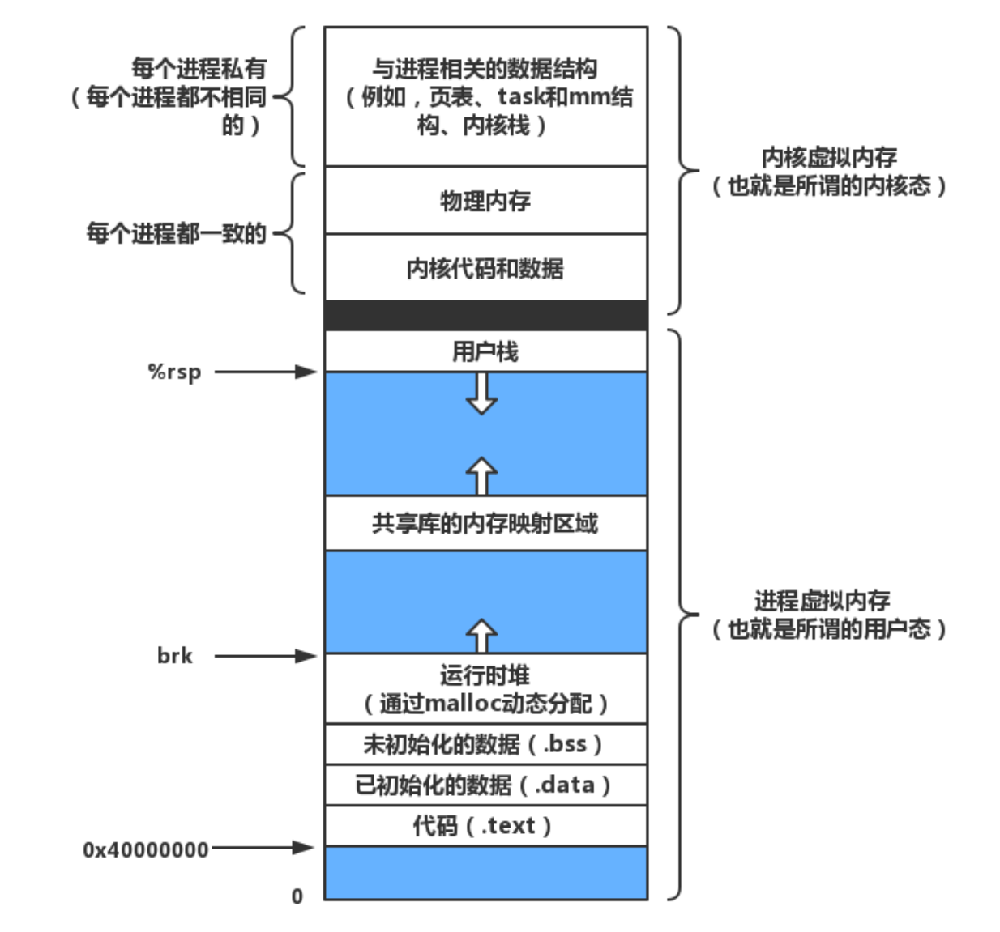
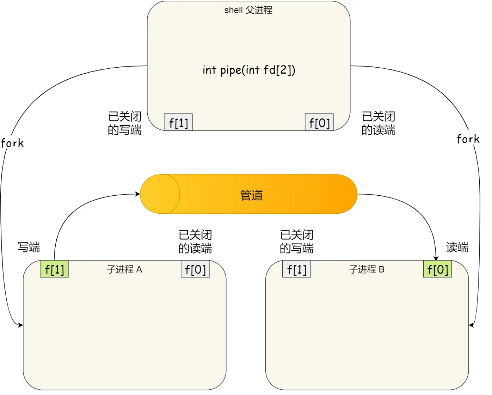
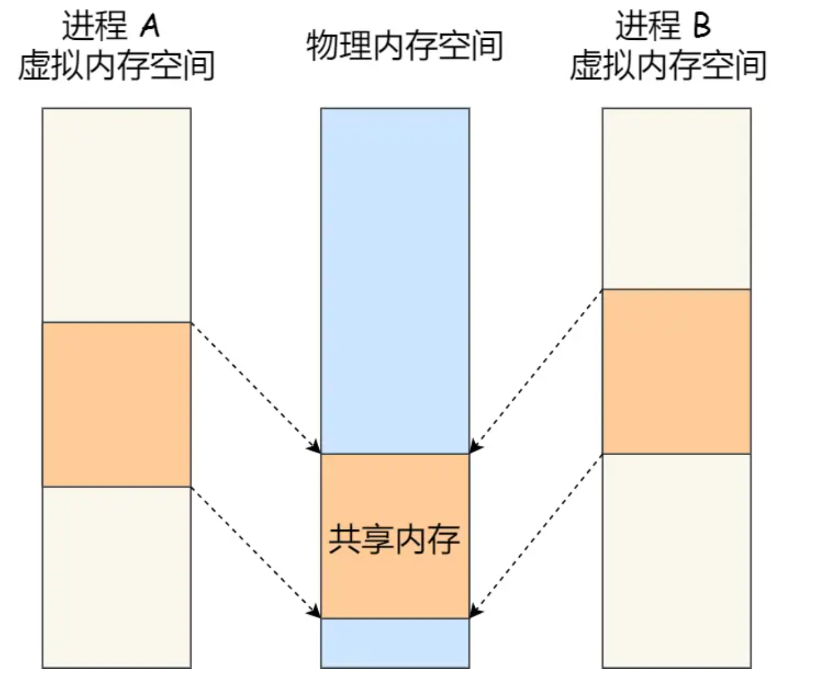
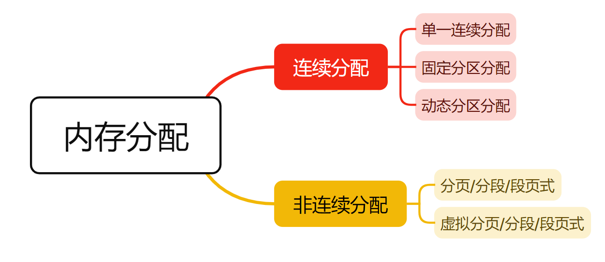
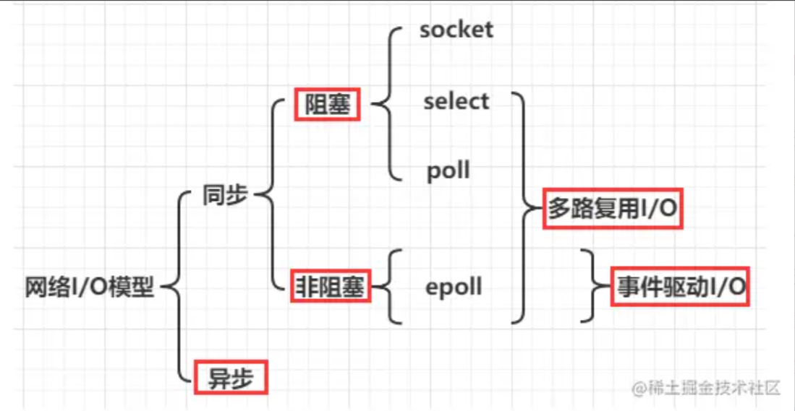

# 计算机系统概述

## 如何提升多核 CPU 的缓存命中率？

虽然 L3 Cache 是多核心之间共享的，但是 L1 和 L2 Cache 都是每个核心独有的，如果一个线程在不同核心来回切换，各个核心的缓存命中率就会受到影响。

线程调度优化：线程绑定在某一个 CPU 核心上

数据布局优化：

- 伪共享问题：多线程访问不同变量，但这些变量位于同一缓存行（一般是 64 字节），会引起频繁的 cache line 无效与同步。解决方法，变量之间填充 padding，使其占用不同缓存行。

- 数据按访问局部性布局

编程模式优化：数据本地化，每个线程尽量只处理属于自己的数据子集，避免共享（ThreadLocal）。

## 多核CPU缓存一致性？

多个 CPU 核心**缓存了同一份内存数据副本**，当某个核心修改了它自己的副本，其他核心的副本就不一致了，可能导致程序错误。

| 方案名称        | 主要原理                           | 代表架构/系统  |
| --------------- | ---------------------------------- | -------------- |
| MESI 协议       | 状态标记 + 总线嗅探                | Intel x86 架构 |
| MOESI 协议      | MESI 的增强版（加入 Owned 状态）   | AMD 等         |
| MESIF 协议      | MESI 的优化版（加入 Forward 状态） | Intel QPI      |
| Directory-Based | 集中目录记录每个缓存块的位置       | NUMA 架构      |

**MESI 是最经典、最常用的缓存一致性协议**，支持 4 种状态：

| 状态 | 全称      | 含义                                         |
| ---- | --------- | -------------------------------------------- |
| M    | Modified  | 已修改，**仅此缓存拥有数据，主内存是过期的** |
| E    | Exclusive | 独享，缓存和主存一致，**只有一个缓存有数据** |
| S    | Shared    | 共享，缓存和主存一致，**多个缓存可有副本**   |
| I    | Invalid   | 无效，此缓存中的该数据已无效                 |


协议关键机制：

- **总线嗅探（Bus Snooping）**：各缓存监听总线请求，感知是否需要变更自己的缓存状态。
- **写入时通知**：某个核心写数据时，发出广播或总线请求，使其他缓存**将副本设为无效**（I）。

# 进程与线程

进程的设计是为了在处理器较少，任务较多的情况下的并发，提高系统的吞吐。

线程的设计是在处理共享资源的任务时，减少进程切换的开销。

因此，线程变成了调度的基本单位，进程变成了资源分配的基本单位。

进程资源：虚拟内存，文件句柄，信号量。

## 进程内存




## 协程

是高并发场景下异步程序用同步方式编写的模型，它更像是用户级的线程，并且它可控，占用内存小，切换也在用户态更快。

介绍：https://zhuanlan.zhihu.com/p/337978321

比如解决了以下异步回调的嵌套问题：

Node.js 传统回调（callback‑hell），嵌套四层、try/catch 无效、每一步都要 `if (err)`。

```js
// 读取文件 → HTTP 请求 → 结果写盘
fs.readFile('ids.txt', 'utf8', (err, ids) => {
  if (err) return handle(err);
  httpGet(`https://api.xxx.com/u/${ids.trim()}`, (err, json) => {
    if (err) return handle(err);
    fs.writeFile('user.json', json, (err) => {
      if (err) return handle(err);
      console.log('Done!');
    });
  });
});
```

用 async/await

```js
// Node 14+ 支持 top‑level await；也可以包在 async function 里
try {
  const ids  = await fs.promises.readFile('ids.txt', 'utf8');
  const resp = await fetch(`https://api.xxx.com/u/${ids.trim()}`);
  await fs.promises.writeFile('user.json', await resp.text());
  console.log('Done!');
} catch (err) {
  handle(err);
}
```

**为什么会设计协程？**

1. **高并发 + I/O 为主的应用**（Web Server、即时聊天、抓取系统……）往往要同时维护 *几十万* 个「正在等待网络或磁盘」的任务。
   - **线程方案**：每个任务绑一个内核线程 → 内存（栈）和内核调度开销巨大；频繁上下文切换让 CPU 时间浪费在保存/恢复寄存器和 TLB*miss* 上。
2. **异步 API 难写难维护**
   - 事件回调（“callback‑hell”）把线性业务逻辑拆碎；异常传播、资源清理、栈追踪都变得麻烦。
   - 程序员渴望 “写成同步直线代码，执行时又是异步无阻塞” 的双赢体验。

> **协程**（coroutine）正是为“**极轻量** 并发 + **同步式写法**”而生。 

## 进程通信

### 管道通信

匿名管道：单向，父子进程



命名管道：无关的进程间进行通信的机制，基于文件系统。

### 消息传递

网络信息传递，邮箱，消息队列

### 共享内存

把部分虚拟内存映射到同一块物理内存，需要自己控制并发（比如用信号量）



## 线程通信

**互斥锁**

- POSIX：`pthread_mutex_t`；Java：`synchronized` / `ReentrantLock`；C++：`std::mutex`；Rust：`Mutex<T>`。
- 用途：最常用的临界区保护。

**自旋锁**

- POSIX：`pthread_spinlock_t`；Linux 内核大量使用；用户态一般少用。
- 用途：**极短临界区**、不宜睡眠的热路径。

**读写锁**

- POSIX：`pthread_rwlock_t`；Java：`ReadWriteLock/StampedLock`；C++：`shared_mutex`。
- 用途：**读多写少**，读者并行、写者独占。

**条件变量**

- POSIX：`pthread_cond_t`（配互斥锁）；Java：`Condition`/`wait/notify`；C++：`condition_variable`。
- 用途：等待**状态变化**（“不满足就等、满足再走”）。
- 要点：**与互斥锁配对**；用 `while` 判条件防虚假唤醒；先改状态，再 `signal/broadcast`。

**信号量**

- POSIX：`sem_t`（计数/二元）；Java：`Semaphore`；C++：`counting_semaphore`。
- 用途：配额/并发数控制、生产者-消费者。
- 要点：既能**线程内**也能**跨进程**（命名/系统V）。

**屏障/栅栏**

- POSIX：`pthread_barrier_t`；Java：`CyclicBarrier`/`Phaser`；C++：`barrier`。
- 用途：多个线程到齐再同时进入下一阶段。

## 处理机调度

## 同步与互斥

## 死锁

**死锁条件**

互斥、不可剥夺、请求并保持、循环等待

**死锁预防**

破坏死锁条件

**死锁避免**

银行家算法：预分配，安全性检查，安全才正式分配

# 内存管理

## 内存分配



fork()复制父进程的页表（虚拟内存）

虚拟分页的页表项：（页号）物理页号 + 有效位 + 访问位 + 脏位 + 权限位 + 外存地址

# 文件管理


# 输入输出管理

## 网络IO模型

https://juejin.cn/post/7120907747498934280

用户程序想要执行IO操作，但是不能访问内核空间，只有借助系统调用。

当应用程序发起 I/O 调用后，会经历两个步骤：内核等待 I/O 设备准备好数据。将数据从内核空间拷贝到用户空间。

### 概念

**阻塞**：调用 `read/recv` 若数据未到，线程**睡眠**直到有数据并拷贝完成才返回。

**非阻塞**：把 fd 设成 `O_NONBLOCK`；若没数据，`read/recv` 立刻返回 `EAGAIN/EWOULDBLOCK`，应用得**自己再试**或配合事件机制再试。

**同步**：最终**用户线程亲自参与**把数据从内核缓冲区拷到用户缓冲区（即使之前用 `epoll` 等候就绪，拷贝仍是你做）。

**异步**：**内核帮你拷**，拷完再通知你“结果就绪”（完成事件/回调/完成队列）。调用方不用在数据拷贝期间忙等或阻塞。

### 五种模型



#### 阻塞 I/O

- 流程：一次recv同时完成“等待 + 拷贝”，其间线程阻塞。
- 特点：实现最简单；一个连接常配一线程；连接数高时线程切换/栈空间成本高。
- 适用：连接数低，或“简单优先”的场景；也常配合线程池做“伪并发”。

#### 非阻塞 I/O

- 流程：把等待和拷贝拆成多次短调用：没数据就 `EAGAIN` 立即返回；应用自己轮询重试。
- 问题：纯轮询会忙等吃 CPU；工业界很少“单干”，几乎总与多路复用搭配。

#### I/O 多路复用（Reactor）

把“等待就绪”统一交给内核事件分发器；就绪后你再去 `read` 完成同步拷贝。常见实现差异：

- select
  - fd 集合位图，需每次重建；用户态/内核态间拷贝集合；
  - fd 上限（常见 1024，由 `FD_SETSIZE` 决定）；
  - 就绪后线性扫描 O(n)；适合小规模或兼容性场景。
- poll
  - 用数组 `struct pollfd[]`，无硬 fd 上限；
  - 仍需 O(n) 扫描；每次传入完整数组。
- epoll（Linux）
  - 把关注的 fd **注册**到内核红黑树。fd有数据时，socket回调通知epoll，放入就绪队列。就绪队列返回就绪列表；
  - 近似 O(1) 扩展；fd 多时表现最好；
  - 触发方式
    - LT（电平触发）：缓冲区还有数据就会反复触发（最稳妥）。
    - ET（边沿触发）：状态从“无”变“有”才触发；要求非阻塞并在回调里一次性读到 `EAGAIN`，否则易丢事件。
  - 常用事件：`EPOLLIN/EPOLLOUT/EPOLLRDHUP/EPOLLERR/EPOLLHUP/EPOLLONESHOT` 等。
  - 典型优化：`EPOLLONESHOT`（一次性事件，处理完再 `MOD` 重新上边沿）、`eventfd/timerfd` 跨线程唤醒、批量 accept、读写合并。
- kqueue（BSD/macOS）
  - 与 epoll 类似的事件队列模型；跨多种内核对象；语义强大。

#### 信号驱动 I/O

设置 `F_SETOWN` + `O_ASYNC`；数据就绪时内核发 `SIGIO`，进程在信号处理器/回调里再做非阻塞 read。

#### 异步 I/O（Proactor）

提交 I/O 请求立即返回；内核在拷贝完成后，用完成事件/回调/完成队列通知你。

### Reactor

Reactor 是一种事件驱动的架构/设计模式。

Redis/Netty/Nginx 的网络层都是 Reactor（就绪驱动）+ 非阻塞 fd + epoll/kqueue 实现。

- Redis：单 Reactor 单进程
- Netty：多 Reactor 多线程
- Nginx：多 Reactor 多进程

## 中断

中断是 CPU 的事件通知与抢占机制：外设或内核把紧急事件“打断”给 CPU，CPU转入内核 ISR 快速处理并把重活丢给下半部；它让 I/O 从轮询变为事件驱动，配合 DMA 提升并行度，同时时钟中断支撑调度与定时；系统调用和异常也借助中断门进入内核。这就是为什么中断既保证**响应性**又提升**效率**。