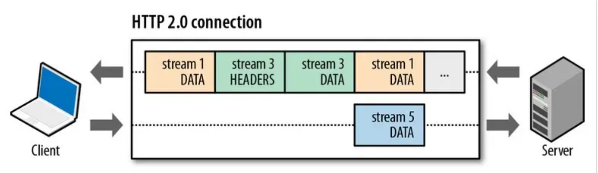
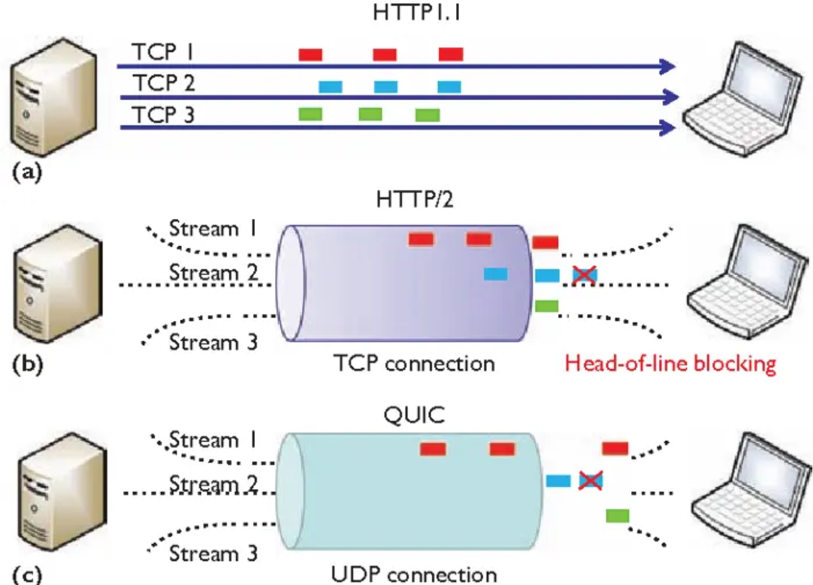
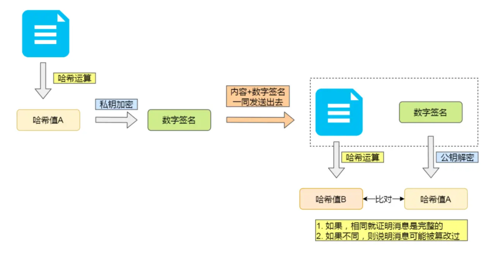
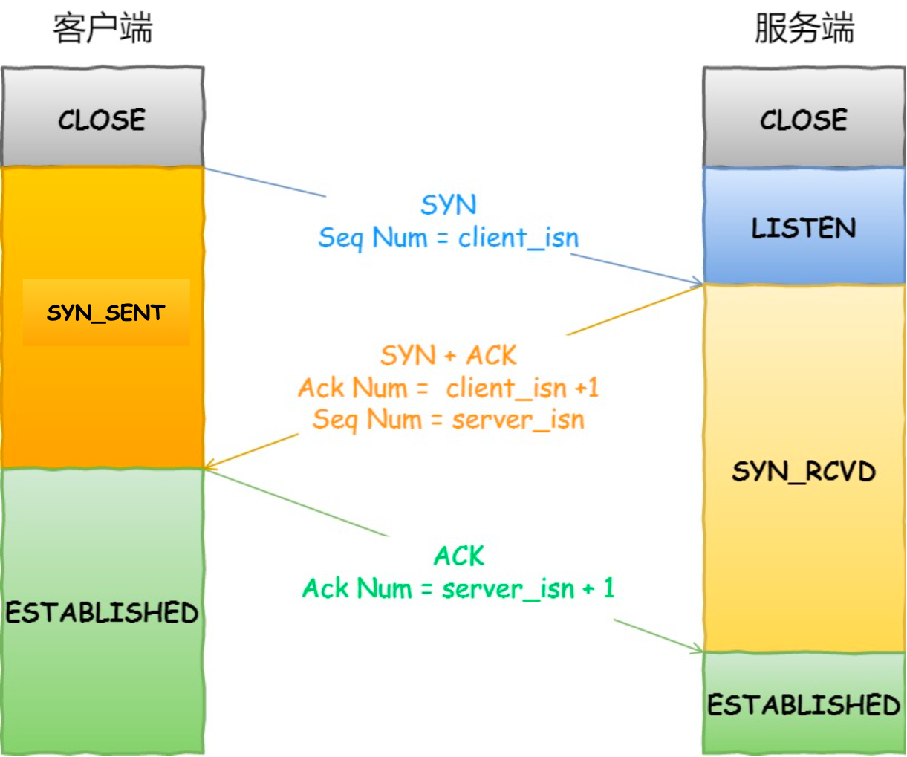
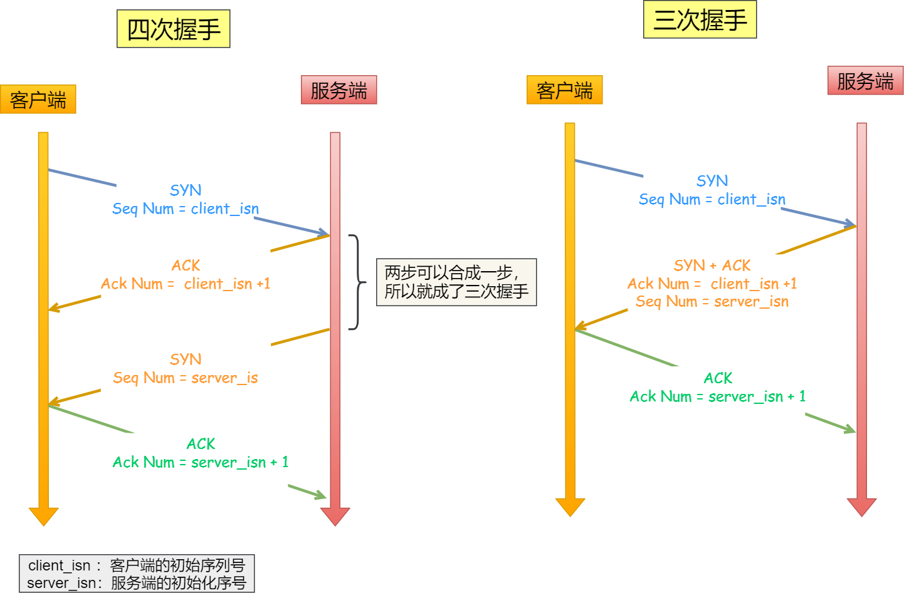
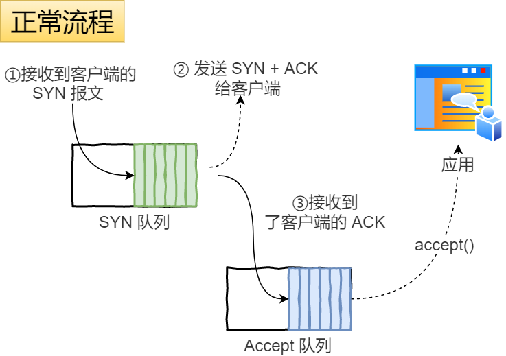
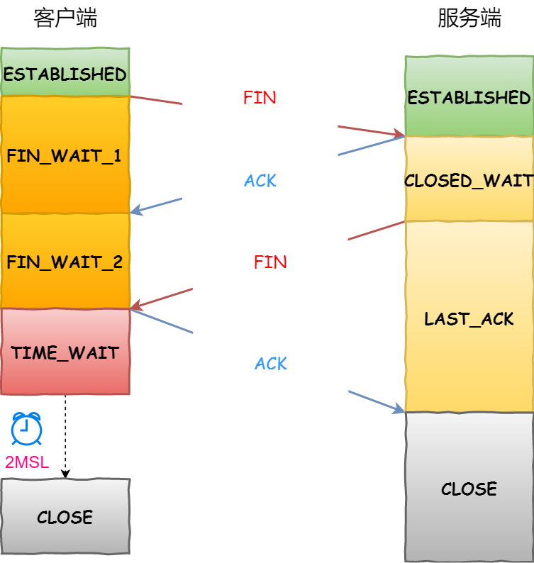
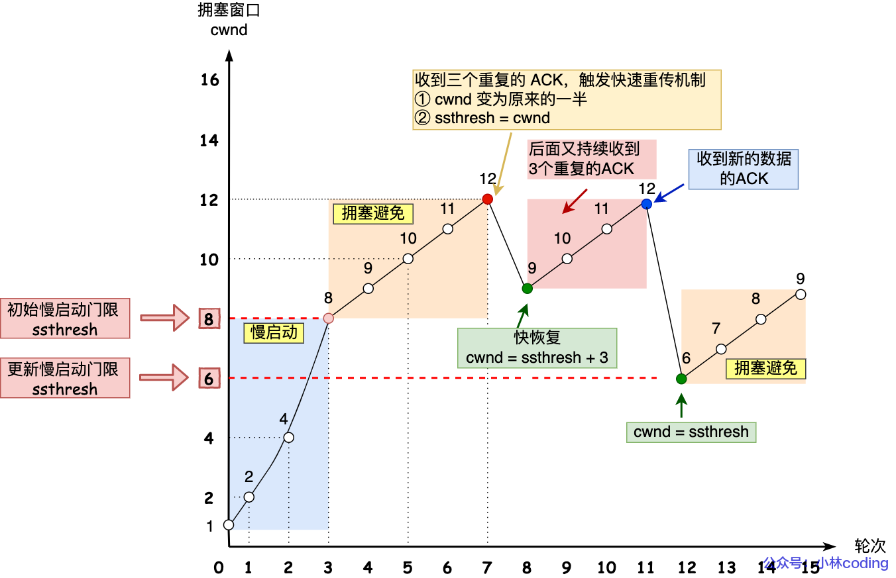

## 基础

### 输入网址到显示网页

> 输入 URL → 浏览器解析与策略（HSTS、缓存、SW）→ 解析域名（DNS）→ 选路/建连（TCP/TLS 或 QUIC/TLS）→ 发 HTTP 请求 → CDN/反代/应用服务器处理并返回 → 浏览器收响应并渲染（HTML/CSS/JS/图片/字体）→ 首次像素出现并继续增量更新。

URL 解析与升级：浏览器拆解 URL，按 HSTS/默认策略走 HTTPS；先查 内存/磁盘缓存，或由 Service Worker 拦截。

DNS：本地/系统缓存未命中就递归解析，可能走 DoH，并行 IPv6/IPv4（Happy Eyeballs）。

建连与加密：

- 本地先做 **ARP/NDP** 获取下一跳 MAC；走交换机/路由到 ISP/骨干网。

- HTTP/2：TCP 三次握手 + TLS1.3（SNI/ALPN 协商）。
- 或 HTTP/3：QUIC+TLS1.3，1-RTT/0-RTT，减少握手与队头阻塞。

发起 HTTP 请求：携带必要头（Accept/Encoding/Cookie…），若遇 重定向 按规则跟随；H2/H3 做 多路复用与头压缩（HPACK/QPACK）。

CDN/反代/应用：就近 CDN 命中则直接回；未命中经 WAF/负载均衡/反向代理 到应用，访问缓存/数据库生成响应，设置 缓存/安全头，压缩传回。

浏览器接收与渲染：状态码与缓存处理（含 304）；渲染进程解析 HTML→DOM、CSS→CSSOM，下载执行 JS（defer/async），合成 渲染树→布局→绘制→GPU 合成，出现 FCP，随后 LCP/CLS/INP 优化迭代。

后续优化常提：连接复用、`preconnect/dns-prefetch/preload`、静态资源指纹 + `Cache-Control: max-age, immutable`、图片现代格式、关键 CSS 内联与脚本延后。

### JWT

**JWT (JSON Web Token)** 是一种**自包含**的**令牌格式**（RFC 7519）。它常见有两种形态：

- **JWS**：带**签名**，保证“未被篡改”。最常用。
- **JWE**：带**加密**，保证“保密性”。较少用，场景更窄。

> 重点：绝大多数“JWT”指的都是 **JWS**（只签名不加密）。JWT 的内容是 **Base64URL 可直接解码** 的，别放敏感信息。

令牌长什么样？

`<header>.<payload>.<signature>`（三段 Base64URL）

它解决什么问题？

- **无状态认证**：令牌里自带必要的授权信息，业务服务只需“验签+校验时效/受众”等即可放行，天然适合**分布式/微服务**。
- **跨语言/跨网关**：标准化格式，各端易实现。

## HTTP

### HTTP状态码

| 类别    | 具体含义                                                   | 常见的状态码       |
| ------- | ---------------------------------------------------------- | ------------------ |
| **1xx** | 提示信息，表示目前是协议处理的中间状态，还需要后续的操作； | —                  |
| **2xx** | 成功，报文已经收到并被正确处理；                           | 200、204、206      |
| **3xx** | 重定向，资源位置发生变动，需要客户端重新发送请求；         | 301、302、304      |
| **4xx** | 客户端错误，请求报文有误，服务器无法处理；                 | 400、403、404      |
| **5xx** | 服务器错误，服务器在处理请求时内部发生了错误。             | 500、501、502、503 |

### :star:HTTP缓存技术

先尝试强缓存——如果失败，再走协商缓存——如果仍失败，再下载最新资源

**1. 本地有没有对应的缓存副本？**

- 如果没有，直接向服务器发起普通请求，流程结束。
- 如果有，继续第 2 步。

**2. 判断副本是否有效**——所谓“强缓存”

- 浏览器会根据响应头里的 **`Cache-Control: max-age=...` / `Expires`** （或其他能决定过期时间的指令，如 `s-maxage`、`immutable` 等）计算出当前年龄（Age）是否小于允许的最大值。
- 只要缓存仍在新鲜期内，浏览器**直接返回本地副本**，既不会向服务器发送请求，也不会走后续步骤。

**3. 若缓存已过期或被声明必须重新验证**（如 `Cache-Control: no-cache`、`must-revalidate`），进入“协商缓存”阶段

- 浏览器在请求报文里加上条件首部
  - **`If-None-Match: <ETag>`** —— 优先使用 ETag
  - 或 **`If-Modified-Since: <Last-Modified>`** —— 当没有 ETag 时退而用之
- 服务器收到条件请求后有两种典型响应：
  - **`304 Not Modified`**：说明资源未变，浏览器可继续使用本地副本（同时更新响应头的部分元数据）。
  - **`200 OK`**（或其他 2xx）：说明资源已更新，浏览器用新响应体替换本地副本并正常渲染。

### HTTP协议特点

简单、易扩展、广泛应用、无状态、明文传输、长链接

### HTTP/1.1

长链接：不断开TCP，1.1版本默认开启。

管道传输：流水线式，连续发送请求，但是响应报文队头会阻塞。

### 对HTTP/1.1优化

主线：先避免发请求，不然就少发，最后减少发的数据

**避免发请求：**参考缓存技术

**减少发请求：**1. 使用Nignx反向代理，减少重定向。2. 合并请求，包括客户端和服务端。3. 延迟发送，长网页还没显示的先不要加载。

**减少响应的数据：**无锁压缩（针对文件），有损压缩（针对图片）。

### HTTP2

**头部压缩：**在客户端和服务器同时维护一张头信息表，所有**字段**（比如status）都会存入这个表，之后发索引号。

**二进制格式：**头信息和数据体都是二进制，并且统称为帧：头信息帧（Headers Frame）和数据帧（Data Frame）。

**并发传输：**引入Stream，多个Stream复用在一条TCP连接。为什么比流水线式要优秀，因为流水线式必须要等按序确认，而stream可以后面的请求先确认。

**推送：**服务端不再是被动地响应，可以主动向客户端发送消息。

**队头阻塞：**TCP层的按字节确认还是会导致一条Stream阻塞，而阻塞所有Stream。

### HTTP3

**采用UDP：**基于UDP的QUIC协议

**无队头阻塞：**因为不用确认，所以只会阻塞单条Stream，可靠性由QUIC实现。

**建立连接更快：**本来TCP和TLS分层，不能合并。而QUIC中包含TLS。

**连接迁移：**本来TCP连接依赖IP，IP一变就要重新连接，现在QUIC通过连接ID标识。

### HTTPS

#### HTTP有什么问题

HTTPS是为了解决HTTP存在的一些问题，比如明文传输导致内容被窃听，没有验证手段导致收到被篡改的垃圾信息和访问到冒充网站，HTTPS通过加了SSL/TLS协议解决。

#### HTTP的问题怎么解决

**混合加密：**先用**非对称加密**交换会话密钥，也就是建立连接；接下来用会话密钥（**对称加密**）通信，也就是HTTP请求/响应。

**摘要算法：**摘要算法就是hash运算，保证内容没有被修改，但是内容和哈希值一起被修改无法察觉。

**数字签名：**数字签名就是私钥加密，公钥解密，保证消息不会被冒充。

**摘要算法+数字签名：**两个结合保证消息是服务器发出的，没有被篡改过。

**数字证书：**需要保证公钥是可靠的，通过引入数字证书认证机构（CA）来保证。

#### :star:完整的TLS握手过程

1. 客户端：TLS版本，随机数1（用于生成会话密钥），支持的密码套件（比如RSA）
2. 服务器：确认TLS版本，随机数2，确认密码套件，**数字证书（包含公钥）**。
3. 客户端：验证数字证书，有效则**取出公钥加密随机数3**（如果这个随机数还是明文，相当于会话密钥泄露了)，做一个摘要，供服务器校验。（公钥加密，私钥解密保证内容的安全，也就是只有私钥持有者才能解密）
4. 服务器：产生**会话密钥**，做一个摘要，供客户端校验。

在 HTTPS/TLS 中，**RSA** 和 **ECDHE** 指的是握手阶段用于生成对称会话密钥的两种算法：RSA 靠“公钥加密随机数”且缺乏前向保密，ECDHE 靠“椭圆曲线一次性 Diffie‑Hellman”提供前向保密。

RSA数学基础：大整数因数分解

ECDHE数学基础：椭圆曲线 & 离散对数

#### RSA 的问题

加密的pre-master key可以被回放解密

RSA 密钥交换流程（TLS 1.0~1.2）：

1. 客户端生成一个 pre-master key（随机数3）
2. 用服务器公钥（从证书中获取）加密，发送给服务器
3. 服务器用私钥解密，得出pre-master key，派生会话密钥

问题来了：

如果你是攻击者，**偷偷记录下这段 TLS 握手数据（特别是被加密的 pre-master key）**，并保存下来

过几天你又成功黑了服务器，拿到了它的私钥……

你就可以：

拿记录下来的加密 pre-master key
用私钥解密出原始 pre-master key
用 pre-master key + Random 值派生出对称密钥
解密整段 TLS 会话内容！

这就叫做：**没有前向保密（No Forward Secrecy）**

### WebSocket

TCP是双向的连接，但是HTTP是单向的，我们要实现服务端推送，有哪些方案？

前端代码不断定时发送HTTP请求到服务器。

把HTTP的请求超时设置的很大，比如30s。

还有就是WebSocket。

WebSocket是建立在TCP上的，所以还是要先建立TCP连接，然后在普通的HTTP请求中携带一些**特殊的header 头**，如果服务器支持，则返回101状态码。接下来就可以使用WebSocket协议**双向传输**了。

HTTP/2 Server Push

- **定位**：在**响应一次请求时**，服务器“顺便”把**额外的 URL 资源**（如 CSS/JS）预送给客户端，省掉这些资源后续的 1 次 RTT。
- **形态**：推送的仍是“像客户端请求过的一样的资源响应”，不是应用层消息通道。
- **限制**：
  - 只能绑定在**某次请求的上下文里**，不是随时想推就推。
  - 推的是**URL 资源**，不适合**用户定制的事件数据**（行情、聊天消息等）。
  - **缓存/带宽浪费**难题：客户端也许已有该资源；浏览器难以在握手前精准告知“我已有/我不要”。
  - **生态现状**：浏览器端基本已 **弱化/停止支持**，业界更推荐 **`Link: rel=preload`** 或 **`103 Early Hints`** 预热资源。

## TCP

### TCP连接数量

- IP数 * 端口数
- 文件描述符限制
- 内存限制

### 为什么是三次握手

三次能建立的连接，我们肯定不会去设计四次，所以应该解释一下二次握手为什么不行。

- 防止历史连接初始化连接。客户端发送连接后掉线，这个连接应该废弃，但是客户端重启之后，这个历史连接到达服务端，因为是二次握手，服务端**没有中间状态**，也就是established了，分配了资源，并且可以发送消息。**浪费了服务器的资源。**
- 第一次的请求如果因为超时多次重传，因为是二次握手就会建立多个无效连接，**浪费了服务器的资源。**
- 服务端的初始**syn序号**也需要确认，TCP是全双工，所以服务端必须保证客户端知道该序号来保证可靠传输。（比如两次握手就建立了连接，那么服务端紧接着就发送数据，这批数据可能就会丢失）

如何理解这里的浪费服务器资源，三次握手在收到第一次握手的时候也会分配资源。

二次握手：会过早分配重资源，服务器会给这个“已建立”连接分配完整的 TCB、收发缓冲区、放进 `accept()` 队列，线程/FD 都就位。

三次握手：服务器只进入 SYN-RECEIVED，在 SYN backlog 里放极少量元数据 + 定时器。

### 为什么要MSS

大的TCP报文如果经过IP分片，然后有一个分片丢失会导致整个TCP报文重传。所以MSS是为了适应IP层的MTU。

### 握手丢失怎么办

第一次握手：重传，syn号不变，间隔为1s，2s，4s...，直到重传上限。

第二次握手：因为第二次握手有两个任务，一是对第一次握手的确认，而是服务器发起的syn。所以会出发两边都会重传。

第三次握手：是对第二次握手的确认，所以应该由服务器重传。

### SYN攻击

攻击者发送很多SYN，导致服务器的SYN队列溢出，之后正常的SYN连接就会被丢弃。

**怎么解决？**

- 增大半连接队列
- 启动syn cookie：这样就不占用服务器内存，服务器把必须的信息**编码进 ISN**。
- 减少重传次数：尽快让这些半连接断开。

### 四次挥手

**为什么是四次？**

第二次挥手和第三次挥手无法合并，因为服务器可能还有数据要发送，这里和三次握手区别。

### 挥手丢失怎么办

第一次挥手：重传，1s，2s，4s...，直到上限。还是不行，再等待一段时间后断开连接。

第二次挥手：**:star:ACK 报文是不会重传的**，所以由客户端重传。

第三次挥手：服务器重传。

第四次挥手：同样是服务器重传，重传的第三次挥手可以 刷新2MSL的定时器。

### TIME_WAIT

#### 为什么是2MSL？

Maximum Segment Lifetime，报文最大生存时间，是根据IP跳数TTL被丢弃时间估算的。为什么是2倍，允许第四次挥手丢失，服务器重传第三次挥手，这里需要两倍的时间。

#### 为什么要这个状态？

- 防止历史连接中的数据，被后面相同四元组的连接错误的接收。有了2MSL就**保证网络中无效数据都被丢弃**。

- 保证被动关闭连接的一方，能被正确的关闭。也就是**保证第四次挥手到达**。

#### 如何优化 TIME_WAIT

- 复用这个状态的连接
- 跳过这个状态，直接关闭。

#### 服务器出现大量这个状态的原因

> 主动关闭方才会出现

- 不管哪一方禁用了 HTTP Keep-Alive，也就是都是短连接，一般由服务端主动关闭连接，那么此时服务端上就会出现 TIME_WAIT 状态的连接。

- web 服务软件（Nginx）一般都会提供一个参数，用来指定 HTTP 长连接的超时时间。大量HTTP 长连接同时超时，导致服务端主动关闭连接。
- HTTP**长连接**上最大能处理的请求数量（不是连接数量），当超过最大限制时，就会主动关闭连接。

### TCP可靠机制

校验、序号、确认、重传

### TCP流量控制

这是针对收发双方：发送窗口 = min{接收窗口, 拥塞窗口}

连接一方收到对方的**零窗口**通知，就启动持续计时器。

### TCP拥塞控制

防止网络中路由器的过载，导致时延增加。

实现：控制拥塞窗口

TCP连接建立时和网络超时：慢开始+拥塞避免

发送方收到冗余ACK时：快重传+快恢复

### 如何理解TCP面向字节流

TCP需要对上层协议的数据进行拆分，这时候会在任意字节处断开。另外收发双方都是对字节编号与确认的。

字节流有一个问题，粘包现象，可能存在多条消息分到一个TCP报文中，接收方无法区分边界在哪。如何解决，HTTP采用回车换行控制边界。

### TCP连接出现异常

如果「客户端**进程崩溃**」，客户端的进程在发生崩溃的时候，**内核会发送 FIN 报文**，与服务端进行四次挥手。

但是，「客户端**主机宕机**」，那么是不会发生四次挥手的，具体后续会发生什么？还要看服务端会不会发送数据？

- 如果服务端会发送数据，由于客户端已经不存在，收不到数据报文的响应报文，服务端的数据报文会超时重传，当重传总间隔时长达到一定阈值（内核会根据 tcp_retries2 设置的值计算出一个阈值）后，会断开 TCP 连接；

- 如果服务端一直不会发送数据，再看服务端有没有开启 TCP keepalive 机制（和HTTP的keep-alive区别）？
  - 如果有开启，服务端在一段时间没有进行数据交互时，会触发 TCP keepalive 机制，探测对方是否存在，如果探测到对方已经消亡，则会断开自身的 TCP 连接。
  - 如果没有开启，服务端的 TCP 连接会一直存在，并且一直保持在 ESTABLISHED 状态。

### TCP粘包

#### 什么是粘包

**TCP在内核里会把到来的多个报文段（segments）按序重组为一条连续的字节流**再交给应用；应用通过 `read/recv` 拿到的是**没有“消息边界”的字节流**。

不是值TCP报文段粘在一起，而是报文段携带的数据黏在一起。

#### 粘包的原因

发送方原因：TCP默认使用Nagle算法（主要作用：减少网络中报文段的数量），而Nagle算法主要做两件事：

1. 只有上一个分组得到确认，才会发送下一个分组
2. 收集多个小分组，在一个确认到来时一起发送

接收方原因：TCP接收到数据包时，并不会马上交到应用层进行处理，或者说应用层并不会立即处理。多个包就会被缓存，应用程序就有可能读取到多个首尾相接粘到一起的包。

#### 处理粘包

**发送方：**对于发送方造成的粘包问题，可以通过关闭Nagle算法来解决，使用TCP_NODELAY选项来关闭算法。

**接收方：**接收方没有办法来处理粘包现象，只能将问题交给应用层来处理。

**应用层：**应用层的解决办法简单可行，不仅能解决接收方的粘包问题，还可以解决发送方的粘包问题。解决办法：循环处理，应用程序从接收缓存中读取分组时，读完一条数据，就应该循环读取下一条数据，直到所有数据都被处理完成，但是如何判断每条数据的长度呢？

1. 格式化数据：每条数据有固定的格式（开始符，结束符），这种方法简单易行，但是选择开始符和结束符时一定要确保每条数据的内部不包含开始符和结束符。
2. 发送长度：发送每条数据时，将数据的长度一并发送，例如规定数据的前4位是数据的长度，应用层在处理时可以根据长度来判断每个分组的开始和结束位置。

### 网络攻击

**DDoS**：（Distributed Denial of Service，分布式拒绝服务）是指**大量受控主机/设备**（“肉鸡”“僵尸网络”）同时向目标发起异常流量或异常请求，**挤占带宽、连接或计算资源**，让正常用户无法访问。

**CSRF（跨站请求伪造）**：攻击者**借助受害者已登录站点的 Cookies**，诱导浏览器向该站点发起**状态更改**请求（转账、改密码等）。浏览器会自动带上 Cookie，导致在受害者会话下“替身操作”。

**XSS（跨站脚本）**：攻击者把**恶意脚本注入页面**，让脚本在受害者浏览器里以该站点的权限执行（窃取 Cookie/Token、调用接口、篡改页面）。