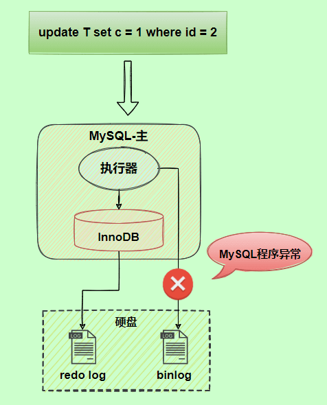

## JavaSE

Java基础：IO模型

Java集合：关键词过一遍

JVM：类加载过程，垃圾回收器

## 数据库

### MySQL

#### MySQL的架构是什么

[链接](./MySQL知识结构.md###存储结构)

#### InnoDB对比MyISAM

表级锁、事务、外键、索引结构、故障恢复（redo log)

#### 三大日志

服务层：binlog

引擎层：redolog、undolog

binlog：追加写、不覆盖。写的是每一条修改数据的原始SQL。用于备份恢复、主从复制。

redolog

过程：先修改buffer pool中数据，再写到redolog buffer，redo log刷盘，最后脏页写回磁盘（**日志先于数据落盘**（write-ahead），最后两步的机制叫做WAL）。

作用：崩溃恢复，将随机写变成顺序写。注：本来把数据直接写到数据库就行，但是这样频繁写，随机写太慢，所以用了缓存，写回频率可以降低，但是脏页的写回还是随机写。只是日志的写是顺序写。

如何理解redolog用于崩溃恢复？因为用了缓存，内存中的缓存脏页未写回时崩溃，会导致数据的不一致。但是由于redolog会刷盘，所以可以用于恢复。

**两阶段提交**

问题产生：redolog和binlog都是用于保证数据的一致性，但是崩溃时这两个日志不一致怎么办？

这两个日志又为什么会不一致呢？redolog是每执行一条写一次，而**binlog是事务提交才写**。那么如果再redolog写完刷盘后，准备写binlog时崩溃了，就会不一致。

用两阶段提交解决，就像2pc一样，redolog分为prepare和commit阶段，等binlog写完才是commit。

undolog：用于原子性和MVCC

#### MVCC如何介绍

并发事务控制方式：悲观式的锁，乐观式的MVCC

MVCC的实现依赖：记录的隐藏字段、read view、undo log

#### 普通读/快照读流程

#### hash索引问题

顺序查找，范围查找

#### 回表查询/覆盖索引/索引下推的概念

索引下推：针对联合索引，多条件查询

### Redis

缓存更新策略：旁路缓存，读穿透，写穿透，异步缓存（后三种应用只与缓存服务打交道）

批量命令的问题是redis集群下不一定全命中

