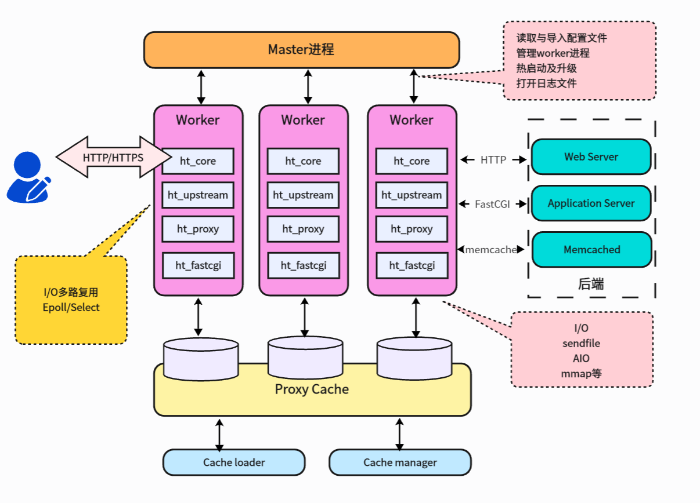
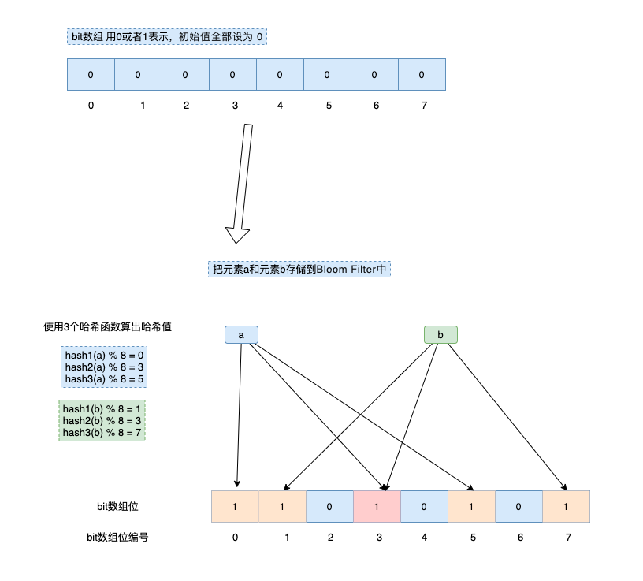
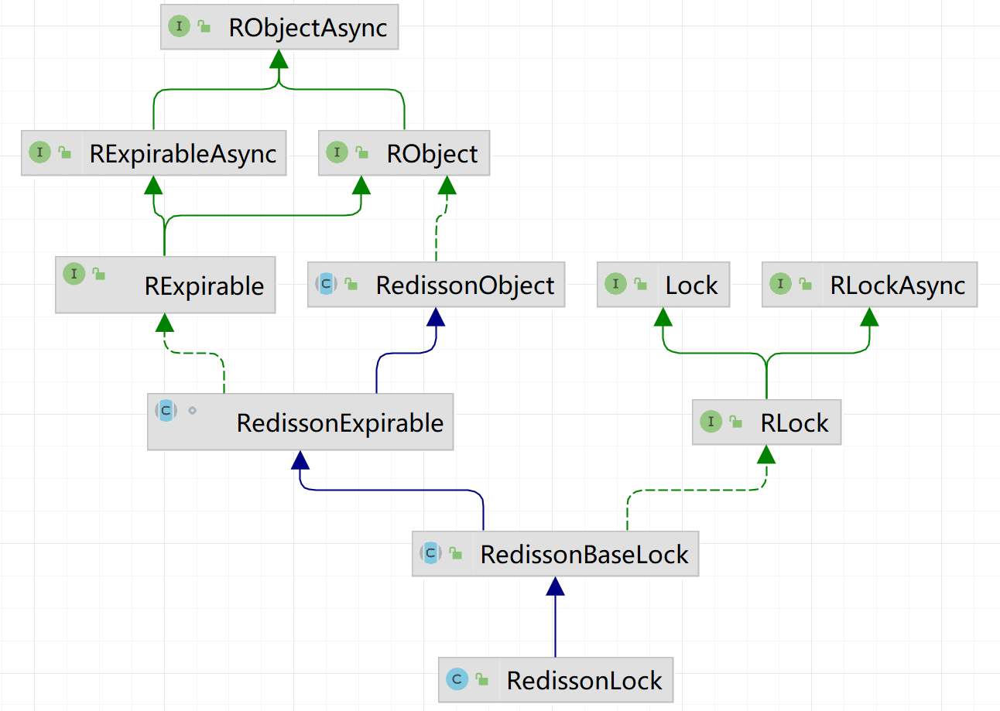
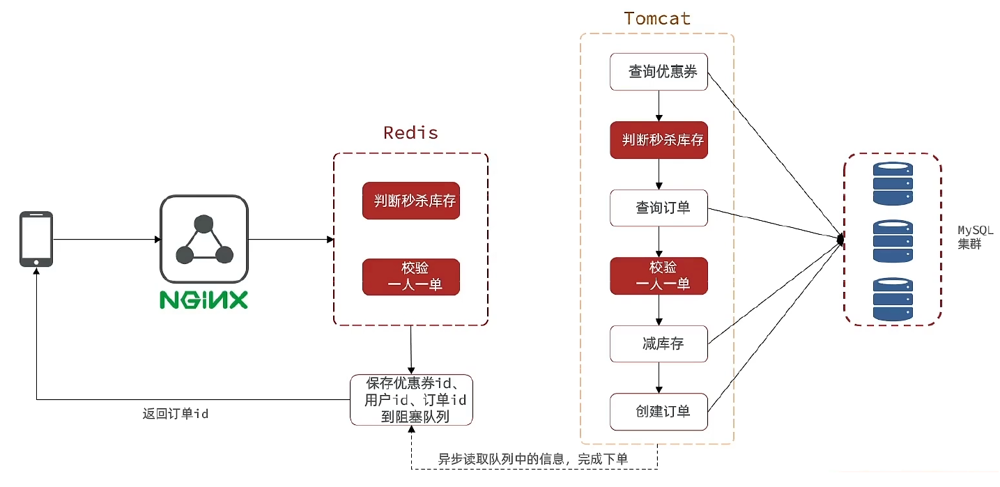
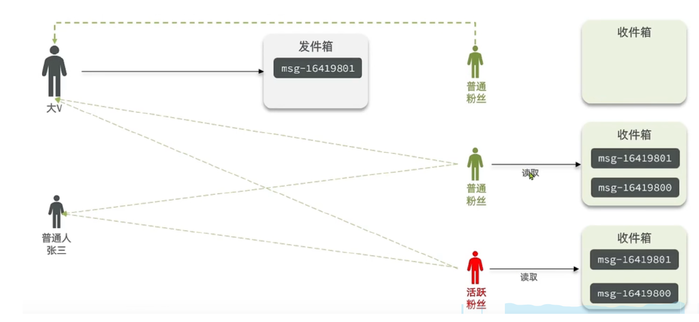

## 项目架构

### 项目介绍

这是一个高并发场景下的实战项目，是一个模仿大众点评的点评类系统。这个项目的整体架构是典型的前后端分离的单体架构，前端通过 Nginx 部署，后端基于Spring Boot搭建，使用了 MySQL 和 Redis作为数据库。我在开发过程中重点学习和应用了 Redis，在缓存、分布式锁、异步队列等方面做了大量实践。虽然目前项目是单体结构，但整体设计思路和技术选型已经比较贴近真实企业的开发模式。后续我也计划将其升级为微服务架构，完善注册中心、服务调用、限流等能力，提升项目的扩展性与可运维性。

### 简历上项目描述

- 登录与鉴权：基于Redis Hash + Token实现分布式Session，解决集群模式下Session共享问题；两层拦截器完成登录校验与续期，支持横向扩展。

- 高并发缓存：落地Cache Aside，空值缓存抗缓存穿透；互斥锁+逻辑过期抗缓存击穿；随机TTL抗缓存雪崩。

- 秒杀与一致性：使用Redis自增和时间戳生成全局唯一订单ID；Lua脚本原子扣减库存，MyBatis-Plus乐观锁防超卖；单机用事务和悲观锁实现“一人一单”；集群用分布式锁（SET NX + Lua/Redisson RLock）实现“一人一单”。最终超卖率与重复下单率均为0。

- 异步下单：对比阻塞队列、Redis List/PubSub/Stream，最终采用Redis Stream + 消费者组异步落单，削峰填谷。平均下单时延从500ms降低至180ms。

- 用户交互：ZSet做点赞时间序排行榜；Set实现关注/取关/共同关注与消息推送；Bitmap统计用户签到；Geo查询附近商铺；Feed采用推模式收件箱和基于score的游标分页。

### 项目主要功能

- 单体tomcat的session缓存 --> Redis分布式session缓存 -->完成了手机号登录验证码/用户信息的缓存
- 拦截器本身作用：验证登录态、拦截用户信息、刷新token
  - 第一个拦截器：对所有路径拦截
  - 第二个拦截器：对需要登录的页面拦截，只完成验证登录态这个功能
- 缓存更新策略 --> 商铺信息有高一致性需求 --> 采用主动更新（Cache Aside的主动删除） + 超时剔除策略（TTL）
- 超卖问题 --> 乐观锁：它的定义是假设不会冲突，更新时才验证
- 一人一单
  - MySQL的表，优惠券ID + 用户ID作为主键 --> 新增操作 --> 悲观锁
  - 还是要防止超卖 --> 事务（好几条SQL，能回滚）
  - 同一个人 --> 不同时间下两单，也需要靠事务回滚
- 分布式锁：< lock:order:{userId}, UUID-{threadId} > 这里如果锁的范围太大了，可以在键上再拼订单号
- 秒杀优化 --> 异步编排，没必要 --> 异步下单 --> Redis String 存库存 --> 优惠券ID, 用户ID 用Set结构保证一人一单 --> 因为这里有好几条Redis命令，所以要用Lua脚本。使用Lua脚本之后就不用加锁了。
- 阻塞队列 + 线程池异步下单：有内存问题，确认问题
- 点赞：Redis Zset收集userId，点赞数量还是记在MySQL
- 好友关注：MySQL和Redis中都有存，Redis中可以用来做共同关注
- 游标分页：记录上一个score值 + 相同score的偏移量
- 附近商家：不同类型放入不同的GEO
- 签到：sign:{userId}:202509，可以按月统计

### 项目架构是怎么样的？

SpringBoot + MyBatis-Plus + MySQL + Redis

### Nginx

#### **Nginx 概述**

 Nginx（读作 *engine-x*）是一个开源、高性能的 Web 服务器软件，同时也可以充当反向代理、负载均衡器、内容缓存和邮件代理等多种角色。它最初由 Igor Sysoev 于 2004 年为解决“C10K”并发连接问题而开发，采用非阻塞、事件驱动架构，能在极低资源占用下处理成千上万并发连接。

#### 核心架构特点

- **主进程 + 多工作进程**：主进程负责加载配置、管理子进程；工作进程基于 epoll／kqueue 等 I/O 多路复用机制执行事件循环。
- **非阻塞事件模型**：同一线程在单个事件循环中处理大量连接，减少上下文切换和线程开销，从而提高吞吐率。
   这些设计使 Nginx 在静态资源服务或高并发代理场景下具备“轻量、快、可扩展”的优势。
- 

#### 主要功能与作用

| 角色                   | 典型用途                                                     | 关键点                                                       |
| ---------------------- | ------------------------------------------------------------ | ------------------------------------------------------------ |
| **静态 Web 服务器**    | 直接向客户端提供 HTML、CSS、JS、图片、视频等静态资源         | 支持 `sendfile` 零拷贝、`gzip`/`brotli` 压缩、HTTP/2/3 及 TLS 终止，提高页面加载速度 |
| **反向代理**           | 位于客户端与后端应用（Tomcat、Spring Boot、Node.js 等）之间，转发请求并隐藏后端拓扑 | 支持 FastCGI、uWSGI、SCGI、memcached 协议，加速动态站点      |
| **负载均衡器**         | 将流量按 round-robin、least conn、ip hash 等算法分发到多台应用服务器 | 支持被动/主动健康检查（主动检查为 Nginx Plus 专属），可做到故障转移与会话保持 |
| **内容缓存**           | 作为前置缓存层，减少后端压力并降低 RTT                       | 可设置细粒度缓存键、过期时间、缓存层级                       |
| **TCP/UDP 代理**       | 通过 `stream` 模块代理 MySQL、MQTT、Redis、Syslog 等四层流量 | 同样具备负载均衡与 TLS 终止能力                              |
| **邮件代理**           | 代理 IMAP/POP3/SMTP，进行 SSL/TLS 卸载与认证转发             | 常见于大规模邮件系统场景                                     |
| **API 网关 / Ingress** | 在微服务或 Kubernetes 中用作入口网关，统一认证、限流、熔断、路由 | 可结合 Nginx Lua / NJS 独立实现逻辑，或使用商业版 Nginx Plus/NGINX Unit |

正向代理：代理 **客户端** 去访问外部服务器

反向代理：代理 **服务器** 向外提供统一入口

#### 近年来的新特性

1. **原生支持 HTTP/3 & QUIC**：自 1.25.x 主线版本起，Nginx 在 OSS 版本中加入了对 QUIC + HTTP/3（草案版）协议的实验性支持，显著降低首包延迟并改善移动网络体验。
2. **gRPC、WebSocket、HTTP/2 server push**：使其能够代理现代双向流式通信。
3. **动态模块化**：可按需编译/加载第三方模块（如 `ngx_brotli`、`ModSecurity WAF`），保持核心精简。

#### 使用场景速览

- **大型网站静态加速**（CDN 边缘节点、对象存储回源缓存）
- **微服务网关与服务网格入口**（与 Kubernetes Ingress 或 Istio Gateway 配合）
- **SSL 终止 + HTTP/3 提升移动端首包速度**
- **数据库或消息队列的四层负载均衡**（MySQL、SMTP、SMPP、Syslog 等）
- **高并发直播/点播流媒体分发**（HLS、MPEG-DASH 搭配 RTMP/HTTP-FLV 插件）

## 分布式Session登录

### Session是什么？

`Session` 是服务端用来跟踪用户状态的一种机制，是一种**服务器端的用户会话数据存储方式**。

当用户第一次访问网站时

服务端会为其创建一个 `Session` 对象，并生成一个唯一的 `Session ID`，然后这个 `Session ID` 会通过 `Cookie` 或 URL 参数的方式发送给客户端。

之后客户端每次请求时都带上这个 `Session ID`，服务端就能识别这个用户并从自己的内存中取出对应的用户数据（例如用户信息、验证码等）。

第二次访问时，Tomcat 获取 Session 的大致流程如下：

1. 浏览器自动携带 Cookie，其中包含 JSESSIONID；
2. Tomcat 解析请求头，提取出 JSESSIONID；
3. 调用 Session 管理器（Manager）中的 findSession(sessionId) 方法；
4. Manager（如 StandardManager）内部使用线程安全的 Map（如 ConcurrentHashMap）存储所有 Session，通过 sessionId 查找对应的 StandardSession；
5. 找到后，将其绑定到当前 Request 对象中，并封装为 HttpSession；
6. 开发者通过 request.getSession() 即可获取该 HttpSession 对象；
7. 通过 session.getAttribute(key) 等方法访问用户数据（如登录用户信息）。

获取到用户数据之后：

为了保证线程安全，使用ThreadLocal去存用户信息userDTO（去除敏感信息后的用户信息），ThreadLocal的优点。

这个项目使用分布式session之后，不再使用JSESSIONID，而是使用request头中的authorization的UUID，去redis中查找。


### 单体项目session存在哪里

> Servlet 容器（如 Tomcat）默认将 Session **保存在服务器内存中**。

- 创建位置：`HttpSession` 对象由服务器创建并存储。
- 存储内容：保存在服务器内存中的一个 `Map` 中，键是 `SessionId`，值是用户数据。
- 缺点：**服务重启/切换服务器会丢失 Session 数据**。


### 分布式部署场景

因为用户的请求可能被 Nginx 等负载均衡转发到不同的服务器，如果仍用本地内存保存 Session，会导致**Session 不共享问题**。常见解决方案：

#### 1. **Session 复制（Tomcat 集群同步）**

- 多台 Tomcat 实例之间通过集群配置同步 Session（效率低、使用复杂）。

#### 2. **将 Session 存入 Redis（推荐）**

- 使用 Redis 替代服务器内存，**将 Session 统一存储在 Redis 中**。
- 实现共享：无论用户请求转发到哪一台服务器，都能从 Redis 中获取用户信息。

#### 3. 存储在MySQL

查询性能差，不适合高并发场景


### 能使用concurrenthashmap来实现session吗？

单体可以，分布式不行。


### HttpServletRequest 是什么？

是 Java EE / Servlet 提供的一个类，是 **Tomcat 接收到前端 HTTP 请求后封装出来的**，包含：

- 请求方式 + 路径
- Header、Cookie、参数、Body
- Session、IP、端口等环境信息


### session中包含的内容

```
Session 对象
├── id: A94F34... (JSESSIONID)
├── 创建时间: 2025-05-22 21:30:00
├── 最后访问时间: 2025-05-22 21:45:00
├── 过期时间: 30分钟
└── 数据 Map:
     ├── "user" -> UserDTO{id=1, name="zhangsan"}
     └── "code" -> "9527"  // 短信验证码

```


### 这一模块在两个地方使用了redis

1.存验证码，使用string类型，格式为**<login:code:手机号, 验证码>**

2.代替httpsession，使用hash类型，格式为**<login:token:uuid, 用户信息map>**。优点是可以经常修改，占用内存少。

## 拦截器

### 拦截器作用

登录鉴权、用户上下文注入、接口幂等、限流等。

### nginx的限流和拦截器限流

Nginx 能做的限流（边缘层，轻量高效），在配置中配置即可生效。

Spring 拦截器限流（应用层，业务感知）

优势：能拿到用户身份、URI、参数等业务维度；还能用 Redis 做分布式限流，多实例一致。

常见实现：固定窗口 / 滑动窗口 / 令牌桶，**底层用 Redis**（INCR+EXPIRE、ZSET、Lua）。

## 商铺缓存

### 有哪些缓存类型？

| 缓存类型           | 举例                                     | 典型特点                                                     |
| ------------------ | ---------------------------------------- | ------------------------------------------------------------ |
| **本地缓存**       | `Guava`、`Caffeine`、`Map`               | 读写速度极快，延迟低，适合热点数据；但无法跨服务共享，重启即失效 |
| **应用层远程缓存** | `Redis`、`Memcached`                     | 支持分布式、多节点共享，适合用户Session、缓存击穿保护、热点数据存储，高性能高并发 |
| **数据库缓存**     | MySQL `Buffer Pool`、`Query Cache`       | 提高数据库访问效率，减少磁盘 I/O，缓存数据页（Innodb）和查询结果 |
| **浏览器缓存**     | `Cache-Control`、`ETag`、`ServiceWorker` | 缓存静态资源，减少带宽和请求，提升前端响应速度；由前端或 CDN 控制 |
| **CPU 缓存**       | `L1` / `L2` / `L3` Cache                 | 处理器访问速度极快；用于加速内存读取，硬件级优化不可控，主要用于系统性能提升 |


### 本地缓存有哪些？

1. **`HashMap`**

2. **`ConcurrentHashMap`**

3. **`Guava Cache`**

- Google 出品的本地缓存库；
- 支持过期淘汰（写后过期、访问后过期）、最大容量；
- 提供自动加载机制 `CacheLoader`；
- 易用性适中，适合轻量级缓存场景。

4. **`Caffeine`**

- Guava 的升级版，性能更强；
- 支持多种淘汰策略（LRU、LFU、权重）、异步刷新；
- 性能接近 `ConcurrentHashMap`；
- 是高并发业务中**首选的本地缓存库**。

5. **`Ehcache`**

- 支持本地缓存 + 磁盘缓存 + 多级缓存；
- 可配置性强，支持 JCache 标准；
- 可与 Spring 框架深度整合；
- 缺点是依赖重、使用复杂，适用于企业级应用。

6. **自定义缓存（Map + 定时清理线程）**

- 需要开发者自行实现 TTL 逻辑和清理机制；
- 灵活但实现复杂，维护成本高；
- 适合特殊业务需求场景（如精确控制缓存粒度或行为）。

### 缓存一致性问题以及解决方案

https://www.cnblogs.com/wzh2010/p/17205453.html

这个项目采用标准的cache aside pattern

读命中：直接返回

读未命中：读数据库，再更新缓存，并设置超时时间

写：先写数据库，再删除缓存

为什么读要更新？写要删除？我个人理解读的店铺是大概率是热门的，而更新的店铺不一定是热门的。

:star: 缓存是通过牺牲强一致性来提高性能的。这是由**CAP理论**决定的。但是通过一些方案优化处理，是可以**最终一致性**的。

为什么采用这个方案？

其他方案需要缓存服务来进行接下来的更新？

### 为什么选用cache aside pattern

- **一致性诉求**：你的“高一致性”场景（如店铺详情）推荐“主动更新+超时兜底”：读时命中就返，未命中查库并写缓存；写时“先写数据库，再删除缓存”（避免并发下旧值回填），这正是旁路缓存的套路。 

- **读路径天然匹配**：现有查询流程就是“先查缓存、没中再查库并写回缓存”，这本身就是 Cache-Aside 的读路径，不需要额外中间层或代理。

- **实现/运维成本低**：

  1）**调用方双写（Cache-Aside）**；并没有独立的“缓存服务层”，而是由业务自己控制读写。

  2）**把缓存与数据库整成一个服务（Read/Write-Through）**；没这层基础设施，因此不合适当下落地。

  3）**只写缓存、异步落库（Write-Behind）**：只写缓存、后台异步刷库，**只有最终一致**；这类对读即时一致性有要求的业务（店铺详情、价格等）不友好

- **可落地的风控手段多**：旁路缓存由业务掌控，方便叠加“缓存空值/布隆过滤防穿透、TTL+随机防雪崩、互斥重建或逻辑过期防击穿”等组合拳，这些在课件里都按这套模型讲解和实现。  

### 如何保证数据库和缓存的更新的原子性？

:star:个人理解，这里加上事务并不能保证缓存和数据库的更新是原子性的。事务只能对MySQL起作用，如果有多条MySQL语句，加上事务相当于开启数据库的事务，但是这里只有一条MySQL，我认为没有必要用事务。

**单体系统**，将缓存与数据库操作放在一个事务中，通常使用 Spring 的声明式事务（`@Transactional`）将数据库写入和缓存更新封装在一个事务方法内。

**在分布式架构下**，单个事务无法覆盖多个系统/服务，此时可使用 TCC（Try-Confirm-Cancel）、可靠消息最终一致性、SAGA 等分布式事务方案来保证数据库与缓存一致性。

### 缓存穿透

#### 缓存穿透常见解决方案？主动和被动方式

| 方案                  | 原理简介                                                     |
| --------------------- | ------------------------------------------------------------ |
| **缓存空对象**        | 将数据库中确实不存在的结果也缓存起来（如设为 `""` 或 `"null"`） |
| **布隆过滤器**        | 用位图和多个哈希函数判断 key 是否存在，提前拦截非法请求      |
| **增强 ID 难度**      | 使用不可预测的 UUID 或加密 ID 避免穷举攻击                   |
| **基础格式校验**      | 对请求参数做合法性校验（如数字范围、格式）                   |
| **权限校验**          | 验证请求用户是否具有访问权限                                 |
| **热点参数限流/降级** | 对特定参数限流、熔断、兜底（如服务降级、返回友好提示）       |

#### 布隆过滤器的原理是什么？

布隆过滤器通过一个**固定长度的二进制位数组**和**若干个独立的哈希函数**来判断某个元素是否存在于集合中：

- **添加元素**时，将该元素分别通过 `k` 个哈希函数计算出 `k` 个位置，并将这些位置对应的位设置为 `1`。
- **查询元素**时，再用同样的 `k` 个哈希函数计算位置，如果这些位置全是 `1`，则认为该元素“可能存在”；只要有一个位置是 `0`，就说明**该元素一定不存在**。

由于多个元素可能映射到相同的位，因此存在 **“假阳性”**（误判为存在）的可能，但**绝不会出现“假阴性”**（明明存在却判断为不存在）。

- **优点**：
  - 空间效率高（远小于哈希表）
  - 查询速度快（O(k) 时间复杂度）
  - 不存储原始数据，适合大数据集
- **缺点**：
  - 有误判（假阳性）
  - 无法删除（除非用 Counting Bloom Filter）
  - 不支持获取原始数据




### 缓存雪崩

#### 缓存雪崩定义

**缓存雪崩**是指：在同一时间**大量缓存Key同时失效**，或**Redis整体宕机**，大量请求瞬间涌入数据库，导致数据库承压甚至崩溃。

#### 缓存雪崩的解决方案

##### 1. 给不同的 Key 的 TTL 添加随机值

##### 2. 使用 Redis 集群 / 哨兵机制 提高服务可用性

##### 3. 为缓存业务添加限流与降级策略

通过限流、熔断、降级等方式对流量进行控制，一旦请求超过阈值，返回默认结果、兜底数据或提示稍后重试。

关键点：

- 接入 Sentinel、Bucket4J、Guava RateLimiter 等限流组件
- 降级方式如返回静态数据、提示服务繁忙

优点：

- 可以从源头控制突发请求
- 提高系统稳定性和抗压能力

缺点：

- 实现复杂（需结合业务逻辑）
- 会影响用户体验（返回兜底数据）

适用场景：

- 秒杀/抢购/热点详情页等高并发接口

##### 4. 给业务添加多级缓存（如本地缓存 + Redis）

在应用服务器内存中构建一级缓存（如 Caffeine、Guava Cache），Redis 作为二级缓存，数据库为最终兜底。

```
用户请求 → 本地缓存 → Redis → 数据库
```

优点：

- 访问命中率高，速度极快（内存访问）
- 降低对 Redis 的依赖

缺点：

- 数据一致性难以保障（可能读到旧数据）
- 本地缓存受内存容量限制

适用场景：

- 高频读取、数据更新不频繁，如商户信息、分类列表、地区信息

##### 5. 缓存预热 / 预加载

在服务启动时、或者定时任务中，提前将热点数据加载到缓存中，避免首次访问时出现缓存未命中。

优点：

- 提高冷启动性能
- 避免热点数据的击穿

缺点：

- 需要预估并维护热点数据集合
- 更新频繁的数据不适合

适用场景：

- 首页推荐、导航分类、节假日营销配置等核心静态内容

##### 6. 异步重建 + 互斥锁（如逻辑过期或互斥锁方案）

缓存失效后，不是所有请求都重建缓存，而是只允许一个线程执行重建，其他请求等待或返回旧数据。

两种典型实现：

- **互斥锁方案（setnx）**：加锁重建，避免并发冲击
- **逻辑过期方案**：过期标志写在Value中，过期后返回旧数据，并异步触发重建

优点：

- 控制并发重建，保护数据库
- 可灵活控制重建时机和并发量

缺点：

- 实现相对复杂
- 重建期间其他线程可能读到旧数据

适用场景：

- 高QPS热点数据（店铺详情、商品详情页等）

#### 本项目采用缓存空对象

### 缓存击穿

#### 缓存击穿定义

**某一个热点Key在某个时刻失效了（TTL过期），而此时大量请求并发访问该Key**，由于缓存未命中，所有请求都会打到数据库，瞬间压垮数据库。

#### 解决方案

##### 一、互斥锁方式

在缓存失效后，只有**一个线程能访问数据库**并重建缓存，其他线程等待或稍后重试。

实现方式：

使用 Redis 的分布式锁（如 `SETNX + EX`），或者 Java 的本地锁。

```java
// 伪代码
String data = redis.get(key);
if (data == null) {
    if (tryLock(key)) {
        data = db.query();
        redis.set(key, data, 30min);
        unlock(key);
    } else {
        Thread.sleep(50);
        return retry(); // 递归重试
    }
}
```

适用场景：秒杀详情页、热门商品详情等**单热点Key**

##### 二、逻辑过期

缓存结构中包含“逻辑过期时间”，即使TTL未过期，业务逻辑中判断是否过期。如果过期则**异步启动线程重建缓存**，当前仍然返回旧值。

##### 三、提前预热 + 永不过期

提前将热点数据缓存，设置为**永不过期**（手动控制失效），通过定时任务或数据变更时主动更新。

##### 四、短时间锁定+快速失败返回

发现缓存失效时，短时间内拒绝相同请求（进入失败缓存或限流状态），返回默认结果或提示稍后重试。

#### 本项目互斥锁+逻辑过期

## 优惠券秒杀

### 分布式ID方案

为什么不使用数据库自增：数量有限并且容易猜测。

| 类型                     | 实现方式                      | 性能 | 优点                       | 缺点                                 |
| ------------------------ | ----------------------------- | ---- | -------------------------- | ------------------------------------ |
| 1. 数据库自增 ID         | MySQL 自增主键                | 中   | 简单易用；可控             | 单点瓶颈、主从同步延迟、分表分库困难 |
| 2. UUID（Java 自带）     | `UUID.randomUUID()`           | 高   | 简单、无依赖               | 不可读、不排序、冗长（128bit）       |
| 3. Redis 自增 ID         | Redis `INCR` + 拼接           | 高   | 高性能、支持集群           | 依赖 Redis；存在序列号溢出风险       |
| 4. 雪花算法（Snowflake） | 时间戳 + 机器ID + 序列号      | 高   | 无中心、趋势递增、64位短ID | 实现稍复杂，需时钟同步               |
| 5. Leaf（美团开源）      | Leaf-segment / Leaf-snowflake | 高   | 高可用、支持多种模式       | 引入额外中间件                       |
| 6. 百度 UidGenerator     | RingBuffer + 时间戳生成       | 极高 | 缓存预分配、吞吐极高       | 实现复杂，需要 SDK                   |
| 7. Mongo ObjectId        | 时间戳+机器码+计数器          | 中   | 唯一、含时间特征           | 不适合高并发严格排序                 |
| 8. 雪花算法变种 + Redis  | Redis 控制序列号雪花算法      | 高   | 分布式安全，可扩展         | 实现稍复杂，需要协调                 |

### 超卖问题

#### 悲观锁实现方案

对有线程安全的加锁，比如synchronized、ReentrantLock。

#### 乐观锁实现方案

乐观锁假设并发冲突是少数，只在提交时进行冲突检测。它不依赖数据库或系统级锁，而是通过版本号或 CAS 实现。

| 类型                    | 描述                                                         |
| ----------------------- | ------------------------------------------------------------ |
| 版本号机制              | 常用于数据库更新时，带 `version` 字段，更新时检查版本号是否一致。 |
| CAS（Compare And Swap） | 如 Java 中的 `AtomicInteger.compareAndSet`，底层硬件原子操作支持。 |
| Redis乐观锁             | 如使用 `watch` + `multi/exec` 实现事务控制，如果期间键被修改则事务失败。 |

### 一人一单

#### 为什么synchronized(userId.toString().intern())？

为什么intern？返回当前字符串在字符串常量池中的引用，如果池中没有，就把它加入池中。

字符串常量池和运行时常量池的关系？**运行时常量池 = 多种信息的集合，字符串常量池只是其中放在堆里的那一部分。**也就是说方法区/元空间的内容并不是独立存在的，分布在jvm的各个区域。


#### 锁为什么要先于事务？

##### 1. Spring事务底层是通过代理实现的

Spring 的 `@Transactional` 是通过 AOP 动态代理实现的。当你调用本类方法时，若方法上加了 `@Transactional`，直接调用 `this.method()` 是不会触发事务的。

因此：

- 如果你在事务方法内部加锁（如 `synchronized` 或 `RedissonLock.lock()`），锁是有效的；
- 但若事务方法内部调用一个 `@Transactional` 方法，事务实际还没开启，**加锁动作可能早于事务开始，也可能晚于事务提交**，产生顺序错乱。

##### 2. 锁是为了保障线程安全，事务是确保数据的一致性和完整性

加锁的目的是为了让多个线程“串行”执行某段逻辑，防止数据竞态，比如“一人一单”逻辑、库存扣减等。

如果锁在事务**之后**才加上，那么多个线程可能同时进入事务逻辑（因为事务开始前没加锁），这时候即使你加了数据库事务，也可能多个事务都成功，造成超卖等问题。

也就是说，这里是为了实现一人一单，如果先事务，那么多个线程进入事务，一个线程完成锁内的逻辑，释放锁，另一个线程获得锁，又开始执行事务内的逻辑，导致一人下了很多单！


### 常见的分布式锁方案

##### 1. 基于 Redis 的分布式锁

实现方式：

使用 Redis 的 `SET key value NX EX` 命令实现加锁，使用 `DEL` 删除释放锁，或用 Lua 脚本实现释放锁的原子性。

Redis 本身是单线程事件循环模型，任何一条命令都会在内部依次排队、串行执行。

衍生方案：

| 名称                        | 特点                                                       |
| --------------------------- | ---------------------------------------------------------- |
| **自己手写 Redis 分布式锁** | 结合 setnx + UUID + Lua 脚本解决误删和原子性问题           |
| **Redisson**（推荐）        | 提供了可重入锁、公平锁、读写锁等，支持自动续期（WatchDog） |

##### 2. 基于 Zookeeper 的分布式锁

利用 Zookeeper 的临时有序节点 + Watch 机制实现加锁，节点挂掉自动删除，保证可靠性。

##### 3. 基于数据库的分布式锁

通过数据库表字段加唯一索引、行级锁（如 `SELECT ... FOR UPDATE`）等方式实现锁。

##### 4. 基于 Etcd 的分布式锁

 实现方式：

使用 Etcd 的租约机制和原子性操作实现锁，类似于 Zookeeper，但基于 Raft 算法，支持高可用。

优点：

- CAP 中偏向 CP，适合一致性场景
- 性能比 Zookeeper 稍好

缺点：

- 运维门槛较高
- 国内使用相对较少

场景：

- Kubernetes 控制器锁等基础设施服务

#### 原生Redis实现的普通分布式锁过程

- 最基础，获取锁，一条语句set...nx，删除锁，一条语句，del...
- 防止死锁，给获取锁加个有效期set...nx...ex
- 有效期引发问题，如果持有锁t1执行时间太长，锁释放了，t2进入，t1把t2锁删了
- 给锁加个名字，只有自己的锁才能删
- 这时删除锁的程序多了if判断，失去了原子性，就会出现问题
- 使用lua脚本解决多条redis命令的原子性问题
- 此时redis锁已经实现，高可用高并发可以用redis集群解决
- 但是依然存在以下问题，可重入，重试，超时释放，主从一致，用其他工具解决

### Redisson

https://juejin.cn/post/6961380552519712798?from=search-suggest这篇博客介绍了什么是Redisson，以及可重入锁redissonLock

#### 什么是Redisson？

Jedis把Redis命令封装好，Lettuce则进一步有了更丰富的Api，也支持集群等模式。但是两者也都点到为止，只给了你操作Redis数据库的脚手架，而Redisson则是基于Redis、Lua和Netty建立起了成熟的分布式解决方案，甚至redis官方都推荐的一种工具集。

#### Redisson 的作用有哪些？

| 模块                                              | 说明                                       | 应用场景                                   |
| ------------------------------------------------- | ------------------------------------------ | ------------------------------------------ |
| **分布式锁** `RLock`                              | 提供可重入锁、读写锁、公平锁等             | 保证分布式环境下的数据一致性（如库存扣减） |
| **分布式集合** `RMap`, `RList`, `RSet` 等         | 分布式 Hash、List、Set、Queue 等           | 多实例下共享数据结构                       |
| **分布式限流** `RRateLimiter`                     | 实现固定窗口、漏桶限流等算法               | 接口防刷、防爆破                           |
| **分布式计数器** `RAtomicLong`, `RCountDownLatch` | 分布式原子操作工具                         | 全局计数、并发控制                         |
| **分布式缓存** `RMapCache`                        | 支持 TTL 和本地缓存（二级缓存）            | 热点缓存、本地优先读                       |
| **发布订阅** `RTopic`                             | 类似 Kafka 的消息发布/接收模型             | 消息通知、事件驱动                         |
| **分布式任务调度** `RScheduledExecutorService`    | 支持定时执行、延迟任务                     | 定时任务、延迟队列                         |
| **对象持久化** `RLiveObjectService`               | 将 Java 实体对象自动映射为 Redis Hash 存储 | 像使用 ORM 那样操作 Redis                  |

#### 什么是Redis 客户端

> Redisson比Spring Data Redis低一个层级

```
Redis Server（服务端）
   ↑
Jedis / Lettuce（真正的 Redis 客户端）
   ↑
Spring Data Redis（Spring 的 Redis 支持框架）
   ↑
RedisTemplate / StringRedisTemplate（你写代码时用的操作类）
```


#### 分布式锁RLock



- 我们上面实现的锁有很多问题，这时使用Redisson提供的分布式锁，功能更加的完善。
- 实现了可重入功能，结构为Map<锁名称, Map<线程标识, 计数>>，注意RLock是用**Hash**实现的。
- 实现了续约功能，WatchDog每（超时时间 / 3）毫秒续约一次
- 获取锁时被阻塞的线程，通过**发布订阅pub/sub功能**来实现再次尝试，而不是自旋

为什么要续约？

为了某种场景下保证业务不影响，如任务执行超时但未结束，锁已经释放的问题。

为了解决Redisson 实例宕机或线程崩溃，30s后过期。

Watch-dog 本质上是 **“时间轮 + Lua”** 的组合：

- **时间轮 (`HashedWheelTimer`)** 提供轻量级定时调度；
- **Lua 脚本** 原子刷新 TTL；
- **递归定时** 保证锁在持有者存活期间永不过期；
- **`unlock()` 取消 Timeout** 才会停止续租。
- 它是利用 Netty 的 `Timeout` 对象和时间轮机制来实现高性能的定时续约。

什么是RedissonMultiLock？

逻辑“AND”锁，只有当所有指定 `RLock` 都成功加锁时才视为加锁成功，若任意一步失败即回滚已获锁。多个 `RLock` 可以来自不同的 RedissonClient，甚至连接到不同 Redis 节点、不同 key，适合给“多资源事务”加全局互斥。

### 秒杀优化

#### 高并发下单场景优化思路

在秒杀／高并发下单这种 **“短时间大量并发 + 多数据库操作 + 串行业务逻辑”** 的场景里，常见的加速思路可以从 **「路径缩短」+「并发提升」+「读写解耦」+「资源隔离」** 四个维度来拆解。

| 目标                       | 典型做法                                                     | 关键点                                               | 适用步骤 |
| -------------------------- | ------------------------------------------------------------ | ---------------------------------------------------- | -------- |
| **1️⃣ 尽量少走数据库**       | - **本地/Redis 缓存**：优惠券、商品基本信息提前放入 Redis；- **布隆过滤器或 Set**：过滤非活动用户 / 重复下单 | 命中率高、TTL 要与活动窗口匹配                       | ①②③④     |
| **2️⃣ 让真正串行的逻辑更快** | - **单机乐观锁 / 分布式锁**：秒杀库存扣减可用 Redis Lua 原子脚本或 Redisson tryLock；- **DB 乐观锁版本号 / 行锁**：保证库存记录一致性 | 尽量把锁粒度收敛到单行／单键                         | ②⑤       |
| **3️⃣ 能并行的并行**         | - **CompletableFuture / Reactor**：查询优惠券、校验一人一单、读订单等可并行；- **业务线程池隔离**：IO-密集型与 CPU-密集型分池，避免互相拖慢 | 核心线程数 ≈ CPU × 2， 队列选 Synchronous/RingBuffer | ①③④      |
| **4️⃣ 能异步的异步**         | - **消息队列 (Kafka / RocketMQ / RabbitMQ)**： • 请求进来只做快速校验 + Redis 预扣库存，随后投递「创建订单」消息； • 异步消费者落库、扣真实库存、发送短信- **延迟队列 / 死信队列**：订单超时未支付自动回滚库存 | 保证 MQ exactly-once 或者幂等消费                    | ⑤⑥       |
| **5️⃣ 削峰填谷**             | - **令牌桶 / 漏桶限流**：GateWay/Nginx 维度对接口限速；- **预热库存映射**：秒杀前把库存拆分成若干令牌写入 Redis List，pop 即代表抢购成功 | 避免数据库直接承压                                   | 整体     |
| **6️⃣ 存储层抗并发**         | - **读写分离 + 分库分表**：订单库按用户维度或时间维度分片；- **批量写**：异步消费者按批 insert / update | 热点库表打散                                         | ⑥        |
| **7️⃣ 全过程幂等 + 监控**    | - **幂等 Token / 唯一索引**：保证 MQ 重试、客户端刷单都不会重复下单；- **链路追踪 / Metrics**：秒杀 QPS、库存余量、失败原因可观测 | ——                                                   | 整体     |

#### 异步优化



大致流程：

- 先利用Redis完成库存余量、一人一单判断，完成抢单业务
- 再将下单业务放入**阻塞队列**，利用独立线程异步下单

基于阻塞队列的异步秒杀存在哪些问题？

| 风险点            | 具体表现                            | 典型后果                                        |
| ----------------- | ----------------------------------- | ----------------------------------------------- |
| **内存限制**      | 队列驻留 JVM 堆；突发流量把队列打满 | **OOM** 或 GC 长暂停，引发全站雪崩              |
| **数据安全**      | 任务只在本机内存，没有落盘          | 进程宕机 / 容器重启时，**排队中的订单全部丢失** |
| **单机瓶颈**      | 队列和消费者线程都在同一实例        | 无法横向扩容；流量一旦打到另一台机器就排不上队  |
| **监控/治理困难** | 纯内存队列缺指标                    | 难以做告警、限流、预警、优雅关闭                |

### Redis消息队列

#### 1. List 队列

优点

1. **语义简单、成熟稳定**：`LPUSH/RPUSH + BLPOP/BRPOP` 即可搭建工作队列，社区和客户端支持充分。
2. **支持阻塞**：消费者阻塞在 `BLPOP`，新任务一入队立即唤醒。
3. **可持久化**：队列是普通键，和其他 Redis 数据一样受 RDB/AOF 保护。

缺点

1. **无确认机制**：一旦被 `BLPOP` 弹出便从列表删除，消费者崩溃即丢消息。可以改用 `BRPOPLPUSH` 把任务先挪到 “processing-list” 再业务确认后 `LREM`，但需要额外代码。
2. **只能“竞争消费”**：同一条消息无法同时给多个消费者。
3. **易受内存限制**：极端堆积时可能把实例撑爆，同时长时间阻塞可能导致连接被服务端或网络设备断开，需要重连处理。

#### 2. Pub/Sub

优点

1. **实时广播，延迟极低**：消息立即推送到所有订阅端，几乎没有排队。
2. **实现最简单**：不需要额外队列键，也无需手动裁剪。
3. **模式订阅**：支持通配符订阅，方便一条消息多路分发。

缺点

1. **无持久化、无回放**：订阅者掉线期间的消息永久丢失——Redis 明确标注 *at-most-once* 语义。
2. **无确认/重投**：无法做到至少一次或恰好一次交付。
3. **监控与可观测性弱**：无法查询 backlog、消费进度。
4. **集群跨槽广播需额外方案**：原生 Pub/Sub 只在单节点生效，跨分片需客户端或代理转发。

#### 3. Stream 队列（Redis 5.0+）

优点

1. **持久化 + 顺序日志**：每条 XADD 自动带唯一 ID，可按需回放／审计。
2. **Consumer Group**：天然支持“组内竞争 / 组间广播”两种模式，方便扩容。
3. **确认 & 重试**：XACK 确认、PEL 查询、XCLAIM 转移，实现至少一次交付、死亡信箱等高级特性。
4. **阻塞读取**：`XREAD[GROUP] ... BLOCK` 低成本长轮询，避免空轮询。
5. **可裁剪**：MAXLEN / TRIM 按长度或时间窗口自动截断，控制内存。

缺点

1. **学习 & 代码成本更高**：需要掌握 XADD/XREAD/XACK/XPENDING/XCLAIM 等一整套 API。
2. **内存占用略高**：每条记录包含 ID、field-value；此外维护 radix-tree/index 等结构。
3. **依然基于单线程实例**：吞吐极端场景下可能不如 Kafka/RabbitMQ；跨槽 Consumer Group 仍需业务分区。

#### 使用Stream作为消息队列的过程

- 先由生产者通过 `XADD` 将消息追加到流中。

- 启动时为流创建消费者组（`XGROUP CREATE`），多个消费者用各自的 consumer 名字调用 `XREADGROUP GROUP <group> <consumer> BLOCK ... STREAMS <key> >` 阻塞读取未消费的记录并批量处理业务，处理成功后立即用 `XACK` 确认以从 PEL（待确认列表）删除。
- 若消费者宕机或业务异常，可定期用 `XPENDING` 或 `XAUTOCLAIM` 捞取超时未确认的消息重新消费，保证至少一次投递；必要时通过设置最大长度（`MAXLEN`）或定期 `XTRIM` 控制流大小，实现高并发、持久化、可回溯且支持消费者组的可靠消息队列。

我的实现哪里有问题？

- 异常的消息处理有问题，处理PEL（Pending Entries List）时每次只读第一条消息，要是一直卡在第一条会出问题。

- Pending-list 只在 catch 中兜底，如果是线程死亡，没有进入catch，就不处理消息了

```java
catch (Exception e) {
	log.error("处理订单异常", e);
	//处理异常消息
	handlePendingList();
}
```

### 达人探店

#### 图片的传输

1. 前端如何发起上传？

```js
const form = new FormData();
form.append("file", fileInput.files[0]);   // “file” 对应 @RequestParam 名称

fetch("/blog", {
  method: "POST",
  body: form          // 浏览器会自动加上 multipart/form-data; boundary=xxx
});
```

浏览器看到你把 `body` 指定为 `FormData` 对象，就会：

- 在请求头加上`Content-Type: multipart/form-data; boundary=----WebKitFormBoundary...`

- 把每个字段包装成 **“part”**：

```
------WebKitFormBoundary...
Content-Disposition: form-data; name="file"; filename="cat.png"
Content-Type: image/png

(这里是文件二进制)
------WebKitFormBoundary...--
```

所有 **part** 最终都写进请求体中，彼此用 `boundary` 分隔。

2. Spring Boot 如何拿到 `MultipartFile`？

- Spring Boot 默认启用了 `StandardServletMultipartResolver`或手动声明 `CommonsMultipartResolver`。
- 解析器看到 `Content-Type: multipart/form-data` 后，会把每个 part 解析成
  - 表单字段 → `String`
  - 文件字段 → `MultipartFile`
- 解析完成后把它们放进 `HttpServletRequest` 的 attribute 里，`DispatcherServlet` 再根据 `@RequestParam("file")` 装配到方法参数。

因此，`MultipartFile image` 已经包含：

| 属性                     | 含义                       |
| ------------------------ | -------------------------- |
| `byte[]` / `InputStream` | 文件真实内容（来自请求体） |
| `getOriginalFilename()`  | 客户端提交的原始文件名     |
| `getContentType()`       | 客户端上报的 MIME 类型     |
| 其他                     | 大小、是否为空等           |

#### 实现的功能

- 发布博客：增
- 查询博客：查
- 点赞功能：不能重复点赞，如果再点一次是取消，如果当前用户已经点赞，则点赞按钮高亮显示（前端已实现，判断字段Blog类的isLike属性），点赞的时间排序（类似微信的点赞）

#### 点赞功能实现

- 给Blog类中添加一个isLike字段，标示是否被当前用户点赞

```java
    @TableField(exist = false)
    private Boolean isLike;
```

- 修改点赞功能，利用Redis的Zset集合判断是否点赞过，未点赞过则点赞数+1，已点赞过则点赞数-1。为什么要使用Zset，是为了排行榜的功能。点赞过程是，先在数据库的liked字段+1，然后每篇博客在Redis中存Zset< blog:liked:blogId >，把所有点赞过的用户id存到集合中，因为要按时间顺序输出排行榜，所以把时间戳作为Zset的score。

- 修改根据id查询/分页查询Blog的业务，判断当前登录用户是否点赞过，赋值给isLike字段。isLike字段并不是存在数据库中的，所以在查询Blog的时候需要设置isLike字段。

- 排行榜只需要范围查询Redis中的集合的前五个用户id，然后回数据查询，为了使查询后结果还是按顺序，需要使用field函数

```sql
SELECT *
FROM user
WHERE id IN (5, 1)           -- 只取榜单上的那些 id
ORDER BY FIELD(id, 5, 1);    -- 按传入的顺序 5 → 1 排序
```

#### 如何改进功能

- **Lua 原子脚本** 解决并发一致性；

- **异步刷库或双写保证最终一致**；

- **按业务维度拆分数据结构**（人、榜单、热度）；

- **内存边界与分片规划** 让系统后期仍可水平扩展；

- **幂等/批量优化** 降低重复请求与网络消耗。

### 好友关注

#### 实现功能

- 博主与用户属于多对多，所以新建一张表存储粉丝关系。
- 为了实现共同关注功能，同时在Redis中，使用set存储每个博主的粉丝，然后利用set的交集得到共同关注。
- 博主发布博客之后，使用Feed流推送给粉丝

#### Feed流介绍

- **消息获取**本质是 **“空间 vs 时间”+“写放大 vs 读放大”** 的权衡。
- **推 / 拉 / Hybrid** 决定了中心存储与缓存的形态；
- **SSE / WebSocket / APNs/FCM** 决定了最后一公里的实时体验。
   根据业务规模、粉丝分布及端能力，灵活组合这些组件，就能搭出一条既高性能又成本可控的 Feed 推送链路。

------

##### 1. 传统“用户查询”(Pull)模式

| 典型场景                           | 技术要点                                           | 优缺点                                                       |
| ---------------------------------- | -------------------------------------------------- | ------------------------------------------------------------ |
| 用户主动刷新消息列表、分页历史记录 | 短轮询 / 长轮询 HTTP；聚合层按需去各存储拉取并合并 | - **优**：存储空间小、实现简单  - **缺**：高并发时读取放大（明星用户一次被 N 个粉丝同时拉取） |

- Facebook 早期 NewsFeed 就是纯 **read-fan-out**：读时去好友列表，批量拉最新活动，再在内存排序和打分([cloud.tencent.com](https://cloud.tencent.com/developer/article/1350690?policyId=1004), [raychase.net](https://www.raychase.net/6269))

------

##### 2. Feed 推送模式（Write Diffusion）

2.1 Fan-out-on-Write（推模式）

> 发布时就把 *帖子 ID*（甚至整条帖子）写到每个粉丝的「Inbox」
>
> 适合粉丝数较少、对时延极度敏感的场景（朋友圈、抖音好友页）

- 写时通过消息队列异步把 job 分发给“Fan-out Worker”；Worker 把 `postId` 插到粉丝的 **Redis/ZSet** 或分片 MySQL Inbox 表，再用时间戳做 score，阅读时 O(1) 取最新 N 条。
- Twitter 绝大部分用户沿用该策略([cloud.tencent.com](https://cloud.tencent.com/developer/article/1350690?policyId=1004))

**难点**：明星用户一次 fan-out 上亿条；常见做法是——

1. **分级推送**：只给近 30 天活跃粉丝推，长尾粉丝读时再拉；
2. **ID-Only**：Inbox 里只存 `postId`，正文仍单份存储，降低空间；
3. **分片 + 批量写**：按粉丝 id hash 分片，批量写入减少随机 I/O。

2.2 Fan-out-on-Read（拉模式）

> 发布时只写一份；读 Timeline 时，聚合服务并发去 N 个作者分区拉最近帖子，再归并排序

- 典型如 Facebook / 新浪微博早期([cloud.tencent.com](https://cloud.tencent.com/developer/article/1350690?policyId=1004))
- **优**：写放大=1；**缺**：读合并成本高，热点明星会把读链路打爆。

2.3 Hybrid

- 新浪微博在**在线用户**走推（Inbox Cache），离线或明星内容走拉，折中“写放大”与“读放大”([cloud.tencent.com](https://cloud.tencent.com/developer/article/1350690?policyId=1004))
- 实际项目常按“粉丝阈值 + 作者活跃度”动态决定推 / 拉。

------

##### 3. 实时送达链路（客户端感知“新动态”）

| 方式                         | 通信特点                                                | 适用                           |
| ---------------------------- | ------------------------------------------------------- | ------------------------------ |
| **短轮询**                   | 浏览器定时 AJAX                                         | 简单、延迟高                   |
| **长轮询**                   | 客户端请求保持，服务端有数据即返回                      | 延迟中、易被代理中断           |
| **SSE** (Server-Sent Events) | 单向推送，HTTP/2 天然多路复用，浏览器原生 `EventSource` | 看消息流、对移动端兼容性要求低 |
| **WebSocket**                | 全双工、长连接                                          | 聊天 / 高频实时 Feed           |
| **移动推送**                 | APNs、FCM 系统长连，下发通知唤醒 App                    | 离线提醒必备                   |

长轮询 / SSE / WebSocket 技术对比详见；APNs 与 FCM 的整体链路可参考([blog.csdn.net](https://blog.csdn.net/qq_41581588/article/details/132159773), [blog.linioi.com](https://blog.linioi.com/posts/3/?utm_source=chatgpt.com), [getinfo.com.tw](https://www.getinfo.com.tw/apple-apns-technical-guide/?utm_source=chatgpt.com))

------

##### 4. 推荐与排序层（Feed Ranking）

不论推还是拉，最终呈现给用户前通常会走一层 **Ranker**：

1. **粗排**：倒排时间戳 / 粉丝图权重
2. **精排**：CTR 预估、协同过滤、Embedding 相似度
3. **重排**：去重、内容多样性、冷启动补偿

（实现与推荐系统相似，这里略）

------

##### 5. 示例：社交平台“博主→粉丝”流程

5.1 数据写链路

1. **博主发帖** → 写 Post 表 & 图片对象存储
2. **Publish Event** → Kafka 主题 `post_publish`
3. **Fan-out Worker** (根据阈值决定)：
   - **推模式**：查粉丝列表，批量把 `postId` 写入 Redis-ZSet `inbox:{fanId}`；
   - **拉模式**：仅将 `postId` 写入作者分区表，等待读时聚合。

5.2 读链路

1. App 打开 → 先读本地缓存 / Redis Inbox；命中则直接返回。
2. 缺数据 → Timeline Aggregator：
   - **推模式**：直接取 `ZREVRANGE inbox:{uid} 0 49`，再批量查正文；
   - **拉模式**：并发去关注列表作者分区拉最近帖，归并排序。
3. **Ranker 服务** 算 CTR、过滤广告、做冷启补偿，返回前 20 条。
4. **实时新帖提示**：用户在线时，WebSocket 通道监听 `user:{uid}` topic；有新帖时下发“红点 + 新增条数”；离线时由 APNs / FCM 发送系统通知。

5.3 关键优化

| 痛点           | 方案                                                 |
| -------------- | ---------------------------------------------------- |
| 明星用户写放大 | 活跃粉丝推、普通粉丝拉，或采用“延迟队列 + 分批推”    |
| 聚合延迟       | Redis Sorted-Set + Pipeline 批量取；结果分页落地缓存 |
| 推送可靠性     | WebSocket 心跳 + 重连，离线回落系统推送              |

这样既保证 **活跃粉丝秒级可见**，又把明星写放大控制在可承受范围。

#### Feed流实现



理想方案：大V写到收件箱，并推给活跃粉丝，普通粉丝通过拉获取，普通博主推给所有粉丝。

最终因为数据少，直接使用推模式。

Feed流的滚动分页，记录每次查询的最后一条记录（记录时间戳+同一时间戳的偏移量）。

### 附近商户

#### Redis GEO 的底层到底是什么？

在 Redis 里根本不存在一个真正独立的「GEO type」。
 所有 `GEOADD / GEOSEARCH / GEOHASH / GEO*` 系列指令的存储基础，其实就是 **Sorted Set（ZSet）**。
 区别仅仅在于：

| ZSet 字段  | 在 GEO 中的含义                             |
| ---------- | ------------------------------------------- |
| **member** | 你插入的商户 ID、用户名等标识               |
| **score**  | 由 *经纬度→GeoHash→整数* 得到的 52 bit 数值 |

------

#### 经纬度如何塞进一个 score？

1. **经纬度归一化**

   - 纬度 `lat` ∈ [-85.05112878°, 85.05112878°]
   - 经度 `lon` ∈ [-180°, 180°]
      Redis 先把这两个值线性映射到区间 [0, 2²⁶ − 1]（26 bit）。

2. **比特交叉（Z-order / Morton Code）**

   - 把经度的 26 bit 和纬度的 26 bit 逐位交叉：

     ```
     nginx
     
     
     复制编辑
     lon25 lat25 lon24 lat24 … lon1 lat1 lon0 lat0
     ```

   - 得到一个 **52 bit** 的整数，这就是 GeoHash（和谷歌/开放街图常用的 base32 GeoHash 底层原理一样，只是 Redis 不再做 base32 编码，而是直接把比特当整数用）。

3. **作为 double 存到 score**

   - IEEE-754 double 的有效精度是 53 bit，足以容纳这 52 bit，所以 Redis 直接把整数转成 double，作为 `ZADD key score member` 的 score。
   - 因此 **ZSet 仍按 score 排序**，但地球表面被折叠成 Z-order 曲线，一段 score 区间就对应一块 2D 区域。

### 用户签到

使用bitmap来实现签到，< sign:用户id:年月, string >，实现了连续签到，签到统计。

### UV统计

UV：全称Unique Visitor，独立访客量

PV：全称Page View，页面访问量或点击量

使用HyperLogLog统计，基于String类型统计UV，误差小。
